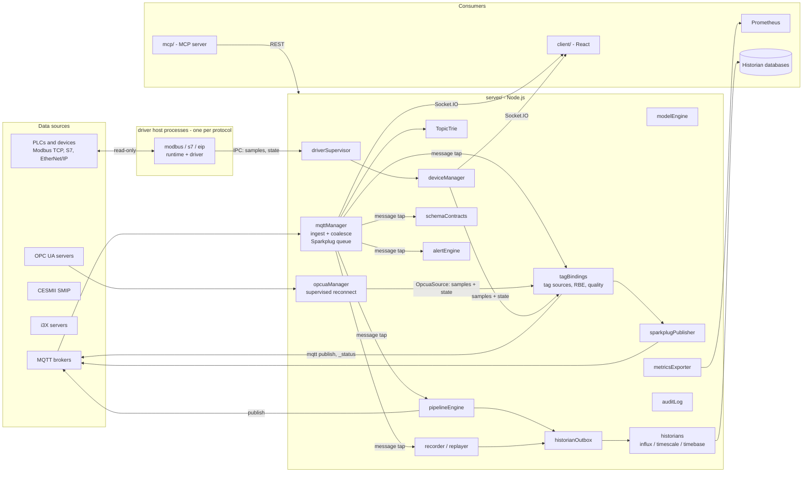
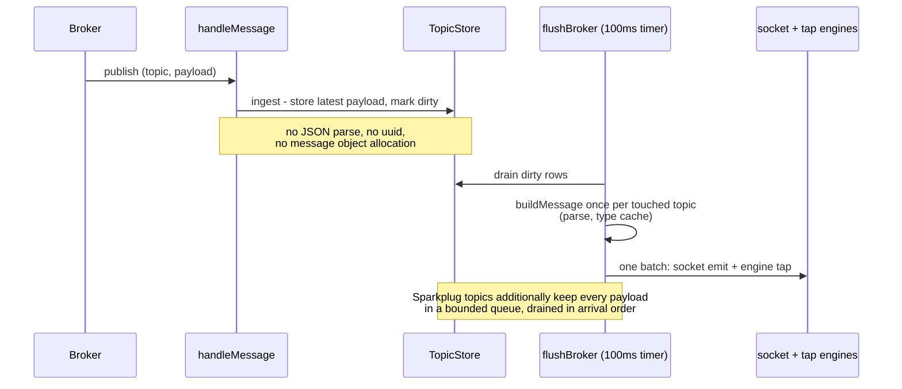
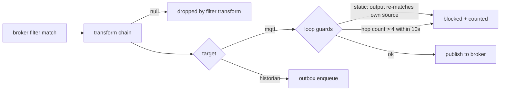
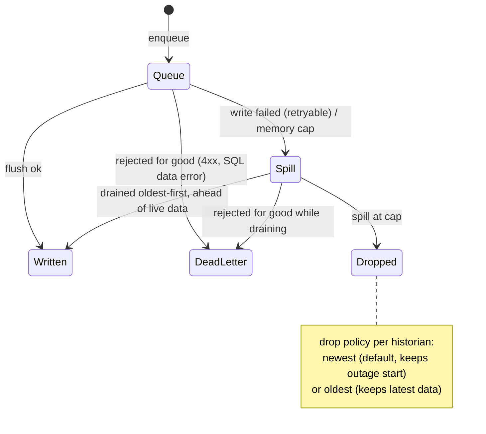
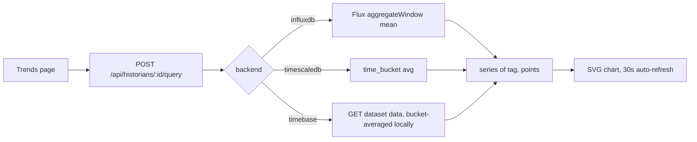
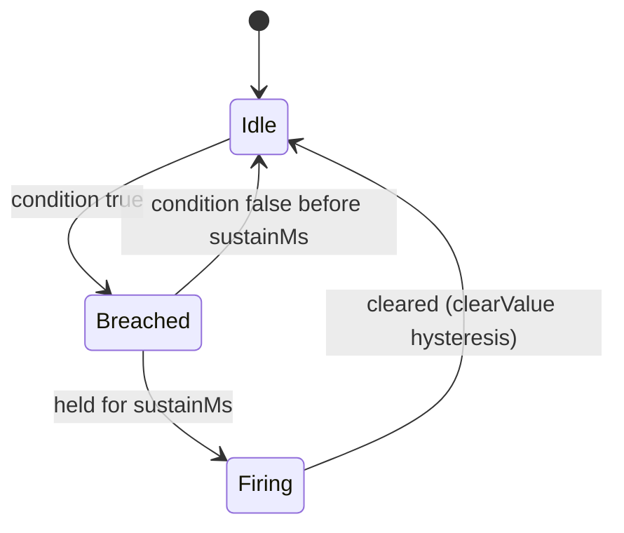
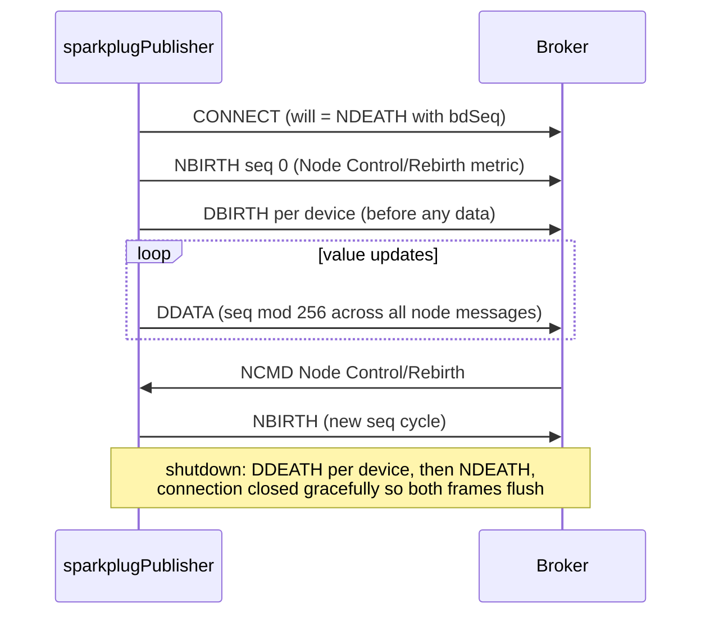
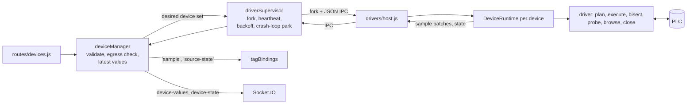
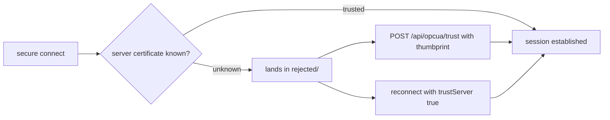

# Manifold architecture

This document describes how Manifold is built: the system layout, the message
hot path, each subsystem, the API surface, protocol behavior worth knowing,
and the testing strategy. The README stays short; the details live here.

## System overview



The backend owns all live state. The client is a real-time view over
Socket.IO plus REST for configuration. The MCP server is a stateless bridge
over the same REST API, so a browser user and an MCP agent see identical
data. Device drivers are the one part that does not run in the server
process: each protocol's driver runs in a supervised child process, and the
server only ever sees its IPC messages (see
[Southbound device drivers](#southbound-device-drivers)).

## Repository layout

```
server/   Express + Socket.IO backend; protocol managers and engines
  drivers/    southbound device drivers (modbus, s7, eip), the shared runtime
              (runtime/deviceRuntime.js) and the child-process entry (host.js)
  services/   managers, engines, tagSources/ (tag-source adapters)
  tools/      runnable simulators for the demo stack (simulators.js)
  test/       node:test suites; test/support/ holds the device simulators
client/   React 18 + Vite + Tailwind; canvas renderers, Zustand store
mcp/      MCP server (stdio), forwards to the backend REST API
native/   Rust/napi hot-path experiment, kept as a reproducible benchmark
docker/   Demo stack: app, mosquitto, OPC PLC simulator, traffic generator,
          simulated Modbus / S7 / EtherNet/IP devices (docker-compose.yml)
docs/     design notes, review, and the wiki sources (docs/wiki/)
```

## Message hot path

The server is built to survive high publish rates. The design rule: per-message
work is minimal and allocation-free; everything expensive is deferred to a
coalesced flush that is bounded by *topics touched*, not messages received.
Sparkplug is the one deliberate exception, described below.



Key mechanics:

- **TopicStore** (`server/services/topicStore.js`) is a struct-of-arrays: one
  `Map(topic → slot)` plus parallel typed arrays, with the latest payload kept
  as a latin1 string (one byte per char in V8, lossless for arbitrary bytes).
  Capped at 2M topics per broker (reaching the cap raises a
  `topic-cap-reached` event and a log warning; new topics are dropped and
  counted). Slots are normally never freed; setting
  `MANIFOLD_TOPIC_IDLE_TTL_MS` turns on an incremental background sweep that
  frees topics idle for longer than the TTL. At 1M topics this measured 425 MB RSS versus
  532 MB for a Map-of-objects; the Rust store measured 380 MB but lost on
  FFI round-trip cost (see `native/README.md` for the full benchmark).
- **Coalescing**: a topic published 10,000 times inside one 100 ms window
  produces one forwarded update. Per-flush forwarding is capped
  (`FORWARD_CAP`), with counts always exact server-side. This applies to every
  topic **except Sparkplug**.
- **Sparkplug is not coalesced.** NDATA/DDATA carry only the metrics that
  changed, so latest-wins would lose data that the registry, Sparkplug-source
  bindings, pipelines and historian targets need. The store classifies each
  topic once per slot (`queueClassifier`); Sparkplug topics also append every
  payload to a per-flush queue that is drained in arrival order. Each queued
  message is decoded and delivered, in order, to the registry and the engine
  tap; the UI batch still carries only the latest message per topic. The queue
  is bounded (`MANIFOLD_SPARKPLUG_QUEUE_MAX`, default 5,000 messages, and
  `MANIFOLD_SPARKPLUG_QUEUE_BYTES`, default 8 MiB, per flush). Past a bound a
  message is not queued, the broker's `sparkplugCoalesced` metric increments,
  and that topic falls back to latest-wins for the rest of the window (its
  latest payload is appended at drain, so it is never lost or reordered).
  Messages therefore reach consumers at flush cadence (up to 100 ms later),
  in order, not synchronously.
- **Per-slot type cache**: a topic's classification (telemetry/alarm/…,
  Sparkplug or not) is a pure function of the topic string, so it is computed
  once per slot, not per flush.
- **Single topic split**: the flush splits each topic once and passes
  `topicParts` to every tap consumer (pipelines, recorder, contracts,
  bindings).
- **Zero-listener guard**: the socket batch is not serialized when no client
  is connected (headless or MCP-only deployments).
- Intake subscribes at QoS 1 by default (configurable per broker). If the
  broker refuses the wildcard grant (SUBACK 0x80), the manager emits
  `subscription-downgraded` and retries at QoS 0. `$SYS/#` stays at QoS 0.
  A subscribe that fails for another reason (a timeout, a busy client) is
  retried with exponential backoff, at most three times, before an error is
  surfaced.
- **Source time and quality** travel with the message when the payload has
  them: a TVQ envelope's `t` and `q`, a Sparkplug message and metric
  timestamp, and a metric's `Quality` property. `timestamp` stays arrival
  time; `sourceTimestamp` and `quality` are set only when present, and the
  pipeline engine and historian targets prefer them.
- Other growth is bounded too: the MQTT 5 property side table is capped
  (`MANIFOLD_MAX_MSG_PROPS`), `publish-success` socket emits are folded into
  at most one summary per broker per second, and branch-silent alert rules read
  an activity cache updated in O(depth) per touched topic instead of walking
  the trie every interval.

## MQTT transports and versions

A broker connection is `mqtt`, `mqtts`, `ws`, or `wss`. WebSocket transports
require an explicit path (`wsPath`, default `/mqtt`) because there is no
universal convention (Mosquitto listens on 9001, reverse proxies on 443).

`mqttVersion` is 4 (MQTT 3.1.1, default) or 5 per broker. On v5 sessions,
inbound user properties, content type, response topic, and correlation data
are decoded onto the message (correlation data as base64), and the publish
API takes `properties` (`userProperties`, `contentType`, `responseTopic`) on
`POST /publish`. Properties are silently dropped on v4 sessions — mqtt.js
errors if they are sent there.

The intake subscription itself is configurable per broker (`subscribeFilter`,
default `#`), including shared subscriptions: `$share/<group>/<filter>` works
unchanged because messages still arrive on the real topic, so nothing
downstream cares. Use it to split intake load across multiple Manifold
instances or to scope intake to a namespace.

## Wildcard resolution

A subscription filter is a query, not a destination. `TopicTrie` indexes every
observed topic; filters (`+`, `#`, `$share` groups, `$`-topic exclusion rules)
resolve to exact match counts, covering subtree roots, and concrete leaf
topics. The trie builds lazily on first resolve and indexes incrementally
afterward. Flows uses this to show what each consumer actually receives;
pipeline previews and alert rules run on the same index.

## UNS derivation

The UNS view is derived entirely from observed traffic — there is no separate
registration step. The client keeps per-path activity, value, and rate maps
fed by the message stream, aggregated up the ancestor chain. Staleness is
per-topic: an EMA of inter-arrival gaps means a topic publishing every 500 ms
is flagged *overdue* seconds after it stops, while a daily report topic is not
flagged for hours. Server-side, `getUnsTree` returns a depth- and node-capped
skeleton with exact subtree counts, and the lint pass scores structural
conformance (naming-convention mixes, payloads on branches, empty segments,
single-child chains, depth variance).

The topology canvas throttles its draw loop to roughly 8 fps when there is no
traffic and no interaction, returning to full frame rate on either signal.

## Pipelines



- The route table is **compiled**: filters pre-split, disabled routes
  excluded, rebuilt only when the profile store revision changes. Steady-state
  per-message cost is array walks against pre-split segments.
- Transforms: `repath` (with `{n}` / `{n-}` / `{topic}` segment templates),
  `pick`, `rename`, `set`, `scale`, `numeric` (drop non-numeric; with `field`
  it also unwraps a JSON field, e.g. `v` of an envelope), `sparkplugFlatten`
  (`is_null` metrics propagate as explicit nulls), `envelope` (TVQ `{v,t,q}`;
  `t` and `q` come from the source payload when it carries them, else arrival
  time and Good).
- Loop protection is two-layer because repath templates defeat static
  analysis: outputs matching the route's own source are blocked outright, and
  a short-lived hop counter on published (broker, topic) pairs catches
  indirect A→B→A cycles across routes and brokers.
- Every route can be dry-run against the observed topic set before enabling:
  the trie resolves the source filter, each sample's latest payload runs
  through the transform chain, and the in→out mapping is reported without
  publishing.

## Historians and store-and-forward

Three backends share one write interface (`writePoints`):

| Backend | Wire format | Notes |
|---|---|---|
| InfluxDB v2 | line protocol | real numbers write `value=`, everything else (including booleans, as `"true"`/`"false"`) writes `raw="…"`, so a topic that alternates types cannot cause field-type conflicts in a shard. `null` is skipped and counted; names with control characters are rejected so a topic cannot inject lines. **No quality is stored**, which is why it is not offered for device data |
| TimescaleDB / PostgreSQL | batched parameterized INSERT | table auto-created, promoted to hypertable when the extension exists; stores `quality`; identifier allow-list; pooled connections with bounded connect/query timeouts; the pool is keyed by the whole connection config, so an edited password or TLS setting takes effect |
| Timebase (Flow Software) | TVQ REST on `:4511` | datasets auto-create; write path overridable per instance; quality is carried (Bad is preserved), each tag's samples are sent oldest-first; Timebase's native MQTT/Sparkplug ingestion is an equally valid path |

Delivery always goes through the **outbox** — engines never call a historian
directly:



**Ordering.** Delivery per historian is strictly oldest-first, because Timebase
may ignore a point older than a tag's newest. While a spill backlog exists,
live points are never sent ahead of it: if the backlog cannot be drained they
are appended behind it on disk. A memory overflow spills the oldest queued
points, and points that overflow while a live batch is in flight are held back
so a failed batch is re-spilled in front of them.

**Spill format** (per historian, under `<MANIFOLD_DATA_DIR>/outbox/`):

| File | Contents |
|---|---|
| `<id>.<seq>.seg` | append-only JSONL segments, one point per line, rotated at 4 MiB; `<seq>` is a monotonic 13-digit number |
| `<id>.cursor` | `{seg, offset}`: bytes already delivered from the oldest segment, written temp + fsync + rename, so a crash either keeps the old offset (a re-send, so delivery is **at-least-once**) or the new one, never a lost or half-written spill |
| `<id>.deadletter.jsonl` | points the historian permanently rejected; capped at 5 MiB and counted |
| `<id>.jsonl` | **legacy** single-file spill from older versions: read as the oldest segment and drained first, never appended to, so upgrading needs no conversion |

Draining reads each segment once, forward (O(n)); all disk writes are
asynchronous and serialized per historian. The in-memory queue holds 5,000
points, the live spill is capped at 20 MiB (the drop policy decides which end
goes beyond it), and each flush sends batches of 1,000.

**Poison batches.** A batch the historian *permanently* rejects (HTTP 4xx except
408/429 and the credential errors 401/403; PostgreSQL data or integrity errors)
is bisected, with a bounded number of extra requests, to isolate the bad points.
Those move to the dead-letter file; the rest is delivered and draining
continues. Credential errors are different: the backlog waits for the operator
to fix the token rather than being discarded. All bounds are explicit and
reported (queue depth, spill bytes, written/spilled/dropped counts on `/metrics`;
dead-letter counts in the outbox stats).

### Read-back (Trends)

The write path has a read counterpart: `queryTags` lists distinct stored
topics and `querySeries` reads downsampled series for up to 10 tags over a
time range (`GET /api/historians/:id/tags`, `POST /api/historians/:id/query`).



- Downsampling happens in the database: the requested range is bucketed to at
  most `maxPoints` (default 1000) buckets, so a month of 1 Hz data comes back
  as ~1000 averaged points, not 2.6M rows.
- Flux has no parameter binding over the raw `/query` endpoint, so tag names
  are strictly validated and quoted rather than interpolated cleverly;
  TimescaleDB queries are parameterized.
- Timebase read-back uses the same documented dataset GET the CI integration
  test exercises; the API returns raw TVQs, so downsampling happens locally.
  Tag listing has no Timebase endpoint — Trends falls back to manual entry.
- **Unverified Timebase behaviour.** The REST API reference could not be read
  when the device work was written. Not confirmed: that a point older than a
  tag's newest is ignored (the outbox is ordered as if it were), the shape
  Timebase accepts for a Bad sample with no value (Manifold sends `v: null`
  with the quality), whether samples closer than its advertised 500 ms
  resolution are kept, and its quality-code semantics. CI runs against
  `timebase/historian:1.3.4`; 2.x is current. See
  [`docs/design/southbound-drivers.md`](docs/design/southbound-drivers.md) §11.

## Alerting

Four rule types share one engine (`server/services/alertEngine.js`), with two
evaluation paths:

- **Silence and appearance rules** (`branch-silent`, `topic-silent`,
  `new-topic`) evaluate on a 15 s interval against the topic index.
- **Value rules** (`value-threshold`) ride the live message tap: a dot-path
  `field` into the JSON payload (or the payload itself) is compared against
  `value` with one of `>`, `>=`, `<`, `<=`, `==`, `!=` — at message latency,
  not poll latency. The rule table is compiled (filters and field paths
  pre-split, disabled rules excluded, rebuilt only on profile revision
  change — the same pattern as the pipeline engine), so steady-state
  per-message cost is an integer compare plus array walks.

Value-rule state machine:



`sustainMs` requires the condition to hold continuously before firing;
`clearValue` adds hysteresis (a `>` rule resolves only at
`value <= clearValue`, a `<` rule only at `value >= clearValue`) so a signal
hovering at the threshold cannot flap. Non-numeric payloads are ignored, not
errors.

Rules fire on transitions and can POST each event to a webhook (5 s timeout).
Webhook failures do not kill the engine, but they are not silent either:
`webhookFailures` and `lastWebhookError` are reported on
`GET /api/alerts/rules`. Webhook delivery goes through the egress guard
(`guardedFetch`), so a webhook to loopback, link-local or, by default, a private
address is refused; viewers see only `hasWebhook`, never the URL.

## Tag sources, bindings and the Sparkplug publisher

### The tag-source abstraction

A binding no longer knows about OPC UA. `TagBindings` consumes **tag sources**:
adapters registered with `registerSource(type, adapter)` that emit two
normalized events (`server/services/tagSources/`):

```js
// one reading
'sample'       { sourceType, sourceId, address, v, type, q, qReason?, tSource?, tRead }
// the source as a whole
'source-state' { sourceType, sourceId, state: 'online' | 'offline', reason }
// optional: the end of one batch of samples (the device manager sends it per poll-group cycle)
'batch-end'    { sourceType, sourceId }
```

`type` is a normalized name (`bool`, `int8` ... `uint64`, `float32`, `float64`,
`string`, `datetime`); `q` is **192 Good / 64 Uncertain / 0 Bad**; `tSource` is
the source's own timestamp when it has one (OPC UA does, polled protocols do
not) and `tRead` is when the value was read. An adapter also implements
`ensureMonitored(sourceId, address, intervalMs)`. There are two adapters: the
OPC UA adapter (`OpcuaSource`, wrapping the manager's `value` and
`connection-state` events and mapping OPC UA status codes to quality) and the
device manager (`source type 'device'`, fed by the driver supervisor). Sparkplug
sources are not adapters: they read the decoded message tap directly.
MQTT-source selections still compile into pipeline routes instead.

### Bindings

A binding is `{ source, target, rbe }`. The pure half (validation, expansion into
publishing units, topic and payload shapes, the retained-topic set, warnings and
the preview) is `services/bindingModel.js`; `services/tagBindings.js` is the run
time on top of it.

```js
source: { type: 'device', deviceId, tags: [{ address: <tagKey>, name? }] | 'all' }
      | { type: 'device-profile', profileId, tags: [<profile tag key>] | 'all' }
      | { type: 'opcua', connectionId, samplingInterval?, tags: [{ address: <nodeId>, name }] }
      | { type: 'sparkplug', brokerId, group, edge, device?, metrics? }
target: { mode: 'mqtt', brokerId,
          assetPath                       // 'acme/dallas/line4/filler' (no placeholders)
          | pathTemplate                  // legacy 'site/area/{name}'
          | assetPathTemplate | assetPaths // device-profile only: 'acme/{site}/{device}' | { deviceId: path }
          layout?: 'topic-per-tag' | 'object-per-asset', maxObjectBytes?,   // default 64 KB, 1 KB..1 MB
          format: 'plain' | 'envelope',   // object layout always carries quality
          qos?, retain?, statusTopic?, metaTopic?,   // false opts out of <asset>/_status, <asset>/_meta
          historian?: { historianId } }   // direct store-and-forward target (Timebase, TimescaleDB)
      | { mode: 'sparkplug', brokerId, group, edge, device /* profile: may use {device}, {param} */, historian? }
rbe:    { heartbeatMs?, deadband?: { type: 'absolute' | 'percent', value } }   // legacy target.deadband = absolute
```

**Units.** A binding expands into **units**, one per (source, asset) pair: a plain
binding is one unit; a `device-profile` binding is one unit per instance of the
profile (unit id `<bindingId>#<deviceId>`), re-expanded whenever devices or the
profile change, so instances added later are picked up. A unit whose asset path
cannot be resolved is skipped and reported as a warning.

**Names and topics.** The published name of a device tag is the binding entry's
`name`, else the tag's `property`, else its key; the device address never becomes
a topic by itself. The topic is `<assetPath>/<slugged name>` (slug: whitespace,
`/`, `+`, `#` to `_`). An asset path has no empty segments, wildcards, braces or
segment starting with `$`, and is at most 512 characters. In a profile template
`{device}` is the device name, `{deviceId}` its id, and any other placeholder a
profile parameter with that instance's value; an unknown placeholder fails at
save time.

**Payloads (mqtt).** `plain` is the bare value. `envelope` is `{ v, t, q }` plus
`u` when the tag has a unit; `t` is the source time when there is one, else the
read time, and stays the time of the last change on a heartbeat repeat.
`object-per-asset` publishes one object to the asset path itself,
`{ t, values: { <name>: { v, q, u? } } }`, at the end of a source batch (or after
a 50 ms timer, whichever comes first) when some member changed, plus the
heartbeat. It is rejected at save time when tags times the worst-case member size
(by type) could exceed the cap, and an object that is over the cap at run time is
not published and counted as an error. `<asset>/_status` is the retained QoS 1
document `{ online, since, reason }`; `<asset>/_meta` is the retained QoS 1
document `{ properties: { <name>: { type?, unit?, description?, range?,
source: { deviceId | connectionId, address, profileId? } } }, updatedAt }`,
published when its content changes. Sparkplug targets carry unit, description
and range as metric properties (`engUnit`, `description`, `engLow`, `engHigh`) in
the BIRTH instead of `_meta`.

Semantics (covered by `bindings-v2.test.js`, `mapping-phase4.test.js`,
`mapping-routes.test.js`, `devices-int.test.js` and the OPC UA integration test):

- **Report-by-exception on (value, quality).** An **absolute** deadband
  suppresses numeric changes smaller than the band. A **percent** deadband is that
  percentage of the tag's `range` (max minus min) when it defines one, otherwise
  of the magnitude of the **last published** value (so from 0 any change
  publishes); a change equal to the band publishes. Other values publish on
  change; structures compare by bounded JSON. A quality change is always a change
  (Good to Bad with the same value publishes), but only the `envelope` format and
  the object layout can express it, so for `plain` and Sparkplug targets a
  quality-only change is counted as suppressed.
- **Bad on source loss.** When a source goes `offline` (a device loses its
  connection, its driver host dies, an OPC UA session drops) every known tag
  of that source's bindings gets one Bad publish: the last value with `q: 0`
  in an `envelope` binding, and every member `q: 0` in one object publish.
  `plain` cannot carry quality, so there only the status document changes.
  Recovery republishes as Good. The heartbeat continues to republish an offline
  envelope or object binding's last values with `q: 0` and skips offline `plain`
  bindings so stale values do not masquerade as live.
- **`_status` topic.** Published whenever the source reports a state, and also
  when a binding is created or edited while its source is already online
  (`_publishStatusForNewUnits`; without it the topic would not exist until the
  next transition). `statusTopic: false` turns it off. No MQTT last-will covers
  it, so it keeps its last value if Manifold itself stops.
- **Typed Sparkplug metrics.** The sample's `type` selects the Sparkplug
  datatype (Int8 ... UInt64, Float, Double, Boolean, String, DateTime). The
  datatype is pinned the first time a metric is seen so BIRTH and DATA agree,
  and a value that cannot be represented as it is sent as `is_null`. An unknown
  type keeps the old by-value encoding. Sparkplug metrics do not carry
  per-metric quality; a device going offline is a **DDEATH** (sequence-numbered,
  only for a device that has been birthed) and recovery is a **DBIRTH** with the
  last values before any further DDATA.
- **Heartbeat.** `rbe.heartbeatMs` (at least 1000 when set through the API,
  swept once a second) republishes unchanged tags (or the whole object) at least
  that often. Heartbeat repeats are not sent to a historian target.
- **Retained cleanup.** `retainedTopics()` derives from configuration the set of
  retained topics a binding owns (`_status`, `_meta`, and value or object topics
  when `retain` is on); `reconcile()` keeps the previous set in memory and
  publishes an empty retained message (QoS 1) to every topic that left it
  (binding deleted, disabled, path or broker changed, retain off, instance
  removed). The set is rebuilt at start, so an edit made while the server was
  down is not cleaned up; Sparkplug-source value topics are not derivable; a
  clear sent to a disconnected broker is dropped.
- **Direct historian target.** `target.historian.historianId` enqueues each
  published sample, after report-by-exception, to the outbox as `{ tag: <resolved
  topic>, ts, value, quality }` (object layout: the per-member topic; Sparkplug:
  `group/edge/device/metric`). `validateBinding` accepts only `timebase` and
  `timescaledb` historians and rejects InfluxDB (its writer stores no quality).
  A quality change a `plain` or Sparkplug target suppresses never reaches the
  outbox either, and the Bad sample on source loss is enqueued only for envelope
  and object bindings.
- **Preview and warnings.** `bindingModel.previewBinding` and
  `POST /api/tags/bindings/preview` resolve topics and example payloads from the
  latest known values without storing or publishing anything; `bindingWarnings`
  (also returned by the save) reports names that look like raw device addresses,
  topics another enabled binding on the same broker already publishes, and
  unresolvable instance paths, at most 50, never blocking.
- **Lifecycle.** When a source comes (back) online its monitored items are
  re-requested; a failed monitor request retries on a slow timer; editing or
  deleting a binding resets its state (`reconcile`), which is also called after
  a profile edit and after a config import. The old defect where OPC UA bindings
  went silent after a restart, an edit or a delete is gone.
- **Time and quality of Sparkplug-source bindings** are the metric's own
  timestamp and quality; unlike pipelines and the recorder (`messageTime`: a
  source time before 2000-01-01 or more than 24 h ahead is replaced by arrival
  time) they apply no plausibility window.

**Bindings never write toward devices**, and this is enforced where the bytes
are built, not by the binding engine's good manners: the engine has no write
path at all, and every device driver builds all outgoing frames through one
encoder with an allowlist (Modbus function codes 1 to 4; S7 setup communication,
Read Var and SZL reads; CIP session and connection management, Read Tag,
Read Tag Fragmented, Multiple Service Packet with every inner service checked,
and attribute and template reads). A forbidden service throws before any socket
write, and the EtherNet/IP client re-parses each buffer once more before
`socket.write`. Each allowlist has tests that attempt every refused service
against a simulator that counts writes it receives. This is a guarantee about
Manifold's code; it says nothing about what else on the network can write to
the same PLC (see [Security model](#security-model)).

### The Sparkplug publisher

Sparkplug output runs one session per (broker, group, edge node) with the
lifecycle the specification requires:



### Sparkplug host application STATE

The registry also folds `spBv1.0/STATE/{host}` messages: each host
application's online/offline status (JSON `{online, timestamp}` per Sparkplug
3.0, with legacy `ONLINE`/`OFFLINE` strings accepted) is tracked, shown in the
UI, and emitted as `host-online` / `host-offline` events. STATE is retained,
so a new subscriber replays the current status immediately.

Manifold can act as a primary host itself: `POST /api/tags/sparkplug/state`
starts a dedicated session that publishes retained STATE for a chosen host ID
with a matching last-will, so edge nodes waiting on a primary host see one.

## Southbound device drivers

Read-only polling of Modbus TCP, Siemens S7 (S7comm) and EtherNet/IP (Logix)
devices, with tags landing in the same binding engine as OPC UA. The design is
in [`docs/design/southbound-drivers.md`](docs/design/southbound-drivers.md)
(status: implemented, S7 and EtherNet/IP experimental, nothing verified on real
hardware); this section describes what exists.



**Process model.** `driverSupervisor` forks one host (`drivers/host.js`) per
protocol, or one per device that sets `isolate: true`. The main process never
loads driver code. IPC is JSON; 64-bit integers cross as strings. One message per
poll cycle carries a batch of samples. The supervisor pings each host,
SIGKILLs one that stops answering, and restarts a dead one with exponential
backoff (0.5 s doubling to 30 s). After more than five crashes in a minute the
host is **parked** (surfaced on the Devices page, retried when the device set
is saved again) and its devices report offline. An uncaught error inside a host
is fatal on purpose: log, exit, be restarted. `testConnection` uses a
transient host if none is running.

**Runtime** (`drivers/runtime/deviceRuntime.js`) is protocol-agnostic and owns
everything that must not be reimplemented per driver. Per device:

- A **connection state machine** (`connecting`, `online`, `backoff`,
  `stopped`) with jittered exponential backoff from 1 s to 60 s and no retry
  cap. Any fatal transport result (timeout, response that does not match its
  request, framing error) destroys the socket, marks every tag Bad
  (`disconnected`) and reconnects. A socket is never reused after a timeout, so
  a late reply cannot be matched to the next request.
- A **scheduler**: tags belong to poll groups with an interval (at least
  100 ms). One cycle per group at a time and one request in flight on the
  device's single connection across all groups. An overrun is skipped and
  counted, never queued. After five overrunning cycles in a row the effective
  interval doubles (up to 8x) and is reported; it halves again after 20 clean
  cycles.
- **Deadlines** on every request plus a watchdog around the driver call.
- **Bisect and quarantine.** A permanent request failure (Modbus exception 02,
  an S7 or CIP refusal) is bisected to the offending tag, which is quarantined
  (Bad, `quarantined`) and retried every minute while the rest keep polling.
- **Per-unit circuit breakers** for Modbus gateways: three gateway exceptions
  (0A/0B) open a unit's breaker (Bad, `unit-down`); it is probed every 30 s.
- A device status (state, phase, connects, requests, timeouts, exception counts,
  quarantined keys, `quarantineReasons` (per key: code, message, since; at most
  100), `lastError` and `lastErrorAt`, per-group cycle times, overruns) that the
  supervisor relays. Quarantining a tag sets `lastError` to `tag <key>:
  <message>`.

**Driver contract.** A driver module exports `describe()` (static description:
fields, types, prerequisites, `experimental`, `readOnly`, capabilities),
`validateTag(tag, options)` (a pure validator that normalizes the address) and
`createDriver(device)` returning `{ connect, plan, execute, bisect, probe,
browse?, close }`. `plan` is a pure function packing tags into requests within
the device's limits (Modbus blocks with a default max gap of 0; S7 reads within
the negotiated PDU, at most 20 items; CIP Multiple Service Packets);
`execute` never throws for device or transport problems and returns per-item
status; drivers hold exactly one connection. All three are our own
implementations on `node:net`, with no new dependency; the EtherNet/IP
decision record (`drivers/eip/NOTES.md`) explains why the candidate libraries
were rejected.

**Device manager.** Owns the stored configuration (profile-store collections
`devices` and `deviceProfiles`), validates it with each driver's validators (tag keys `[A-Za-z0-9_.\-:[\]]{1,128}`, at most 20,000
tags per device), applies the egress guard (`assertAllowedDeviceTarget`), pushes
the desired set to the supervisor, keeps the latest value per tag, and emits the
tag-source events above. A device whose target is refused is reported Stopped
with the reason instead of being started. Live values reach the UI as coalesced
volatile `device-values` batches (250 ms) and `device-state` events.

**Device profiles.** `services/deviceProfiles.js` is the pure half: a profile
(`protocol`, `options`, `pollGroups`, `params`, `tags` with `{param}` placeholders
in `key`, `address` and `property`) merged with a device instance (`profileId`,
`params`, own tags) into the **effective device** the drivers see. Options
override by key, poll groups by id; the instance's own tag with the same key as a
profile tag is an error; effective profile tags carry `origin: 'profile'` so a
client that echoes `GET /api/devices` into a `PUT` does not turn them into ad-hoc
tags. `deviceManager` validates every instance against the driver and applies a
profile edit to all instances atomically (a 400 lists the instances that would
break); deleting a profile with instances or bindings is a 409. Bulk creation is a
client loop over `POST /api/devices/profiles/:id/instantiate` (not atomic).

**Discovery.** `services/deviceIdentify.js` holds the read-only identification
probes the CIDR scan uses when device ports are requested (`includeDevices` or
`modbusPorts` / `s7Ports` / `eipPorts`): one TCP connection, one request, one
bounded reply (4 KB, 3 s), closed. The requests are built with the drivers' own
frame encoders: Modbus `encodeRequest` with function 3 for one register at
address 0, unit 1 (the encoder throws for anything but functions 1 to 4); S7
`encodeConnectRequest`, a COTP Connection Request only, no S7 setup or job;
EtherNet/IP `encodeFrame` with the ListIdentity command. A port that does not
answer the protocol is not reported; a result carries the protocol, the decoded
identity and a `suggestedDevice` body for `POST /api/devices`. Every candidate
address goes through `isAllowedAddress` first, so loopback and link-local are
always refused and private ranges need `MANIFOLD_ALLOW_PRIVATE_TARGETS=1`.

**Metrics.** `metricsExporter.renderDevices` renders, per device (name,
`device_id`, protocol): `manifold_device_up`, `_connects_total`,
`_requests_total`, `_timeouts_total`, `_exceptions_total` (by code),
`_cycle_ms` and `_overruns_total` (per poll group) and `_quarantined_tags`; per
driver host: `manifold_driver_host_up` and `_restarts_total`; and per binding
`manifold_binding_published_total`, `_suppressed_total`, `_errors_total`. Series
are capped (500 devices, bindings and hosts; 16 groups and 16 exception codes per
device).

**Samples.** A sample is `{ key, v, type, q, qReason?, tRead }`; `qReason` is one
of `disconnected`, `quarantined`, `unit-down`, `device-exception`, `decode`,
`unavailable`. Polled protocols have no device timestamp, so `tRead` is the
honest timestamp.

**Refusal reasons.** A tag that a device refuses (an S7 CPU with PUT/GET off or
optimized access, a Modbus exception, a CIP status) is quarantined with the
driver's message, which reaches the device status as above and the Devices page.
The exception counter still reads `33028` (0x8104) for a whole-request S7
refusal. `lastError` holds the most recent quarantined tag's reason, not a list.

## OPC UA security

OPC UA connections accept `securityMode` (`None`, `Sign`, `SignAndEncrypt`)
and `securityPolicy`. Secure modes run through a shared application PKI
rooted at `<MANIFOLD_DATA_DIR|server/data>/pki` in the standard node-opcua
layout:

```
pki/
  own/certs/client_certificate.pem   Manifold's application certificate
  own/private/                       private key
  trusted/certs/                     server certificates we accept
  rejected/                          server certificates seen but not trusted
  issuers/                           CA material
```

The self-signed application certificate is created on first use; the URI
baked into it must match the client's application URI (node-opcua checks the
two on every secure connect). `GET /api/opcua/certificate` returns it in PEM
form so it can be trusted on the server side.

Trust is explicit in both directions:



Unknown server certificates are never auto-accepted: they land in
`rejected/`, listed by `GET /api/opcua/trust`, and are promoted by thumbprint
(`POST /api/opcua/trust`) or by an explicit trust-on-first-connect flag on
the connection. A trust failure produces an actionable error naming both
paths instead of a bare `BadSecurityChecksFailed`.

`POST /api/opcua/discover` asks an endpoint URL for its available endpoints
(security mode/policy combinations), so the right mode can be picked before
connecting.

### Supervised reconnect

A connection that has been established and then drops is retried **forever**
with jittered exponential backoff (1 s to 60 s): node-opcua's own short retry
is only the first line, and when it gives up the manager's supervisor takes
over. Saved connections are restored at startup with `supervise: true`
(lightly staggered, 100 ms apart), so one that is unreachable when Manifold
starts keeps retrying instead of being logged once and forgotten. A first
connect started from the API that fails is reported to the caller and not kept.
The manager emits a `connection-state` event (`online` / `offline`, with a
reason) that the OPC UA tag source turns into `source-state`, which is what
drives Bad-on-loss and re-monitoring in bindings. After any reconnect, the
subscription and every monitored item are rebuilt from the recorded
(nodeId, samplingInterval) pairs, serialized per connection so concurrent
`monitor()` calls cannot create duplicate subscriptions — the UI never shows a
live-looking value that stopped updating. Value updates to socket clients are
coalesced (100 ms); the in-process tap used by bindings stays immediate.

## Client graph stack

All graph rendering and layout is client-side; the server ships data, not
coordinates.

- **Force layout** runs d3-force in a Web Worker
  (`client/src/graph/forceLayoutWorker.js`, 30k-node cap) so layout ticks
  never block the UI thread.
- **3D** (`ForceGraph3D.jsx`) is real three.js: nodes are one `InstancedMesh`
  of low-poly spheres, smooth at 50k nodes, with analytic ray-sphere picking
  instead of triangle raycasting. three.js is a lazy chunk loaded only when
  the 3D view opens.
- **WebGL 2D** remains the renderer for very large namespaces (60k+ topics).
- **Icons**: the UNS topology uses a curated ~130-icon industrial subset
  imported individually from lucide (tree-shaken; the full ~2,000-icon
  library stays out of the main bundle and loads on demand in the picker).
  User-defined single-path SVG icons are stored server-side
  (`/api/uns/icons`) and resolve like built-ins.

## Security model

**Authentication and roles**

- `MANIFOLD_AUTH_TOKEN` (admin), `MANIFOLD_VIEWER_TOKEN` (read-only) and
  `MANIFOLD_TOKENS` (`name:token[:role]`, named and individually revocable, with
  per-token audit identity) gate the REST API and the socket handshake. **Any of
  the three turns auth on**; a viewer token alone leaves nobody with admin.
- Roles **fail closed** (`services/authConfig.js`): an unrecognised role in
  `MANIFOLD_TOKENS` rejects that entry with a startup error rather than granting
  admin, and a token containing `:` needs an explicit role. If tokens were
  configured but every entry was rejected, auth stays on and everything is 401.
- A **viewer** may use `GET`, `HEAD` and `OPTIONS` plus an explicit allowlist of
  read-only POSTs: historian query, pipeline preview, subscription resolve,
  schema inference, `/api/devices/validate-tags` and the i3X reads. Everything
  else non-GET, over HTTP or the socket, is refused. Alert webhook URLs are
  hidden from viewers.
- Failed authentication is rate-limited per IP (20 failures/minute, then 429),
  on both the REST and the socket paths.
- `/metrics` requires a bearer token (any role) when auth is on, because broker
  ids and route names are reconnaissance; `MANIFOLD_METRICS_PUBLIC=1` opts out.
  `/health` stays open.
- CORS is locked to `CLIENT_URL` (default `http://localhost:3000`); a blanket
  `cors()` would let any website script an authenticated browser.

**Egress guard** (`services/egressGuard.js`). One chokepoint for connections the
caller could not make directly. Two tiers: *always blocked* (loopback,
link-local including cloud metadata `169.254.169.254`, multicast, reserved and
carrier-grade-NAT space, and IPv6 forms that embed an IPv4 address, which are
classified by the embedded address) and *blocked unless
`MANIFOLD_ALLOW_PRIVATE_TARGETS=1`* (RFC1918, IPv6 ULA). Coverage differs by
path and the differences matter:

| Path | How it is checked |
|---|---|
| Network scanner (including the device probes) | each candidate address through `isAllowedAddress`: loopback, link-local and reserved always refused, private ranges only with `MANIFOLD_ALLOW_PRIVATE_TARGETS=1`; `MANIFOLD_ALLOW_LOOPBACK_DEVICES` does not apply |
| i3X, CESMII, broker admin, alert webhooks | `guardedFetch`: check before the request, a connect-time `lookup` that pins the checked address (closes DNS rebinding), manual redirects (at most 5, each hop re-checked, `Authorization`/cookies dropped across origins), one overall deadline |
| Device drivers | `assertAllowedDeviceTarget` when a device is saved, tested or applied. Check-only: the driver opens its own socket, so a hostname is re-resolved at connect time and a small rebinding window remains (literal IPs have none). Loopback is additionally allowed when `MANIFOLD_ALLOW_LOOPBACK_DEVICES=1` |
| MQTT brokers, OPC UA endpoints, historian and database URLs | **not checked, by decision**: admin-configured connections that the libraries open themselves. A broker or historian on `localhost` or the LAN is the normal setup, so guarding them by default would break it. Residual risk: an admin token can make the server connect to any host it can reach through these three paths; protect admin tokens and use network policy |

**Audit** (`services/auditLog.js`). The middleware is mounted *before* auth so
rejected requests (401, 403, 429) are recorded even when they are GETs. Mutations
are always recorded, with role, token *name* (never the token), IP, route
without its query string, outcome, and a redacted body summary. Redaction is one
shared rule (`services/secrets.js`: field names matching `pass`, `token`,
`secret`, `key`, `credential`, `cert`, `authorization`, `webhook`, `ca`, `pfx`,
and passwords in URLs), also used by config export. The file rotates by size
(`MANIFOLD_AUDIT_MAX_BYTES`, `MANIFOLD_AUDIT_KEEP`); lines are written
synchronously, so nothing is buffered across a crash.

**Config export and import.** Export strips secrets by the shared name rule and
includes devices and device profiles. Import is validated whole before anything
is applied (ids, sizes, depth, prototype-polluting keys) and keeps stored
secrets where the import carries null. The name rule matches `key`, so
`redactSecrets` keeps `key` only inside arrays named `tags` or `ownTags` (device
and profile tag identifiers, strings or numbers); a secret nested in a tag, or a
`key` anywhere else (a TLS private key), is still masked. A tag list under any
other property name would lose its keys. Import applies immediately (bindings
reconciled, devices re-applied).

**Profile store durability** (`services/profileStore.js`). The in-memory view
updates synchronously; the disk write is coalesced (one per tick) and goes temp
file, `fsync`, rename, directory `fsync`, so a crash leaves a complete old or
new file. Rotating backups `profiles.json.bak.1` to `.5` are cut from the
previous good file at most once per minute; a corrupt or missing file on startup
is recovered from the newest valid backup, loudly. Pending writes are flushed on
shutdown and on process exit. Ids are checked against prototype-polluting names
and looked up with `Object.hasOwn`.

**Secrets and files.** Secrets (broker passwords, historian tokens, admin API
keys) are stored server-side only: never echoed by the API, redacted from audit
entries, and stripped from config exports. `server/data/` is written mode
0600/0700. It is not encrypted: without a real key-management story,
at-rest encryption of a file the server must read on boot adds no protection, so
the honest measure is file permissions plus host security.

**Devices.** Creating or editing a device is admin-only and audited. The drivers
are read-only by construction (see
[Tag sources, bindings and the Sparkplug publisher](#tag-sources-bindings-and-the-sparkplug-publisher)),
but Modbus TCP, S7comm and plain EtherNet/IP do not authenticate the client:
anything that can reach the PLC can also write to it. Enabling PUT/GET on an S7
CPU makes its data blocks writable by any peer. Restrict the network path (a
firewall rule or a data diode) where a stronger guarantee than software is
required.

**Outbound HTTP** (historian writes and queries, alert webhooks, broker admin
APIs) uses bounded timeouts (`services/httpTimeout.js`), so a hung remote
endpoint cannot pin a request handler forever.

## Protocol notes

Observed behavior that shapes the implementation:

- **EMQX default ACL and QoS 1 wildcards.** Stock EMQX denies `#`
  subscriptions at QoS 1+ from non-localhost clients, and its default
  `deny_action = ignore` makes the denial silent: the SUBACK reports success
  and the subscription simply never exists. No client-side logic can detect
  this. The QoS-0 fallback covers brokers that refuse loudly per spec;
  for EMQX, either grant the permission in the broker ACL or configure
  intake at QoS 0. CI's EMQX container authorizes wildcard intake the way a
  production deployment backing a UNS platform would.
- **Mosquitto has no per-client subscription API.** `mosquitto_ctrl` manages
  accounts and ACLs, not live subscriptions, so consumer resolution against
  mosquitto is limited to observed traffic. The UI states this rather than
  implying MQTT exposes more than it does.
- **Sparkplug edge death cascades to devices**, per specification, and the
  registry applies this when an NDEATH arrives.
- **Sparkplug DATA is a delta.** Only changed metrics are sent, which is why
  Sparkplug intake queues every message instead of coalescing.
- **InfluxDB field types are fixed per shard.** The first write wins; later
  writes with a different type are rejected. Splitting numeric (`value=`) and
  string (`raw=`) fields at the client makes this failure mode impossible.
- **pg defaults block forever.** `connectionTimeoutMillis` defaults to 0; an
  unreachable database turns into a hung process rather than an error. All
  pools set bounded connect/query timeouts and `allowExitOnIdle`.

## HTTP API

| Method | Path | Description |
| --- | --- | --- |
| `GET` | `/api/system/status` | Overall status |
| `POST` | `/api/system/discovery/start` | Start a network scan (`range`, `mqttPorts`, `opcuaPorts`, `i3xPorts`; device probes only with `includeDevices` or `modbusPorts` / `s7Ports` / `eipPorts`) |
| `GET/POST` | `/api/mqtt/brokers` | List / connect brokers |
| `PUT/DELETE` | `/api/mqtt/brokers/:id` | Edit in place (reconnects); disconnect |
| `GET` | `/api/mqtt/brokers/:id/topics` · `/messages` | Topic list; recent messages |
| `POST` | `/api/mqtt/brokers/:id/publish` | Publish (MQTT 5 `properties` on v5 sessions) |
| `GET` | `/api/mqtt/brokers/:id/sparkplug` · `/sys` | Sparkplug topology; `$SYS` summary |
| `POST` | `/api/mqtt/brokers/:id/subscriptions/resolve` | Resolve wildcard filters against observed topics |
| `GET` | `/api/mqtt/brokers/:id/topictree` | One tree level with subtree counts |
| `GET` | `/api/mqtt/brokers/:id/admin/pubsub` | Per-client subscriptions from the broker admin API |
| `GET` | `/api/mqtt/brokers/:id/uns/tree` · `/uns/lint` · `/uns/events` | UNS skeleton, lint report, event feed |
| `GET/POST/DELETE` | `/api/uns/mounts` | Mount OPC UA / i3X sources into the UNS |
| `GET/POST/DELETE` | `/api/uns/icons` | Custom UNS icons (single-path SVG, upsert by name) |
| `GET/POST/DELETE` | `/api/alerts/rules` · `GET /api/alerts/events` | Alert rules (upsert by id); recent firings |
| `GET/POST/DELETE` | `/api/pipelines` · `POST /preview` | Routes (upsert by id); dry-run |
| `GET/POST/DELETE` | `/api/historians` · `POST /:id/test` | Historian connections (upsert by id); test write |
| `GET/POST` | `/api/historians/:id/tags` · `/query` | Read-back: stored tags; downsampled series |
| `GET/POST/DELETE` | `/api/models` | Contextualization models |
| `GET/POST/DELETE` | `/api/recorder` · `GET /:id/data` · `POST/DELETE /replay` | Recording; read-back; replay |
| `GET/POST/DELETE` | `/api/contracts` · `/infer` · `/violations` | Schema contracts |
| `GET` | `/api/tags/sources` · `/browse` | Tag browser (devices, OPC UA, Sparkplug, MQTT) |
| `GET/POST/DELETE` | `/api/tags/bindings` | Tag bindings (device, device-profile, OPC UA or Sparkplug source; mqtt or Sparkplug target); a save returns the binding plus non-blocking `warnings` |
| `POST` | `/api/tags/bindings/preview` | Dry run of a binding draft: resolved topics and example payloads, collisions, `_meta` and `_status` topics, warnings; stores and publishes nothing (allowed for viewers) |
| `POST` | `/api/tags/sparkplug/state` | Start/stop a Sparkplug host STATE session |
| `GET` | `/api/audit` | Audit trail (admin only) |
| `GET/POST` | `/api/system/config/export` · `/import` | Config as code (devices included; import validated whole) |
| `GET` | `/metrics` | Prometheus metrics (bearer token required when auth is on, unless `MANIFOLD_METRICS_PUBLIC=1`) |
| `GET` | `/api/devices` | Devices with live status, driver host states, and the driver descriptors (protocols, fields, types, prerequisites, `experimental`) |
| `POST` | `/api/devices` | Create a device (validated, egress-checked, applied live) |
| `GET/POST` | `/api/devices/profiles` | Device profiles with their instances; create a profile |
| `GET/PUT/DELETE` | `/api/devices/profiles/:id` | Read; edit (re-applied to every instance atomically, 400 lists instances that would break); delete (409 while a device or a binding uses it) |
| `POST` | `/api/devices/profiles/:id/instantiate` | Create a device from a profile (`name`, `host`, `port?`, `params`, protocol fields) |
| `PUT/DELETE` | `/api/devices/:id` | Edit in place; delete (409 while a binding uses it) |
| `POST` | `/api/devices/test` | One-off connect with an unsaved config: identity and negotiated limits, or the error |
| `POST` | `/api/devices/validate-tags` | Validate and normalize tags for a protocol (read-only; allowed for viewers) |
| `POST` | `/api/devices/:id/probe` | Read raw bytes at one address and return every candidate decoding |
| `GET` | `/api/devices/:id/browse?node=` | The controller's own tag list (drivers with `browse`; EtherNet/IP); folder nodes carry an `address` |
| `GET` | `/api/devices/:id/values` | Latest value, type, quality and read time per tag |
| `POST` | `/api/opcua/connections` · `/:id/monitor` | OPC UA connect; monitor |
| `PUT/DELETE` | `/api/opcua/connections/:id` | Edit in place (reconnects); disconnect |
| `GET` | `/api/opcua/connections/:id/browse` | Browse the address space |
| `POST` | `/api/opcua/discover` | Endpoint discovery (security modes/policies) |
| `GET` | `/api/opcua/certificate` | Manifold's application certificate (PEM) |
| `GET/POST` | `/api/opcua/trust` | List trusted/rejected certs; trust by thumbprint |
| `POST` | `/api/cesmii/config` · `/history` | CESMII configure; time-series |
| `POST` | `/api/i3x/connect` · `/probe` · `/value` · `/history` | i3X connect/probe; reads |
| `GET` | `/api/i3x/objects` · `/graph` · `/namespaces` | i3X inventory |

Live updates (messages, broker stats, engine metrics, alerts, OPC UA values,
device values and state, discovery progress) stream over Socket.IO. Engine
metrics push every 2 s only while a client is connected. Device errors map to
HTTP codes: validation 400 (with per-tag `details`), egress refusal 403, a
driver or device failure 502.

### Devices API

A device is stored and returned as:

```js
{
  id, name, enabled, protocol: 'modbus-tcp' | 's7' | 'ethernet-ip',
  host, port,                       // egress-checked on save
  unitId | rack, slot | slot, routePath,   // protocol-specific top-level fields
  options: { byteOrder, wordOrder, addressBase, maxRegisters, maxGap, ... },  // Modbus also unmapped: [{table, from, to}] (REST only)
  limits:  { requestDeadlineMs: 2000, connectTimeoutMs: 5000, interRequestDelayMs: 0 },
  pollGroups: [{ id, intervalMs }],           // intervalMs >= 100
  tags: [{ key, address, type, pollGroup?, unit?, description?, property?, ... }],
  isolate?: boolean,                          // own host process; no UI
  profileId?, params?: { name: value }        // instance of a device profile
}
```

`GET /api/devices` adds `status` to each device (`state`, `phase`, `reason`,
`since`, `lastError`, `connects`, `requests`, `timeouts`, `exceptions` by code,
`quarantined` keys, `quarantineReasons`, `lastErrorAt`, `openUnits`, and per-poll-group `intervalMs`,
`effectiveIntervalMs`, `lastCycleMs`, `avgCycleMs`, `overruns`, `cycles`), the
driver host states, and the driver descriptors the UI builds its forms from
(`tagTypes` as plain names, `tagTypeInfo` for per-type detail, `tagTypeOptional`
where the device resolves the type, `experimental`, `prerequisites`,
`capabilities`). For a profile instance the listed `tags` are the **effective**
tags (profile tags marked `origin: 'profile'` plus its own) and `ownTags` lists
only the ad-hoc ones.
Saving a device returns the stored record; a device that fails validation
returns 400 with `details: [{ key, error }]`. Deleting a device that a binding
uses returns 409.

## MCP tools

75 tools, covering reads and mutations across the whole backend (there are no
device-specific tools yet; devices and profiles are managed through the REST API
and the UI, and `binding_save` declares only `opcua` and `sparkplug` source types,
so device and device-profile bindings cannot be created through MCP). Mutating
tools say so in their descriptions, and every call goes through the same
authenticated REST API (and therefore the same audit log) as the UI.

| Group | Tools |
| --- | --- |
| System & config | `system_status` · `discover_scan` · `discover_results` · `discovery_stop` · `config_export` · `config_import` |
| MQTT | `mqtt_list_brokers` · `mqtt_connect` · `mqtt_disconnect` · `mqtt_list_topics` · `mqtt_get_messages` · `mqtt_sparkplug_topology` · `mqtt_sys_stats` · `mqtt_resolve_subscriptions` · `mqtt_topic_tree` · `mqtt_admin_pubsub` · `mqtt_subscribe` · `mqtt_publish` |
| UNS | `uns_tree` · `uns_lint` · `uns_events` · `mount_save` · `mount_delete` |
| Pipelines | `pipelines_list` · `pipeline_preview` · `pipeline_save` · `pipeline_delete` |
| Historians | `historians_list` · `historian_save` · `historian_delete` · `historian_test` |
| Contracts | `contracts_list` · `contract_infer` · `contract_lock` · `contract_delete` · `contracts_violations` |
| Models | `models_list` · `model_save` · `model_delete` |
| Tags & bindings | `tags_sources` · `tags_browse` · `bindings_list` · `binding_save` · `binding_delete` |
| Recorder & replay | `recorder_list` · `recorder_save` · `recorder_delete` · `recorder_data` · `replay_start` · `replay_stop` |
| Alerts & audit | `alert_rule_save` · `alert_rule_delete` · `alert_events` · `audit_recent` |
| OPC UA | `opcua_list_connections` · `opcua_connect` · `opcua_disconnect` · `opcua_browse` · `opcua_read` · `opcua_monitor` |
| CESMII SMIP | `cesmii_status` · `cesmii_configure` · `cesmii_list_equipment` · `cesmii_list_attributes` · `cesmii_history` · `cesmii_query` |
| i3X | `i3x_status` · `i3x_connect` · `i3x_probe` · `i3x_namespaces` · `i3x_object_types` · `i3x_graph` · `i3x_related` · `i3x_value` · `i3x_history` |

## Testing

Server tests (`cd server && npm test`) run on `node:test` through a
small serial runner (`server/test/run.js`) that executes each file
in-process. The stock `node --test` runner spawns each file as a child and
streams results over an IPC pipe whose framing corrupts intermittently on CI
runners ("Unable to deserialize cloned data") — observed on Node 20 and 22,
including at concurrency 1. Direct execution produces the same TAP output and
exit semantics with no IPC.

Coverage highlights:

- Topic trie wildcard semantics, UNS lint and feeds, alert transitions,
  history snapshot/restore, auth/RBAC boots with audit and `/metrics`.
- DataOps: every transform, both loop guards (including an A→B→A ping-pong),
  outbox spill/drain across a simulated restart, both drop policies verified
  byte-for-byte on the spill file, every historian wire format (write and
  read-back) against fakes (including an identifier-injection refusal for
  TimescaleDB).
- OPC UA security: PKI bootstrap (application certificate generation), the
  trust API, and promotion of rejected certificates to trusted.
- Subscription-refusal fallback against a fake client reproducing mqtt.js's
  error-form SUBACK.
- Real-broker integration via in-process aedes: manager round-trip, a
  pipeline end-to-end, and the full Sparkplug NBIRTH → DBIRTH → DDATA →
  DDEATH/NDEATH lifecycle with sequence assertions, witnessed by an
  independent client.
- Perf smoke: order-of-magnitude floors on 200k ingests, trie build/resolve,
  and 50k tapped messages across 20 compiled routes.
- Device drivers: pure-core tests per protocol (framing, addressing, decode
  golden vectors, the planner, the read-only allowlist), driver tests and the
  runtime against in-process simulators with fault injection (black-holed
  socket, reset mid-response, late reply, truncated frame, wrong transaction
  id, exceptions, device restart, connection refused then recovery), supervisor
  tests (crash, hang, crash-loop parking), and an HTTP integration test of the
  device API. The simulators (`server/test/support/`) implement write services on
  purpose and count them, so tests can prove none is ever sent. They show that
  driver and simulator agree, not that either matches real firmware.
- Bindings v2 (quality-aware change detection, Bad on loss, `_status`, typed
  Sparkplug metrics, heartbeat), an end-to-end OPC UA manager plus bindings
  test, OPC UA reconnect, Sparkplug same-topic bursts and queue overflow,
  historian outbox ordering, crash safety, poison batches and legacy-spill
  migration, egress guard (IPv6 forms, redirects, rebinding), role parsing and
  the viewer allowlist, config export/import validation, and profile-store
  durability (crash, corrupt file, backups).

Client tests (Vitest) cover the pure logic modules: topic-filter matching,
graph builders/collapse/coverage, UNS tree building, payload diff.

CI (`.github/workflows/ci.yml`) runs four jobs on every push and PR: server
tests (Node 22), client tests + production build, an MCP load check, and an
integration job against real service containers — EMQX 5 (configured to
authorize wildcard QoS-1 intake), InfluxDB 2 (line-protocol writes queried
back via Flux), TimescaleDB (rows queried back out of a hypertable), and a
Timebase historian. Version tags (`v*`) additionally build and publish the
`ghcr.io/zbest1000/manifold` image.
Jobs carry 15-minute timeouts, the service-wait step fails by name instead of
passing through a dead container, failures dump container logs, and a
concurrency group cancels superseded runs.

## Performance notes

The pure-JS hot path sustains ~4M messages/s ingest on commodity hardware. A
Rust/napi implementation of the same store was benchmarked (`native/`):
Rust wins when Rust owns the loop (12M/s) but loses through per-message or
batched FFI (2.8M/s and 1.4M/s) — the napi boundary costs more than the work
it saves. The struct-of-arrays JS store also recovered most of Rust's memory
advantage (425 MB vs 380 MB at 1M topics). The addon is kept as a
reproducible benchmark, not a dependency.
