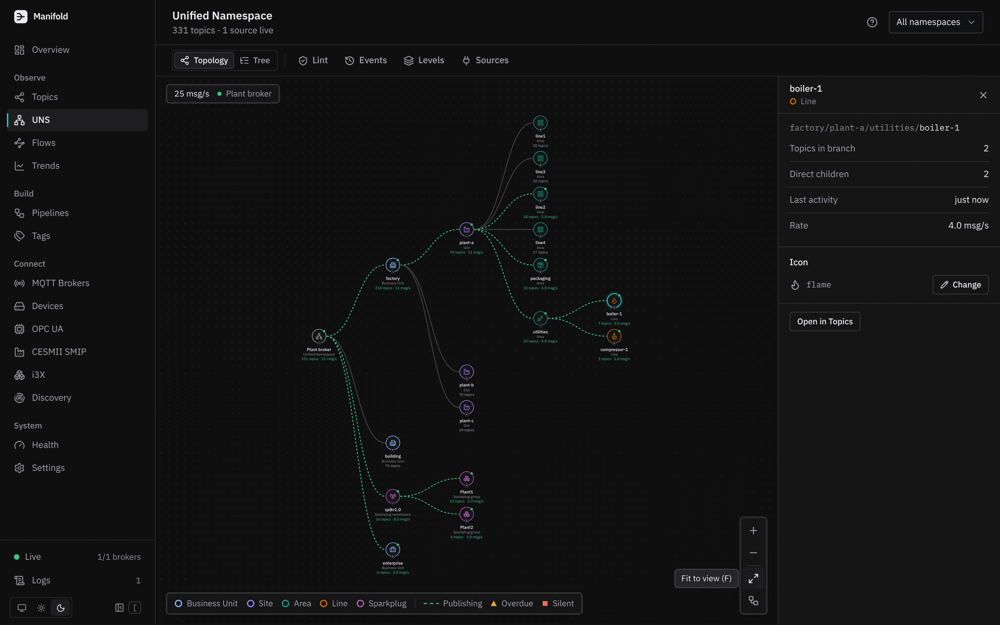

# Manifold

[](https://github.com/zbest1000/manifold/actions/workflows/ci.yml)
[](#license)
[](https://nodejs.org)

Industrial data explorer and DataOps toolkit: MQTT, Sparkplug B, OPC UA, CESMII SMIP, and i3X, plus read-only device drivers for Modbus TCP, Siemens S7 and EtherNet/IP, with a live Unified Namespace view.

**[Website](https://zbest1000.github.io/manifold/)** · **[Docs / Wiki](../../wiki)** · **[Architecture](ARCHITECTURE.md)** · **[Changelog](CHANGELOG.md)**

<p align="center">
  
</p>

Manifold connects to brokers and servers, streams their data in real time, and renders it as a live UNS topology, interactive topic/address-space graphs, and producer → topic → consumer lineage. A DataOps layer routes and reshapes the stream: pipelines, contextualization models, historian delivery with store-and-forward, recording/replay, schema contracts, and tag bindings with a Sparkplug B publisher. Device drivers poll PLCs directly and feed the same bindings. They never write to a device. An included MCP server exposes the same backend to AI agents.

## Features

**Explore**
- MQTT topic tree, 2D/3D graphs, and a WebGL renderer for very large namespaces (60k+ topics). JSON, text, binary, and Sparkplug B payloads decoded. The 3D view is real three.js instancing (50k nodes); force layout runs in a Web Worker.
- MQTT 3.1.1 and 5 (per broker), over `mqtt`/`mqtts`/`ws`/`wss`, with a configurable intake filter including `$share` shared subscriptions. MQTT 5 user properties, content type, response topic, and correlation data decoded on messages; the first three publishable.
- OPC UA address-space browsing with live monitored values; secure connections (Sign / SignAndEncrypt) with endpoint discovery and a built-in certificate trust store.
- Producer/consumer lineage: Sparkplug topology from BIRTH/DEATH certificates (including host application STATE), per-client subscriptions from broker admin APIs (EMQX, HiveMQ), wildcard filters resolved against observed topics.
- Network discovery by CIDR scan with protocol handshake verification; opt-in, read-only identification of Modbus TCP, S7 and EtherNet/IP devices, with "Add as device".
- Message history survives restarts; any two payloads can be diffed structurally.

**Unified Namespace**
- Live ISA-95 topology built from observed traffic: values on leaves, per-branch message rates, publishing edges animated.
- Per-topic staleness calibrated to each topic's own publish cadence.
- Namespace lint (0–100 score with structural findings), event feed (new topics, Sparkplug lifecycle), editable level ladder, and mounts for OPC UA / i3X sources.
- Curated industrial icon set (~130 icons) with automatic mapping, plus user-defined custom SVG icons.

**DataOps**
- Pipelines: filter → transform chain (repath, pick/rename/set, scale, numeric, Sparkplug flatten, TVQ envelope) → broker or historian, with a dry-run preview against live topics and two-layer loop protection.
- Models: merge fields from many topics into one object at a clean UNS path.
- Historians: InfluxDB v2, TimescaleDB/PostgreSQL, and Timebase (Flow Software) — all through a store-and-forward outbox with segmented disk spill, strict oldest-first delivery, dead-lettering of permanently rejected points, and a configurable drop policy. Timebase is the reference historian for device data; InfluxDB stores no quality and is not offered for it.
- Trends: chart stored series from InfluxDB and TimescaleDB — or a local file **recording**, with no external database — up to 10 tags per chart, downsampled server-side, auto-refreshing.
- Recorder and replay, schema contracts with drift detection, alert rules with webhooks — silence/new-topic rules plus value thresholds with sustain and hysteresis, evaluated at message latency.
- Everything edits in place: brokers, OPC UA connections, pipelines, historians, models, bindings, and alert rules update without delete/re-add.

**Devices** (southbound drivers, **read-only by construction**)
- **Modbus TCP**, **Siemens S7** (S7comm; **experimental**) and **EtherNet/IP** Logix (**experimental**). Experimental means verified only against in-process simulators, not real hardware; the per-driver checklists are in [`server/drivers/s7/NOTES.md`](server/drivers/s7/NOTES.md) and [`server/drivers/eip/NOTES.md`](server/drivers/eip/NOTES.md).
- Devices, poll groups and tags are edited on the Devices page (generic forms with presets and experimental badges, spreadsheet paste and CSV import, inline address validation, a connection test, polling health with the device's own reason for every quarantined tag, and a **probe** that shows raw registers decoded under all four Modbus byte/word orders). Modbus addresses accept `holding:100` or Modicon `40001` / `400001` with explicit 0/1-based handling. EtherNet/IP tags can be imported from the controller's own tag list.
- **Device profiles**: define a meter, drive or PLC type once (tags with `{param}` placeholders, poll groups, options), then create devices from it one at a time or in bulk from a pasted table or CSV.
- Each driver runs in a supervised child process: a crash, hang or protocol fault takes down only that process, which restarts with backoff and is parked if it crash-loops. Each device keeps one connection, reconnects forever with jittered backoff, skips (and counts) overrunning poll cycles instead of queueing them, and quarantines tags that fail permanently while the rest keep polling.
- Read-only is enforced where bytes are built: each driver's single frame encoder has an allowlist (Modbus function codes 1-4; S7 setup, Read Var and SZL read; CIP read and connection services), and the tests assert that no write ever reaches a socket. It is a guarantee about Manifold, not about your network: none of these protocols authenticates the client.

**Tags**
- Unified tag browser (devices, OPC UA, Sparkplug registry, MQTT trie) with an accessible tree, filter and CSV import.
- Bindings publish tags under an **ISA-95 asset path** as plain values, TVQ envelopes with units, **one JSON object per asset** (size-capped), or a Sparkplug B device (typed metrics: Int16, Float, Boolean, ...), with absolute or percent deadband, a heartbeat, and quality mapping. Quality is part of change detection; when a source goes offline every tag gets one Bad publish and a retained `<path>/_status` document (or DDEATH for Sparkplug), and a retained `<path>/_meta` document carries types, units, ranges and sources. A **profile binding** maps every instance of a device profile with one definition. Retained topics are cleared when a binding is renamed or deleted. The wizard previews what the server would publish, and warns about raw-address names and topic collisions. Read-only toward devices.
- An opt-in **direct historian target** on a binding (Timebase or TimescaleDB; InfluxDB is refused because it stores no quality).
- Optional Sparkplug primary-host session: Manifold publishes retained `STATE` so edge nodes see a host application.

**Operations**
- Token auth with admin and read-only roles (including named, individually revocable tokens), enforced identically on the REST API and the Socket.IO handshake, with per-IP auth-failure rate limiting on both. Unknown roles are rejected, never treated as admin. Audit log (rejected requests included, rotated by size), config export/import with secrets stripped and the import validated whole before it is applied.
- Fail-closed by default: with no token the server binds `127.0.0.1` only. An egress guard blocks the network scanner, i3X/CESMII/broker-admin clients, alert webhooks and device targets from reaching loopback (device targets: opt-in for simulators), cloud-metadata, and (unless opted in) private ranges. It does not cover MQTT broker, OPC UA or historian endpoints, which an admin configures by hand. Security headers (`helmet`) and a general request rate limit are on by default.
- Durable state: `profiles.json` is written with fsync and rotating backups, and recovered from the newest valid backup if it is ever corrupt.
- OPC UA connections are supervised: a lost session or a restart retries forever with jittered backoff and rebuilds its monitored items.
- Self-observability: a **System (Health)** page renders Manifold's own Prometheus `/metrics` live — process health, per-broker ingest, and every engine counter, each with a rolling sparkline. `/metrics` requires a bearer token when auth is on. Device and driver-host health (state, cycle times, overruns, timeouts, exceptions, quarantined tags) is on `/metrics` as `manifold_device_*` and `manifold_driver_host_*`, on the Devices page and in `GET /api/devices`.

See [ARCHITECTURE.md](ARCHITECTURE.md) for how it works: system design, the message hot path, the API surface, protocol notes, and testing. Operational guides (broker ACLs, historian setup, transform reference, troubleshooting) live in the [wiki](../../wiki), generated from [`docs/wiki/`](docs/wiki). Release history is in [CHANGELOG.md](CHANGELOG.md); release steps and verification status are in [docs/RELEASING.md](docs/RELEASING.md).

## Quick start

Requires Node.js ≥ 20.19 (or 22+).

```bash
npm run install:all
npm run dev            # client on :3000, backend on :5000
```

Production build:

```bash
npm run build
npm start              # serves API + built client on :5000
```

## Docker

A prebuilt image serves the API and the built UI from one container (published on every `v*` tag):

```bash
docker run -p 5000:5000 -v manifold-data:/data ghcr.io/zbest1000/manifold:latest
# open http://localhost:5000
```

`/data` holds profiles, history, spill files, and the OPC UA PKI (`MANIFOLD_DATA_DIR`). Pass auth tokens as `-e` environment variables. A full demo stack (broker, OPC UA simulator, simulated Modbus / S7 / EtherNet/IP devices, traffic generator) is one command away — see [DOCKER.md](DOCKER.md).

## Authentication

Manifold is a control plane: it can publish to brokers, send Sparkplug commands, and start network scans. Before exposing it beyond localhost, set a token:

```bash
MANIFOLD_AUTH_TOKEN=$(openssl rand -hex 24) npm start
```

With a token set (`MANIFOLD_AUTH_TOKEN`, `MANIFOLD_VIEWER_TOKEN` or `MANIFOLD_TOKENS`), all API routes and the socket handshake require `Authorization: Bearer <token>`, and the UI shows an unlock screen. `MANIFOLD_VIEWER_TOKEN` adds a read-only role, and `MANIFOLD_TOKENS` (`name:token:role,…`) issues named, individually revocable tokens whose names appear in the audit trail. Failed authentication is rate-limited per IP (on both the REST and socket paths). Without a token the server **binds `127.0.0.1` only** and warns at startup — an unauthenticated instance is reachable off-host only if you set `MANIFOLD_HOST=0.0.0.0` deliberately.

**Behaviour changes to know about when upgrading**

- A **viewer token alone enables auth**, and then nobody is admin: also set `MANIFOLD_AUTH_TOKEN` or an admin entry in `MANIFOLD_TOKENS`.
- **Unknown roles are rejected** (an entry such as `bob:secret:readonly` used to become an admin token). Rejected entries are logged at startup, and if tokens were configured but all were rejected, auth stays on and every request is 401.
- **`/metrics` needs a bearer token** (any role) when auth is on. Give Prometheus a viewer token, or set `MANIFOLD_METRICS_PUBLIC=1`. `/health` stays open.
- **Alert webhooks now pass the egress guard**, so a webhook to `localhost`, a link-local address, or (without `MANIFOLD_ALLOW_PRIVATE_TARGETS=1`) a private address is refused. Redirects are re-checked on every hop.
- Viewers can call a short list of read-only POSTs (historian queries, pipeline preview, subscription resolve, schema inference, device tag validation, i3X reads) and no longer see alert webhook URLs.
- **Device targets** are guarded: loopback hosts need `MANIFOLD_ALLOW_LOOPBACK_DEVICES=1` and private ranges need `MANIFOLD_ALLOW_PRIVATE_TARGETS=1`.
- Sparkplug messages are delivered **in order and un-coalesced** (a bounded queue; overflow is counted, not silent), and bindings **publish a Bad-quality envelope when a source goes offline** and a retained `_status` topic. The binding wizard no longer ticks **retain** by default.
- The historian spill is now **segment files plus a cursor** under `outbox/` (a legacy `<id>.jsonl` is still read first and drained, no conversion needed), and permanently rejected points go to a dead-letter file.
- `audit.jsonl` rotates by size and now records rejected requests (401/403/429).
- Config export keeps device tag `key` fields (an earlier build blanked them) and an import applies immediately.
- **Not verified on real hardware:** none of the three device drivers has been run against real PLCs, and the Timebase REST behaviour is unconfirmed. See [Verifying on real hardware](docs/wiki/Verifying-on-Real-Hardware.md) and the [changelog's known issues](CHANGELOG.md).

Connection profiles persist in `server/data/profiles.json` (mode 0600; directory configurable via `MANIFOLD_DATA_DIR`, restore disabled via `MANIFOLD_NO_RESTORE=1`). The file may contain broker credentials, so protect the host.

### Environment variables

Every variable the server reads. All are optional.

| Variable | Default | Purpose |
|----------|---------|---------|
| `PORT` | `5000` | HTTP and Socket.IO port |
| `MANIFOLD_AUTH_TOKEN` | _(none)_ | Admin bearer token. With any of the three token variables set, auth is on; with none set the server binds loopback only |
| `MANIFOLD_VIEWER_TOKEN` | _(none)_ | Read-only token (GETs and a short list of read-only POSTs succeed, other mutations 403). Setting it alone turns auth on, so also set an admin token |
| `MANIFOLD_TOKENS` | _(none)_ | Named revocable tokens: `name:token[:role]`, e.g. `alice:secret:admin,grafana:tok:viewer`. Role is `admin` or `viewer` (default `admin` when omitted); an unrecognised role rejects that entry with a startup error (never treated as admin), and a token containing `:` needs an explicit role (`bot:ab:cd:viewer`). If entries are configured but all rejected, auth stays on (everything 401) |
| `MANIFOLD_METRICS_PUBLIC` | `0` | Set to `1` to leave `/metrics` open when auth is on. Otherwise `/metrics` needs a bearer token of any role |
| `MANIFOLD_HOST` | `127.0.0.1` (open) / `0.0.0.0` (auth on) | Bind address; set to `0.0.0.0` to expose an open instance (not advised) |
| `CLIENT_URL` | `http://localhost:3000` | Allowed CORS origin (dev client) |
| `MANIFOLD_ALLOW_PRIVATE_TARGETS` | `0` | Set to `1` to let the scanner, i3X/CESMII/broker-admin clients, alert webhooks and device drivers reach RFC1918/LAN targets (needed for Discovery, on-prem i3X/CESMII and PLCs on a plant network; safe only on a trusted network). Fail-closed by default; cloud-metadata link-local is **always** blocked, loopback is blocked except as below. The server warns at startup when this is on |
| `MANIFOLD_ALLOW_LOOPBACK_DEVICES` | `0` | Set to `1` to let **device drivers** target `127.0.0.0/8` and `::1` (local simulators, such as `node server/tools/simulators.js`). Does not affect webhooks or other clients. Leave unset in production; the server warns at startup when it is on |
| `MANIFOLD_DATA_DIR` | `server/data` | Where profiles (and their backups), history, outbox spill and dead-letters, audit log, recordings and OPC UA PKI live |
| `MANIFOLD_NO_RESTORE` | `0` | Skip reconnecting saved profiles on startup |
| `MANIFOLD_RATE_MAX` / `MANIFOLD_RATE_WINDOW_MS` | `600` / `60000` | General `/api` request rate limit |
| `MANIFOLD_AUDIT_MAX_BYTES` | `10485760` (10 MiB) | Size at which `audit.jsonl` rotates |
| `MANIFOLD_AUDIT_KEEP` | `5` | Rotated audit files kept (`audit.jsonl.1` ... `.N`) |
| `MANIFOLD_MAX_PAYLOAD_BYTES` | `262144` (256 KB) | Per-topic retained payload cap; larger payloads are truncated for storage/preview |
| `MANIFOLD_MAX_MSG_PROPS` | `200000` | Cap on topics with surfaced MQTT 5 properties; entries past it are refused and counted (`droppedProps`) |
| `MANIFOLD_TOPIC_IDLE_TTL_MS` | `0` (off) | When set, topics idle for longer than this many milliseconds are evicted by a background sweep, freeing their slots under the 2,000,000-topic cap |
| `MANIFOLD_SPARKPLUG_QUEUE_MAX` | `5000` | Sparkplug messages queued un-coalesced per 100 ms flush, per broker. Beyond it a topic falls back to latest-wins for the window and `sparkplugCoalesced` counts it |
| `MANIFOLD_SPARKPLUG_QUEUE_BYTES` | `8388608` (8 MiB) | Payload-byte bound for the same queue |
| `MANIFOLD_HISTORIAN_TIMEOUT_MS` | `15000` | Deadline on historian HTTP calls |

The MCP server (`mcp/`) reads `MANIFOLD_API_URL` and `MANIFOLD_AUTH_TOKEN`. The simulator tool reads `SIM_HOST`, `SIM_MODBUS_PORT`, `SIM_S7_PORT`, `SIM_EIP_PORT` (see [DOCKER.md](DOCKER.md#simulated-devices)).

## MCP server

Point any MCP client at `mcp/index.js` with the backend running:

```json
{
  "mcpServers": {
    "manifold": {
      "command": "node",
      "args": ["/absolute/path/to/mcp/index.js"],
      "env": { "MANIFOLD_API_URL": "http://localhost:5000" }
    }
  }
}
```

75 tools cover MQTT, UNS, DataOps (including saves/deletes for every engine), OPC UA, CESMII, and i3X. The full list is in [ARCHITECTURE.md](ARCHITECTURE.md#mcp-tools). Set `MANIFOLD_AUTH_TOKEN` in the MCP server's environment when the backend runs authenticated.

## Testing

```bash
cd server && npm test    # node:test, includes real-broker integration
cd client && npm test    # Vitest over the pure logic modules
```

CI additionally runs an integration job against real EMQX, InfluxDB, TimescaleDB, and Timebase containers. Details in [ARCHITECTURE.md](ARCHITECTURE.md#testing).

## License

MIT
