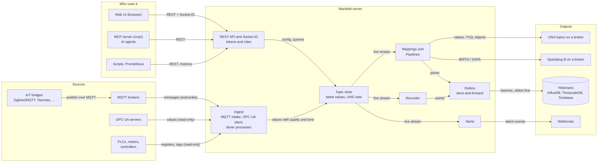

# Manifold

[](https://github.com/zbest1000/manifold/actions/workflows/ci.yml)
[](#license)
[](https://nodejs.org)

Manifold is a self-hosted web application that reads live data from your plant's brokers, OPC UA servers and devices, shows it as one browsable namespace, and republishes it in a clean, consistent shape for other systems.

**[Website](https://zbest1000.github.io/manifold/)** · **[Docs (wiki)](https://github.com/zbest1000/manifold/wiki)** · **[Architecture](ARCHITECTURE.md)** · **[Changelog](CHANGELOG.md)** · **[Security](SECURITY.md)**

## What you can do with it

- **See what is on your MQTT brokers** without writing code: every topic, its latest value, its rate, who publishes and who subscribes, decoded Sparkplug B (a standard payload and session format for plant data over MQTT), and a live tree of your namespace.
- **Read PLCs, meters and controllers without risking a write.** The device drivers can only send read requests (Modbus TCP, Siemens S7, EtherNet/IP and more), and OPC UA servers are browsed and subscribed to, never written.
- **Build a Unified Namespace (UNS)**, meaning one topic tree on a broker where every asset publishes under a predictable path such as `acme/dallas/line4/filler/temperature`, with units, quality and timestamps, as plain values, JSON envelopes or Sparkplug B.
- **Reshape messy topics** into clean ones with pipelines (filter, rename, scale, repath) and merge several topics into one object per asset (models).
- **Keep history** in InfluxDB, TimescaleDB or Timebase. Data is buffered on disk while the historian is down and delivered oldest first when it comes back.
- **Get alarms** on silent topics, new topics and value thresholds, acknowledge them, and keep a history that survives restarts.
- **Let an AI agent work with the same data** through the included MCP server, under the same tokens and audit log as the web UI.

<p align="center">
  
</p>

<p align="center">
  
  
</p>

<sub>Screenshots are from the real application running against simulated devices and a simulated plant (demo data, not a customer site).</sub>

## How it works

Manifold is a Node.js server with a browser UI. It connects out to your data sources, keeps the latest value of everything it sees in memory, and runs four engines over that live stream: **mappings** (tags into UNS topics), **pipelines** (topic-to-topic routes), **alerts** and the **recorder**. Each device protocol runs in its own supervised child process, so a crashing driver cannot take the server down.



The full set of diagrams (processes, the path of one value from a PLC register to a historian row, driver supervision, mappings, store-and-forward, security boundaries, alarms and deployment) is in [ARCHITECTURE.md](ARCHITECTURE.md#diagrams).

## Quick start

### Docker

The image serves the API and the built UI from one container. Without a token the server listens on loopback only, which inside a container means nobody can reach it, so pass a token:

```bash
docker run -p 5000:5000 -v manifold-data:/data \
  -e MANIFOLD_AUTH_TOKEN=$(openssl rand -hex 24) \
  ghcr.io/zbest1000/manifold:1.1.0
# open http://localhost:5000 and enter the token on the unlock screen
```

`/data` holds the saved configuration, message history, historian spill files, the alert and audit logs and the OPC UA certificates. Keep it on a volume.

To try everything without your own equipment, `docker compose up --build` starts Manifold with an MQTT broker, an OPC UA simulator, simulated Modbus, S7 and EtherNet/IP devices and a traffic generator, already connected. See [DOCKER.md](DOCKER.md).

### From source

Requires Node.js 20.19+ or 22.12+ (the OPC UA client and the client build tool need it).

```bash
npm run install:all    # root, server, client and mcp dependencies
npm run dev            # UI on http://localhost:3000, API on :5000
```

For a production-style run:

```bash
npm run build          # builds the client into client/dist
npm start              # serves the API and the built UI on http://localhost:5000
```

Next steps (connect a broker, add a device, map its tags) are in [Getting started](docs/wiki/Getting-Started.md).

## What it connects to

| Source or target | How | Read-only? | Status |
|---|---|---|---|
| MQTT 3.1.1 and 5 brokers | subscribe; publish for mappings, pipelines and manual publish | No | Tested in CI against a real EMQX broker |
| Sparkplug B | decode from MQTT; publish as an edge node; optional primary-host `STATE` | No | Tested against an in-process broker |
| OPC UA servers | browse, read, subscribe; None, Sign, SignAndEncrypt | Yes | Tested against a real node-opcua server; Kepware, S7-1500, Ignition etc. not tested |
| Modbus TCP | device driver (function codes 1-4 only) | Yes | Supported; tested against simulators only |
| Siemens S7, EtherNet/IP (Logix), BACnet/IP, SNMP, HTTP/JSON, MTConnect, CoAP | device drivers | Yes | Experimental; tested against simulators only |
| Matter and Z-Wave networks | through the Matter Server and Z-Wave JS Server | Yes | Experimental; tested against stand-ins only |
| Zigbee2MQTT, Z-Wave JS UI, Home Assistant discovery, Tasmota, Shelly, ChirpStack, The Things Stack | read their MQTT traffic | Yes (never publishes to them) | Experimental; tested against a simulator of their documented messages |
| CESMII SMIP, i3X | HTTP clients | Reads (SMIP also has a raw GraphQL passthrough) | Mock servers in the demo stack only; not tested against the real services |
| InfluxDB v2, TimescaleDB / PostgreSQL | write through the outbox; read back for Trends | n/a | Tested in CI against real containers |
| Timebase (Flow Software) | write through the outbox; read back for Trends | n/a | Tested in CI against a real container (1.3.4); some REST details unconfirmed |
| Webhooks, Prometheus | alert events out; `/metrics` scraped | n/a | Tested |

Payloads in JSON, text, Sparkplug B, CBOR, MessagePack, SenML, Protobuf and Avro are decoded. Driver details: [Devices and Drivers](docs/wiki/Devices-and-Drivers.md). IoT details: [IoT devices over MQTT](docs/wiki/IoT-Devices-over-MQTT.md).

## Security

- **Drivers cannot write.** Each driver builds every frame through one encoder with an allowlist of read services, and tests prove nothing else reaches a socket. Many plant protocols do not authenticate clients, so other machines on that network still can write.
- **Tokens and roles.** `MANIFOLD_AUTH_TOKEN` (admin), `MANIFOLD_VIEWER_TOKEN` (read-only) or named tokens in `MANIFOLD_TOKENS` protect the REST API and the Socket.IO connection the same way.
- **No token, local only.** Without a token the server binds `127.0.0.1` and answers only to loopback host names (add names with `MANIFOLD_ALLOWED_HOSTS`), so a web page you visit cannot drive it.
- **Egress guard.** Network scans, alert webhooks, device targets and the outbound HTTP clients never reach cloud-metadata addresses, and reach loopback or private addresses only when you allow it (`MANIFOLD_ALLOW_PRIVATE_TARGETS`, `MANIFOLD_ALLOW_LOOPBACK_DEVICES`). Brokers, OPC UA servers and historians are configured by an admin and may be on the LAN, but refuse link-local and metadata addresses.
- Reporting a vulnerability and the full deployment checklist: [SECURITY.md](SECURITY.md). Operating details: [Operations](docs/wiki/Operations.md).

## Configuration

Manifold is configured in the UI and stored in `<data dir>/profiles.json` (mode 0600; it contains broker and historian credentials, so protect the host). The server process reads environment variables (and a `.env` file in its working directory). All are optional. The ones most deployments touch:

| Variable | Default | Purpose |
|----------|---------|---------|
| `PORT` | `5000` | HTTP and Socket.IO port |
| `MANIFOLD_AUTH_TOKEN` | _(none)_ | Admin bearer token. With any of the three token variables set, auth is on; with none set the server binds loopback only |
| `MANIFOLD_VIEWER_TOKEN` | _(none)_ | Read-only token (GETs and a short list of read-only POSTs succeed, other mutations 403). Setting it alone turns auth on, so also set an admin token |
| `MANIFOLD_TOKENS` | _(none)_ | Named revocable tokens: `name:token[:role]`, e.g. `alice:secret:admin,grafana:tok:viewer`. Role is `admin` or `viewer` (default `admin` when omitted); an unrecognised role rejects that entry with a startup error (never treated as admin), and a token containing `:` needs an explicit role (`bot:ab:cd:viewer`). If entries are configured but all rejected, auth stays on (everything 401) |
| `MANIFOLD_HOST` | `127.0.0.1` (open) / `0.0.0.0` (auth on) | Bind address; set to `0.0.0.0` to expose an open instance (not advised) |
| `MANIFOLD_ALLOWED_HOSTS` | _(none)_ | Open instance on loopback only: extra host names (comma-separated) the server answers to besides `localhost`, `127.x` and `::1`. Any other `Host` is refused with 421, so a DNS-rebinding web page cannot drive an unauthenticated instance |
| `MANIFOLD_ALLOW_PRIVATE_TARGETS` | `0` | Set to `1` to let the Discovery scan, i3X/CESMII/broker-admin clients, alert webhooks and device drivers reach RFC1918/LAN targets (needed for Discovery, on-prem i3X/CESMII and PLCs on a plant network; safe only on a trusted network). Fail-closed by default; cloud-metadata link-local is **always** blocked, loopback is blocked except as below. The server warns at startup when this is on |
| `MANIFOLD_DATA_DIR` | `server/data` (`/data` in the image) | Where profiles (and their backups), history, outbox spill and dead-letters, audit log, recordings and OPC UA PKI live |

<details>
<summary>Every other variable the server reads</summary>

| Variable | Default | Purpose |
|----------|---------|---------|
| `MANIFOLD_METRICS_PUBLIC` | `0` | Set to `1` to leave `/metrics` open when auth is on. Otherwise `/metrics` needs a bearer token of any role |
| `CLIENT_URL` | `http://localhost:3000` | Allowed CORS origin (dev client); also the one cross-origin page allowed to open the Socket.IO connection (same-origin pages and non-browser clients always may) |
| `MANIFOLD_ALLOW_LOOPBACK_DEVICES` | `0` | Set to `1` to let **device drivers** and the **Discovery scan** target `127.0.0.0/8` and `::1` (local simulators, such as `node server/tools/simulators.js`). Does not affect webhooks or other clients; i3X is not probed on loopback. Leave unset in production; the server warns at startup when it is on |
| `MANIFOLD_DISCOVERY_MAX_HOSTS` | `1024` | Largest range one Discovery scan may cover (a /22). A bigger range is refused with its size and expected duration; raise it only if you mean to |
| `MANIFOLD_NO_RESTORE` | `0` | Set to `1` to skip reconnecting saved profiles on startup |
| `MANIFOLD_RATE_MAX` / `MANIFOLD_RATE_WINDOW_MS` | `600` / `60000` | General `/api` request rate limit |
| `MANIFOLD_TRUST_PROXY` | _(off)_ | Behind a reverse proxy: the number of proxy hops in front of Manifold (`1` for one proxy) or the proxy addresses/subnets, comma-separated (`10.0.0.5,10.0.1.0/24`, or `loopback`). Then the rate limit, the auth-failure throttle and the audit log use the client address from `X-Forwarded-For`; off, every client behind the proxy shares the proxy's address (one rate-limit bucket for everyone). `true` (trust any hop, so any client could choose its own address) is refused with a startup warning |
| `MANIFOLD_AUDIT_MAX_BYTES` | `10485760` (10 MiB) | Size at which `audit.jsonl` rotates |
| `MANIFOLD_AUDIT_KEEP` | `5` | Rotated audit files kept (`audit.jsonl.1` ... `.N`) |
| `MANIFOLD_MAX_PAYLOAD_BYTES` | `262144` (256 KB) | Per-topic retained payload cap; larger payloads are truncated for storage/preview |
| `MANIFOLD_MAX_MSG_PROPS` | `200000` | Cap on topics with surfaced MQTT 5 properties; entries past it are refused and counted (`droppedProps`) |
| `MANIFOLD_TOPIC_IDLE_TTL_MS` | `0` (off) | When set, topics idle for longer than this many milliseconds are evicted by a background sweep, freeing their slots under the 2,000,000-topic cap |
| `MANIFOLD_SPARKPLUG_QUEUE_MAX` | `5000` | Sparkplug messages queued un-coalesced per 100 ms flush, per broker. Beyond it a topic falls back to latest-wins for the window and `sparkplugCoalesced` counts it |
| `MANIFOLD_SPARKPLUG_QUEUE_BYTES` | `8388608` (8 MiB) | Payload-byte bound for the same queue |
| `MANIFOLD_HISTORIAN_TIMEOUT_MS` | `15000` | Deadline on historian HTTP calls |
| `MANIFOLD_ALERT_HISTORY_MAX_BYTES` | `8388608` (8 MiB) | Size cap of the alert history (`<data dir>/alerts.jsonl`, two segments; the oldest events go first) |
| `MANIFOLD_CODEC_AUTODETECT` | on | Set to `0` to stop decoding CBOR and MessagePack payloads that have no codec binding |
| `MANIFOLD_CODEC_MAX_BYTES` | `262144` (256 KiB) | Largest payload a codec decodes; bigger payloads stay as they arrived |
| `MANIFOLD_EXPORT_MAX_ROWS` | `1000000` | Row cap of a Trends CSV export (the file says when it stopped) |
| `MANIFOLD_IOT_MAX_DEVICES` | `2000` | IoT-over-MQTT devices kept per broker |
| `MANIFOLD_IOT_MAX_TAGS` | `50000` | IoT-over-MQTT tags kept per broker |
| `MANIFOLD_RETAINED_LEDGER` | `<data dir>/binding-retained.json` | File that records the retained topics mappings own, so orphaned retained topics can be cleared after a restart or an edit made while the target broker was away |

The two tables list every `MANIFOLD_*`, `PORT` and `CLIENT_URL` variable that `grep -rn "process.env" server/` finds outside tests (checked November 2026). Test-only variables: `INTEGRATION`, `INTEGRATION_EMQX_HOST`/`_PORT`/`_WS_PORT`, `INTEGRATION_INFLUX_URL`/`_TOKEN`/`_ORG`/`_BUCKET`, `INTEGRATION_TSDB_HOST`/`_PORT` and `INTEGRATION_TIMEBASE_URL` select the real-service integration test; `MANIFOLD_OPCUA_TEST_CERT_CACHE` caches the OPC UA test server's certificates; the Playwright suite uses `E2E_PORT` and `PW_CHROMIUM_PATH`. The MCP server reads `MANIFOLD_API_URL` and `MANIFOLD_AUTH_TOKEN`; the simulator tool reads `SIM_HOST`, `SIM_MODBUS_PORT`, `SIM_S7_PORT` and `SIM_EIP_PORT` (see [DOCKER.md](DOCKER.md#simulated-devices)).

</details>

Limits and their settings are explained in [Operations: limits](docs/wiki/Operations.md#limits-that-protect-the-server). Upgrading from 1.0.0? Read the [upgrade notes](CHANGELOG.md#upgrade-notes) in the changelog.

## MCP server

The MCP server (`mcp/`) lets an MCP client such as an AI agent use Manifold through its REST API: 83 tools for brokers, topics, the UNS, pipelines, historians, mappings, alerts, IoT devices, OPC UA, CESMII and i3X. There are no device or device-profile management tools yet. Run it next to a running backend:

```json
{
  "mcpServers": {
    "manifold": {
      "command": "node",
      "args": ["/absolute/path/to/mcp/index.js"],
      "env": { "MANIFOLD_API_URL": "http://localhost:5000", "MANIFOLD_AUTH_TOKEN": "<token, when auth is on>" }
    }
  }
}
```

Tools that change state say so in their descriptions, and every call is audited like a UI action. The tool list is in [ARCHITECTURE.md](ARCHITECTURE.md#mcp-tools).

## Project status

This is the first public release. What has and has not been proven:

- **Proven in CI:** MQTT intake and MQTT 5 against a real EMQX broker; writes and Trends read-back against real InfluxDB, TimescaleDB and Timebase containers; OPC UA (including Sign and SignAndEncrypt) against a real node-opcua server; the UI in both themes with automated accessibility checks.
- **Not proven on real hardware:** no device driver and no IoT convention has been run against a real device. Every driver except Modbus TCP is marked *Experimental* in the UI. If you have a PLC, the checklist is [Verifying on real hardware](docs/wiki/Verifying-on-Real-Hardware.md).
- **Not confirmed:** some Timebase REST behaviour (ordering of old samples, Bad samples without a value, quality codes); the public test-broker presets in the connect form were written from memory; WebGL and 3D views were only run on a software renderer.

Open issues and accepted limits are listed in [docs/KNOWN-ISSUES.md](docs/KNOWN-ISSUES.md); release steps and verification status are in [docs/RELEASING.md](docs/RELEASING.md).

## Development and testing

```bash
npm run lint                                   # ESLint for server, client and mcp
cd server && npm test                          # node:test, including in-process broker and OPC UA server tests
cd client && npm test                          # Vitest over the client's logic modules
cd client && npm run build && npm run e2e      # Playwright against the built client and a real backend
```

CI also runs an integration job against real EMQX, InfluxDB, TimescaleDB and Timebase containers. The screenshots in `docs/wiki/images/` are generated by `cd client && npm run build && npm run docs:shots`, which starts a simulated plant and captures every page; see [How the screenshots are made](docs/wiki/User-Interface.md#how-the-screenshots-are-made). Code layout and the test strategy: [ARCHITECTURE.md](ARCHITECTURE.md#repository-layout).

## License

MIT, see [LICENSE](LICENSE).
