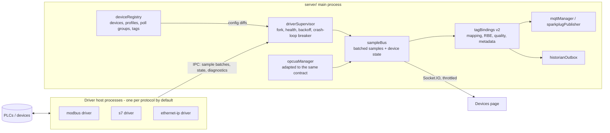

# Design: southbound device drivers (Modbus TCP, S7, EtherNet/IP) and UNS mapping

Status: **implemented; every driver except Modbus TCP is experimental — not verified on real
hardware** (checked against the code, November 2026, after the Devices, Profiles, mapping-editor
and Discovery UI work, the selective-mapping and context API, and the BACnet/IP, SNMP, HTTP/JSON,
MTConnect, CoAP, Matter Server and Z-Wave JS drivers and IoT over MQTT; the UI calls a binding a
"mapping", the API and this document keep "binding"). Nothing in this document has been verified against real hardware or
against the Timebase REST reference; see
[Verifying on real hardware](../wiki/Verifying-on-Real-Hardware.md).
The rest of this document is the original proposal and is kept as written, so
where it differs from the code, the table below and the notes after it win.
Scope: read-only data collection from PLCs and field devices, and a mapping
layer that lands their tags in the Unified Namespace with context.

### Implementation status

| Area | Status | Where, and how it differs from the proposal |
|---|---|---|
| Phase 0: defects P1 to P5 | **implemented** | Source lifecycle and re-sync on reconnect (P1), supervised OPC UA reconnect (P2), change detection on (value, quality) (P3), typed Sparkplug metrics (P4), Bad on source loss (P5). `services/tagBindings.js`, `services/opcuaManager.js`, `services/tagSources/` |
| Tag-source contract | **implemented, narrower** | Bindings consume normalized `sample` / `source-state` events (and an optional `batch-end`) from registered adapters (OPC UA adapter, device manager). OPC UA does **not** implement the full Driver interface (`connect`/`plan`/`execute`); only the event contract is shared. There is no separate `sampleBus` or `deviceRegistry`: `deviceManager` plus the profile store fill those roles |
| Driver contract (4.1) | **implemented, renamed** | Modules export `describe()`, `validateTag()` and `createDriver()`; the driver has `connect`, `plan`, `execute`, `bisect`, `probe`, `browse?`, `close`. `validateAddress` became `validateTag`; `execute` returns per-item results. The descriptors are uniform: tag types are plain names plus a separate `tagTypeInfo`, and `tagTypeOptional` marks drivers (EtherNet/IP) that resolve the type from the device |
| Supervisor and process model (4.2) | **implemented** | One host process per protocol, `isolate: true` for one per device (the **Advanced** section of the device form), heartbeats both ways, exponential backoff (0.5 s to 30 s), crash-loop parking (more than 5 crashes in 60 s), host exits when its parent disconnects. Parking is on the Devices page and on `/metrics` (`manifold_driver_host_up`, `manifold_driver_host_restarts_total`) |
| Runtime (4.3) | **implemented, mostly** | State machine with 1 s to 60 s jittered backoff and no cap, staggered first connects (25 ms per device, up to 500 ms), one in-flight request per connection, deadlines with a watchdog, socket destroyed on timeout, TCP keepalive and `TCP_NODELAY`, bisect and quarantine (retry every 60 s), per-unit breakers, adaptive slowdown (x2 up to x8 after 5 overrunning cycles). **Metrics** are on `/metrics` (`metricsExporter.js`, names in [Operations](../wiki/Operations.md#prometheus)). The device status carries `quarantineReasons` (per tag: code, message, since), `lastError` and `lastErrorAt`. **Not implemented:** a ceiling on request rate (`interRequestDelayMs` is only a lower bound the user sets) |
| Egress guard for devices | **implemented, with address pinning** | `assertAllowedDeviceTarget` at save, test and apply, with loopback behind `MANIFOLD_ALLOW_LOOPBACK_DEVICES`. The validated address is passed to the driver host and connected to directly (no second resolution); names are re-checked on host restart and every 30 s. The Discovery scan honours the same loopback flag (except for i3X) |
| Device configuration (4.4) | **implemented, mostly** | Collections `devices` and `deviceProfiles` are both used. A **profile** (`services/deviceProfiles.js`) holds protocol, options, poll groups, `params[]` and tags whose `key`, `address` and `property` may contain `{param}` placeholders; a **device** references it with `profileId` and `params` and may add ad-hoc tags (a key that equals a profile tag key is a validation error). `PUT /api/devices/profiles/:id` re-applies to every instance atomically; `DELETE` is refused with 409 while a binding uses the profile. The UI has a Profiles tab with create-from-device, new device from profile and **bulk create** from a pasted table or CSV: one `POST /api/devices/bulk` request (at most 200 rows) that is **all-or-nothing** (every row validated first, per-row errors, nothing created if any fails). A device save is validated against its driver (options, limits, S7 rack and slot) and names must be unique. CSV import and export of tags is in the UI. There is still no separate JSON/YAML schema document: the config export is that document, and it now keeps device tag keys |
| Modbus TCP (5.1) | **implemented** | Own client; explicit table, wire offset, byte and word order; Modicon 5 and 6 digit; probe with four decodings; planner with `maxGap` default 0 and declared `unmapped` ranges (the **Advanced** section of the device form); exceptions 02 (bisect, then quarantine), 04/05/06 (retry), 0A (gateway) and 0B (unit-down breaker). **Not implemented:** a warning when the client deadline is shorter than a gateway's serial timeout |
| S7 (5.2) | **implemented, experimental** | Own read-only S7comm client, rack/slot presets and TSAP override, negotiated PDU, at most 20 items per request, block merging, the type list in 5.2, SZL identity, the PUT/GET prerequisites text. A refused read now surfaces in `lastError` as `tag <key>: <message>` and in `quarantineReasons`. **Not implemented:** the optional sentinel tag per DB (rule 9), symbol / TIA export import |
| EtherNet/IP (5.3) | **implemented, experimental; differs from the proposal** | The spike rejected both candidate libraries (`drivers/eip/NOTES.md`), so this is our own read-only CIP client: Large then small Forward Open, Multiple Service Packet with per-item status, fragmented reads, symbol and template browse, External Access, BOOL arrays, orderly Forward Close. The Devices page has an **Import from controller** browse tree. **Not implemented:** ListIdentity as a driver call (the Discovery probe sends it), PCCC, Micro800 and Omron specifics (only a `maxPacketBytes` knob), controller change detection (drift is caught by path errors and structure-handle mismatches), the keepalive timer (poll traffic keeps the connection alive) |
| BACnet/IP (added after this proposal) | **implemented, experimental** | `drivers/bacnet/`: own read-only BACnet/IP client over UDP (unicast Who-Is, ReadProperty, ReadPropertyMultiple only; no COV), APDU-sized planning without segmentation, RP fallback, routed devices, object-list browse; opt-in Discovery probe. Needed no runtime change: the driver owns one UDP socket per device, sends to the pinned address and accepts replies only from it. Deviations and open items: `drivers/bacnet/NOTES.md` |
| SNMP, HTTP/JSON, MTConnect, CoAP (added after this proposal) | **implemented, experimental** | `drivers/snmp/` (v1, v2c, v3 USM with Node's crypto; Get, GetNext, GetBulk only; counter rates; GetBulk browse), `drivers/httpjson/` and `drivers/mtconnect/` (one shared GET-only HTTP client, `drivers/common/httpClient.js`; JSONPath selectors; MTConnect `/probe`, `/current`, `/sample` without gaps), `drivers/coap/` (confirmable GET, block-wise, Observe, CBOR and SenML; no DTLS). Opt-in UDP Discovery probes for SNMP and CoAP share BACnet's mechanism (`UDP_PROBES` in `services/discovery.js`). Each has a `NOTES.md` with deviations, unsupported features and a hardware checklist |
| Matter and Z-Wave via bridge servers (added after this proposal) | **implemented, experimental** | `drivers/matterserver/` and `drivers/zwavejs/` read the open-source Matter Server and Z-Wave JS Server over WebSocket (a hand-written RFC 6455 client in the runtime), with allow-listed read commands only. They are the first **subscription drivers** (`capabilities.subscribe`): values are pushed between poll cycles; the runtime keeps connection state, backoff and Bad-on-disconnect |
| URL devices and secrets (added after this proposal) | **implemented** | One field model for the HTTP and WebSocket drivers (`scheme`, `path`, `authToken`, TLS CA, fingerprint pin, explicit opt-out; `drivers/common/urlTarget.js`). One rule for device secrets: descriptor fields of type `password` are stored, answered as `null` by every API call, kept on an edit that leaves them blank, dropped when unused. A device saved without limits runs with its driver's `describe().limits` |
| IoT devices over MQTT (added after this proposal) | **implemented, experimental** | Not a driver: `services/iot/` reads Zigbee2MQTT, Z-Wave JS UI, Home Assistant discovery, Tasmota, Shelly, ChirpStack and The Things Stack traffic from a connected broker (it never publishes) and is the binding engine's tag source `iot` |
| Read-only enforcement (7) | **implemented** | Allowlisted frame encoders in every driver; tests try every refused service and assert no bytes reach the socket. The Discovery probes build their frames with the same encoders (`services/deviceIdentify.js`) |
| Bindings v2 (6) | **implemented** | Rule 1 (`assetPath` and `property`, raw-address lint and save-time warning), rule 2 (profile bindings: `source.type: 'device-profile'` with `assetPathTemplate` or `assetPaths`, one unit per instance, picks up instances added later), 3 (quality in change detection, Bad on loss), 4 (`_status`; also published when a binding is created while its source is already online), 5 (absolute and percent deadband, heartbeat), 6 (units in envelopes, retained `_meta`, Sparkplug BIRTH properties `engUnit`/`description`/`engLow`/`engHigh`), 7 (typed metrics), 8 (retained cleanup, see limits below), 9 (server preview with collisions and warnings in the single-sheet mapping editor; **not** a lint delta), 10 (`object-per-asset`, size-capped, rejected at save time when the worst case exceeds the cap), 12 (retain off by default). The legacy `pathTemplate` form is still accepted and used by stored bindings and the demo seed. **The `property` field of the proposal is not a binding field**: the published name comes from the binding entry's `name`, else the tag's `property`, else its key |
| Selective mapping and context | **implemented** | `services/bindingContext.js` with `bindingModel.js`: per-entry `enabled`, `source.select` rules (include and exclude globs, poll groups, types, has-a-property), `source.overrides` and per-tag overrides (name, displayName, description, unit, range, dataType, scale, offset, precision, states, statesMode, limits, deadband, context), `target.context` with placeholders, `target.contextMode` (`meta`, `payload`, `none`), `target.fields`, `target.metaFields`; `GET /api/tags/bindings/schema`, `POST /api/tags/bindings/suggest`, preview rows with the origin of each field, `option-ignored` and other warnings. Value pipeline: read, device decode, scale and offset, cast, deadband, then precision and states. Byte-for-byte compatible with earlier bindings (`test/fixtures/mapping-legacy.json`). Limits are metadata only: the alert engine (Alerts page) does not read them. Field order inside a payload follows `target.fields` in the API but the editor offers fixed order |
| Retained cleanup (rule 8), limit | **implemented, with a limit** | Topics a binding owns are derived from config (or, for filter-mode MQTT and Sparkplug sources, recorded when published) and cleared (empty retained publish, QoS 1) when they leave the set: delete, disable, path or broker change, retain switched off, instance removed. The owned set is recorded in `<data dir>/binding-retained.json` (`services/bindingRetained.js`), so edits made while the server was down, a crash and clears aimed at a disconnected broker are cleaned once the broker is connected. Limit: at most 20,000 recorded topics per broker; what does not fit is counted and not cleaned automatically |
| Historian delivery for device data | **implemented; Timebase REST unverified** | Path 1 (via the broker) needs no code. Path 2a: a pipeline from the binding's output topics to a historian. Path 2b: the **direct historian target** on a binding (`target.historian.historianId`; Timebase and TimescaleDB only, InfluxDB is rejected at save time) enqueues each published sample, with its read timestamp and quality, to the store-and-forward outbox under the resolved topic name (for `object-per-asset`, the per-member topic; for a Sparkplug target, `group/edge/device/metric`). Heartbeat repeats are not enqueued. The Timebase API facts listed under section 11 as unverified are still unverified |
| Devices page (8) | **implemented; hub planned** | A sortable, filterable device table (state, poll-cycle meter, quarantine, last error, enable switch), a detail drawer (Overview with poll groups, counters and exceptions; live Tags; Probe), a full-page add/edit form (Connection, Protocol options, Polling, Tags, Advanced) with presets, experimental badges, prerequisites and Test connection; tag table with paste, CSV, inline validation and probe; **Import from controller** (EtherNet/IP); Profiles tab with bulk create. The Tags page maps device tags and profiles, and a mapping links to its node in the UNS (`/uns?broker=&path=`). **Planned:** a hub that lists MQTT and OPC UA connections too, and device nodes in the UNS topology |
| Discovery of devices | **implemented, opt-in** | `includeDevices: true` or explicit `modbusPorts` / `s7Ports` / `eipPorts` in the scan options; the UDP kinds (BACnet/IP, CoAP, SNMP) only with their own port list or `include...` flag. "Add as device" turns a result into a device. Each port gets one read-only identification exchange (Modbus FC 43/14 Read Device Identification, then FC 3 of one register at address 0, unit 1, if refused; S7 COTP connection request, then the SZL identity read; EtherNet/IP ListIdentity; BACnet unicast Who-Is and a wildcard ReadProperty; CoAP `GET /.well-known/core`; SNMP one v2c `public` Get). A port that does not answer the protocol is not reported. The FC 43 frame is fixed in `services/deviceIdentify.js` and stays outside the Modbus driver's allowlist |
| Testing (9) | **partly implemented** | Done: pure-core tests, fault-injecting in-process simulators for every protocol (the simulators are our own, not jsmodbus, snap7 or cpppo), runtime and supervisor tests, simulators in the Docker demo (`server/tools/simulators.js`). **Not done:** a shared contract suite run against every driver as one table, and, above all, **verification on real hardware** (decision 1 in section 11): every driver but Modbus TCP remains experimental until it happens |
| Delivery plan phases | | Phases 0 to 4 are implemented (2 and 3 without hardware verification). Phase 5 (libplctag host, Modbus/TCP Security) is not started |

Where the code differs from this document, or a defect remains, open items:

- **Modbus exception 02 is quarantined, not "marked unmapped and stopped".**
  Quarantined tags are retried every minute, forever.
- **Sparkplug-source bindings** take the metric's own timestamp and quality
  without the plausibility window that pipelines and the recorder apply (a
  source time before 2000-01-01 or more than 24 h ahead is replaced by arrival
  time there).
- **Resolved since the first pass:** the MCP `binding_save` tool accepts `device` and `device-profile` sources; a `_meta` or `_status` publish that failed because the broker was not connected is retried on a 15 s timer (review finding N16); a mapping links to its UNS node; `isolate` and `unmapped` are in the device form.
- **No lint delta in the preview** (rule 9).
- **Sparkplug host STATE sessions** reconnect with new broker settings only when started again.
- **Bulk and Discovery "Add all"** use the atomic endpoint; the older client loop over `instantiate` is gone.

Fixed since the first status pass: config export blanked every device tag
`key` (`services/secrets.js`, commit `ceb979a5`); refusal reasons did not reach
the device status (`ceb979a5`).

Evidence levels used in this document:

- **[code]** — verified by reading this repository.
- **[src]** — backed by a source linked in [Research notes](#research-notes).
- **[unverified]** — widely stated, but not confirmed against a primary source
  during the research pass. Each of these must be checked against vendor
  documentation or a real device before the dependent code ships.

## 1. Goals and non-goals

Goals

1. Poll Modbus TCP, Siemens S7 and EtherNet/IP (Logix) devices without harming
   them: one connection per device, bounded request rate, planned reads.
2. Never publish a wrong or stale value as good. Every sample carries a value,
   a quality and two timestamps, end to end.
3. A driver fault cannot take down the Manifold server.
4. Mapping a device into the UNS is a modelling step (asset path, units,
   types), not a tag dump, and it scales to thousands of tags through
   templates and CSV rather than per-tag clicking.
5. One driver contract that the existing OPC UA source also implements, so
   bindings, the tag browser and the UI have a single code path.

Non-goals (first release)

- **Writes.** There is no write path, and the wire encoders refuse write
  services (section 7). If writes are ever added they are a separate,
  explicitly enabled feature with its own review.
- S7CommPlus (optimized/symbolic access on S7-1200/1500). The protocol is
  proprietary and TLS-wrapped from TIA V17; Apache PLC4X abandoned it over key
  and legal concerns [src]. Users with optimized blocks are pointed to the
  PLC's OPC UA server, which Manifold already speaks.
- CIP class 1 implicit I/O, CIP Security, Modbus RTU serial, Modbus/TCP
  Security (TLS on port 802 — design leaves room for it; real-world uptake is
  low [src]).

## 2. What the existing code gives us, and what has to change first

How tags reach the UNS today [code]:

```
opcuaManager.monitor() ── emit('value', {connectionId,nodeId,value,status,sourceTimestamp})
        └─> TagBindings.onOpcuaValue ─> _publishTag(binding, name, value, quality, ts)
                 ├─ target.mode 'mqtt'      → mqttManager.publish(plain | {v,t,q})
                 └─ target.mode 'sparkplug' → sparkplugPublisher.updateDevice()
```

OPC UA is hard-wired in four places: the `source.type` enum and index in
`server/services/tagBindings.js`, the validation in
`server/routes/tags.js`, the browse branch in the same file, and UNS mounts in
`server/routes/uns.js`. The unified browse node shape
(`{id, name, kind, address, meta}`) is the only existing seam.

These existing defects sit directly under the new feature and are
prerequisites, not nice-to-haves (details in `docs/REVIEW-2026-11.md`):

| # | Defect [code] | Why it blocks drivers |
|---|---|---|
| P1 | Bindings never re-create monitors after a restart or connection edit: `syncMonitors()` runs once at start, before the connection has a session, and nothing retries | The same lifecycle bug would be inherited by every driver |
| P2 | An OPC UA connection that stays down for more than a few seconds is never retried (`maxRetry: 2`) | Supervised reconnect must be a property of the runtime, not of each driver |
| P3 | `_publishTag` dedupes on value only, so a Good→Bad change with an unchanged value is suppressed | This is the "frozen value published as good" failure, the top-ranked failure in the field (section 3) |
| P4 | Data type is dropped at the binding; every Sparkplug number becomes Double | PLC types (INT, DINT, REAL, BOOL) must survive to the UNS |
| P5 | Nothing publishes bad quality when a source disconnects | Same as P3 |

## 3. Where others failed, and the rule each failure implies

Ranked by how often the failure shows up in the research. Sources are in
[Research notes](#research-notes).

| # | Failure seen elsewhere | Design rule in Manifold |
|---|---|---|
| 1 | **Frozen values published as good.** Ignition tags kept Good quality after updates stopped; MQTT Transmission sent no DDEATH when the underlying device connection died because it publishes folders, not devices [src] | Quality is part of every sample and part of the change-detection key. On device disconnect the runtime emits Bad quality for every bound tag, a retained device status, and DDEATH for Sparkplug targets. A per-tag staleness timer backs this up |
| 2 | **Late response matched to the next request → silently wrong values.** Open transaction-id desync issues in grid-x/modbus (under Telegraf) and pymodbus; modbus-serial has no default timeout and a history of transaction-id fixes [src] | After any timeout the socket is destroyed, never reused. Every response is validated against its request (Modbus: TID, unit id, function code, byte count; S7: PDU reference; CIP: sequence/context). Timeouts are mandatory, with a watchdog around every request |
| 3 | **Driver crash kills the host.** Node-RED repeatedly crashed on uncaught `ECONNRESET` / timeouts in S7 and EtherNet/IP contrib nodes [src] | Drivers run in supervised child processes (section 4.2). The main server only ever sees IPC messages |
| 4 | **Reconnect that never recovers** — after PLC power cycle, download or mode change; manual flow restart needed (Node-RED CIP), PLC4X-261 [src]. Manifold's own OPC UA path has this today (P2) | One connection state machine per device, owned by the runtime: exponential backoff with jitter, no retry limit, staggered first connects. A PLC-restart test is part of every driver's contract suite |
| 5 | **Connection exhaustion on the PLC.** Leaked Modbus connections (PLC4X-322), devices that accept ~4 connections, EtherNet/IP modules with small CIP connection tables, S7 CPUs with a handful of PUT/GET resources [src / unverified exact numbers] | Exactly one connection per device, shared by all poll groups; orderly close (Forward Close then FIN for CIP). Connection count is a visible metric |
| 6 | **Polling harder than the device can answer.** Queues build when the interval is shorter than the cycle time; comms load stretches the PLC scan [unverified magnitudes] | One poll cycle per group at a time; an overrun is *skipped and counted*, never queued. Cycle time, overruns and lag are shown per device. Default one request in flight per socket |
| 7 | **One bad item poisons a batch.** Modbus exception 02 for a block spanning an unmapped register; Kepware then marks the whole block bad [src]. Same shape for CIP multi-service packets and S7 multi-reads | Per-item status is always parsed. On a batch failure the planner bisects once, quarantines the offending tag with a slow retry (auto-demotion), and keeps the rest polling |
| 8 | **One dead unit behind a gateway stalls the bus** (Modbus TCP→RTU) [src] | Per-unit circuit breaker; a tripped unit is probed rarely and the healthy units are polled first |
| 9 | **Layout drift.** A re-downloaded S7 DB shifts offsets and reads still "succeed" with plausible wrong values; Logix symbol instance ids change after online edits [unverified, widely reported] | S7: optional sentinel tag per DB (a constant the PLC programmer exposes) that gates quality for the block. Logix: symbol/template caches are invalidated on path errors and on controller change detection, and tags are Bad until re-resolved |
| 10 | **Decoding errors that look like data.** Modbus word order (ABCD/CDAB/BADC/DCBA), 0- vs 1-based and 5- vs 6-digit addresses; S7 STRING headers and BCD dates; Logix UDT padding and BOOLs packed in DINTs [src] | Explicit, never inferred: register type, wire offset, byte order and word order are separate fields. A commissioning probe shows the raw bytes and every candidate decoding before a tag is saved. UDT layouts come from the controller's template, never from summed member sizes |
| 11 | **Tag dump UNS.** Raw PLC names as topics, no units, no types; "names are not identities" [src] | The UNS path is a separate field from the device address. Mapping targets an asset path plus a property name; units, description and range are first-class. Namespace lint flags topics that equal a raw device address |
| 12 | **Retained-message leftovers** — values and "online" states that outlive the device [src] | Retain is off for values by default; payloads carry timestamp and quality. When a mapping is deleted or its topic changes, the old retained topic is cleared |
| 13 | **Oversized bundled payloads** (Kepware reconnect loops at ~500 tags per message; whole-UDT republish on a single change) [src] | Object payloads are per asset and size-bounded; the per-tag topic mode stays available |
| 14 | **Config that doesn't scale or needs a restart** — no bulk edit, refresh needed for new tags [src, low-confidence source] | Diff-based live apply (existing compiled-view pattern), device profiles with instances, CSV import/export for tags and mappings |
| 15 | **Abandoned or copyleft driver libraries** (section 5) | One vetted library per protocol behind the driver contract, with a simulator-backed contract test suite so a library can be swapped |

Ideas worth copying: HighByte/Ignition-style **model → instance** templating;
UMH's explicit **raw vs modelled** tiers; Telegraf's Modbus **request
optimisation with a bounded gap fill**; Kepware's **auto-demotion**; Cybus's
**declarative, schema-validated config file** as the import/export format.
Not copied: Neuron's thread-only plugin isolation; per-tag or per-driver
licensing.

## 4. Architecture



### 4.1 The driver contract

One interface for every tag source, including OPC UA. Polled drivers implement
it inside a host process; subscription sources (OPC UA) adapt to it.

```ts
interface Driver {
  readonly protocol: 'modbus-tcp' | 's7' | 'ethernet-ip' | 'opcua';
  readonly capabilities: {
    browse: boolean;        // EtherNet/IP Logix, OPC UA: yes. Modbus, S7: no
    subscribe: boolean;     // OPC UA only; the others are polled
    maxInFlight: number;    // default 1
  };
  validateAddress(address: string, opts): { ok: true; normalized: TagAddress } | { ok: false; error: string };
  connect(device: DeviceConfig): Promise<DeviceInfo>;   // negotiated PDU, identity, limits
  plan(tags: TagDef[], limits: DeviceLimits): ReadPlan; // pure function, unit-testable
  execute(plan: ReadPlan, deadlineMs: number): Promise<ItemResult[]>; // per-item status, never all-or-nothing
  browse?(node?: string): Promise<BrowseNode[]>;        // existing {id,name,kind,address,meta} shape
  probe(address: TagAddress): Promise<{ raw: Buffer; decodings: Record<string, unknown> }>;
  close(): Promise<void>;                               // orderly, releases the device's connection slot
}
```

`plan` being a pure function is deliberate: read packing is where S7, CIP and
Modbus libraries have had their bugs (PLC4X-182 trims items larger than the
PDU [src]), and a pure planner can be property-tested without a device.

The sample that crosses the bus:

```ts
type Sample = {
  deviceId: string; tagId: string;
  v: number | bigint | string | boolean | null | object;
  type: 'bool'|'int8'|…|'float64'|'string'|'datetime'|'struct';
  q: 192 | 64 | 0;          // Good / Uncertain / Bad, as today
  qReason?: 'timeout'|'disconnected'|'device-exception'|'decode'|'stale'|'quarantined'|'layout';
  tSource?: number;         // only when the device supplies one (OPC UA, some Sparkplug)
  tRead: number;            // when the driver completed the read
};
```

Polled protocols have no device timestamp, so `tRead` is the honest timestamp
and is labelled as such; the TVQ envelope keeps `t` and gains nothing false.
64-bit integers (LINT, LTIME, Logix LINT) are `bigint` in the driver and
serialised as strings on IPC and MQTT — the OPC UA path already does this
[code].

### 4.2 Process model and supervision

- **One child process per protocol** (`child_process.fork`), hosting all
  devices of that protocol; a device can be pinned to its own process when it
  needs isolation (a flaky gateway) or when a driver embeds native code.
  Per-device processes by default were rejected: tens of megabytes each is too
  much for a 200-device site.
- Worker threads were rejected for isolation: an uncaught exception or a
  native-addon fault in a thread still ends the process.
- IPC carries **batches** (one message per poll cycle, not per sample), so a
  2,000-tag device at 1 s costs one message per second. This is the same
  bounded-by-touched-keys rule as the MQTT hot path.
- The supervisor restarts a dead host with exponential backoff and a
  crash-loop breaker (N crashes in M minutes → host parked, surfaced in the
  UI and `/metrics`). While a host is down, every tag it owns is published
  Bad with `qReason: 'disconnected'`.
- Heartbeat both ways: a host that stops answering is killed and restarted; a
  host that loses its parent exits.
- Any native dependency (libplctag via koffi, snap7) is only ever loaded in a
  host process, never in the main server.

### 4.3 Runtime shared by all drivers

Everything below lives in the runtime, written once, so the per-protocol code
is only framing, addressing, planning and decoding.

- **Connection state machine** per device:
  `idle → connecting → online → degraded → backoff → connecting …`, with
  jittered exponential backoff (1 s → 60 s), no retry cap, and staggered first
  connects so a server restart does not open 200 sockets at once.
- **Scheduler.** Tags belong to poll groups (scan classes) with an interval.
  One cycle per group at a time; overruns are skipped and counted. Groups on
  one device share its single connection through a request queue with a
  bounded depth.
- **Deadlines.** Every request has a deadline. On expiry the socket is
  destroyed (rule 2), which also defeats half-open TCP; TCP keepalive and
  `TCP_NODELAY` are set on every socket (a 100 ms latency floor in pycomm3 was
  traced to delayed ACK [src]).
- **Auto-demotion and quarantine.** Failing items are bisected out of batches
  and retried on a slow timer; failing units trip a circuit breaker.
- **Adaptive slowdown.** If cycle time exceeds the interval for several
  cycles, the effective interval is raised and reported, rather than silently
  running late.
- **Egress guard.** Driver targets pass through the existing egress guard:
  loopback and metadata ranges stay blocked, private ranges require
  `MANIFOLD_ALLOW_PRIVATE_TARGETS=1` as for Discovery. Creating or editing a
  device is admin-only and audited.
- **Metrics** per device, exported on `/metrics`: state, connects, request
  count, timeouts, exceptions by code, cycle time, overruns, quarantined tags,
  bytes in/out.

### 4.4 Configuration model

Stored in the profile store under new collections, applied live through the
existing compiled-view/revision pattern.

```
deviceProfile            reusable description of a device TYPE
  ├─ protocol, protocol defaults (byte/word order, max block, max gap …)
  └─ tags[]: { key, address (may use {params}), type, decode opts,
               pollGroup, unit, description, range, property }

device                   one physical device
  ├─ protocol, host, port, protocol options (unit id | rack/slot | CIP path)
  ├─ profileId? + params { … }      → instantiates the profile's tags
  ├─ tags[]                          → ad-hoc tags, same shape
  ├─ pollGroups[]: { id, intervalMs }
  └─ limits: { maxInFlight, requestDeadlineMs, interRequestDelayMs }

mapping (tagBindings v2) device/profile tags → UNS
```

Profiles are what make this scale: fifty identical power meters are one
profile and fifty three-line instances, and a fix to a register address is
made once. The whole model round-trips through CSV (tags) and a
schema-validated JSON/YAML document (devices, profiles, mappings) so it can
be bulk-edited and kept in git.

## 5. Protocol drivers

Library data below comes from the npm registry; download counts and GitHub
activity could not be retrieved in the research pass, so each choice is gated
on a short spike with the acceptance criteria listed.

### 5.1 Modbus TCP — first, because it is the smallest and the most common

**Implementation: own client on `node:net`** (roughly 300 lines), not
`modbus-serial` or `jsmodbus`. The protocol is a 7-byte header plus four read
function codes, and the failure that matters most — response/request
mismatch after a timeout — is exactly what the runtime must own.
`modbus-serial` ships with no default timeout and its changelog shows
repeated transaction-id fixes [src]; `jsmodbus` (MIT) is kept as a dev
dependency to act as the simulator in tests.

Design points

- Address model: `{ table: 'coil'|'discrete'|'holding'|'input', offset (0-based wire), count }`.
  The UI accepts Modicon notation (`40001`, `400001`) and 1-based offsets but
  always shows the resolved wire address beside it. The table is never
  inferred from a leading digit.
- Decode options per tag, defaults per device: `type`, `byteOrder`,
  `wordOrder`, `scale`, `offset`, `bit`, string length/padding, sentinel
  values meaning "unavailable" (`0x7FFF`, `0xFFFF`, `-32768`).
- Planner: coalesce by table into blocks ≤ `maxRegisters` (default 125, the
  protocol limit; many devices are lower) with `maxGap` **default 0** — reads
  spanning unmapped registers fail on many devices [src]. Declared unmapped
  ranges are never crossed.
- Exceptions: 02 → bisect once, then mark unmapped and stop polling; 06 →
  retry with backoff; 0A → gateway alarm; 0B → trip that unit's breaker only.
- Gateways: all unit ids behind one `host:port` share one socket and one
  queue; per-unit breakers; client deadline ≥ gateway serial timeout, with a
  warning when configured otherwise [src].
- Unit id is explicit per device (default 255 for direct TCP, 1 as a
  selectable alternative — devices disagree).

### 5.2 Siemens S7 (classic S7comm, read-only)

**Implementation: own read-only S7comm client** (TPKT/COTP connect, setup
communication, Read Var, SZL read for CPU identity and state), using the
MIT-licensed `nodes7` as a reference. Reasoning:

- `nodes7` (MIT) has had no release since 2022 and has open issues for
  endless silent reconnect on a wrong IP, stalls and concurrent-read
  problems [src].
- The actively maintained fork `@st-one-io/nodes7` is **GPL-3.0-or-later**,
  which cannot be linked into this MIT project.
- `node-snap7` is a native addon with an install-time build; acceptable only
  inside a host process and a burden on the Docker image and on arm targets.
- The read-only subset is small and the runtime already owns timeouts,
  reconnect and queuing, which is where those libraries failed.

Spike exit criteria: read DB, M, I, Q areas of every type below against a
snap7 server simulator; correct behaviour on negotiated PDU 240/480/960; a
single item larger than the PDU is split correctly.

Design points

- Device options: rack and slot with presets (S7-300/400 → 0/2, S7-1200/1500
  → 0/1 [src]) plus raw TSAP override for LOGO! and drives.
- Use the **negotiated** PDU size; at most 20 items per read request [src];
  merge adjacent ranges in one DB into a single block read and decode
  client-side; split reads larger than the PDU. Exact per-item overheads must
  be confirmed against a capture [unverified].
- One in-flight job per connection regardless of what the CPU negotiates.
- Types: BOOL (byte.bit), BYTE/WORD/DWORD, INT/DINT/LINT, REAL/LREAL,
  CHAR/STRING (2-byte header; clamp actual length to max length)/WSTRING
  (4-byte header, UTF-16BE), DATE_AND_TIME (BCD), DTL, TIME/LTIME (bigint).
  All big-endian.
- Per-item return codes are checked; "function refused by CPU" is translated
  into the actual cause for the operator: PUT/GET not permitted, optimized
  block access enabled, protection level, or DB shorter than the request
  [src].
- No browsing exists in classic S7comm. Tag entry is manual, CSV, or a symbol
  import (TIA Portal tag/DB export). The UI states the PLC-side requirements
  (global DB, optimized access off, PUT/GET permitted) before the first
  connect, and says plainly that enabling PUT/GET makes the DB readable *and
  writable* by anything on that network segment — and that the PLC's OPC UA
  server is the better route where it is licensed.
- Optional sentinel tag per DB to detect layout drift (rule 9).

### 5.3 EtherNet/IP (Logix first)

**Implementation: wrap an existing MIT library; do not write CIP from
scratch.** CIP explicit messaging with symbol and template browsing is an
order of magnitude more code than the other two. Candidates: `st-ethernet-ip`
(MIT, 2025) and `ethernet-ip` 2.0 (MIT, 2026, zero dependencies). The
fallback for PCCC (SLC/MicroLogix/PLC-5), Micro800 and Omron is libplctag
through koffi in a dedicated host process; its core licence was not confirmed
in the research pass and must be before adoption [unverified].

Spike exit criteria: tag list and UDT template browse on a ControlLogix or
simulator; multi-service read with per-item status; survives controller
download and mode change; Forward Close on shutdown verified by capture;
every outgoing frame can be intercepted for the service allowlist.

Design points

- Explicit messaging over a class 3 connection; implicit I/O is out of scope.
- Try Large Forward Open (4002 bytes), fall back to 504 when the target
  rejects it, and cache the result per device [src]. Path: slot on the
  backplane by default, full CIP route path as an advanced field.
- Batching with Multiple Service Packet, parsing each inner status; Read Tag
  Fragmented for values larger than the connection size. Packing is
  **per-vendor**: Omron NJ/NX fails bundled reads above roughly 1900 bytes
  [src].
- Browse: controller and program-scoped tags, UDT layouts from the template
  object, External Access respected (tags marked None are shown as
  inaccessible, not as errors). The class/service details need confirming
  against Rockwell's Logix Data Access manual (1756-PM020) [unverified].
- Decoding from templates only: BOOL members hidden in host bytes, BOOL
  arrays packed in DINTs, 88-byte STRING, padding and alignment.
- Keepalive before the connection timeout; orderly Forward Close then FIN so
  the module's connection slot is released [src].
- Whole-UDT reads are preferred over member-by-member reads when several
  members of one instance are mapped.

### 5.3a CoAP (UDP, experimental)

Own client on `node:dgram`, read-only by construction (the codec can only build GET and empty messages; the
socket re-checks every datagram). The runtime is TCP-shaped, so the UDP additions stay inside the driver:
one socket per device, connected to the pinned address, destination passed through the device egress policy,
unicast only. A timeout (no datagram at all after the RFC retransmissions) is a fatal result so the runtime
shows the device offline and reconnects; 4.xx/5.xx and decode problems are per-tag Bad quality. Observe needs
no push path in the runtime: observed tags are served from the notification cache by `execute()`, and the
client re-registers on Max-Age expiry or after a Reset. DTLS is out of scope (no built-in DTLS in Node).
Details and limits: `server/drivers/coap/NOTES.md`.

### 5.4 Order of delivery

Modbus TCP → S7 → EtherNet/IP. Modbus proves the runtime with the simplest
framing; S7 adds PDU negotiation and packing; EtherNet/IP adds browsing and
structured types, and depends on the outcome of a library spike.

## 6. Mapping into the UNS (tagBindings v2)

The existing binding model stays, generalised:

```js
{
  id, name, enabled,
  source: { type: 'device', deviceId, tags: [tagKey…] | 'all', profileId? }
        | { type: 'opcua', … } | { type: 'sparkplug', … },      // unchanged
  target: {
    mode: 'mqtt' | 'sparkplug',
    brokerId,
    // mqtt
    assetPath: 'acme/dallas/packaging/line4/filler',   // ISA-95 path, picked from the UNS tree
    layout: 'topic-per-tag' | 'object-per-asset',
    format: 'plain' | 'envelope',                      // envelope = {v,t,q} (+ u when units are set)
    property: '{property}',                            // from the tag definition, not the PLC address
    qos, retain,                                       // retain defaults to false for values
    // sparkplug
    group, edge, device
  },
  rbe: { deadband: { type: 'absolute'|'percent', value }, heartbeatMs }
}
```

Rules

1. **Path and address are different things.** A tag has a device `address`
   (`DB10.DBD4`, `40012`, `Program:Main.Filler.Speed`) and a UNS `property`
   (`speed`). The topic is `assetPath/property`. The mapping editor never proposes the
   raw address as the property name, and namespace lint flags topics that
   look like device addresses.
2. **Profiles map once.** A mapping can target a profile; each device
   instance supplies its `assetPath`. Mapping fifty identical machines is one
   mapping definition.
3. **Quality is published, always.** Change detection keys on `(value,
   quality)`. On device disconnect, host crash or tag quarantine, every
   affected topic gets one Bad-quality publish (envelope) or, for `plain`
   format, the device status topic changes — the UI warns that `plain` cannot
   carry quality and recommends `envelope`.
4. **Device status topic.** Each mapped device publishes a retained
   `assetPath/_status` `{ online, since, reason }`. For Sparkplug targets
   this is DBIRTH/DDEATH on the existing publisher.
5. **Report by exception with a heartbeat.** Deadband (absolute or percent)
   suppresses noise; `heartbeatMs` forces a publish so a consumer can
   distinguish "unchanged" from "dead" without relying on the status topic.
6. **Metadata travels.** Units, description, type and range are stored on the
   tag, included in Sparkplug BIRTH properties, and published once as a
   retained `assetPath/_meta` document for plain-MQTT consumers.
7. **Types survive.** The sample's type selects the Sparkplug datatype
   (Int16, Float, Boolean…) instead of Double for everything.
8. **Renames clean up.** Changing or deleting a mapping clears the retained
   messages it previously published.
9. **Preview before enabling.** Reuse the pipeline dry-run: show the resolved
   topic and payload for a sample of tags, flag collisions with topics that
   already exist in the namespace, and show the lint delta.
10. **Object payloads are bounded.** `object-per-asset` publishes one JSON
    object per asset per cycle, capped in size; a mapping that would exceed
    the cap is rejected at save time with the count.

Historian delivery: the broker publish is always on. A mapping can
additionally add a direct historian target (opt-in), which reuses the outbox
so device history survives a broker outage.

## 7. Safety and security

- **Read-only is enforced at the frame encoder**, not in configuration or the
  UI. Each driver has a single function through which every outgoing frame
  passes, with an allowlist:
  - Modbus: function codes 1, 2, 3, 4 (optionally 43/14 device
    identification). 5, 6, 15, 16, 22, 23 and diagnostics are refused.
  - S7: setup communication, Read Var, SZL read. Write Var, PLC stop/start,
    block upload/download/delete and clock set are refused.
  - CIP: Forward Open/Close, Read Tag, Read Tag Fragmented, Multiple Service
    Packet whose inner services are all allowed, attribute and template
    reads. Write Tag variants, Set Attribute, Reset and program/mode services
    are refused.
  Each allowlist has tests that attempt every refused service and assert that
  no bytes reach the socket.
- None of the three protocols authenticates the client. The documentation and
  the device form say so, and recommend a read-only network path (firewall
  rule or data diode) where the site requires a guarantee stronger than
  software.
- Device endpoints go through the egress guard; device CRUD is admin-only and
  audited; a per-device request-rate ceiling cannot be exceeded by
  configuration.
- Discovery: the existing CIDR scan may identify ports 502, 102 and 44818 by
  handshake (Modbus device identification, COTP connect, CIP List Identity).
  All three are read-only probes, but scanning OT networks is intrusive and
  stays opt-in behind the existing flag.

## 8. UI

The Connect group in the navigation gains a **Devices** hub that lists every
connection (MQTT, OPC UA and the new drivers) with one "Add device" picker;
the existing per-protocol pages become detail views under it. New drivers
appear as additional source types in `/api/tags/sources` and `/browse`, so
the existing tag tree and mapping editor keep working.

- **Device list**: state, protocol, cycle time vs interval, overruns,
  quarantined tags, last error — the numbers that show polling health at a
  glance.
- **Add device**: protocol picker, protocol-specific form with presets
  (S7 rack/slot, Modbus unit id, CIP slot), PLC-side prerequisites shown
  inline, and a **Test connection** that reports identity and negotiated
  limits.
- **Tag editor**: a table, not a form per tag — paste from a spreadsheet, CSV
  import/export, inline address validation, and the **probe** panel showing
  raw bytes and candidate decodings (the four Modbus byte/word orders side by
  side). Browse tree for EtherNet/IP.
- **Map to UNS**: as built, the Tags page plus the single-sheet mapping editor (it replaced the
  three-step wizard) — pick tags or a profile (or a rule), pick an asset in the UNS tree, review
  generated property names, preview topics and payloads, save.
- Device nodes appear in the UNS topology as sources, with their status.

Detailed findings on the current UI are in `docs/REVIEW-2026-11.md`.

## 9. Testing

- **Planner property tests** (pure functions): any tag set produces requests
  within negotiated limits, never crossing declared gaps, covering every tag
  exactly once.
- **Decoder golden vectors** for every type and byte/word order.
- **Fault-injection harness** shared by all drivers, against in-process
  simulators: black-holed socket, RST mid-response, late response after
  timeout, truncated frame, wrong transaction id, exception/error codes,
  device restart, connection refused for ten minutes then recovery.
- **Contract suite** every driver must pass: read-only allowlist, quality on
  disconnect, reconnect after restart, single connection, orderly close.
- **Simulators** in CI and the Docker demo stack: Modbus (jsmodbus server),
  S7 (snap7 server), EtherNet/IP (an open simulator such as cpppo or OpENer —
  to be chosen in the spike).
- **Real hardware** before any driver leaves "experimental": simulators do
  not reproduce connection limits, firmware quirks or scan-time effects.

## 10. Delivery plan

| Phase | Content | Exit |
|---|---|---|
| 0 | Fix P1–P5; extract the driver contract and sample bus; move OPC UA onto it; bindings v2 with quality-aware change detection, status topic and typed Sparkplug metrics | Existing OPC UA bindings survive restart and connection loss, verified by new tests |
| 1 | Driver supervisor and runtime; Modbus TCP driver; Devices page; tag table with probe; CSV | 2,000 tags at 1 s from the simulator with zero overruns; fault-injection suite green |
| 2 | S7 driver; symbol import | Verified against a real S7-1200/1500 and an S7-300 |
| 3 | EtherNet/IP library spike, then Logix driver with browse and UDTs | Verified against a real CompactLogix/ControlLogix, including download and mode change |
| 4 | Device profiles and instances; profile-level mappings; `_meta`; object-per-asset layout | Fifty-instance profile mapped in one operation |
| 5 | Optional: libplctag host for PCCC/Micro800/Omron; Modbus/TCP Security | — |

Phase 0 is worth doing even if the drivers are never built: it fixes defects
in the OPC UA path that exist today.

## 11. Decisions and open questions

Decided

1. **Hardware verification.** Real S7 and Logix hardware is available, so
   phases 2 and 3 include a hardware verification step and the drivers leave
   "experimental" only after it.
2. **Broker first, historian optional.** A mapping always publishes to the
   broker, so the UNS remains the single source of truth and every consumer
   sees the same data. A direct historian target is opt-in per mapping, for
   data whose history must survive a broker outage; it goes through the
   existing store-and-forward outbox with the read timestamp preserved.
3. **Timebase is the reference historian for device data.** A device sample
   is a TVQ (value, read timestamp, quality) and Timebase stores TVQs
   natively, so Good/Bad transitions — including the Bad sample published on
   disconnect — are kept without translation. The existing Timebase backend
   already writes `q` [code]. What Timebase's own product pages state
   (read November 2026 from `timebase.flow-software.com`):
   - The Historian is free with no tag limit. Its collectors cover OPC UA,
     Sparkplug, MQTT, Ignition, Telegraf, SQL and other historians, plus a
     REST API for datasets, tags and writes. **No Modbus, S7 or EtherNet/IP
     collector is listed**, so these drivers fill a gap rather than
     duplicate one.
   - That gives two delivery paths, and the broker-first decision uses the
     first by default:
     1. *Via the broker* — Manifold publishes to the UNS (plain or
        Sparkplug B) and Timebase's own MQTT/Sparkplug collector ingests it.
        No Manifold historian configuration is needed, and Timebase's
        collector brings its own store-and-forward.
     2. *Direct REST write* — the opt-in target for history that must
        survive a broker outage, through Manifold's outbox.
   - Duplicates: the Historian is "first-in-wins" on a tag's timestamp and
     discards a second identical timestamp/value pair. Outbox retries after
     an ambiguous failure are therefore safe to resend.
   - Feed loss: Timebase's own collectors write a null value at the moment a
     feed is interrupted. Manifold's Bad-quality sample on disconnect is the
     same idea and should be written to the direct target too.
   - Metadata: tags carry "Fields" (key/value), and a Topic Definition can
     map each topic level to a named attribute. The mapping's ISA-95
     `assetPath` levels and the tag's units should be delivered so they land
     as Fields — by topic structure on the broker path.
   - Timebase 2.0 is current; this repository's CI integration test runs
     against `timebase/historian:1.3.4` [code] and should be moved to 2.x
     before the direct target is relied on.

   Still to verify against the REST API reference, which could not be read
   from the research environment (the URL cited in
   `server/services/historians.js` now returns 404):
   - Ordering. The existing code comment says the Historian ignores TVQs
     older than a tag's newest point. If that holds in 2.x, the outbox must
     replay spilled samples strictly oldest-first per tag and never let live
     samples overtake a backlog for the same tag.
   - Resolution. The product page says storage is lossless "down to 500ms
     resolution". Whether samples closer together than that are kept needs
     confirming before poll groups faster than 500 ms are offered with a
     Timebase target.
   - Quality code semantics, batch limits, authentication (Timebase Pulse
     tokens) and the tag/Field management endpoints.
   - **InfluxDB is not a device-data target.** Its line-protocol writer
     drops quality [code], and it is excluded by decision rather than
     extended. TimescaleDB, which has a `quality` column, remains available
     as a secondary target. The existing InfluxDB backend for pipelines and
     recordings is unchanged.

Open

1. Percent deadband: settled in code, still open as a product question.
   Percent is of the tag's `range` (max minus min) when it defines one, and
   otherwise of the magnitude of the last **published** value (so from 0 any
   change publishes). Is that fallback what users expect?
2. Is the GPL-3.0 S7 library acceptable as an optional, separately installed
   plugin for users who prefer it?

## Research notes

The research was done by web search; several vendor documentation sites were
unreachable from the research environment, so items marked [unverified] above
remain open. Primary sources still to be read: Rockwell 1756-PM020 (Logix
Data Access), the Modbus Application Protocol specification, and the Siemens
technical data sheets for per-CPU connection resources.

Cross-product failures

- Ignition tag quality stayed Good after updates stopped —
  https://forum.inductiveautomation.com/t/tag-stopped-updating-quality-still-showed-good/44100
- No DDEATH when the underlying device disconnected (MQTT Transmission) —
  https://forum.inductiveautomation.com/t/opc-ua-device-disconnected-from-ignition-but-no-ddeath-from-sparkplug-b/94218
- Kepware IoT Gateway reconnect loops with large JSON payloads —
  https://community.ptc.com/t5/Kepware/MQTT-Disconnects-When-Sending-Large-JSON-Payloads-From-Kepware/td-p/1047410
- Kepware store-and-forward not pushing all values —
  https://community.ptc.com/t5/Kepware/Kepware-store-amp-forward-functionality-is-not-pushing-all-the/m-p/863305
- Node-RED crash when the PLC connection drops —
  https://discourse.nodered.org/t/node-red-crash-when-connection-to-plc-drops/54918,
  https://discourse.nodered.org/t/node-red-crashes-because-of-s7-comm/70841
- Node-RED CIP node not reconnecting —
  https://discourse.nodered.org/t/node-red-contrib-cip-st-ethernet-ip/81530
- PLC4X-261 (no recovery after power cycle) —
  https://issues.apache.org/jira/browse/PLC4X-261
- Retained state pitfalls —
  https://hivemq.com/blog/managing-iot-device-state-within-mqtt
- UMH contracts and topic structure —
  https://docs.umh.app/production/migration-from-classic
- Namespace-as-tag-dump criticism —
  https://www.automation.com/article/monolithic-namespace-liability-not-strategy
- Cybus commissioning files —
  https://docs.cybus.io/data-flows/service-commissioning-files

Modbus

- Exception handling — https://www.se.com/ie/en/faqs/FA386843,
  https://support.ptc.com/help/kepware/drivers/en/kepware/drivers/modbus-exception-codes_8.html
- Bad address in block — https://community.ptc.com/kepware-396/tag-quality-is-good-but-values-are-zero-got-bad-address-in-block-error-kepware-ex6-159179
- Transaction-id desync — https://github.com/grid-x/modbus/issues/78,
  https://github.com/pymodbus-dev/pymodbus/issues/538
- modbus-serial methods (no default timeout) —
  https://github.com/yaacov/node-modbus-serial/wiki/Methods
- Gateway stalls — https://forum.inductiveautomation.com/t/modbus-tcp-failing-on-more-than-1-slave-device-read/117129
- Telegraf Modbus plugin — https://docs.influxdata.com/telegraf/v1/input-plugins/modbus/
- Modbus/TCP Security — https://www.modbus.org/docs/MB-TCP-Security-v36_2021-07-30.pdf

S7

- Snap7 client notes on S7-1200/1500 —
  https://snap7.sourceforge.net/snap7_client.html
- TIA Portal prerequisites and error meanings —
  https://python-snap7.readthedocs.io/en/latest/tia-portal-config.html,
  https://python-snap7.readthedocs.io/en/latest/error-reference.html
- S7CommPlus status in PLC4X —
  https://plc4x.apache.org/protocols/s7/s7comm-plus.html
- nodeS7 — https://github.com/plcpeople/nodeS7 (issues #76, #129, #130, #132, #140)
- PLC4X-182 (PDU trimming) — https://issues.apache.org/jira/browse/PLC4X-182
- Telegraf s7comm plugin — https://docs.influxdata.com/telegraf/v1/input-plugins/s7comm/
- Hard-coded key research (CVE-2022-38465) —
  https://claroty.com/team82/research/the-race-to-native-code-execution-in-plcs-using-rce-to-uncover-siemens-simatic-s7-1200-1500-hardcoded-cryptographic-keys

EtherNet/IP

- Connection size — https://forum.inductiveautomation.com/t/cip-connection-size-parameter/14681
- Large Forward Open unsupported on some controllers —
  https://github.com/libplctag/libplctag/issues/437
- libplctag performance and packing —
  https://github.com/libplctag/libplctag/wiki/Performance-Tips-with-AB-CIP-based-PLCs
- Omron bundled-read limit — https://github.com/libplctag/libplctag/issues/454
- pycomm3 template read failure —
  https://github.com/ottowayi/pycomm3/discussions/284
- pycomm3 latency (delayed ACK) —
  https://forum.inductiveautomation.com/t/pycomm3-logix-plc-response-times/101164
- Sessions not closing on adapters — https://rtautomation.com/?p=4538
- Rockwell advisory PN1585 —
  https://www.rockwellautomation.com/en-us/trust-center/security-advisories/advisory.PN1585.html
- Kepware ControlLogix driver —
  https://www.ptc.com/en/store/kepware/drivers/allen-bradley-controllogix-ethernet
