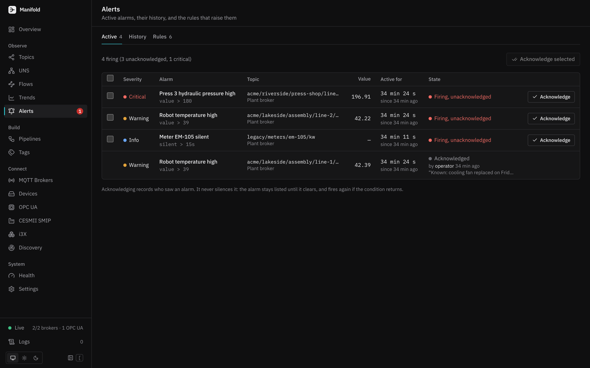
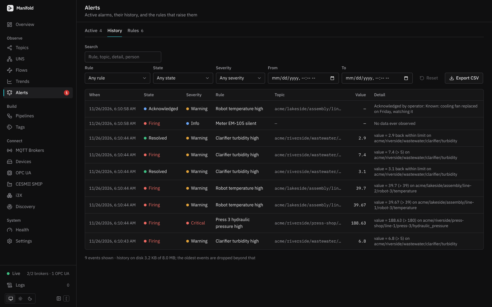

# 🔔 Alerts

Alert rules watch the namespace on the server and raise **alarms**. Everything about them is on one
page, **Observe → Alerts**, in three tabs:

| Tab | What it is for |
|---|---|
| **Active** | what is firing now, and value rules that are breached but not firing yet; acknowledge alarms here |
| **History** | every firing, resolution, acknowledgement and end, kept across restarts; filter and export CSV |
| **Rules** | add, edit and delete the rules (this used to be **Settings → Alert rules**; Settings now links here, and the old link `/settings?tab=alerts` opens this tab) |

The **Alerts** item in the sidebar shows a red count while any **critical** alarm is firing and nobody
has acknowledged it. The Overview's **Needs attention** list links each firing or breached rule
straight to its alarm on the Active tab (highlighted).

## Rules

| Rule | Fires when | Evaluated |
|---|---|---|
| 📉 Branch silent | nothing under a path for N seconds | every 15 s |
| 🔇 Topic silent | a specific topic stops for N seconds | every 15 s |
| 🆕 New topic | a topic appears (optionally under a prefix) | every 15 s |
| 📈 Value threshold | a numeric value crosses a limit | **per message**, as it arrives |

Every rule has a **severity**: *info*, *warning* (the default) or *critical*. Severity sorts the Active
tab, colours alarms, feeds the sidebar count (critical only) and labels the Prometheus series.

Value-threshold rules watch a topic's payload, or a dot-path `field` inside a JSON payload
(`motor.temp`), against `>`, `>=`, `<`, `<=`, `==`, `!=`. The topic may be an MQTT filter with `+` and
`#`; each concrete topic it matches is its own alarm. Two controls stop flapping:

- **Sustain** (`sustainMs`, the "for" time): the condition must hold continuously this long before the
  rule fires. While it waits the rule is *Breached* and the Active tab shows the time left.
- **Clear value** (`clearValue`, hysteresis): a `> 90` rule with clear value `85` fires at 90 but only
  resolves once the value is back at 85 or below, so a signal hovering at the limit cannot flap.

Silence rules already fire only after their threshold, so they need neither.

Rules can POST each firing and resolution to a **webhook** (5 s timeout, through the egress guard).
The webhook URL is a credential (for chat webhooks the path is the secret): once saved it is never
shown again, to any role. The editor shows *Set, calls https://hooks.example.com* with **Replace**
and **Remove**; saving without touching it keeps it. Over the API, a rule saved without `webhookUrl`
(or with `null`) keeps the stored URL, `""` removes it, and answers carry `hasWebhook` and
`webhookOrigin` instead.
Delivery failures are counted and the last error is shown on the Rules tab. Acknowledgements and
restart bookkeeping are not sent to webhooks.

Saving a rule over a newer version is refused (`409`, the editor shows both versions), and a rule
that names a broker that does not exist is refused (`400`). Deleting or disabling a rule ends its
active alarms at once, with an *Ended* event in the history.

## Acknowledging

An acknowledgement says "someone has seen this and is on it". It records **who** (the token's name
when the server has authentication, or `operator` on an open server, which cannot tell people apart),
**when**, and an optional **note** (up to 500 characters).

- It holds until the alarm **clears**, then it is dropped: if the condition comes back, that is a new
  alarm and it needs a new acknowledgement.
- It never silences anything. An acknowledged alarm stays on the Active tab until it clears, and a new
  occurrence always fires.
- Acknowledge one alarm with its **Acknowledge** button, or tick several and use **Acknowledge
  selected**. Each request carries the start time of the occurrence you were looking at; if that alarm
  cleared and fired again in the meantime the server refuses it, so nobody acknowledges an occurrence
  they have not seen.
- Viewer (read-only) sessions see acknowledgements but cannot make them.

## History

Every event is appended to `alerts.jsonl` in the data directory (`MANIFOLD_DATA_DIR`). The file is
size-capped in two segments, like file recordings: when the current file reaches half of
`MANIFOLD_ALERT_HISTORY_MAX_BYTES` (default 8 MiB) it becomes `alerts.jsonl.1` and a new file starts,
so the history stays within the cap and always keeps the newest events. The History tab shows how much
of the cap is used.

Writes are queued and flushed in the background (every 250 ms), so a slow disk never delays an alarm.
A clean shutdown writes everything queued; a crash can lose the last fraction of a second. A line cut
off by a crash is skipped on the next start (and counted in the start-up log), never glued to the next
record.

Event states in the history:

| State | Meaning |
|---|---|
| Firing | the rule fired (per topic for value rules) |
| Resolved | the condition cleared |
| Acknowledged | someone acknowledged the alarm, with their note |
| Ended | the alarm was closed without its condition clearing: the rule was deleted or disabled, or the server restarted |
| Event | a new-topic rule saw a new topic (these do not stay active) |

Filters: text (rule name, topic, detail, person, note), rule, state, severity, and a time range.
**Load older** pages back 100 events at a time. **Export CSV** downloads every event that matches the
filters, not only the loaded pages; text cells that a spreadsheet would run as a formula are prefixed
with `'`.

### What a restart does to active alarms

The engine keeps no alarm state across a restart: it starts with every rule idle and works the state
out again from live data (silence rules on their first pass from the topics' last activity, value
rules from the next message, which for retained topics arrives as soon as the broker reconnects).
So alarms that were active at shutdown are **closed with an *Ended* event** ("Ended by restart"),
not restored. If the condition still holds, the rule fires again from live data as a new,
unacknowledged alarm. Restoring them instead would either fire the same alarm twice or leave one
active for ever that nothing could resolve.

## API

| Method | Path | |
|---|---|---|
| `GET` | `/api/alerts/active` | active alarms (`id`, `ruleId`, `ruleName`, `severity`, `type`, `topic`, `value`, `since`, `state` firing/breached, `condition`, `remainingMs`, `acknowledged`, `ack: { by, at, note }`) and `counts` (`firing`, `breached`, `unacknowledged`, `unacknowledgedCritical`) |
| `POST` | `/api/alerts/ack` | `{ ruleId, topic?, note?, since? }` acknowledges one alarm (value rules need the `topic`); `{ ruleId, all: true }` every firing alarm of the rule. `409 not-firing` if it is not firing, `409 stale` if `since` names an earlier occurrence. Admin only |
| `GET` | `/api/alerts/history` | `?cursor=&limit=&ruleId=&state=&severity=&q=&from=&to=`, newest first; `state` and `severity` take comma lists, `from`/`to` epoch ms or ISO; pass the returned `nextCursor` for the next page. `&format=csv` exports every match |
| `GET` | `/api/alerts/rules` | rules with the engine's state on each (`idle`, `breached`, `firing`, `disabled`, `broken`), severity, unacknowledged count and webhook health; no role sees webhook URLs (`hasWebhook`, `webhookOrigin` instead) |
| `POST` | `/api/alerts/rules` | create or edit (upsert by id, `rev` for optimistic concurrency); `severity` is `info`, `warning` or `critical` |
| `DELETE` | `/api/alerts/rules/:id` | delete (its active alarms end) |
| `GET` | `/api/alerts/events` | the newest events from memory (`?ruleId=` for one rule) |

Socket events: `alert` (every event, acknowledgements included) and `alert-state` (a rule's state
changed, including when it is acknowledged).

The MCP server has `alerts_active` and `alert_history` (read-only) next to `alert_rule_save`,
`alert_rule_delete` and `alert_events`. It does not acknowledge alarms: that is left to people.

## Metrics

| Metric | Meaning |
|---|---|
| `manifold_alerts_active` (`state` firing/breached, `severity`) | active alarms; every combination is present, zero included |
| `manifold_alerts_unacknowledged` (`severity`) | firing alarms nobody has acknowledged |
| `manifold_alert_transitions_total` (`state`, `severity`) | events since the server started |
| `manifold_alert_history_bytes`, `manifold_alert_history_write_errors_total` | size of the history on disk, failed writes |
| `manifold_alert_events` | events in the in-memory ring |

An alerting rule in Prometheus on `manifold_alerts_unacknowledged{severity="critical"} > 0` pages
someone when a critical alarm sits unacknowledged.
