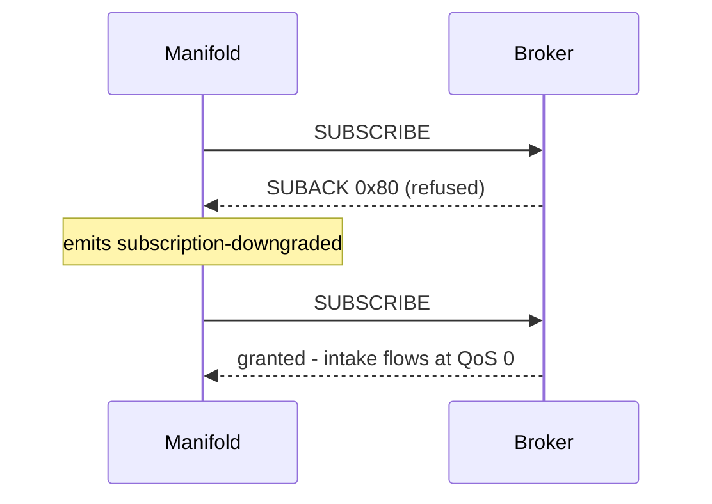
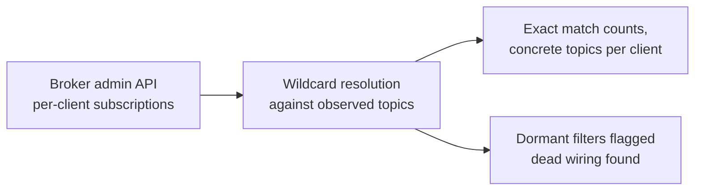
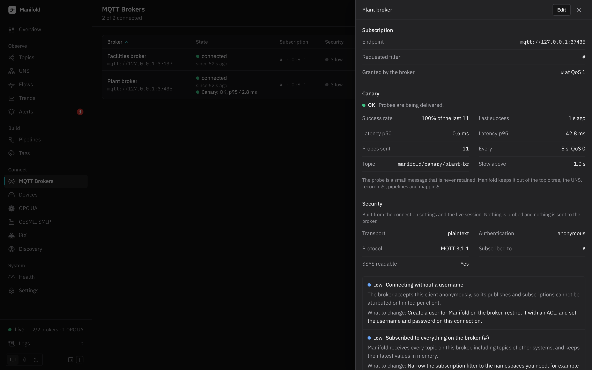

# 🔌 Broker setup

> **Goal:** durable intake from any broker, plus the extras — consumer
> lineage and per-client rates — that need a broker admin API.

## Intake QoS — what it means and why it matters

Manifold subscribes to `#` at **QoS 1** by default: if the connection hiccups,
the broker retransmits anything Manifold didn't acknowledge, so pipelines and
historians don't silently lose samples. It's configurable per broker
(the broker's **Connection settings** → **Subscribe QoS (intake durability)**). `$SYS/#` always uses QoS 0 — losing one
diagnostics sample is meaningless.

When a broker **refuses** the wildcard grant, Manifold reacts instead of going
quiet:



## ⚠️ EMQX: the silent deny

Stock EMQX ships an ACL that denies `#` and `$SYS/#` subscriptions at QoS 1+
from non-localhost clients — and because its default
`authorization.deny_action` is `ignore`, the denial is **invisible**: the
SUBACK reports success, the subscription simply never exists, and no client
in the world can detect it. The symptom is a connected broker with an empty
topic tree.

**Fix — allow the intake user in `etc/acl.conf`** (the allow rule must come
before the stock deny):

```erlang
%% Manifold intake — allow wildcard subscription at any QoS
{allow, {username, "manifold"}, subscribe, ["#", "$SYS/#"]}.

%% stock rules follow
{allow, {ipaddr, "127.0.0.1"}, all, ["$SYS/#", "#"]}.
{deny, all, subscribe, ["$SYS/#", {eq, "#"}]}.
{allow, all}.
```

<details>
<summary>Throwaway containers (CI, local testing) — clear authorization entirely</summary>

```yaml
environment:
  EMQX_AUTHORIZATION__NO_MATCH: allow
  EMQX_AUTHORIZATION__SOURCES: '[]'
```

Never do this on a shared broker — scope the allow rule to the intake user
instead.

</details>

Alternatively set the broker's *Subscribe QoS* to **0** in Manifold and accept
fire-and-forget intake.

## Mosquitto

Wildcard subscriptions work at any QoS out of the box — nothing to configure.
One honest limitation: Mosquitto has **no admin API** that lists live
per-client subscriptions (`mosquitto_ctrl` manages accounts and ACLs), so the
Flows → Consumers view falls back to observed-traffic resolution there.

## Admin APIs — unlocking consumer lineage

The Flows page answers *"who receives what?"* by fetching per-client
subscriptions from the broker's admin API and resolving every wildcard filter
against the topics actually observed:



Configure under **Flows → Consumers** (the **Broker admin connection** region):

| Broker | API | Extras |
|---|---|---|
| EMQX v5 | REST, API key + secret | cumulative per-client counters, diffed into live msg/s per client |
| HiveMQ Enterprise | REST | per-client subscriptions |

Keys are stored server-side only and never echoed back.

## Public test brokers

The **Connect a broker** form has a short list of well-known public test brokers (EMQX public broker,
with and without TLS, HiveMQ public broker, Mosquitto test broker). A preset only fills in the form; you
still press **Connect**.

> **These are public.** Anything you publish is visible to everyone, and anyone can publish to them.
> Do not use them with plant data.

- A preset subscribes to the narrow filter `testtopic/#`, not `#`: a root subscription on a public
  broker is a firehose of strangers' data. Change it in **Connection settings** if you want more.
- If a broker's access rules refuse the root wildcard you ask for, Manifold does not sit quietly with no
  data. It walks a ladder, `#` then `+/#` then `+/+/#`, retrying each step at the intake QoS and then QoS 0,
  and reports every step (a warning in the log and a toast). The **Subscription** column shows what the
  broker actually granted, marked *(fallback)*, and the broker details explain it. `+/+/#` misses only
  topics with a single level. A narrow filter that is refused is reported as an error, not widened.
- The `$SYS` subscription is quiet: public brokers often refuse it, and that is not an error.
- Presets go through the normal add path, so adding the same one twice is refused like any duplicate. The
  host names are public, so they pass the [egress guard](Operations#network-safety-egress-guard).
- **The host names and ports were written from memory**, not checked against the operators' current
  documentation (`broker.emqx.io` 1883 and 8883, `broker.hivemq.com` 1883, `test.mosquitto.org` 1883;
  `server/services/brokerPresets.js`). Only these well-known entries are listed; the operators' other TLS
  and WebSocket ports are not. If a preset does not connect, check the operator's page and use the normal form.

## Broker canary (opt-in round-trip probe)



A connected session does not prove that the broker delivers. The canary does:

1. every few seconds Manifold **publishes** a small JSON message (never retained) to a canary topic,
2. receives it back through its own subscription,
3. measures publish-to-deliver latency.

**It is off by default**, because it publishes to your broker. Turn it on per broker in the connect or
edit form (**Canary (optional)**): topic, QoS, interval (5 to 3600 s, default 30) and the latency that
counts as slow (default 1000 ms).

| Setting | Default | Notes |
|---|---|---|
| Topic | `manifold/canary/<first 8 characters of the broker id>` | A custom topic must start with `manifold/canary/` followed by a name, and may not contain a level used by command, request or Sparkplug topics (`set`, `get`, `cmd`, `cmnd`, `command`, `rpc`, `down`, `api`, `write`, `_CLIENTS`, `NCMD`, `DCMD`, `spBv*`), so the canary can neither hide a real data topic nor publish a command. Give your broker's ACL a rule for it |
| QoS | 0 | A QoS above 0 whose subscription is refused is retried at QoS 0 once |
| Interval | 30 s | The probe times out after 80% of it (at most 10 s) |

States, over a rolling window of the last 30 probes:

| State | Meaning |
|---|---|
| **OK** | probes are delivered and the 95th percentile is under the slow threshold |
| **Slow** | delivered, but the 95th percentile is above the threshold |
| **Failing** | two probes in a row were not delivered (or under half of at least six were) |
| **Not permitted** | the broker refused the canary **subscribe** (SUBACK refused), or answered the **publish** with "not authorized" (MQTT 5). The details say which |
| Waiting, Not running | no probe has finished yet, or the broker is not connected |

The details show success rate, p50 and p95 latency, time since the last success and the last problem.
A broker that **silently drops** a publish (QoS 0, no error) cannot be told apart from a broken one: it
reads *Failing* and the message names the possibility. A broker that closes the connection on a publish it
refuses (Aedes, some Mosquitto setups) also reads *Failing*, with that explanation.

Where it shows: the broker list and details, `/metrics` (`manifold_broker_canary_*`), the MCP tool
`mqtt_broker_canary`, and Overview **Needs attention** when it is failing or not permitted. It follows
broker edits (an edit reconnects, so the window starts again) and goes away with the broker.

**It stays out of your data.** The canary's deliveries are taken out before the topic store, so they never
reach the topic tree, the UNS, recordings, pipelines, mappings, alerts or the broker's message counters.
Everything under `manifold/canary/` is ignored on every broker, so another Manifold's canary on a shared
broker does not appear either.

## Security posture

Each broker's details list what is weak about the connection. It is read from the settings and the live
session: **nothing is probed and nothing extra is sent**. Findings are listed worst first, each with a
severity (high, medium, low, info), a plain explanation and what to change. There is no score. The broker
list shows a compact count such as *1 high, 2 medium*.

| Finding | Severity | When |
|---|---|---|
| Password sent unencrypted | high | a password on a plain `mqtt://` or `ws://` connection |
| Certificate verification is off | high | TLS with *Verify TLS certificate* unchecked |
| Certificate expired, or expires in under 7 days | high | read from the TLS session (plain TLS only; not available over WebSocket) |
| Another client uses this client ID | high | the broker closed this session with MQTT 5 reason "session taken over" |
| Connection is not encrypted | medium | plain `mqtt://` or `ws://` |
| Certificate expires in under 30 days | medium | |
| Connecting without a username | medium | anonymous |
| Connection keeps dropping | medium | 5 or more unexpected disconnects in 5 minutes (a common cause is a shared client ID) |
| Subscribed to everything (`#` or `+/#`) | low | what the broker granted, not just what was asked |
| `$SYS` topics are readable | low | `$SYS` messages were received |
| MQTT 3.1.1 | info | |

A **loopback** host (`localhost`, `127.x`, `::1`) lowers the findings about traffic crossing a network,
because nothing leaves the machine. A LAN address does not: plaintext on a plant network is a real finding.
The details also list the facts behind the findings (transport, certificate days left, authentication,
protocol, subscription). The same data is at `GET /api/mqtt/brokers/:id/posture` and in the MCP tool
`mqtt_broker_posture`.

## Transports, TLS, and MQTT 5

The connection form takes four transports:

| Protocol | Transport | Notes |
|---|---|---|
| `mqtt` | plain TCP | default, port 1883 |
| `mqtts` | TLS | for a private CA paste its certificate; for a test broker with a self-signed certificate untick *Verify TLS certificate* (a high posture finding) |
| `ws` | WebSocket | set the **path** — there is no universal default (Mosquitto `9001`, EMQX `8083/mqtt`, proxies `443`); Manifold defaults to `/mqtt` |
| `wss` | WebSocket over TLS | same path rule |

**MQTT 5** is opt-in per broker. On a v5 session, user properties, content
type, response topic, and correlation data show up on inbound messages, and
user properties / content type / response topic can be set when publishing.
On v4 sessions these properties are dropped rather than sent (the protocol
has nowhere to put them).

## Intake filter and shared subscriptions

The auto-subscribe filter defaults to `#` but is configurable per broker —
scope intake to a namespace (`plant7/#`) or use a **shared subscription**:

```
$share/manifold/#
```

Messages still arrive on their real topics, so everything downstream (UNS,
pipelines, historians) works unchanged — but the broker load-balances the
stream across every member of the `manifold` share group. That's the knob for
splitting intake across multiple Manifold instances on a very busy broker.

> ⚠️ A shared subscription means *this instance sees only its share* — don't
> use one on the instance that is supposed to render the complete UNS.

Broker connections **edit in place**: change the host, transport, version, or
intake filter in the broker's edit dialog (the pencil on its row) and Manifold reconnects with the new
settings — no delete/re-add, no lost history.
