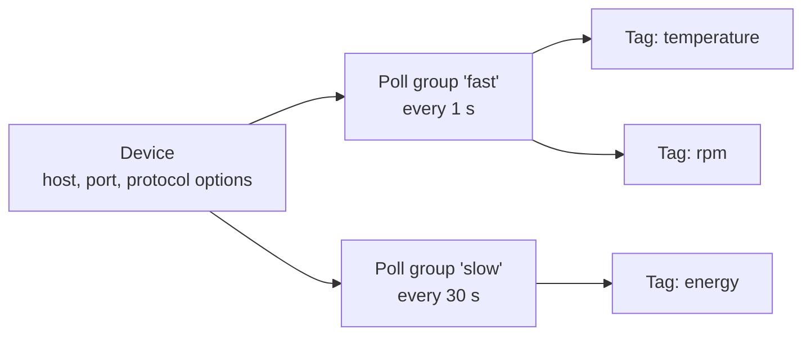
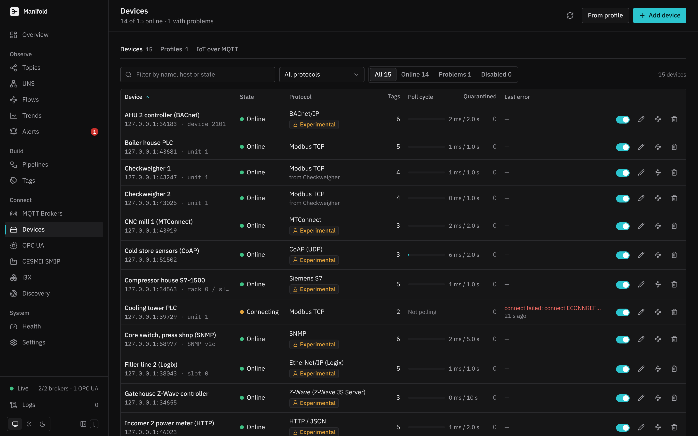
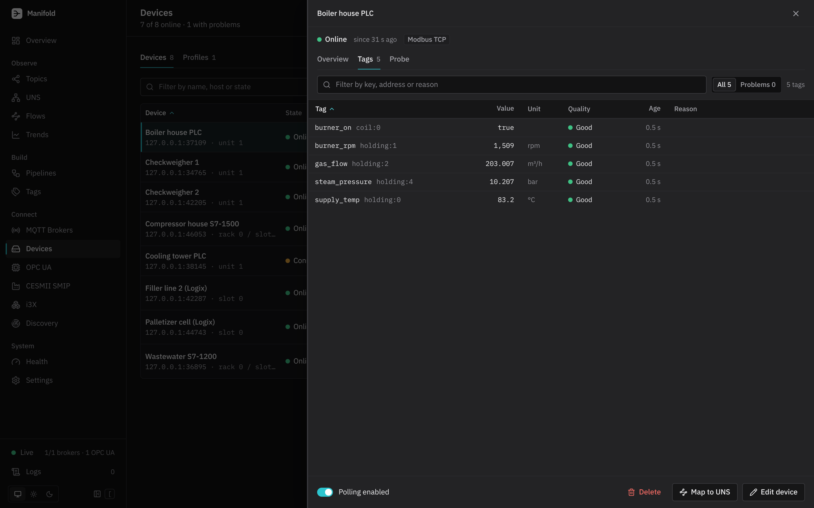
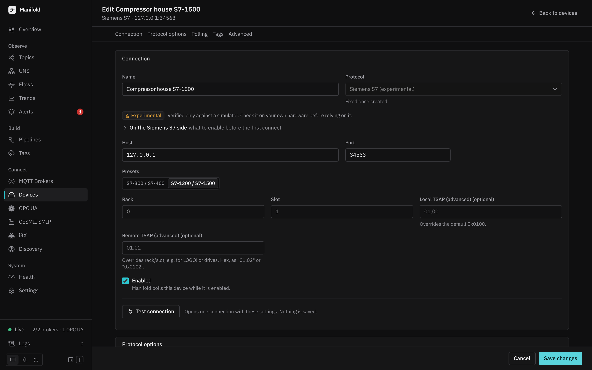
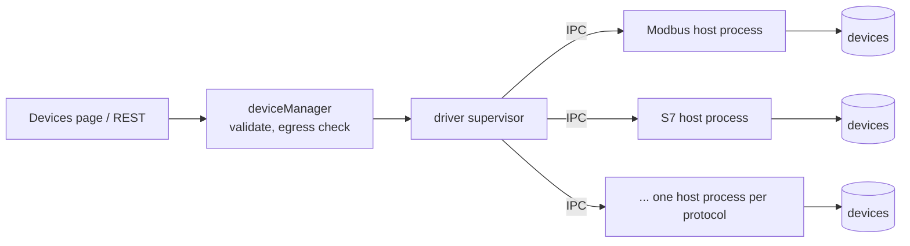

# 🔧 Devices and Drivers

> **Goal:** read PLCs, controllers, meters, building automation, network gear and sensors directly,
> see whether they are healthy, and turn their tags into values you can map into the UNS.
> **Manifold only reads from devices.**

Manifold already speaks OPC UA. If the device has an OPC UA server you can
license and use, prefer it: it carries types, names and authentication. The
drivers here are for the many devices that only speak other protocols.

This page is the reference for adding and running devices: start with the table below and
[The Devices page](#the-devices-page), then read the section for your protocol.

**Contents:** [Drivers at a glance](#drivers-at-a-glance) · [Concepts](#concepts) ·
[The Devices page](#the-devices-page) · [Common to every driver](#common-to-every-driver) ·
[The drivers](#the-drivers) ([Modbus TCP](#modbus-tcp), [S7](#siemens-s7),
[EtherNet/IP](#ethernetip-logix), [BACnet/IP](#bacnetip), [SNMP](#snmp), [HTTP/JSON](#http--json),
[MTConnect](#mtconnect), [CoAP](#coap)) · [Profiles and bulk creation](#device-profiles-and-instances) ·
[Discovery](#finding-devices-on-the-network-discovery) · [Polling health](#polling-health) ·
[Not yet verified](#what-is-not-yet-verified) · [Try it without hardware](#try-it-without-hardware)

## Drivers at a glance

| Driver | `protocol` | Status | Transport, default port | Browse | The only requests it can build |
|---|---|---|---|---|---|
| [Modbus TCP](#modbus-tcp) | `modbus-tcp` | supported (simulator-tested) | TCP 502 | no | function codes 1 to 4 |
| [Siemens S7](#siemens-s7) (S7comm) | `s7` | experimental | TCP 102 | no | setup, Read Var, SZL read |
| [EtherNet/IP](#ethernetip-logix) (Logix) | `ethernet-ip` | experimental | TCP 44818 | **Import from controller** | CIP read and connection services |
| [BACnet/IP](#bacnetip) | `bacnet-ip` | experimental | UDP 47808 | **Import from device** (object list, names, units) | unicast Who-Is, ReadProperty, ReadPropertyMultiple |
| [SNMP](#snmp) v1 / v2c / v3 | `snmp` | experimental | UDP 161 | **Import from agent** (bounded subtree walk) | Get, GetNext, GetBulk |
| [HTTP / JSON](#http--json) | `http-json` | experimental | TCP 80 / 443 | **Import from device** | `GET` without a body |
| [MTConnect](#mtconnect) | `mtconnect` | experimental | TCP 5000 | **Import from agent** | `GET /probe`, `/current`, `/sample` |
| [CoAP](#coap) | `coap` | experimental | UDP 5683 (no DTLS) | **Import from device** (`/.well-known/core`) | `GET` (and the empty CoAP ping / ACK messages) |
| [Matter](Bridge-Servers) via Matter Server | `matter-server` | experimental | WebSocket 5580, path `/ws` | **Import from server** | six allow-listed read commands |
| [Z-Wave](Bridge-Servers) via Z-Wave JS Server | `zwave-js` | experimental | WebSocket 3000 | **Import from server** | five allow-listed read commands, answered from the server's cache |

**What "experimental" means.** Every driver except Modbus TCP carries the same notice in these
docs and an **Experimental** badge in the UI: **Experimental — not verified on real hardware.** It was checked only against an in-process
simulator in `server/test/support/`, written together with the driver. The simulators show that
driver and simulator agree, not that either matches real firmware. Each driver's `NOTES.md` lists
the deviations it handles, what is not supported and what to confirm on a real device; the ordered
procedure is [Verifying on real hardware](Verifying-on-Real-Hardware). Modbus TCP is called
"supported" only because it is the simplest protocol and the best tested against its simulator;
**it has not been run against real devices either.**

Matter and Z-Wave are read through their bridge servers; they have their own page,
[Matter and Z-Wave bridge servers](Bridge-Servers). Zigbee, Z-Wave, Tasmota, Shelly, Home
Assistant and LoRaWAN devices that a bridge or gateway already publishes over MQTT are not polled
by a driver at all: Manifold reads them from the broker (**Devices → IoT over MQTT**, see
[IoT devices over MQTT](IoT-Devices-over-MQTT)).

## Concepts



- **Device**: one physical thing at one `host:port`. Manifold opens exactly one
  connection to it and shares that connection between all of its poll groups,
  one request at a time.
- **Poll group**: a name and an interval (at least 100 ms). Tags that change
  slowly belong in a slow group so they do not cost reads every second.
- **Tag**: a `key` (what you call it in Manifold: 1 to 128 characters of
  `A-Z a-z 0-9 _ . - : [ ]`), a device `address`, a `type`, and optional decode
  settings, unit, description and a UNS `property` name.

The **key and address are not the UNS name.** The address is where the value
lives in the device (`DB10.DBD4`, `40012`). What the topic is called is decided
when you map the tag; see [Mapping to the UNS](Mapping-to-the-UNS).

## The Devices page



**Devices** (`/devices`) has three tabs: **Devices**, **Profiles** and **IoT over MQTT** (see [IoT devices over MQTT](IoT-Devices-over-MQTT)). The header offers a refresh
button, **From profile** (create a device from a profile, see below) and the primary **Add device**.
Under the tabs, a banner appears when a driver host is **restarting** or **parked**.

**The table.** One row per device: **Device** (name, `host:port`, and the unit, rack/slot or route
path), **State**, **Protocol** (with an *Experimental* badge for every experimental driver and a "from
&lt;profile&gt;" line for profile instances), **Tags**, **Poll cycle** (a meter of the average cycle
time against the interval, for example `1 ms / 1.0 s`), **Quarantined**, **Last error** (with how
long ago), a **Polling enabled** switch and row actions (edit, map to the UNS, delete). Filter by
name, host or state, by protocol, and with the chips **All**, **Online**, **Problems**, **Disabled**.
The subtitle states the position ("14 of 15 online · 1 with problems").

**The detail drawer.** Click a device name to open a drawer with the state and the time it
began, and three tabs:

- **Overview**: Summary, **Poll groups** (interval, cycle-time meter, last cycle, overruns,
  status), **Counters and device exceptions** (Connects, Requests, Timeouts, and each protocol
  exception by name and code), **Errors**, and the list of **Quarantined tags** with the
  device's reason.
- **Tags**: the live table: tag key and address, **Value**, **Unit**, **Quality** (Good,
  Uncertain, Bad), **Age** and **Reason**. Filter by key, address or reason; **All** and
  **Problems**. Values refresh from the `device-values` stream (see
  [ARCHITECTURE.md](https://github.com/zbest1000/manifold/blob/main/ARCHITECTURE.md#socketio-events)).
- **Probe**: read raw registers or bytes at one address and see every decoding (below).

The drawer's footer has the **Polling enabled** switch, **Delete**, **Map to UNS** (opens the
[Tags page](Mapping-to-the-UNS#the-tags-page-and-the-mapping-editor) on this device) and
**Edit device**. For a driver that can list its points, **Import from controller** (EtherNet/IP),
**Import from device** (HTTP/JSON, BACnet/IP, CoAP) or **Import from agent** (MTConnect, SNMP) or **Import from server** (Matter, Z-Wave) also appears here.



**The form** (**Add device**, or **Edit device**) is a full page with a sticky section strip
**Connection, Protocol options, Polling, Tags, Advanced** and a footer with **Cancel** and
**Create device** / **Save changes**. Errors show inline after the first save attempt.

| Section | What is in it |
|---|---|
| **Connection** | **Name**, **Protocol** (fixed once created), the *Experimental* note ("Verified only against a simulator...") for every experimental driver, a disclosure **On the &lt;protocol&gt; side** with what to enable on the PLC before the first connect (open by default while creating), **Host**, **Port**, the protocol's own fields (Modbus **Unit ID**; S7 **Presets** *S7-300 / S7-400* (rack 0, slot 2) and *S7-1200 / S7-1500* (rack 0, slot 1), **Rack**, **Slot**, and advanced **Local TSAP** and **Remote TSAP**; EtherNet/IP **Slot** and route path), **Enabled**, and **Test connection** ("Opens one connection with these settings. Nothing is saved."), which answers with *Connected in N ms* and the identity or with *Could not connect* and the reason |
| **Protocol options** | Defaults for every tag, such as Modbus **Byte order**, **Word order**, **Address base**, **Max registers per read**, **Max gap to bridge**; a tag can override them in its own row |
| **Polling** | **Poll groups** (id and interval, at least 100 ms) and the **Limits** (request deadline, connect timeout, delay between requests) |
| **Device profile** | Shown when the device is a profile instance: the parameter values (see below) |
| **Tags** | The tag table: **Add tag**, **Import / paste** (a CSV or a block copied from a spreadsheet; header names are matched in any order: `key, address, type, pollGroup, scale, offset, unit, property, description, length, bit, byteOrder, wordOrder`), **Import from controller** / **device** / **agent** (drivers that can browse), **Export CSV**, **Probe**, **Advanced columns**, a filter and paging for long lists. Each row is validated by the driver as you type. Pasting a multi-cell block into any cell fills rows from there |
| **Advanced** | **Unmapped register ranges** (Modbus: *Table*, *From offset*, *To offset*; the planner never reads across them) and **Run this device in its own driver process** (`isolate`) |



For EtherNet/IP, **Import from controller** opens a tree of the controller's own tag list
(controller scope, programs, UDT members, External Access; arrow keys and Enter drive it) and
appends the tags you tick, with generated keys and suggested property names. EtherNet/IP tags
may omit the type: it is resolved from the controller.

**Probe** reads one address, with a count (and unit id for Modbus), and shows the raw bytes
decoded under every plausible type and, for Modbus, all four byte and word orders. Use it to find
the right word order before you create the tags. Probing is a read and cannot write.

### Where the polling runs



Drivers run in **separate child processes**, one per protocol. A driver that
crashes, hangs or corrupts memory takes down only its own process: the
supervisor restarts it with a growing delay (0.5 s doubling to 30 s), kills it
if it stops answering heartbeats, and **parks** it after more than five
crashes in a minute (the Devices page shows a "Driver parked" badge and a
banner). Every tag the process owned shows as Bad while it is down.

## Common to every driver

**Connection fields.** Every device has a **Name**, a **Protocol** (fixed once created), **Host**
and **Port**, **Enabled**, poll groups and **Limits** (request deadline, connect timeout, delay
between requests). A device saved without limits runs with its **driver's default limits**, not a
generic 2 s deadline: CoAP needs about 10 s for its retransmissions, BACnet/IP its APDU timeout
times its retries. **Test connection** opens one connection with the form's settings and saves
nothing.

**URL-based drivers** (HTTP/JSON, MTConnect, Matter Server, Z-Wave JS) share one set of fields:
**Scheme** (`http`/`https` or `ws`/`wss`), **Host**, **Port**, **Path**, **Bearer token** and the
three TLS settings. Pasting a whole URL (`https://meter.local:8443/api/v1`,
`ws://ha.local:5580/ws`) into **Host** fills scheme, host, port and path. **TLS is verified**: for
a private CA paste the CA certificate; for a self-signed device pin its SHA-256 fingerprint; **Do
not verify the TLS certificate** is an explicit per-device opt-out.

**Secrets.** One rule for every driver: a secret is a descriptor field of type `password` (the
HTTP passwords, tokens and custom header value, the SNMP community and v3 passwords, the bridge
servers' bearer token). It is stored with the device on the server and passed to the driver
process, but **every API answer carries a stored secret as `null`** (list, save, bulk,
instantiate and the `409` conflict body); the form shows *stored, leave blank to keep*. An edit
that leaves a secret out, blank or `null` keeps the stored value (same protocol only), and a
secret the settings no longer use (a token after switching to basic authentication, a community
after switching to SNMPv3) is dropped. Config export and the audit log redact them.

**Quality.** A tag's quality is always one of Good (192), Uncertain (64) or Bad (0), with a reason
such as `disconnected`, `quarantined`, `unit-down`, `device-exception`, `decode` or
`unavailable`; each driver section lists its own reasons. Bad is never silently replaced by the
last good value. Drivers that know the device's own time (HTTP/JSON with `timestampSelector`,
MTConnect) report it as the sample's source time; the others, CoAP SenML included, use the read time.

### Egress: which addresses a device may use

Device hosts pass the egress guard when you save, test or start a device (the
Discovery scan checks every candidate address too, with the same flags; see above).
Private networks are refused unless `MANIFOLD_ALLOW_PRIVATE_TARGETS=1` (the
normal setting on a plant network). **Loopback is refused** unless
`MANIFOLD_ALLOW_LOOPBACK_DEVICES=1`, which exists for local simulators and
should stay off in production. Cloud-metadata and link-local ranges are always
refused. See [Operations](Operations#network-safety-egress-guard).

The UDP drivers (BACnet/IP, SNMP, CoAP) send only to the pinned address, unicast; nothing is broadcast or multicast. The SNMP driver's socket (`server/drivers/runtime/udpTransport.js`) also re-checks the egress policy in the driver process and drops answers from other addresses unless the device allows them.

### The read-only guarantee, and its limits

Every driver builds all of its outgoing frames through one function with an
allowlist, and the tests try every refused service and assert that no bytes
reach the socket:

- **Modbus:** function codes 1, 2, 3 and 4 only.
- **S7:** setup communication, Read Var and SZL reads only. Write Var, PLC
  start/stop, block transfer and clock set are refused.
- **EtherNet/IP:** session management, Forward Open/Close, Read Tag, Read Tag
  Fragmented, Multiple Service Packet (every inner service checked), and
  attribute/template reads. The client also re-parses each buffer before
  `socket.write`.
- **HTTP/JSON and MTConnect:** one shared HTTP client whose only request is
  `GET` with no body (a test asserts this against the client source and the
  simulators log every method they see). MTConnect sends only `/probe`,
  `/current` and `/sample`.
- **BACnet/IP:** BVLC Original-Unicast only, no network-layer messages, and
  the APDUs ReadProperty, ReadPropertyMultiple (unsegmented) and Who-Is.
  WriteProperty, COV subscriptions, device control, BBMD registration and every
  other service are refused before a datagram is built.
- **CoAP:** the encoder can only build GET (there is no method parameter), and
  every datagram is checked again before the UDP socket: only an empty message
  or a GET leaves. PUT, POST, DELETE, FETCH, PATCH and iPATCH do not exist in
  the code, and the tests assert the simulator never sees one.
- **SNMP:** GetRequest, GetNextRequest and GetBulkRequest only, every value
  NULL. There is no SetRequest encoder at all; the message layer refuses to
  wrap any other PDU, and the tests check every datagram the driver sent.
- **Matter Server and Z-Wave JS Server:** a short list of allow-listed read commands each; see
  [Matter and Z-Wave bridge servers](Bridge-Servers#read-only-and-what-is-not-verified).

What this does and does not mean:

- It is a guarantee about **Manifold's code**, enforced where bytes are built,
  not by a configuration switch or the UI. No route, binding or transform can
  write to a device.
- It is **not** a guarantee about the **network**. Modbus TCP, S7comm, plain
  EtherNet/IP, BACnet/IP, SNMP v1/v2c, plain CoAP and the two bridge servers do not
  authenticate the client. If your site requires that nothing can write, use
  a firewall rule or a data diode as well.
- It does not protect the device from being **read too hard**. Polling is
  bounded (one connection, one request at a time, overruns skipped) but a very
  small PLC can still be loaded by an aggressive interval. Start slow.

## The drivers

Each section has the same shape: status, what to set up on the device, the device settings, tag
addresses and types, quality and errors, and what is not yet verified.

### Modbus TCP

> **Supported (simulator-tested), not verified on real hardware.** Transport: TCP 502. Browse: no (Modbus has no names). Driver notes: [`server/drivers/modbus/`](https://github.com/zbest1000/manifold/blob/main/server/drivers/modbus).

Nothing to enable. Modbus has no authentication, so anyone who can reach the
port can also write registers. Manifold sends only read function codes
(1 to 4); if you need a guarantee stronger than software, restrict the
network path as well.

**Unit ID.** `255` (or `0`) for a device you reach directly over TCP; `1` to
`247` selects one device behind a TCP-to-RTU gateway. Some devices only answer
one specific value; if you get timeouts with a good connection, try `1`.
A tag can override the unit ID, which is how one gateway's several slaves
share one connection.

**Addressing.** An address is either explicit or Modicon notation, and the
table is never guessed from a bare number:

| You write | Meaning | Wire address |
|---|---|---|
| `holding:100`, `input:0`, `coil:5`, `discrete:12` | table and number | the number, minus the device's **Address base** |
| `40001` (5 digits) | holding register 1 | 0 |
| `400001` (6 digits) | holding register 1 | 0 |
| `30001` / `300001` | input register 1 | 0 |
| `00001` / `000001` | coil 1 | 0 |
| `10001` / `100001` | discrete input 1 | 0 |

Modicon numbers are always 1-based: the leading digit selects the table and
the rest minus one is the wire offset. For `table:number` addresses, the
device option **Address base** decides: `0` if the manual lists wire offsets
(most modern devices), `1` if the manual counts registers from 1. If every
value is shifted by one register, this is the setting to change. A bare
number such as `100` is rejected as ambiguous.

**Types and order.** Types are `bool`, `int16`, `uint16`, `int32`, `uint32`,
`int64`, `uint64`, `float32`, `float64` and `string`. A `bool` on a holding or
input register needs a `bit` (0 to 15); on a coil it is the coil itself. Two
device options (overridable per tag) say how multi-register values are laid
out:

| Option | Values | Meaning |
|---|---|---|
| Byte order | `big` / `little` | order of the two bytes inside each 16-bit register |
| Word order | `big` / `little` | order of the registers in a 32/64-bit value; `little` is the common "word-swapped" CDAB layout |

The four combinations are the familiar ABCD (big/big), CDAB (word order
little), BADC (byte order little) and DCBA (both little).

**Finding the right order with Probe.** Save the device, then open **Probe**:
enter an address and a register count and Probe reads the raw registers and
shows the same bytes decoded all four ways (int16, uint16, int32, uint32,
float32). Pick the row where you know the right answer (a temperature you can
see on the device's own display). Use that row's byte and word order on the
tag. You can also call it directly:

```bash
curl -X POST http://localhost:5000/api/devices/<id>/probe \
  -H 'Content-Type: application/json' \
  -d '{"address":"holding:4","count":2}'
```

Other tag settings: `scale` and `offset` (value × scale + offset),
`sentinels` (raw values meaning "unavailable", such as `-32768`: the tag
turns Bad instead of publishing the number), string `length` in registers, and
a device-level **max registers** (125 is the protocol limit; many devices
accept fewer) and **max gap**. Max gap is how many unused registers one block
read may span; it defaults to **0** because many devices answer a read over an
unmapped register with an error. Ranges known to be unmapped can be listed under
**Advanced → Unmapped register ranges** in the device form (`options.unmapped` in the API) and
are never crossed.

**Not yet verified.** **Modbus TCP** is tested against a fault-injecting simulator (late replies,
  wrong transaction ids, dropped sockets, truncated frames, exceptions).
  Interoperability with specific devices has not been surveyed: **no driver, Modbus
  included, has been run against a real PLC**; the simulators were written together with
  the drivers, so they show agreement, not correctness against firmware.

### Siemens S7

> **Experimental — not verified on real hardware.** Transport: TCP 102. Browse: no (classic S7comm has no tag list). Driver notes: [`server/drivers/s7/NOTES.md`](https://github.com/zbest1000/manifold/blob/main/server/drivers/s7/NOTES.md).

Classic S7comm cannot read "optimized" data blocks or use symbolic names. To
read a CPU, the PLC program has to allow it:

1. Use **global data blocks**. Instance DBs of optimized function blocks
   cannot be read.
2. For each DB you want to read: *Properties → Attributes → Optimized block
   access* **off**, then compile and download. Addresses are then absolute
   (`DB10.DBD4`).
3. CPU properties → *Protection & Security → Connection mechanisms →* **Permit
   access with PUT/GET communication from remote partner** on.
4. The protection level must not block HMI/read access.

> ⚠️ **Security implication.** Enabling PUT/GET makes those data areas readable
> **and writable** by anything that can reach the CPU, because S7comm has no
> authentication. Manifold never sends a write, but other clients could. Put a
> firewall rule or a read-only network segment in front of the CPU. Where the
> CPU's OPC UA server is licensed (S7-1500, recent S7-1200 firmware), it is the
> better route: it supports optimized blocks and authentication.

Device settings: **Rack** and **Slot** with presets (S7-300/400: 0 and 2;
S7-1200/1500: 0 and 1), or a raw **Remote TSAP** (for LOGO! and drives).
Addresses use Siemens absolute notation, English or German mnemonics:
`DB10.DBX0.1` (bit), `DB10.DBB2`, `DB10.DBW4`, `DB10.DBD8`, `M0.1`, `MB0`,
`MW2`, `MD4`, `I0.0` / `E0.0`, `IW2`, `Q0.0` / `A0.0`, `QB1`. The address says
where a value starts; the **type** (never inferred) says how many bytes and how
to decode them. `BOOL` needs a bit address. Types: BOOL, BYTE, WORD, DWORD,
LWORD, SINT, USINT, INT, UINT, DINT, UDINT, LINT, ULINT, REAL, LREAL, CHAR,
WCHAR, STRING, WSTRING, DATE, TIME_OF_DAY, DATE_AND_TIME, DTL, TIME, LTIME,
S5TIME. `STRING` and `WSTRING` take `length` = declared maximum characters.
All S7 values are big-endian; there is no byte-order setting. S7 tags do not
have `scale` or `offset`: scale in the mapping layer or at the consumer.

Adjacent tags in the same DB are merged into one block read (up to **Max gap**
bytes apart, default 8), and reads are split to fit the PDU the CPU negotiates.
Reads of a large value (bigger than one PDU) are several jobs, so the PLC can
change it between them.

**Not yet verified.** **S7**: [`server/drivers/s7/NOTES.md`](https://github.com/zbest1000/manifold/blob/main/server/drivers/s7/NOTES.md)
  lists 14 items to confirm with a packet capture on a real CPU before the
  driver leaves experimental: PDU accounting, items per request, return codes
  for a missing DB or optimized access, how a CPU with PUT/GET off refuses,
  rack/slot to TSAP, SZL layouts used for identity, string encoding and
  date formats.

### EtherNet/IP (Logix)

> **Experimental — not verified on real hardware.** Transport: TCP 44818. Browse: **Import from controller**. Driver notes: [`server/drivers/eip/NOTES.md`](https://github.com/zbest1000/manifold/blob/main/server/drivers/eip/NOTES.md).

Tags are read by name. For each tag the controller's **External Access** must
be *Read Only* or *Read/Write*; a tag set to *None* cannot be read and shows
as inaccessible.

> ⚠️ Plain EtherNet/IP has no authentication either: anything that can reach
> port 44818 can also write to the controller. Manifold only sends read
> services; use a read-only network path where you need a hard guarantee.

Device settings: **Controller slot** (CompactLogix: 0) or a full **Route path**
(`port,link` pairs such as `1,0` or `1,2,2,10.0.0.5,1,0`, which overrides the
slot), **Connection size** (`auto` tries a Large Forward Open of 4002 bytes and
falls back to 504), whether to **pack reads** into Multiple Service Packets,
and an optional cap on the packed reply size (some vendors, such as Omron
NJ/NX, fail large bundles). The driver holds one CIP connection on the
controller or its communication module.

Addresses are Logix names: `Tag`, `Program:MainProgram.Tag`, `Motor.Speed` (UDT
member), `Arr[3]`, `Arr[1,2]`, `Word.5` (bit of an integer). The type is
optional: it is resolved from the controller, and a declared type that
disagrees makes the tag Bad. Structures and STRINGs are decoded from the
controller's own template. EtherNet/IP tags have no `scale` or `offset`.

`GET /api/devices/<id>/browse` lists the controller's tags and data types
(controller scope, program scope, UDT members, External Access); the Devices
page's **Import from controller** is a tree over it.

**Not yet verified.** **EtherNet/IP**: [`server/drivers/eip/NOTES.md`](https://github.com/zbest1000/manifold/blob/main/server/drivers/eip/NOTES.md)
  lists 18 items, including the Large Forward Open parameters, Forward Close,
  attribute 10 (External Access), BOOL-array handling (the one most likely to
  be wrong), template sizes, Multiple Service Packet limits, behaviour after a
  controller download, and route paths through a bridge. The Rockwell and ODVA
  documents were not available when the driver was written.

### BACnet/IP

> **Experimental — not verified on real hardware.** Transport: UDP 47808. Browse: **Import from device** (object list, object names and units). Driver notes: [`server/drivers/bacnet/NOTES.md`](https://github.com/zbest1000/manifold/blob/main/server/drivers/bacnet/NOTES.md).

BACnet has no authentication: anything that can reach UDP port 47808 can
command the device. Manifold sends only **Who-Is** (unicast, to this device;
nothing is ever broadcast), **ReadProperty** and **ReadPropertyMultiple**. It
never writes, commands, or subscribes to COV (a subscription is itself a write
to the device), so values are polled.

Device settings:

- **Host** and **Port** (47808): the device, or the BACnet router in front of it.
- **Device instance** (optional): the device object number. Leave it empty and
  the driver learns it from the I-Am, or, when the device answers Who-Is only
  by broadcast (common; Manifold does not listen for broadcasts), by reading
  the device object at the wildcard instance 4194303. Set it when several
  devices share one IP address.
- **Network number** and **MAC address** (advanced): for a device behind a
  BACnet router (MS/TP, or B/IP on another network). MAC is `0`-`127` for MS/TP,
  `10.0.0.5:47808` for remote BACnet/IP, or hex bytes. A router that cannot
  reach the network says so in the device's last error.
- **ReadPropertyMultiple** `auto` / `on` / `off`, **Read status with values**,
  **APDU timeout** and **Retries** (all within the request deadline; slow
  MS/TP links need 3000 ms or more), and, under Advanced, **Max APDU** (to
  override a device that misreports), **Max properties per request** and
  **Requests in flight**.

Addresses are `object-type:instance[/property][[index]]`:

| Address | Reads |
|---|---|
| `analog-input:3` | present-value of AI 3 (short forms `ai:3`, `av:7`, `bi:1`, `msv:2` work too) |
| `analog-value:7/units` | another property, by name or number |
| `device:1234/object-list[0]` | an array element (index 0 is the array length) |
| `130:5/85` | a proprietary object type and property by number |

The tag type is optional: the value keeps the type the device sends (real ->
float32, double -> float64, unsigned/enumerated -> uint32, signed -> int32,
boolean, character strings in UTF-8, UCS-2 and ISO 8859-1, octet strings as hex,
dates, times and object identifiers as text, bit strings and arrays as
structures). Binary objects' present-value is a boolean. A declared type casts
the value.

**Quality.** With each present-value the driver also reads status-flags,
reliability and out-of-service: a reliability other than *no-fault-detected*
or the FAULT flag makes the tag **Bad** (the reason says which); out of
service makes it **Uncertain**. Turn **Read status with values** off to read
present-value alone.

**Import from device** lists the device's objects by type (read from
`object-list` by array index, so large lists work without segmentation);
importing a point takes its **object-name** as the UNS property and its
**engineering units** as the unit text (`°C`, `kPa`, `%`, ...).

Reads are packed into ReadPropertyMultiple requests that fit the device's
maximum APDU; Manifold does not accept segmented replies, so a reply that
would not fit is split, and a single value that never fits (a long array) is
quarantined with the advice to read it by index. A device without
ReadPropertyMultiple is read one property at a time.

**Not yet verified.** **BACnet/IP**: [`server/drivers/bacnet/NOTES.md`](https://github.com/zbest1000/manifold/blob/main/server/drivers/bacnet/NOTES.md)
  lists 10 items, among them which devices answer a unicast Who-Is by unicast,
  the wildcard device read, RPM sizing on small-APDU devices, routing through a
  real MS/TP router and devices that only reply to port 47808.

### SNMP

> **Experimental — not verified on real hardware.** Transport: UDP 161. Browse: **Import from agent** (a bounded GetBulk walk of a subtree). Driver notes: [`server/drivers/snmp/NOTES.md`](https://github.com/zbest1000/manifold/blob/main/server/drivers/snmp/NOTES.md). Also checked against the RFC test vectors.

On the device, enable the SNMP agent with a **read-only** community (v1/v2c)
or a v3 user with a read-only view, and allow Manifold's address in the
agent's access list. SNMP runs over **UDP 161**.

> ⚠️ v1 and v2c send the community in clear text. Use a read-only community:
> Manifold only sends Get, GetNext and GetBulk (it cannot encode a Set), but a
> read-write community that leaks lets anyone change the device. Use v3
> `authPriv` where the network is not trusted.

Device settings:

| Setting | Meaning |
|---|---|
| **SNMP version** | v1, v2c (default) or v3 (USM) |
| **Community** (v1/v2c) | stored on the server and **never sent back** to the browser: the edit form shows *stored, leave blank to keep*. Blank on a new device means `public` |
| **User name**, **Security level** (v3) | `noAuthNoPriv`, `authNoPriv` or `authPriv` |
| **Authentication** (v3) | MD5, SHA-1, SHA-224, SHA-256, SHA-384, SHA-512 (RFC 3414 / RFC 7860), with its password (at least 8 characters; stored and redacted like the community) |
| **Privacy** (v3, authPriv) | AES-128 (CFB) or DES, with its password |
| **Context name** (v3) | only for agents with several contexts |
| Max OIDs per request | default 20; lowered automatically after a *tooBig* answer |
| Max response size | default 1400 bytes (no IP fragmentation); requests are sized so the answer fits, and a v3 agent's own limit applies too |
| Retries | UDP is unreliable: each request is resent up to this many times (default 1) within the request deadline |
| Accept answers from another address | off: only answers from the device's address and port count. On for multi-homed agents that reply from a different interface |

Addresses are numeric OIDs (`1.3.6.1.2.1.1.3.0`) or a well-known name with
its instance: `sysDescr.0`, `sysUpTime.0`, `sysName.0`, `ifOperStatus.1`,
`ifInOctets.1`, `ifHCInOctets.1`, `ifName.1`, `hrProcessorLoad.196608`,
`hrStorageUsed.31`, `upsBatteryStatus.0`, `upsOutputVoltage.1`,
`entPhySensorValue.5`, and the rest of a small built-in table (system, IF-MIB,
ifXTable, HOST-RESOURCES, UPS-MIB, ENTITY-SENSOR, UCD). There is no MIB
compiler: other objects are entered numerically, or picked with **Import from
agent**, which walks a subtree (system, interfaces, ifXTable, host
resources, UPS-MIB, entity sensors, enterprises, all of mib-2) with GetBulk
(GetNext on v1), at most 500 rows or a few seconds per page, with a **More**
entry that continues.

The **type** is optional: blank accepts what the agent returns; a declared
type (Integer32, Counter32, Gauge32, TimeTicks, Counter64, OctetString, OID,
IpAddress, Opaque) that disagrees makes the tag Bad (`type-mismatch`). Values:

| SNMP type | Published as |
|---|---|
| Integer32 | `int32` |
| Counter32, Gauge32, TimeTicks | `uint32` (TimeTicks in hundredths of a second) |
| Counter64 | `uint64`, the value as a decimal string (like 64-bit integers from the other drivers) |
| OctetString | text when it is printable UTF-8, else colon hex (`00:1a:2b:3c:4d:5e`); the tag's **Text encoding** (`auto`, `text`, `hex`) overrides |
| OID, IpAddress | text |
| Opaque float / double (net-snmp) | `float32` / `float64`; other Opaque values as hex |
| noSuchObject, noSuchInstance, endOfMibView | Bad, with that reason |

**Rate /s** on a Counter32 or Counter64 tag publishes the per-second rate
instead of the raw counter (`float64`). The interval comes from the agent's
`sysUpTime`, read in the same request; a counter that wrapped is unwrapped,
and a `sysUpTime` that went backwards (the agent restarted) gives one Bad
`counter-reset` sample. The first sample after start is Bad `rate-warmup`.
Many agents refresh counters only every few seconds: poll no faster than that.
SNMP tags accept `scale` and `offset` for numeric values (e.g. UPS-MIB values
in tenths).

Error answers: a v1 agent's *noSuchName* with an error index marks only that
OID Bad (it is then not asked again for a minute), *genErr* without an index
is narrowed down by splitting the request, and *tooBig* splits the request
and remembers the smaller size. v3 problems are named: unknown user, wrong
authentication password or protocol (*wrong digest*), wrong privacy password
(*decryption error*), unsupported security level. An agent reboot (engine
boots/time) or a replaced agent (new engine ID) is re-synchronised without
going offline. A wrong v1/v2c community gets **no answer at all** from a real
agent, so the connection test lists what to check.

**Not yet verified.** **SNMP**: [`server/drivers/snmp/NOTES.md`](https://github.com/zbest1000/manifold/blob/main/server/drivers/snmp/NOTES.md)
  lists the agent deviations handled and what to check on net-snmp, a managed
  switch and a UPS card: tooBig handling, v1 noSuchName, every v3 auth/priv
  combination, engine reboot resync, counter rates against the device's own
  counters, multi-homed agents.

### HTTP / JSON

> **Experimental — not verified on real hardware.** Transport: TCP 80 / 443 (HTTP or HTTPS). Browse: **Import from device**. Driver notes: [`server/drivers/httpjson/NOTES.md`](https://github.com/zbest1000/manifold/blob/main/server/drivers/httpjson/NOTES.md).

For devices with a local REST API: energy meters, smart plugs, gateways,
sensors. Manifold sends **GET requests only, never a body**, and picks values
out of the JSON. The device is entered as a URL (see
[Common to every driver](#common-to-every-driver)): **Scheme** (`http` or `https`; https usually
means port 443), **Host**, **Port** and an optional **Path** prefix such as `/api/v1`.

A tag address is `path#selector`, for example `/api/status#$.power.total` or
`/meters#$.items[?(@.id=="main")].kwh`. The selector is a small JSONPath:
`$.a.b`, `$['key']`, `$.list[0]` (negative counts from the end) and an equality
filter `[?(@.id=="x")]` that takes the first match. Wildcards, `..`, slices and
script expressions are not supported and are refused when you save. The tag
types are `number`, `bool` and `string`; scale and offset belong to the mapping.
All tags on one path share **one request per poll cycle**, and an `ETag` is
sent back as `If-None-Match` when the device provides one. Optional tag fields
(set through the API or CSV): `timestampSelector` (the device's own time),
`qualitySelector` with `qualityEquals` (the tag is Bad unless that field has
that value) and `okStatus` (accepted HTTP status codes, default 2xx).

A tag is **Bad with a reason** when the status is not accepted (`http-404`),
the request times out, the body is not JSON, the selector matches nothing, the
response is larger than **Max response size**, or the value does not fit the
type. The device stays Online for these; it goes Offline when the connection is
refused or reset, TLS fails, or three requests in a row time out.

Authentication is none, basic, bearer token or one custom header. The secrets
are stored with the device and never sent back to the browser (the API answers a
stored secret as `null`; the form shows *stored, leave blank to keep*), as for
every driver, redacted in exports and the audit
log, and sent only to the device's own host. **TLS is verified.** For a device
with a private CA paste the CA certificate; for a self-signed device pin its
SHA-256 fingerprint; **Do not verify the TLS certificate** is an explicit opt-out
that accepts any certificate. Redirects are followed only within the same host,
port and scheme: a redirect to another host is refused. **Import from device**
fetches a path and lists every value in it as a ready-made address with a
sample. Details and limits: [`server/drivers/httpjson/NOTES.md`](https://github.com/zbest1000/manifold/blob/main/server/drivers/httpjson/NOTES.md).

> ⚠️ A device that changes state on a GET request would be affected by polling.
> Check the device's documentation before adding a path.

**Not yet verified.** **HTTP/JSON** and **MTConnect**: checked only against in-process simulators
  (`server/test/support/httpJsonSimulator.js`, `mtconnectSimulator.js`) and
  documents written from the public MTConnect schema and examples. Their
  `NOTES.md` files list what to confirm on real devices and agents: keep-alive
  and compression behaviour of small embedded servers, digest authentication
  (not implemented), the status an agent uses for `OUT_OF_RANGE`, and very
  large probe documents. Discovery does not scan for them: a URL is entered by
  hand, and **Test connection** checks it.

### MTConnect

> **Experimental — not verified on real hardware.** Transport: TCP 5000 (HTTP). Browse: **Import from agent**. Driver notes: [`server/drivers/mtconnect/NOTES.md`](https://github.com/zbest1000/manifold/blob/main/server/drivers/mtconnect/NOTES.md).

Reads an MTConnect agent (machine tools) over HTTP GET: `/probe` for the device
model, `/current` for the first snapshot, then `/sample?from=<nextSequence>` on
every poll so that no observation is missed. If the agent restarts (its
`instanceId` changes) or the sequence has left its buffer (`OUT_OF_RANGE`),
Manifold takes a fresh `/current` and carries on. Streaming (`interval=`) is
**not** used: this driver polls.

A tag address is the agent's **data item id** (`Xact`), or `device/id` when the
agent serves several devices. SAMPLE items read as numbers, EVENT items as
text, and `UNAVAILABLE` is Bad. CONDITION items read as `normal`, `warning` or
`fault` (a `number` tag reads 0, 1 and 2; the optional tag field `field` selects
the native code, text, severity or qualifier instead). The observation's own
timestamp is the value's source time. **Import from agent** shows the devices,
components and data items from `/probe` and fills each tag's unit. Time series
and data set items are not supported and read Bad. Details and limits:
[`server/drivers/mtconnect/NOTES.md`](https://github.com/zbest1000/manifold/blob/main/server/drivers/mtconnect/NOTES.md).

**Not yet verified.** See HTTP / JSON above: the same simulator-only testing applies, against `server/test/support/mtconnectSimulator.js` and documents written from the public MTConnect schema and examples (the status an agent uses for `OUT_OF_RANGE`, very large probe documents).

### CoAP

> **Experimental — not verified on real hardware.** Transport: UDP 5683; **CoAP over DTLS (`coaps://`, 5684) is not supported**. Browse: **Import from device** (`/.well-known/core`, and the values inside JSON, CBOR and SenML resources). Driver notes: [`server/drivers/coap/NOTES.md`](https://github.com/zbest1000/manifold/blob/main/server/drivers/coap/NOTES.md).

For constrained IoT devices and sensors that serve **plain CoAP** (RFC 7252) on UDP, default port 5683. Manifold sends
only `GET` (plus one empty ping message when the device is added, and the acknowledgements CoAP itself needs); it never
writes a resource.

> ⚠️ **CoAP over DTLS (`coaps://`, port 5684) is not supported.** Node.js has no built-in DTLS and Manifold adds no
> dependency for it, so a host written as `coaps://...`, a tag address with that scheme, and port 5684 are refused with
> that explanation. Plain CoAP has no authentication or encryption: keep it on a trusted segment, and use a firewall rule
> where nothing may ever write to the device.

**Tag address:** `[observe:]/path[?query][#selector]`.

| Address | Reads |
|---|---|
| `/sensors/temp` | the whole response (text/plain: a number, `true`/`false` or text) |
| `/sensors/temp?unit=c` | the same with a query (one Uri-Query option per `&`-separated part) |
| `/readings#temperature.value` | a member of a JSON or CBOR document: dotted keys, `[0]` array index, `["odd.key"]` for a key with dots or spaces |
| `/senml#urn:dev:ow:10e2/temp` | one SenML record, selected by its resolved name (base name plus name) |
| `observe:/sensors/temp` | subscribes (RFC 7641) instead of polling |

The part after `#` never goes on the wire; it picks a value out of the response. The type is optional (`number`, `bool`,
`string`): without it, numbers, booleans and text are recognised from the response. A tag can also have `scale` and
`offset` (numbers).

- **Content formats:** text/plain, application/json, application/cbor, application/senml+json and senml+cbor (base
  name, time, unit and value are resolved; each record is selectable and its **unit** is offered as the tag's unit
  when you import it), application/link-format, and octet-stream (shown as hex). A device-side choice between formats
  can be steered with **Preferred content format** (the Accept option).
- **Polling and Observe.** Polled tags are read with one GET per resource per cycle (tags on the same resource share
  it). An `observe:` tag registers once and then takes its value from the device's notifications (notifications that
  arrive out of order are dropped). If the device sends nothing for its Max-Age, Manifold registers again; a value past
  its Max-Age is shown as *Uncertain* (stale). A device that ignores Observe is polled instead. On stop, observations
  are cancelled (a GET with Observe set to 1, still a read).
- **Large responses** are fetched block-wise (RFC 7959), up to **Max response size** (256 KiB by default); the
  device may choose a smaller block size than the one proposed.
- **Errors.** A 4.xx or 5.xx answer makes that tag *Bad* with the code name (for example *4.04 Not Found*) while the
  device stays Online; after *5.03 Service Unavailable* the device is not asked again before its Max-Age. A device that
  sends no answer at all, after the CoAP retransmissions (**ACK timeout**, **Retransmissions**), goes Offline.
  **Request deadline** caps every request; for devices on lossy low-power links use 10 s or more (new CoAP devices
  start at 10 s).
- **Connect check.** *Test connection* and *Online* mean the device answered a **CoAP ping** (an empty confirmable
  message). A device that ignores pings needs **Check on connect: none**.
- **Browse.** **Import from device** lists the resources in the device's `/.well-known/core` (resource type,
  interface, content formats and whether it is observable are kept as hints); a JSON, CBOR or SenML resource expands
  into the values inside it, each with the address to use.
- **Addresses.** CoAP uses UDP. The device address is pinned and checked by the same egress guard as every other
  device (loopback only with `MANIFOLD_ALLOW_LOOPBACK_DEVICES=1`, private ranges with `MANIFOLD_ALLOW_PRIVATE_TARGETS=1`).
  Only unicast is used: no multicast discovery.

**Not yet verified.** **CoAP**: [`server/drivers/coap/NOTES.md`](https://github.com/zbest1000/manifold/blob/main/server/drivers/coap/NOTES.md)
  lists what is handled and what is not. Tested only against the in-process simulator: retransmission timing on real
  low-power links, devices that mishandle the Block2 option or Observe, the ping at connect, and SenML as real
  gateways emit it are all unverified. DTLS is not implemented.

### Matter and Z-Wave

Read through the open-source Matter Server and Z-Wave JS Server over WebSocket. Settings, tag
addresses, quality and what is not verified are on their own page:
[Matter and Z-Wave bridge servers](Bridge-Servers).

## Device profiles and instances

When many devices are the same kind of thing (fifty meters, ten drives), define
them once as a **profile** and create **instances** from it.

A **profile** has a name, a protocol, protocol **options**, **poll groups**,
**parameters** and **tags**. A parameter is a name with an optional default
(`site`, `base`, `db`). Tag `key`, `address` and `property` may contain
`{param}` placeholders, for example key `{unit}_power`, address
`holding:{base}`, property `power`. An **instance** is a normal device that
references the profile (`profileId`) and supplies the parameter values
(`params`) plus the host, port and protocol fields (unit ID, rack, slot ...).

- The effective device is the profile merged with the instance: options
  `{ ...profile, ...instance }`, poll groups from both (the instance wins by
  group id), and the profile's tags with the parameters substituted, followed by
  the instance's own ad-hoc tags. An ad-hoc tag whose key equals a profile tag key
  is a **validation error**, never a silent override.
- A parameter without a value or default, an unknown parameter name, and a
  placeholder with no value are validation errors at save time, with the
  offending tag key.
- **Editing a profile re-applies it to every instance, atomically.** If any
  instance would become invalid the save is refused (HTTP 400) with the list of
  instances and why; nothing changes.
- **Deleting a profile** is refused (409) while a [device-profile
  binding](Mapping-to-the-UNS#one-definition-for-many-identical-devices-profile-bindings)
  uses it, with the binding names. Deleting a profile that still has instances is
  also refused (409) until they are deleted; the error lists the devices.
- A device that belongs to a profile shows the profile's tags as read-only
  ("from the profile") next to its own tags.


On the **Profiles** tab (a table with the profile, protocol, tags, parameters and the devices that
use it, each device a link): **New profile**, **Create from device** (copies a device's own tags,
poll groups and options into a new profile for you to add `{param}` placeholders to), per row **New
device** (a dialog with the connection, the **Parameter values** and a **Preview: the tags this
device will have**, with placeholders substituted exactly as the server will), **Create several
devices from "&lt;profile&gt;"**, edit and delete. The header button **From profile** on the
Devices tab opens the same "New device from a profile" flow after asking which profile.

**Bulk create is all-or-nothing.** Paste a table copied from a spreadsheet or load a CSV
(**Insert example** fills in a header and a sample row for the profile; **Load CSV file** reads one from disk). The first row is the header: `name`,
`host`, optional `port` and `enabled`, then one column per profile parameter; a column named like
a protocol field (`unitId`, `rack`, `slot` ...) sets that field. Each row is checked in the
browser first (missing name or host, bad port, missing parameter, repeated name); while any row
is marked *Problem* the **Create N devices** button is disabled. The rows are then sent in **one
request** (`POST /api/devices/bulk`, at most 200 rows). The server validates every row (driver
rules, unique names, parameters) and creates the devices only if **all** are valid; otherwise
**nothing is created**, the dialog says *Nothing was created*, and each row shows its own
message (a name that another device already uses, or "not created because another row was
rejected"). Fix the rows and run it again. Once it succeeds the button is disabled so a second
click cannot create duplicates.

```csv
name,host,port,site,base
Line 1 meter,192.168.1.21,502,dallas,100
Line 2 meter,192.168.1.22,502,dallas,100
```

Map the whole set to the UNS with one profile binding; see
[Mapping to the UNS](Mapping-to-the-UNS#one-definition-for-many-identical-devices-profile-bindings).

## Finding devices on the network (Discovery)


The **Discovery** page runs a CIDR scan that finds **MQTT brokers**, **OPC UA servers** and **i3X servers** and,
opt-in, **Modbus TCP**, **Siemens S7**, **EtherNet/IP**, **BACnet/IP**, **CoAP** and **SNMP** devices, and lets you add what it found.

### Running a scan

1. **Range.** An IPv4 CIDR (`192.168.1.0/24`), a single address, or a hostname (resolved to one IPv4 address). **This
   subnet** fills in the server's own /24; blank scans it. IPv6 is not supported.
2. **What to look for.** MQTT, OPC UA and i3X are ticked; Modbus TCP, S7, EtherNet/IP, BACnet/IP (UDP), CoAP (UDP) and
   SNMP agents (UDP) are **off** until you tick them. The first time you tick one, a banner explains what device probing does to an OT network and the scan stays
   disabled until you tick *I understand, and I am allowed to probe this network* (remembered in that browser).
3. **Advanced options.** Ports per protocol (blank = default: MQTT 1883 and 8883, OPC UA 4840 and 50000, i3X 80, 443 and 8080,
   Modbus 502, S7 102, EtherNet/IP 44818, and over UDP BACnet/IP 47808, CoAP 5683 and SNMP 161), MQTT over WebSocket ports (none by default), and the pacing below.
4. Before you start, the page shows what the server's own planner says: hosts, ports, probes, and how long it can take
   (*usually* about N s; *at most* about M if nothing answers, plus up to a few seconds for each open port that never
   replies). A range the server refuses, or one that is too large, is explained there with the exact setting to change.
5. **Start scan.** Progress shows probes done of total, found so far and the time left, with **Cancel scan**. Cancel
   destroys every socket at once (within a second) and keeps what was found. Results stay until the next scan and are
   still there after a reload (the server keeps the last scan; a server restart clears it).

API: `POST /api/system/discovery/start`, `/stop`, `/plan` (what a scan would do, no traffic), `GET .../results`
(`{ scanning, scan, results }`) and `GET .../defaults` (local subnet, defaults, bounds, what the guard allows). Errors
carry `code` (`RANGE_REFUSED`, `RANGE_TOO_LARGE`, `RANGE_INVALID`, `OPTION_INVALID`, `SCAN_RUNNING`, a 409) and, for a
refused range, `flag` (the setting that would allow it).

### What is sent

Each host:port gets **one TCP connect** (nothing is sent). **Only if it is open** is it identified, with one
handshake per protocol, read-only by construction:

| Protocol | What is sent | What counts as an answer, and what the result shows |
|---|---|---|
| MQTT (1883, 8883, optional WebSocket) | an anonymous **CONNECT**, then DISCONNECT | a CONNACK (anonymous access allowed) or an auth refusal (authentication required) = **verified**; TCP, TLS or WebSocket is shown. Open but silent = **open port**, labelled as such |
| OPC UA (4840) | the UA-TCP **Hello**, then, if it is answered, a real **GetEndpoints** over a security None channel (no session; the client disconnects at once), each step bounded by the identify timeout | GetEndpoints answered = **verified**, with the application name and URI and the security modes, policies and user-token types the server offers. Hello answered but GetEndpoints not = **Not confirmed**, with the reason. A port that does not answer the Hello is **not reported** |
| i3X (80, 443, 8080) | `GET /info` at `/`, `/v1`, `/i3x`, `/i3x/v1` | a valid i3X info document (server name, spec version). An open HTTP port that is not i3X is not reported |
| Modbus TCP (502) | **FC 43 / MEI 14 Read Device Identification** (vendor, product code, revision, product name), then, if the device refuses or ignores it, **FC 3** for one register at address 0, unit 1, on the same connection | any well-formed Modbus reply. `method` records which request answered (`fc43-device-id` or `fc3-register-read`) |
| S7 (102) | one **COTP Connection Request** (rack 0 slot 1; slot 2 if refused), then, if the CPU accepts, the S7 driver's read-only **identity read** (setup communication and read SZL, on a second connection opened after the first closed) | a COTP Connection Confirm or a Disconnect from a CPU that refuses the TSAP. With the identity read: CPU type, order code, firmware, serial, run state |
| EtherNet/IP (44818) | the encapsulation **ListIdentity** command (no CIP service) | vendor, device type, product code, revision, serial, product name, state |
| BACnet/IP (UDP 47808) | no connect step (UDP): one **unicast Who-Is** to the address and, at the same time, a **ReadProperty** of the device object at the wildcard instance 4194303; on an answer, the device object's names via ReadPropertyMultiple (or ReadProperty) | an I-Am or a read reply: device instance, vendor, model name, object name, firmware. The wait for the first answer is the connect timeout. Only scanned when ticked (`bacnetPorts`); `includeDevices` does not add it. Nothing is broadcast, so a device on another subnet is found only by its own address |
| CoAP (5683, **UDP**, opt-in on its own: *CoAP (UDP)* in the form, or `coapPorts` / `includeCoap` in the API) | **one unicast `GET /.well-known/core`** per address and port (one retransmission; no multicast, no broadcast, no further requests) | any well-formed CoAP response proves a CoAP server; a link-format answer adds the resource count, how many are observable and the first paths. A silent address, junk or an ICMP refusal is **not reported**. Needs no TCP port |
| SNMP (UDP 161, opt-in: *SNMP agents*) | no TCP connect (UDP has none): **one** SNMPv2c **GetRequest** with community `public` for `sysDescr.0`, `sysObjectID.0`, `sysName.0`, no retry | a matching Response: system name, description and object ID. Silence (no agent, another community, filtered) is **not reported** |

An open port that does not answer a **device, OPC UA or i3X** protocol is **never reported**; an MQTT port that is
open but silent is shown as **Open port** (not *Verified*), since the port is conventional. One result per
host:port; a port listed for two protocols is probed once and identified by whichever answers.

The Modbus FC 43 request is a fixed 11-byte frame built in `server/services/deviceIdentify.js`; it is **not** added to
the Modbus driver's read-only allowlist, which still refuses every function code except 1 to 4. The simulators count
writes and the tests assert the count stays 0 and that no socket remains open after a scan or a cancel.

A UDP probe has no connect to wait for: a silent address costs one identify timeout (the estimate counts it), and the
same egress policy applies to the destination. Each UDP kind (BACnet/IP, CoAP, SNMP) is opt-in on its own: only its
own tick box (or its port list / `include...` flag in the API) adds it, never `includeDevices`. Two UDP kinds may share a
port number; each is probed with its own protocol. A configured device marks a result as already added only on the
same transport.

### Pacing

The defaults are conservative for an OT network and bound both the load and the total time:

| Setting | Default | Meaning |
|---|---|---|
| connections at once | 32 | sockets in flight across the whole scan |
| connections per host | 2 | to any one address, probe and identification together. PLCs have few connection slots |
| connect timeout | 1200 ms | a dropped (filtered) address costs this per port |
| identify timeout | 3000 ms | an open port that never answers (a tarpit) costs this once per protocol tried |

A /24 with six ports (1,524 probes) finishes in seconds when closed ports answer with a reset, and in at most about a
minute when every address silently drops packets. **A scan is limited to 1,024 hosts (a /22)**; a bigger range is
refused with its size and duration and the advice to scan it in pieces (`MANIFOLD_DISCOVERY_MAX_HOSTS` raises the limit
if you mean it).

### Results and adding what was found

Results show the endpoint, protocol, state (*Verified* / *Identified* / *Not confirmed* / *Open port*), the identity text, and whether
Manifold **already has it**: the server marks each result with `known: { kind, id, name }` when a broker, OPC UA
connection, i3X server or device exists at that host and port, so the table, **Add all** and a re-scan agree. Filter by
protocol, then use the action that fits: **Add broker**, **Add OPC UA connection**, **Connect** (i3X) or **Add as
device**. A broker that needs credentials sends you to the Brokers page instead. **Add as device** opens the Devices page
with the form pre-filled; nothing is created until you save it. **Add all N new** shows a review list (known endpoints
and ports that never answered start unticked) and adds the ticked ones: devices **all-or-nothing** (the bulk request
above), brokers and OPC UA connections one by one.

### Which addresses may be scanned

Every address passes the egress guard:

| Range | Scanned when |
|---|---|
| public | always |
| private RFC1918 (10/8, 172.16/12, 192.168/16) | `MANIFOLD_ALLOW_PRIVATE_TARGETS=1` |
| loopback (127.0.0.0/8) | `MANIFOLD_ALLOW_LOOPBACK_DEVICES=1`, the same opt-in device drivers use for local simulators. Not probed for i3X, whose client cannot connect to loopback |
| link-local and cloud metadata (169.254/16), multicast, reserved (0/8, CGNAT, TEST-NET, 240/4) | never |

The refusal says exactly which flag would allow the range you asked for, or that nothing will. A range that is only
partly blocked scans the rest and lists what it skipped. See [SECURITY.md](../../SECURITY.md#network-discovery).

### Try it against the simulators

`node server/tools/simulators.js` starts the Modbus, S7 and EtherNet/IP simulators; scan them from a local server with
`MANIFOLD_ALLOW_LOOPBACK_DEVICES=1`. [DOCKER.md](../../DOCKER.md#simulated-devices) has the commands for both
the local and the Docker demo.

## Polling health

Open a device (the table and the drawer's **Overview** tab) and read three things.

**State.** *Online*, *Connecting*, *Backoff: reason* (the connection failed or
was lost; Manifold retries forever with a growing, jittered delay from 1 s up
to 60 s, so a power-cycled PLC comes back without anyone touching Manifold),
*Stopped* (the target was refused by the egress guard, with the reason), *Disabled* (the
**Polling enabled** switch is off), or *Driver parked*. The table's State column and the
Overview use exactly these words; *Starting* appears while a driver host is being launched.
What each means:

| State | Meaning | What to do |
|---|---|---|
| **Online** | Connected and polling | nothing |
| **Connecting** | First connection attempt in progress; the reason shows once it fails | wait a few seconds, then read **Last error** |
| **Backoff: reason** | The connection failed or was lost; retrying with a growing delay | fix the cause named in the reason (host, port, firewall, PLC-side setting) |
| **Stopped** | Not started, usually because the egress guard refused the target | read the reason; see [Troubleshooting](Troubleshooting#devices) |
| **Disabled** | You switched polling off | switch it on |
| **Driver parked** | The protocol's host process crashed repeatedly and was parked | read the banner; it is retried when the device set is saved again |

A **Poll cycle** meter above 80 percent of the interval turns amber, and the group's status
reads *Overrunning* or *Slowed to &lt;interval&gt;* (see below).

**Cycle time and overruns.** Each poll group shows how long its last cycles
took against its interval. An **overrun** is a cycle that is still running
when the next one is due: it is **skipped and counted, never queued**, so a
slow device cannot build a backlog. If cycles keep overrunning (five in a
row), Manifold **slows that group down** (doubling the effective interval, up
to eight times) and says so; it speeds back up after 20 clean cycles. Either
fix the cause (fewer tags in that group, a bigger interval, larger Modbus
blocks) or accept the longer interval.

**Quarantine and unit-down.** If one request fails permanently, for example a
Modbus block spanning a register the device does not have (exception 02), the
runtime splits the request in half repeatedly to find the culprit. The tags
that cannot be read are **quarantined**: published as Bad (reason
`quarantined`), listed in the drawer **with the reason the device gave** (for
example "PUT/GET not permitted, optimized block access enabled, or protection
level too high" from an S7 CPU, or "illegal data address" from a Modbus
device) and since when, and retried once a minute, while the rest keep polling.
The device's **last error** reads `tag <key>: <reason>` and has a time
(`lastErrorAt`); it is the most recent quarantined tag's reason, not a list. In
the API these are `quarantineReasons` (per tag: `code`, `message`, `since`; the
first 100) and `lastError` / `lastErrorAt` in `GET /api/devices`. For Modbus gateways, if a single unit ID answers with a
gateway exception (0A or 0B, "target device failed to respond") three times,
its breaker opens: its tags are Bad (reason `unit-down`) and it is probed only
every 30 s, so one dead slave does not slow the healthy ones. A timeout is
different: it destroys the socket and reconnects the whole device.

Tag quality and its reasons: see [Common to every driver](#common-to-every-driver).

### Metrics

The same numbers are on `GET /metrics` (see [Operations](Operations#prometheus)
for the names): `manifold_device_up`, `manifold_device_cycle_ms` and
`manifold_device_overruns_total` per poll group,
`manifold_device_quarantined_tags`, `manifold_device_exceptions_total` by code,
and `manifold_driver_host_up` / `manifold_driver_host_restarts_total` for the
driver processes, so a parked driver or a rising overrun count can alert.

## What is not yet verified

No driver has been run against real hardware; each driver section above ends with what is still
to be confirmed, and [Verifying on real hardware](Verifying-on-Real-Hardware) has one ordered
checklist per driver.

- **Discovery probes** (Modbus FC 43/14 then FC 3 at address 0 unit 1, S7 COTP CR
  with rack 0 slot 1 and the SZL identity read, ListIdentity, the OPC UA Hello)
  have also only been run against the simulators; how real devices, gateways and
  intrusion-detection systems react to them is part of the checklist.
- A driver leaves "experimental" only after verification against real hardware. Contributors
  adding or changing a driver: see the driver contract,
  [`docs/design/driver-contract.md`](https://github.com/zbest1000/manifold/blob/main/docs/design/driver-contract.md).

## Try it without hardware

The Docker demo stack includes simulated Modbus, S7 and EtherNet/IP devices; see
[DOCKER.md](https://github.com/zbest1000/manifold/blob/main/DOCKER.md#simulated-devices). The other
drivers' simulators live in `server/test/support/`; `client/scripts/capture-docs.js --serve`
(see [How the screenshots are made](User-Interface#how-the-screenshots-are-made)) starts all of them as a demo plant.

Next: [Mapping to the UNS](Mapping-to-the-UNS), and
[Troubleshooting](Troubleshooting#devices).
