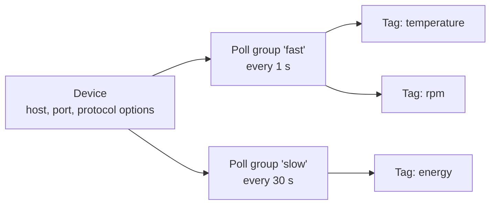
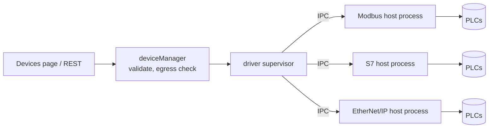
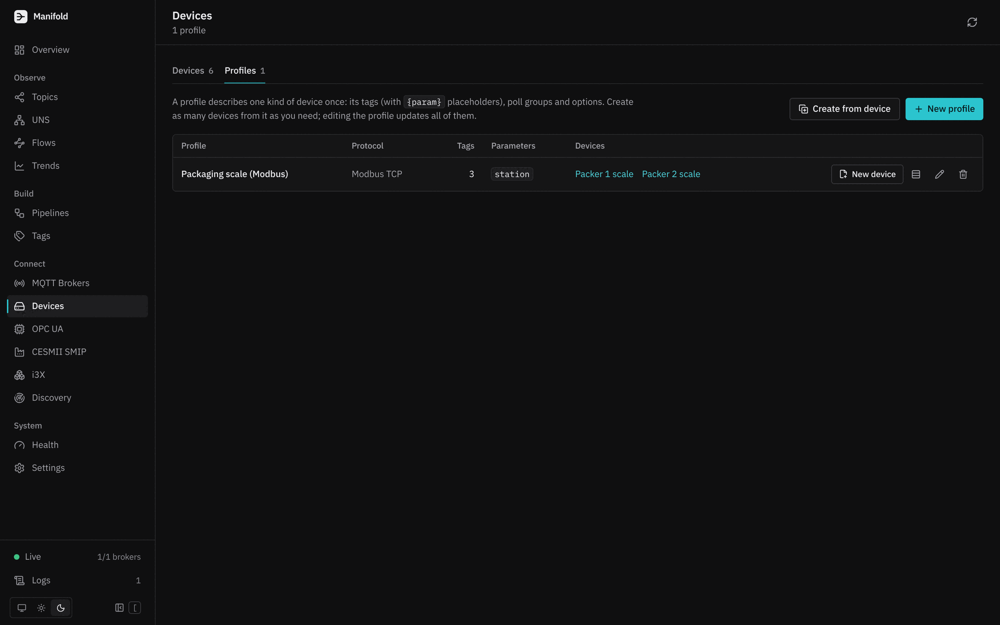
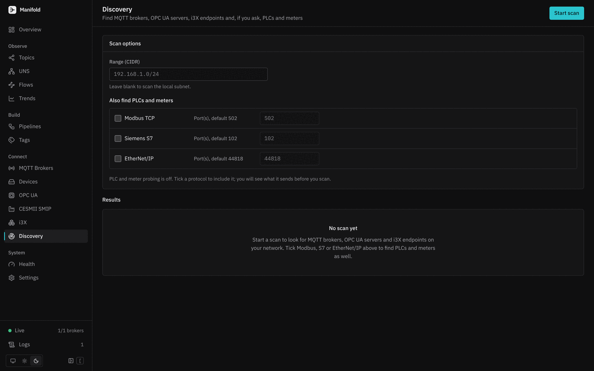

# 🔧 Devices and Drivers

> **Goal:** poll Modbus TCP, Siemens S7 and EtherNet/IP devices directly, see
> whether they are healthy, and turn their tags into values you can map into
> the UNS. **Manifold only reads from devices.**

Manifold already speaks OPC UA. If the device has an OPC UA server you can
license and use, prefer it: it carries types, names and authentication. The
drivers here are for the many devices that only speak the older protocols.

| Driver | Status | Default port | Browse tags | Notes |
|---|---|---|---|---|
| **Modbus TCP** | supported | 502 | no | Registers and coils; byte/word order and addressing are explicit |
| **Siemens S7** (S7comm) | **experimental** | 102 | no | Classic S7-300/400/1200/1500 access. Needs PUT/GET and non-optimized DBs |
| **EtherNet/IP** (Logix) | **experimental** | 44818 | yes (**Import from controller**, and REST) | CompactLogix / ControlLogix tags by name |

**Experimental** means the S7 and EtherNet/IP drivers were checked only against
in-process simulators written by the same author as the drivers. The
simulators show that driver and simulator agree with each other, not that they
match real firmware. Each driver has a "verify on real hardware" list; see
[What is not yet verified](#what-is-not-yet-verified) and the ordered procedure
in [Verifying on real hardware](Verifying-on-Real-Hardware). **Modbus TCP is
"supported" in the sense that it is the simplest protocol and the best tested
against its simulator; it has not been run against real devices either.**
The Devices page marks S7 and EtherNet/IP with an **Experimental** badge and
shows the same notice before the first connect.

## Concepts



- **Device**: one physical thing at one `host:port`. Manifold opens exactly one
  connection to it and shares that connection between all of its poll groups,
  one request at a time.
- **Poll group**: a name and an interval (at least 100 ms). Tags that change
  slowly belong in a slow group so they do not cost reads every second.
- **Tag**: a `key` (what you call it in Manifold: 1 to 128 characters of
  `A-Z a-z 0-9 _ . - : [ ]`), a device `address`, a `type`, and optional decode
  settings, unit, description and a UNS `property` name.

The **key and address are not the UNS name.** The address is where the value
lives in the device (`DB10.DBD4`, `40012`). What the topic is called is decided
when you map the tag; see [Mapping to the UNS](Mapping-to-the-UNS).

## The Devices page


**Devices** (`/devices`) has two tabs, **Devices** and **Profiles**. The header offers a refresh
button, **From profile** (create a device from a profile, see below) and the primary **Add device**.
Under the tabs, a banner appears when a driver host is **restarting** or **parked**.

**The table.** One row per device: **Device** (name, `host:port`, and the unit, rack/slot or route
path), **State**, **Protocol** (with an *Experimental* badge for S7 and EtherNet/IP and a "from
&lt;profile&gt;" line for profile instances), **Tags**, **Poll cycle** (a meter of the average cycle
time against the interval, for example `1 ms / 1.0 s`), **Quarantined**, **Last error** (with how
long ago), a **Polling enabled** switch and row actions (edit, map to the UNS, delete). Filter by
name, host or state, by protocol, and with the chips **All**, **Online**, **Problems**, **Disabled**.
The subtitle states the position ("5 of 6 online - 1 with problems").

**The detail drawer.** Click a device name to open a drawer with the state and the time it
began, and three tabs:

- **Overview**: Summary, **Poll groups** (interval, cycle-time meter, last cycle, overruns,
  status), **Counters and device exceptions** (Connects, Requests, Timeouts, and each protocol
  exception by name and code), **Errors**, and the list of **Quarantined tags** with the
  device's reason.
- **Tags**: the live table: tag key and address, **Value**, **Unit**, **Quality** (Good,
  Uncertain, Bad), **Age** and **Reason**. Filter by key, address or reason; **All** and
  **Problems**. Values refresh from the `device-values` stream (see
  [Operations](Operations#upgrade-notes-behaviour-changes-an-operator-must-know)).
- **Probe**: read raw registers or bytes at one address and see every decoding (below).

The drawer's footer has the **Polling enabled** switch, **Delete**, **Map to UNS** (opens the
[Tags page](Mapping-to-the-UNS#the-tags-page-and-the-mapping-editor) on this device) and
**Edit device**. **Import from controller** also appears here for EtherNet/IP.


**The form** (**Add device**, or **Edit device**) is a full page with a sticky section strip
**Connection, Protocol options, Polling, Tags, Advanced** and a footer with **Cancel** and
**Create device** / **Save changes**. Errors show inline after the first save attempt.

| Section | What is in it |
|---|---|
| **Connection** | **Name**, **Protocol** (fixed once created), the *Experimental* note ("Verified only against a simulator...") for S7 and EtherNet/IP, a disclosure **On the &lt;protocol&gt; side** with what to enable on the PLC before the first connect (open by default while creating), **Host**, **Port**, the protocol's own fields (Modbus **Unit ID**; S7 **Presets** *S7-300 / S7-400* (rack 0, slot 2) and *S7-1200 / S7-1500* (rack 0, slot 1), **Rack**, **Slot**, and advanced **Local TSAP** and **Remote TSAP**; EtherNet/IP **Slot** and route path), **Enabled**, and **Test connection** ("Opens one connection with these settings. Nothing is saved."), which answers with *Connected in N ms* and the identity or with *Could not connect* and the reason |
| **Protocol options** | Defaults for every tag, such as Modbus **Byte order**, **Word order**, **Address base**, **Max registers per read**, **Max gap to bridge**; a tag can override them in its own row |
| **Polling** | **Poll groups** (id and interval, at least 100 ms) and the **Limits** (request deadline, connect timeout, delay between requests) |
| **Device profile** | Shown when the device is a profile instance: the parameter values (see below) |
| **Tags** | The tag table: **Add tag**, **Import / paste** (a CSV or a block copied from a spreadsheet; header names are matched in any order: `key, address, type, pollGroup, scale, offset, unit, property, description, length, bit, byteOrder, wordOrder`), **Import from controller** (EtherNet/IP), **Export CSV**, **Probe**, **Advanced columns**, a filter and paging for long lists. Each row is validated by the driver as you type. Pasting a multi-cell block into any cell fills rows from there |
| **Advanced** | **Unmapped register ranges** (Modbus: *Table*, *From offset*, *To offset*; the planner never reads across them) and **Run this device in its own driver process** (`isolate`) |


Tags are `key` (what you call it here: 1 to 128 characters of `A-Z a-z 0-9 _ . - : [ ]`), an
`address`, a `type` and optional decode settings, unit, description and a UNS `property` name.
For EtherNet/IP, **Import from controller** opens a tree of the controller's own tag list
(controller scope, programs, UDT members, External Access; arrow keys and Enter drive it) and
appends the tags you tick, with generated keys and suggested property names. EtherNet/IP tags
may omit the type: it is resolved from the controller.

**Probe** reads one address, with a count (and unit id for Modbus), and shows the raw bytes
decoded under every plausible type and, for Modbus, all four byte and word orders. Use it to find
the right word order before you create the tags. Probing is a read and cannot write.

### Where the polling runs



Drivers run in **separate child processes**, one per protocol. A driver that
crashes, hangs or corrupts memory takes down only its own process: the
supervisor restarts it with a growing delay (0.5 s doubling to 30 s), kills it
if it stops answering heartbeats, and **parks** it after more than five
crashes in a minute (the Devices page shows a "Driver parked" badge and a
banner). Every tag the process owned shows as Bad while it is down.

## Prerequisites on the device side

### Modbus TCP

Nothing to enable. Modbus has no authentication, so anyone who can reach the
port can also write registers. Manifold sends only read function codes
(1 to 4); if you need a guarantee stronger than software, restrict the
network path as well.

**Unit ID.** `255` (or `0`) for a device you reach directly over TCP; `1` to
`247` selects one device behind a TCP-to-RTU gateway. Some devices only answer
one specific value; if you get timeouts with a good connection, try `1`.
A tag can override the unit ID, which is how one gateway's several slaves
share one connection.

**Addressing.** An address is either explicit or Modicon notation, and the
table is never guessed from a bare number:

| You write | Meaning | Wire address |
|---|---|---|
| `holding:100`, `input:0`, `coil:5`, `discrete:12` | table and number | the number, minus the device's **Address base** |
| `40001` (5 digits) | holding register 1 | 0 |
| `400001` (6 digits) | holding register 1 | 0 |
| `30001` / `300001` | input register 1 | 0 |
| `00001` / `000001` | coil 1 | 0 |
| `10001` / `100001` | discrete input 1 | 0 |

Modicon numbers are always 1-based: the leading digit selects the table and
the rest minus one is the wire offset. For `table:number` addresses, the
device option **Address base** decides: `0` if the manual lists wire offsets
(most modern devices), `1` if the manual counts registers from 1. If every
value is shifted by one register, this is the setting to change. A bare
number such as `100` is rejected as ambiguous.

**Types and order.** Types are `bool`, `int16`, `uint16`, `int32`, `uint32`,
`int64`, `uint64`, `float32`, `float64` and `string`. A `bool` on a holding or
input register needs a `bit` (0 to 15); on a coil it is the coil itself. Two
device options (overridable per tag) say how multi-register values are laid
out:

| Option | Values | Meaning |
|---|---|---|
| Byte order | `big` / `little` | order of the two bytes inside each 16-bit register |
| Word order | `big` / `little` | order of the registers in a 32/64-bit value; `little` is the common "word-swapped" CDAB layout |

The four combinations are the familiar ABCD (big/big), CDAB (word order
little), BADC (byte order little) and DCBA (both little).

**Finding the right order with Probe.** Save the device, then open **Probe**:
enter an address and a register count and Probe reads the raw registers and
shows the same bytes decoded all four ways (int16, uint16, int32, uint32,
float32). Pick the row where you know the right answer (a temperature you can
see on the device's own display). Use that row's byte and word order on the
tag. You can also call it directly:

```bash
curl -X POST http://localhost:5000/api/devices/<id>/probe \
  -H 'Content-Type: application/json' \
  -d '{"address":"holding:4","count":2}'
```

Other tag settings: `scale` and `offset` (value × scale + offset),
`sentinels` (raw values meaning "unavailable", such as `-32768`: the tag
turns Bad instead of publishing the number), string `length` in registers, and
a device-level **max registers** (125 is the protocol limit; many devices
accept fewer) and **max gap**. Max gap is how many unused registers one block
read may span; it defaults to **0** because many devices answer a read over an
unmapped register with an error. Ranges known to be unmapped can be listed in
the device's `options.unmapped` (REST only) and are never crossed.

### Siemens S7

Classic S7comm cannot read "optimized" data blocks or use symbolic names. To
read a CPU, the PLC program has to allow it:

1. Use **global data blocks**. Instance DBs of optimized function blocks
   cannot be read.
2. For each DB you want to read: *Properties → Attributes → Optimized block
   access* **off**, then compile and download. Addresses are then absolute
   (`DB10.DBD4`).
3. CPU properties → *Protection & Security → Connection mechanisms →* **Permit
   access with PUT/GET communication from remote partner** on.
4. The protection level must not block HMI/read access.

> ⚠️ **Security implication.** Enabling PUT/GET makes those data areas readable
> **and writable** by anything that can reach the CPU, because S7comm has no
> authentication. Manifold never sends a write, but other clients could. Put a
> firewall rule or a read-only network segment in front of the CPU. Where the
> CPU's OPC UA server is licensed (S7-1500, recent S7-1200 firmware), it is the
> better route: it supports optimized blocks and authentication.

Device settings: **Rack** and **Slot** with presets (S7-300/400: 0 and 2;
S7-1200/1500: 0 and 1), or a raw **Remote TSAP** (for LOGO! and drives).
Addresses use Siemens absolute notation, English or German mnemonics:
`DB10.DBX0.1` (bit), `DB10.DBB2`, `DB10.DBW4`, `DB10.DBD8`, `M0.1`, `MB0`,
`MW2`, `MD4`, `I0.0` / `E0.0`, `IW2`, `Q0.0` / `A0.0`, `QB1`. The address says
where a value starts; the **type** (never inferred) says how many bytes and how
to decode them. `BOOL` needs a bit address. Types: BOOL, BYTE, WORD, DWORD,
LWORD, SINT, USINT, INT, UINT, DINT, UDINT, LINT, ULINT, REAL, LREAL, CHAR,
WCHAR, STRING, WSTRING, DATE, TIME_OF_DAY, DATE_AND_TIME, DTL, TIME, LTIME,
S5TIME. `STRING` and `WSTRING` take `length` = declared maximum characters.
All S7 values are big-endian; there is no byte-order setting. S7 tags do not
have `scale` or `offset`: scale in the mapping layer or at the consumer.

Adjacent tags in the same DB are merged into one block read (up to **Max gap**
bytes apart, default 8), and reads are split to fit the PDU the CPU negotiates.
Reads of a large value (bigger than one PDU) are several jobs, so the PLC can
change it between them.

### EtherNet/IP (Logix)

Tags are read by name. For each tag the controller's **External Access** must
be *Read Only* or *Read/Write*; a tag set to *None* cannot be read and shows
as inaccessible.

> ⚠️ Plain EtherNet/IP has no authentication either: anything that can reach
> port 44818 can also write to the controller. Manifold only sends read
> services; use a read-only network path where you need a hard guarantee.

Device settings: **Controller slot** (CompactLogix: 0) or a full **Route path**
(`port,link` pairs such as `1,0` or `1,2,2,10.0.0.5,1,0`, which overrides the
slot), **Connection size** (`auto` tries a Large Forward Open of 4002 bytes and
falls back to 504), whether to **pack reads** into Multiple Service Packets,
and an optional cap on the packed reply size (some vendors, such as Omron
NJ/NX, fail large bundles). The driver holds one CIP connection on the
controller or its communication module.

Addresses are Logix names: `Tag`, `Program:MainProgram.Tag`, `Motor.Speed` (UDT
member), `Arr[3]`, `Arr[1,2]`, `Word.5` (bit of an integer). The type is
optional: it is resolved from the controller, and a declared type that
disagrees makes the tag Bad. Structures and STRINGs are decoded from the
controller's own template. EtherNet/IP tags have no `scale` or `offset`.

`GET /api/devices/<id>/browse` lists the controller's tags and data types
(controller scope, program scope, UDT members, External Access); the Devices
page's **Import from controller** is a tree over it. Only EtherNet/IP can be
browsed: classic S7comm has no tag list and Modbus has no names.

## Device profiles and instances

When many devices are the same kind of thing (fifty meters, ten drives), define
them once as a **profile** and create **instances** from it.

A **profile** has a name, a protocol, protocol **options**, **poll groups**,
**parameters** and **tags**. A parameter is a name with an optional default
(`site`, `base`, `db`). Tag `key`, `address` and `property` may contain
`{param}` placeholders, for example key `{unit}_power`, address
`holding:{base}`, property `power`. An **instance** is a normal device that
references the profile (`profileId`) and supplies the parameter values
(`params`) plus the host, port and protocol fields (unit ID, rack, slot ...).

- The effective device is the profile merged with the instance: options
  `{ ...profile, ...instance }`, poll groups from both (the instance wins by
  group id), and the profile's tags with the parameters substituted, followed by
  the instance's own ad-hoc tags. An ad-hoc tag whose key equals a profile tag key
  is a **validation error**, never a silent override.
- A parameter without a value or default, an unknown parameter name, and a
  placeholder with no value are validation errors at save time, with the
  offending tag key.
- **Editing a profile re-applies it to every instance, atomically.** If any
  instance would become invalid the save is refused (HTTP 400) with the list of
  instances and why; nothing changes.
- **Deleting a profile** is refused (409) while a [device-profile
  binding](Mapping-to-the-UNS#one-definition-for-many-identical-devices-profile-bindings)
  uses it, with the binding names. Deleting a profile that still has instances is
  also refused (409) until they are deleted; the error lists the devices.
- A device that belongs to a profile shows the profile's tags as read-only
  ("from the profile") next to its own tags.



On the **Profiles** tab (a table with the profile, protocol, tags, parameters and the devices that
use it, each device a link): **New profile**, **Create from device** (copies a device's own tags,
poll groups and options into a new profile for you to add `{param}` placeholders to), per row **New
device** (a dialog with the connection, the **Parameter values** and a **Preview: the tags this
device will have**, with placeholders substituted exactly as the server will), **Create several
devices from "&lt;profile&gt;"**, edit and delete. The header button **From profile** on the
Devices tab opens the same "New device from a profile" flow after asking which profile.

**Bulk create is all-or-nothing.** Paste a table copied from a spreadsheet or load a CSV
(**Insert example** fills in a header and a sample row for the profile; **Load CSV file** reads one from disk). The first row is the header: `name`,
`host`, optional `port` and `enabled`, then one column per profile parameter; a column named like
a protocol field (`unitId`, `rack`, `slot` ...) sets that field. Each row is checked in the
browser first (missing name or host, bad port, missing parameter, repeated name); while any row
is marked *Problem* the **Create N devices** button is disabled. The rows are then sent in **one
request** (`POST /api/devices/bulk`, at most 200 rows). The server validates every row (driver
rules, unique names, parameters) and creates the devices only if **all** are valid; otherwise
**nothing is created**, the dialog says *Nothing was created*, and each row shows its own
message (a name that another device already uses, or "not created because another row was
rejected"). Fix the rows and run it again. Once it succeeds the button is disabled so a second
click cannot create duplicates.

```csv
name,host,port,site,base
Line 1 meter,192.168.1.21,502,dallas,100
Line 2 meter,192.168.1.22,502,dallas,100
```

Map the whole set to the UNS with one profile binding; see
[Mapping to the UNS](Mapping-to-the-UNS#one-definition-for-many-identical-devices-profile-bindings).

## Finding devices on the network (Discovery)



The **Discovery** page runs a CIDR scan that finds **MQTT brokers**, **OPC UA servers** and **i3X servers** and,
opt-in, **Modbus TCP**, **Siemens S7** and **EtherNet/IP** devices, and lets you add what it found.

### Running a scan

1. **Range.** An IPv4 CIDR (`192.168.1.0/24`), a single address, or a hostname (resolved to one IPv4 address). **This
   subnet** fills in the server's own /24; blank scans it. IPv6 is not supported.
2. **What to look for.** MQTT, OPC UA and i3X are ticked; Modbus TCP, S7 and EtherNet/IP are **off** until you tick
   them. The first time you tick one, a banner explains what device probing does to an OT network and the scan stays
   disabled until you tick *I understand, and I am allowed to probe this network* (remembered in that browser).
3. **Advanced options.** Ports per protocol (blank = default: MQTT 1883 and 8883, OPC UA 4840 and 50000, i3X 80, 443 and 8080,
   Modbus 502, S7 102, EtherNet/IP 44818), MQTT over WebSocket ports (none by default), and the pacing below.
4. Before you start, the page shows what the server's own planner says: hosts, ports, probes, and how long it can take
   (*usually* about N s; *at most* about M if nothing answers, plus up to a few seconds for each open port that never
   replies). A range the server refuses, or one that is too large, is explained there with the exact setting to change.
5. **Start scan.** Progress shows probes done of total, found so far and the time left, with **Cancel scan**. Cancel
   destroys every socket at once (within a second) and keeps what was found. Results stay until the next scan and are
   still there after a reload (the server keeps the last scan; a server restart clears it).

API: `POST /api/system/discovery/start`, `/stop`, `/plan` (what a scan would do, no traffic), `GET .../results`
(`{ scanning, scan, results }`) and `GET .../defaults` (local subnet, defaults, bounds, what the guard allows). Errors
carry `code` (`RANGE_REFUSED`, `RANGE_TOO_LARGE`, `RANGE_INVALID`, `OPTION_INVALID`, `SCAN_RUNNING`, a 409) and, for a
refused range, `flag` (the setting that would allow it).

### What is sent

Each host:port gets **one TCP connect** (nothing is sent). **Only if it is open** is it identified, with one
handshake per protocol, read-only by construction:

| Protocol | What is sent | What counts as an answer, and what the result shows |
|---|---|---|
| MQTT (1883, 8883, optional WebSocket) | an anonymous **CONNECT**, then DISCONNECT | a CONNACK (anonymous access allowed) or an auth refusal (authentication required) = **verified**; TCP, TLS or WebSocket is shown. Open but silent = **open port**, labelled as such |
| OPC UA (4840) | the UA-TCP **Hello**, then, if it is answered, a real **GetEndpoints** over a security None channel (no session; the client disconnects at once), each step bounded by the identify timeout | GetEndpoints answered = **verified**, with the application name and URI and the security modes, policies and user-token types the server offers. Hello answered but GetEndpoints not = **Not confirmed**, with the reason. A port that does not answer the Hello is **not reported** |
| i3X (80, 443, 8080) | `GET /info` at `/`, `/v1`, `/i3x`, `/i3x/v1` | a valid i3X info document (server name, spec version). An open HTTP port that is not i3X is not reported |
| Modbus TCP (502) | **FC 43 / MEI 14 Read Device Identification** (vendor, product code, revision, product name), then, if the device refuses or ignores it, **FC 3** for one register at address 0, unit 1, on the same connection | any well-formed Modbus reply. `method` records which request answered (`fc43-device-id` or `fc3-register-read`) |
| S7 (102) | one **COTP Connection Request** (rack 0 slot 1; slot 2 if refused), then, if the CPU accepts, the S7 driver's read-only **identity read** (setup communication and read SZL, on a second connection opened after the first closed) | a COTP Connection Confirm or a Disconnect from a CPU that refuses the TSAP. With the identity read: CPU type, order code, firmware, serial, run state |
| EtherNet/IP (44818) | the encapsulation **ListIdentity** command (no CIP service) | vendor, device type, product code, revision, serial, product name, state |

An open port that does not answer a **device, OPC UA or i3X** protocol is **never reported**; an MQTT port that is
open but silent is shown as **Open port** (not *Verified*), since the port is conventional. One result per
host:port; a port listed for two protocols is probed once and identified by whichever answers.

The Modbus FC 43 request is a fixed 11-byte frame built in `server/services/deviceIdentify.js`; it is **not** added to
the Modbus driver's read-only allowlist, which still refuses every function code except 1 to 4. The simulators count
writes and the tests assert the count stays 0 and that no socket remains open after a scan or a cancel.

### Pacing

The defaults are conservative for an OT network and bound both the load and the total time:

| Setting | Default | Meaning |
|---|---|---|
| connections at once | 32 | sockets in flight across the whole scan |
| connections per host | 2 | to any one address, probe and identification together. PLCs have few connection slots |
| connect timeout | 1200 ms | a dropped (filtered) address costs this per port |
| identify timeout | 3000 ms | an open port that never answers (a tarpit) costs this once per protocol tried |

A /24 with six ports (1,524 probes) finishes in seconds when closed ports answer with a reset, and in at most about a
minute when every address silently drops packets. **A scan is limited to 1,024 hosts (a /22)**; a bigger range is
refused with its size and duration and the advice to scan it in pieces (`MANIFOLD_DISCOVERY_MAX_HOSTS` raises the limit
if you mean it).

### Results and adding what was found

Results show the endpoint, protocol, state (*Verified* / *Identified* / *Not confirmed* / *Open port*), the identity text, and whether
Manifold **already has it**: the server marks each result with `known: { kind, id, name }` when a broker, OPC UA
connection, i3X server or device exists at that host and port, so the table, **Add all** and a re-scan agree. Filter by
protocol, then use the action that fits: **Add broker**, **Add OPC UA connection**, **Connect** (i3X) or **Add as
device**. A broker that needs credentials sends you to the Brokers page instead. **Add as device** opens the Devices page
with the form pre-filled; nothing is created until you save it. **Add all N new** shows a review list (known endpoints
and ports that never answered start unticked) and adds the ticked ones: devices **all-or-nothing** (the bulk request
above), brokers and OPC UA connections one by one.

### Which addresses may be scanned

Every address passes the egress guard:

| Range | Scanned when |
|---|---|
| public | always |
| private RFC1918 (10/8, 172.16/12, 192.168/16) | `MANIFOLD_ALLOW_PRIVATE_TARGETS=1` |
| loopback (127.0.0.0/8) | `MANIFOLD_ALLOW_LOOPBACK_DEVICES=1`, the same opt-in device drivers use for local simulators. Not probed for i3X, whose client cannot connect to loopback |
| link-local and cloud metadata (169.254/16), multicast, reserved (0/8, CGNAT, TEST-NET, 240/4) | never |

The refusal says exactly which flag would allow the range you asked for, or that nothing will. A range that is only
partly blocked scans the rest and lists what it skipped. See [SECURITY.md](../../SECURITY.md#network-discovery).

### Try it against the simulators

`node server/tools/simulators.js` starts the Modbus, S7 and EtherNet/IP simulators; scan them from a local server with
`MANIFOLD_ALLOW_LOOPBACK_DEVICES=1`. [DOCKER.md](../../DOCKER.md#scan-the-demo-stack) has the exact commands for both
the local and the Docker demo.

## Polling health

Open a device (the table and the drawer's **Overview** tab) and read three things.

**State.** *Online*, *Connecting*, *Backoff: reason* (the connection failed or
was lost; Manifold retries forever with a growing, jittered delay from 1 s up
to 60 s, so a power-cycled PLC comes back without anyone touching Manifold),
*Stopped* (the target was refused by the egress guard, with the reason), *Disabled* (the
**Polling enabled** switch is off), or *Driver parked*. The table's State column and the
Overview use exactly these words; *Starting* appears while a driver host is being launched.
What each means:

| State | Meaning | What to do |
|---|---|---|
| **Online** | Connected and polling | nothing |
| **Connecting** | First connection attempt in progress; the reason shows once it fails | wait a few seconds, then read **Last error** |
| **Backoff: reason** | The connection failed or was lost; retrying with a growing delay | fix the cause named in the reason (host, port, firewall, PLC-side setting) |
| **Stopped** | Not started, usually because the egress guard refused the target | read the reason; see [Troubleshooting](Troubleshooting#devices) |
| **Disabled** | You switched polling off | switch it on |
| **Driver parked** | The protocol's host process crashed repeatedly and was parked | read the banner; it is retried when the device set is saved again |

A **Poll cycle** meter above 80 percent of the interval turns amber, and the group's status
reads *Overrunning* or *Slowed to &lt;interval&gt;* (see below).

**Cycle time and overruns.** Each poll group shows how long its last cycles
took against its interval. An **overrun** is a cycle that is still running
when the next one is due: it is **skipped and counted, never queued**, so a
slow device cannot build a backlog. If cycles keep overrunning (five in a
row), Manifold **slows that group down** (doubling the effective interval, up
to eight times) and says so; it speeds back up after 20 clean cycles. Either
fix the cause (fewer tags in that group, a bigger interval, larger Modbus
blocks) or accept the longer interval.

**Quarantine and unit-down.** If one request fails permanently, for example a
Modbus block spanning a register the device does not have (exception 02), the
runtime splits the request in half repeatedly to find the culprit. The tags
that cannot be read are **quarantined**: published as Bad (reason
`quarantined`), listed in the drawer **with the reason the device gave** (for
example "PUT/GET not permitted, optimized block access enabled, or protection
level too high" from an S7 CPU, or "illegal data address" from a Modbus
device) and since when, and retried once a minute, while the rest keep polling.
The device's **last error** reads `tag <key>: <reason>` and has a time
(`lastErrorAt`); it is the most recent quarantined tag's reason, not a list. In
the API these are `quarantineReasons` (per tag: `code`, `message`, `since`; the
first 100) and `lastError` / `lastErrorAt` in `GET /api/devices`. For Modbus gateways, if a single unit ID answers with a
gateway exception (0A or 0B, "target device failed to respond") three times,
its breaker opens: its tags are Bad (reason `unit-down`) and it is probed only
every 30 s, so one dead slave does not slow the healthy ones. A timeout is
different: it destroys the socket and reconnects the whole device.

A tag's quality is always one of Good (192), Uncertain (64) or Bad (0), with a
reason such as `disconnected`, `quarantined`, `unit-down`, `device-exception`,
`decode` or `unavailable`. Bad is never silently replaced by the last good
value.

### Metrics

The same numbers are on `GET /metrics` (see [Operations](Operations#prometheus)
for the names): `manifold_device_up`, `manifold_device_cycle_ms` and
`manifold_device_overruns_total` per poll group,
`manifold_device_quarantined_tags`, `manifold_device_exceptions_total` by code,
and `manifold_driver_host_up` / `manifold_driver_host_restarts_total` for the
driver processes, so a parked driver or a rising overrun count can alert.

## The read-only guarantee, and its limits

Every driver builds all of its outgoing frames through one function with an
allowlist, and the tests try every refused service and assert that no bytes
reach the socket:

- **Modbus:** function codes 1, 2, 3 and 4 only.
- **S7:** setup communication, Read Var and SZL reads only. Write Var, PLC
  start/stop, block transfer and clock set are refused.
- **EtherNet/IP:** session management, Forward Open/Close, Read Tag, Read Tag
  Fragmented, Multiple Service Packet (every inner service checked), and
  attribute/template reads. The client also re-parses each buffer before
  `socket.write`.

What this does and does not mean:

- It is a guarantee about **Manifold's code**, enforced where bytes are built,
  not by a configuration switch or the UI. No route, binding or transform can
  write to a device.
- It is **not** a guarantee about the **network**. None of the three protocols
  authenticates the client. If your site requires that nothing can write, use
  a firewall rule or a data diode as well.
- It does not protect the device from being **read too hard**. Polling is
  bounded (one connection, one request at a time, overruns skipped) but a very
  small PLC can still be loaded by an aggressive interval. Start slow.

## Egress: which addresses a device may use

Device hosts pass the egress guard when you save, test or start a device (the
Discovery scan checks every candidate address too, with the same flags; see above).
Private networks are refused unless `MANIFOLD_ALLOW_PRIVATE_TARGETS=1` (the
normal setting on a plant network). **Loopback is refused** unless
`MANIFOLD_ALLOW_LOOPBACK_DEVICES=1`, which exists for local simulators and
should stay off in production. Cloud-metadata and link-local ranges are always
refused. See [Operations](Operations#network-safety-egress-guard).

## What is not yet verified

- **Modbus TCP** is tested against a fault-injecting simulator (late replies,
  wrong transaction ids, dropped sockets, truncated frames, exceptions).
  Interoperability with specific devices has not been surveyed: **no driver, Modbus
  included, has been run against a real PLC**; the simulators were written together with
  the drivers, so they show agreement, not correctness against firmware.
- **S7**: [`server/drivers/s7/NOTES.md`](https://github.com/zbest1000/manifold/blob/main/server/drivers/s7/NOTES.md)
  lists 14 items to confirm with a packet capture on a real CPU before the
  driver leaves experimental: PDU accounting, items per request, return codes
  for a missing DB or optimized access, how a CPU with PUT/GET off refuses,
  rack/slot to TSAP, SZL layouts used for identity, string encoding and
  date formats.
- **EtherNet/IP**: [`server/drivers/eip/NOTES.md`](https://github.com/zbest1000/manifold/blob/main/server/drivers/eip/NOTES.md)
  lists 18 items, including the Large Forward Open parameters, Forward Close,
  attribute 10 (External Access), BOOL-array handling (the one most likely to
  be wrong), template sizes, Multiple Service Packet limits, behaviour after a
  controller download, and route paths through a bridge. The Rockwell and ODVA
  documents were not available when the driver was written.
- **Discovery probes** (Modbus FC 43/14 then FC 3 at address 0 unit 1, S7 COTP CR
  with rack 0 slot 1 and the SZL identity read, ListIdentity, the OPC UA Hello)
  have also only been run against the simulators; how real devices, gateways and
  intrusion-detection systems react to them is part of the checklist.
- The design intent is that S7 and EtherNet/IP leave "experimental" only after
  verification against real hardware. The consolidated, ordered procedure is
  [Verifying on real hardware](Verifying-on-Real-Hardware); the design is in
  [`docs/design/southbound-drivers.md`](https://github.com/zbest1000/manifold/blob/main/docs/design/southbound-drivers.md).

## Try it without hardware

The Docker demo stack includes simulated devices for all three protocols;
see [DOCKER.md](https://github.com/zbest1000/manifold/blob/main/DOCKER.md#simulated-devices).

Next: [Mapping to the UNS](Mapping-to-the-UNS), and
[Troubleshooting](Troubleshooting#devices).
