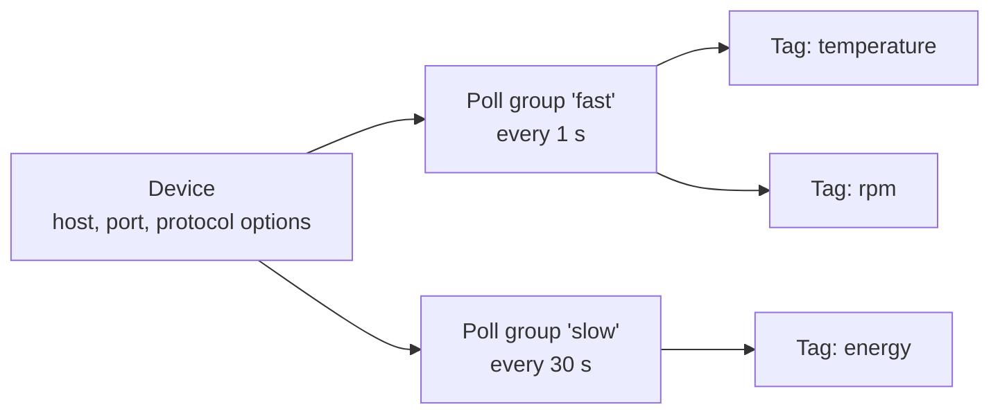
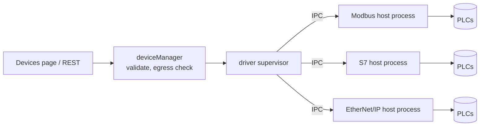

# 🔧 Devices and Drivers

> **Goal:** poll Modbus TCP, Siemens S7 and EtherNet/IP devices directly, see
> whether they are healthy, and turn their tags into values you can map into
> the UNS. **Manifold only reads from devices.**

Manifold already speaks OPC UA. If the device has an OPC UA server you can
license and use, prefer it: it carries types, names and authentication. The
drivers here are for the many devices that only speak the older protocols.

| Driver | Status | Default port | Browse tags | Notes |
|---|---|---|---|---|
| **Modbus TCP** | supported | 502 | no | Registers and coils; byte/word order and addressing are explicit |
| **Siemens S7** (S7comm) | **experimental** | 102 | no | Classic S7-300/400/1200/1500 access. Needs PUT/GET and non-optimized DBs |
| **EtherNet/IP** (Logix) | **experimental** | 44818 | yes (REST only) | CompactLogix / ControlLogix tags by name |

**Experimental** means the S7 and EtherNet/IP drivers were checked only against
in-process simulators written by the same author as the drivers. The
simulators show that driver and simulator agree with each other, not that they
match real firmware. Each driver has a "verify on real hardware" list; see
[What is not yet verified](#what-is-not-yet-verified).

## Concepts



- **Device**: one physical thing at one `host:port`. Manifold opens exactly one
  connection to it and shares that connection between all of its poll groups,
  one request at a time.
- **Poll group**: a name and an interval (at least 100 ms). Tags that change
  slowly belong in a slow group so they do not cost reads every second.
- **Tag**: a `key` (what you call it in Manifold: 1 to 128 characters of
  `A-Z a-z 0-9 _ . - : [ ]`), a device `address`, a `type`, and optional decode
  settings, unit, description and a UNS `property` name.

The **key and address are not the UNS name.** The address is where the value
lives in the device (`DB10.DBD4`, `40012`). What the topic is called is decided
when you map the tag; see [Mapping to the UNS](Mapping-to-the-UNS).

Devices are created on the **Devices** page. Each card shows state, the
cycle time of each poll group, overruns, quarantined tags and the last error.
Tags are entered in a table: paste rows from a spreadsheet or import a CSV
(header names are matched in any order: `key, address, type, pollGroup, scale,
offset, unit, property, description, length, bit, byteOrder, wordOrder`).

### Where the polling runs



Drivers run in **separate child processes**, one per protocol. A driver that
crashes, hangs or corrupts memory takes down only its own process: the
supervisor restarts it with a growing delay (0.5 s doubling to 30 s), kills it
if it stops answering heartbeats, and **parks** it after more than five
crashes in a minute (the Devices page shows a "Driver parked" badge and a
banner). Every tag the process owned shows as Bad while it is down.

## Prerequisites on the device side

### Modbus TCP

Nothing to enable. Modbus has no authentication, so anyone who can reach the
port can also write registers. Manifold sends only read function codes
(1 to 4); if you need a guarantee stronger than software, restrict the
network path as well.

**Unit ID.** `255` (or `0`) for a device you reach directly over TCP; `1` to
`247` selects one device behind a TCP-to-RTU gateway. Some devices only answer
one specific value; if you get timeouts with a good connection, try `1`.
A tag can override the unit ID, which is how one gateway's several slaves
share one connection.

**Addressing.** An address is either explicit or Modicon notation, and the
table is never guessed from a bare number:

| You write | Meaning | Wire address |
|---|---|---|
| `holding:100`, `input:0`, `coil:5`, `discrete:12` | table and number | the number, minus the device's **Address base** |
| `40001` (5 digits) | holding register 1 | 0 |
| `400001` (6 digits) | holding register 1 | 0 |
| `30001` / `300001` | input register 1 | 0 |
| `00001` / `000001` | coil 1 | 0 |
| `10001` / `100001` | discrete input 1 | 0 |

Modicon numbers are always 1-based: the leading digit selects the table and
the rest minus one is the wire offset. For `table:number` addresses, the
device option **Address base** decides: `0` if the manual lists wire offsets
(most modern devices), `1` if the manual counts registers from 1. If every
value is shifted by one register, this is the setting to change. A bare
number such as `100` is rejected as ambiguous.

**Types and order.** Types are `bool`, `int16`, `uint16`, `int32`, `uint32`,
`int64`, `uint64`, `float32`, `float64` and `string`. A `bool` on a holding or
input register needs a `bit` (0 to 15); on a coil it is the coil itself. Two
device options (overridable per tag) say how multi-register values are laid
out:

| Option | Values | Meaning |
|---|---|---|
| Byte order | `big` / `little` | order of the two bytes inside each 16-bit register |
| Word order | `big` / `little` | order of the registers in a 32/64-bit value; `little` is the common "word-swapped" CDAB layout |

The four combinations are the familiar ABCD (big/big), CDAB (word order
little), BADC (byte order little) and DCBA (both little).

**Finding the right order with Probe.** Save the device, then open **Probe**:
enter an address and a register count and Probe reads the raw registers and
shows the same bytes decoded all four ways (int16, uint16, int32, uint32,
float32). Pick the row where you know the right answer (a temperature you can
see on the device's own display). Use that row's byte and word order on the
tag. You can also call it directly:

```bash
curl -X POST http://localhost:5000/api/devices/<id>/probe \
  -H 'Content-Type: application/json' \
  -d '{"address":"holding:4","count":2}'
```

Other tag settings: `scale` and `offset` (value × scale + offset),
`sentinels` (raw values meaning "unavailable", such as `-32768`: the tag
turns Bad instead of publishing the number), string `length` in registers, and
a device-level **max registers** (125 is the protocol limit; many devices
accept fewer) and **max gap**. Max gap is how many unused registers one block
read may span; it defaults to **0** because many devices answer a read over an
unmapped register with an error. Ranges known to be unmapped can be listed in
the device's `options.unmapped` (REST only) and are never crossed.

### Siemens S7

Classic S7comm cannot read "optimized" data blocks or use symbolic names. To
read a CPU, the PLC program has to allow it:

1. Use **global data blocks**. Instance DBs of optimized function blocks
   cannot be read.
2. For each DB you want to read: *Properties → Attributes → Optimized block
   access* **off**, then compile and download. Addresses are then absolute
   (`DB10.DBD4`).
3. CPU properties → *Protection & Security → Connection mechanisms →* **Permit
   access with PUT/GET communication from remote partner** on.
4. The protection level must not block HMI/read access.

> ⚠️ **Security implication.** Enabling PUT/GET makes those data areas readable
> **and writable** by anything that can reach the CPU, because S7comm has no
> authentication. Manifold never sends a write, but other clients could. Put a
> firewall rule or a read-only network segment in front of the CPU. Where the
> CPU's OPC UA server is licensed (S7-1500, recent S7-1200 firmware), it is the
> better route: it supports optimized blocks and authentication.

Device settings: **Rack** and **Slot** with presets (S7-300/400: 0 and 2;
S7-1200/1500: 0 and 1), or a raw **Remote TSAP** (for LOGO! and drives).
Addresses use Siemens absolute notation, English or German mnemonics:
`DB10.DBX0.1` (bit), `DB10.DBB2`, `DB10.DBW4`, `DB10.DBD8`, `M0.1`, `MB0`,
`MW2`, `MD4`, `I0.0` / `E0.0`, `IW2`, `Q0.0` / `A0.0`, `QB1`. The address says
where a value starts; the **type** (never inferred) says how many bytes and how
to decode them. `BOOL` needs a bit address. Types: BOOL, BYTE, WORD, DWORD,
LWORD, SINT, USINT, INT, UINT, DINT, UDINT, LINT, ULINT, REAL, LREAL, CHAR,
WCHAR, STRING, WSTRING, DATE, TIME_OF_DAY, DATE_AND_TIME, DTL, TIME, LTIME,
S5TIME. `STRING` and `WSTRING` take `length` = declared maximum characters.
All S7 values are big-endian; there is no byte-order setting. S7 tags do not
have `scale` or `offset`: scale in the mapping layer or at the consumer.

Adjacent tags in the same DB are merged into one block read (up to **Max gap**
bytes apart, default 8), and reads are split to fit the PDU the CPU negotiates.
Reads of a large value (bigger than one PDU) are several jobs, so the PLC can
change it between them.

### EtherNet/IP (Logix)

Tags are read by name. For each tag the controller's **External Access** must
be *Read Only* or *Read/Write*; a tag set to *None* cannot be read and shows
as inaccessible.

> ⚠️ Plain EtherNet/IP has no authentication either: anything that can reach
> port 44818 can also write to the controller. Manifold only sends read
> services; use a read-only network path where you need a hard guarantee.

Device settings: **Controller slot** (CompactLogix: 0) or a full **Route path**
(`port,link` pairs such as `1,0` or `1,2,2,10.0.0.5,1,0`, which overrides the
slot), **Connection size** (`auto` tries a Large Forward Open of 4002 bytes and
falls back to 504), whether to **pack reads** into Multiple Service Packets,
and an optional cap on the packed reply size (some vendors, such as Omron
NJ/NX, fail large bundles). The driver holds one CIP connection on the
controller or its communication module.

Addresses are Logix names: `Tag`, `Program:MainProgram.Tag`, `Motor.Speed` (UDT
member), `Arr[3]`, `Arr[1,2]`, `Word.5` (bit of an integer). The type is
optional: it is resolved from the controller, and a declared type that
disagrees makes the tag Bad. Structures and STRINGs are decoded from the
controller's own template. EtherNet/IP tags have no `scale` or `offset`.

`GET /api/devices/<id>/browse` lists the controller's tags and data types
(controller scope, program scope, UDT members, External Access). The Devices
page does not have a browse tree yet.

## Polling health

Open a device card and read three things.

**State.** *Online*, *Connecting*, *Backoff: reason* (the connection failed or
was lost; Manifold retries forever with a growing, jittered delay from 1 s up
to 60 s, so a power-cycled PLC comes back without anyone touching Manifold),
*Stopped* (disabled, or the target was refused by the egress guard), or
*Driver parked*.

**Cycle time and overruns.** Each poll group shows how long its last cycles
took against its interval. An **overrun** is a cycle that is still running
when the next one is due: it is **skipped and counted, never queued**, so a
slow device cannot build a backlog. If cycles keep overrunning (five in a
row), Manifold **slows that group down** (doubling the effective interval, up
to eight times) and says so; it speeds back up after 20 clean cycles. Either
fix the cause (fewer tags in that group, a bigger interval, larger Modbus
blocks) or accept the longer interval.

**Quarantine and unit-down.** If one request fails permanently, for example a
Modbus block spanning a register the device does not have (exception 02), the
runtime splits the request in half repeatedly to find the culprit. The tags
that cannot be read are **quarantined**: published as Bad (reason
`quarantined`), listed on the card, and retried once a minute, while the
rest keep polling. For Modbus gateways, if a single unit ID answers with a
gateway exception (0A or 0B, "target device failed to respond") three times,
its breaker opens: its tags are Bad (reason `unit-down`) and it is probed only
every 30 s, so one dead slave does not slow the healthy ones. A timeout is
different: it destroys the socket and reconnects the whole device.

A tag's quality is always one of Good (192), Uncertain (64) or Bad (0), with a
reason such as `disconnected`, `quarantined`, `unit-down`, `device-exception`,
`decode` or `unavailable`. Bad is never silently replaced by the last good
value.

## The read-only guarantee, and its limits

Every driver builds all of its outgoing frames through one function with an
allowlist, and the tests try every refused service and assert that no bytes
reach the socket:

- **Modbus:** function codes 1, 2, 3 and 4 only.
- **S7:** setup communication, Read Var and SZL reads only. Write Var, PLC
  start/stop, block transfer and clock set are refused.
- **EtherNet/IP:** session management, Forward Open/Close, Read Tag, Read Tag
  Fragmented, Multiple Service Packet (every inner service checked), and
  attribute/template reads. The client also re-parses each buffer before
  `socket.write`.

What this does and does not mean:

- It is a guarantee about **Manifold's code**, enforced where bytes are built,
  not by a configuration switch or the UI. No route, binding or transform can
  write to a device.
- It is **not** a guarantee about the **network**. None of the three protocols
  authenticates the client. If your site requires that nothing can write, use
  a firewall rule or a data diode as well.
- It does not protect the device from being **read too hard**. Polling is
  bounded (one connection, one request at a time, overruns skipped) but a very
  small PLC can still be loaded by an aggressive interval. Start slow.

## Egress: which addresses a device may use

Device hosts pass the egress guard when you save, test or start a device.
Private networks are refused unless `MANIFOLD_ALLOW_PRIVATE_TARGETS=1` (the
normal setting on a plant network). **Loopback is refused** unless
`MANIFOLD_ALLOW_LOOPBACK_DEVICES=1`, which exists for local simulators and
should stay off in production. Cloud-metadata and link-local ranges are always
refused. See [Operations](Operations#network-safety-egress-guard).

## What is not yet verified

- **Modbus TCP** is tested against a fault-injecting simulator (late replies,
  wrong transaction ids, dropped sockets, truncated frames, exceptions).
  Interoperability with specific devices has not been surveyed.
- **S7**: [`server/drivers/s7/NOTES.md`](https://github.com/zbest1000/manifold/blob/main/server/drivers/s7/NOTES.md)
  lists 14 items to confirm with a packet capture on a real CPU before the
  driver leaves experimental: PDU accounting, items per request, return codes
  for a missing DB or optimized access, how a CPU with PUT/GET off refuses,
  rack/slot to TSAP, SZL layouts used for identity, string encoding and
  date formats.
- **EtherNet/IP**: [`server/drivers/eip/NOTES.md`](https://github.com/zbest1000/manifold/blob/main/server/drivers/eip/NOTES.md)
  lists 18 items, including the Large Forward Open parameters, Forward Close,
  attribute 10 (External Access), BOOL-array handling (the one most likely to
  be wrong), template sizes, Multiple Service Packet limits, behaviour after a
  controller download, and route paths through a bridge. The Rockwell and ODVA
  documents were not available when the driver was written.
- The design intent is that S7 and EtherNet/IP leave "experimental" only after
  verification against real hardware. See
  [`docs/design/southbound-drivers.md`](https://github.com/zbest1000/manifold/blob/main/docs/design/southbound-drivers.md).

## Try it without hardware

The Docker demo stack includes simulated devices for all three protocols;
see [DOCKER.md](https://github.com/zbest1000/manifold/blob/main/DOCKER.md#simulated-devices).

Next: [Mapping to the UNS](Mapping-to-the-UNS), and
[Troubleshooting](Troubleshooting#devices).
