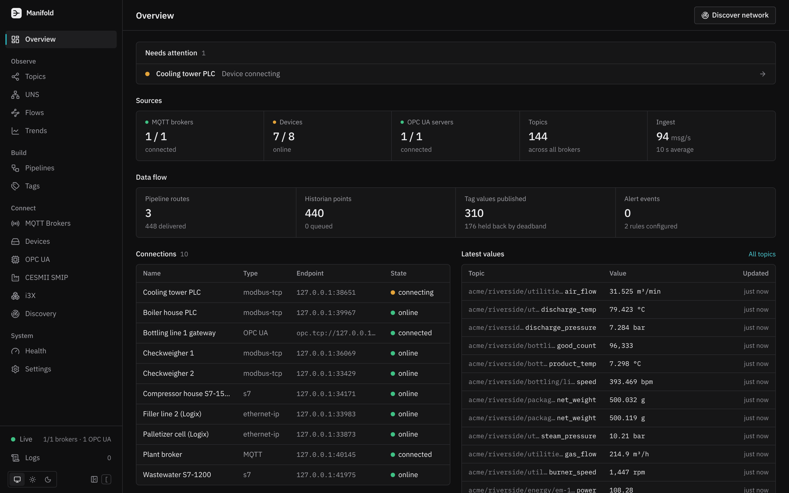
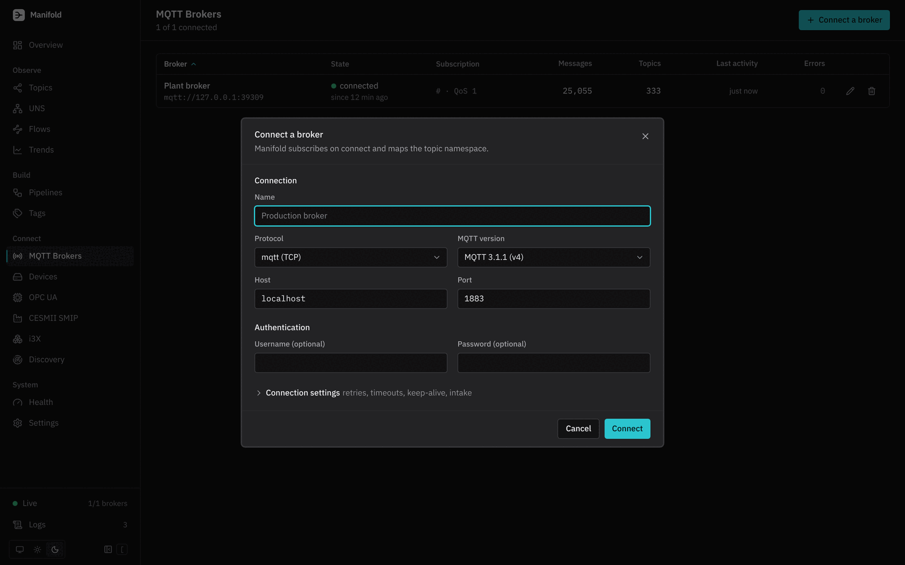
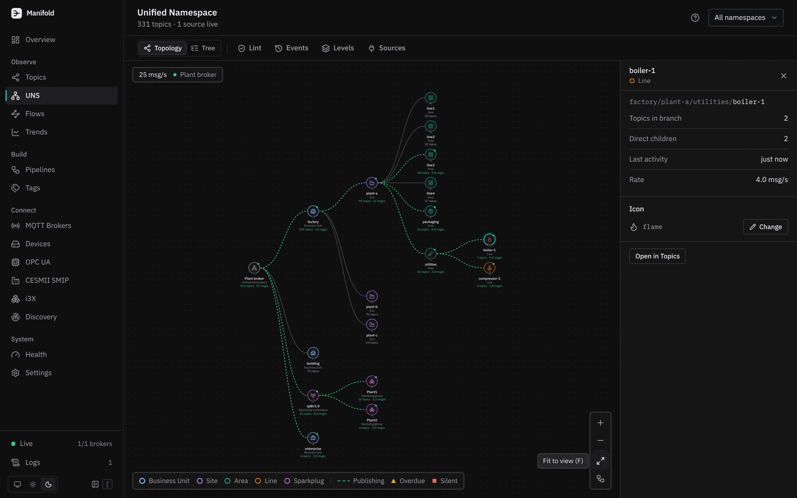

# 🏁 Getting started

> **Goal:** a running Manifold with a broker connected, a device polled, its tags
> mapped, and the result visible in the Unified Namespace, in about fifteen minutes.

## What you need

- Node.js **20.19+ or 22.12+** — the OPC UA client needs `require(ESM)` support and the client build tool (Vite) needs these versions.
- An MQTT broker to point at — or none at all: the Docker stack ships one with simulated traffic.
- Optionally a PLC, or the simulators (see [Try it without hardware](Devices-and-Drivers#try-it-without-hardware)).

## Option A — run from source

```bash
npm run install:all
npm run dev            # client on :3000, backend on :5000 (proxied)
```

For production:

```bash
npm run build          # builds the client into client/dist
npm start              # serves API + built client on :5000
```

## Option B — Docker demo stack

One command brings up Manifold, a Mosquitto broker, an OPC UA simulator, simulated
Modbus TCP / S7 / EtherNet/IP devices, and a traffic generator publishing plain MQTT
and Sparkplug B — pre-wired, so the UI is alive the moment it loads (the
Devices page already polls the three simulators, and the Tags page already has two mappings):

```bash
docker compose up --build
# open http://localhost:5000
```

## Option C — prebuilt image

Just Manifold, no demo services — published to GHCR on every release:

```bash
docker run -p 5000:5000 -v manifold-data:/data \
  -e MANIFOLD_AUTH_TOKEN=$(openssl rand -hex 24) \
  ghcr.io/zbest1000/manifold:1.1.0
# open http://localhost:5000 and enter the token
```

The token is not optional here: without one the server binds `127.0.0.1` inside the
container, where the published port cannot reach it.

The volume at `/data` keeps profiles, history, and the OPC UA PKI across
container restarts. See [Operations](Operations) for tokens and hardening.

> ⚠️ **Loopback by default.** With **no** token set (`MANIFOLD_AUTH_TOKEN`,
> `MANIFOLD_VIEWER_TOKEN` or `MANIFOLD_TOKENS`) the server binds `127.0.0.1` only:
> it is reachable from its own host, not the network. To reach it from other machines,
> set a token (recommended) or `MANIFOLD_HOST=0.0.0.0`. If a token is set, the first page
> is the **Manifold is locked** screen: enter the access token there. See
> [Operations](Operations).

## The first page



**Overview** shows what is connected and what is wrong. A new install is empty: **Needs
attention** is quiet, **Sources** reads `0 / 0` for everything, and the sidebar groups the rest of the
app: **Observe** (Topics, UNS, Flows, Trends, Alerts), **Build** (Pipelines, Tags), **Connect** (MQTT Brokers,
Devices, OPC UA, CESMII SMIP, i3X, Discovery) and **System** (Health, Settings). The sidebar footer has the
theme switch (system, light, dark; see [User interface](User-Interface)) and the `[` key collapses the sidebar.

## 1. Connect a broker

1. Open **MQTT Brokers** and press **Connect a broker**.
2. Fill in **Name** (for example *Plant broker*), **Protocol** (`mqtt (TCP)`, `mqtts`, `ws` or `wss`),
   **MQTT version** (3.1.1 or 5), **Host** and **Port**, and **Username** and **Password** if the broker needs them.
   **Connection settings** (retries, timeouts, keep-alive, intake) is collapsed; the defaults are sensible.
   The **Public test brokers** presets fill the form for a shared public broker, for trying Manifold out only (see
   [Broker Setup](Broker-Setup#public-test-brokers)). The **Canary** box is off by default; turning it on makes
   Manifold publish a small probe message.
3. Press **Connect**.



On connect Manifold subscribes to `#` (QoS 1 by default) and `$SYS/#` (QoS 0): there is no topic list to configure.
The row shows the state, the subscription and live message and topic counts. Open **Topics** and
watch the tree fill, then **UNS**: the ISA-95 topology, live values and per-branch rates appear with
zero registration, because they are derived from observed traffic.



> ⚠️ **Connected but empty on EMQX?** Stock EMQX silently refuses wildcard subscriptions
> at QoS 1. Two-minute fix in [Broker Setup](Broker-Setup).

## 2. Add a device

Devices are PLCs, meters and gateways that Manifold polls directly and read-only.

1. Open **Devices** and press **Add device**.
2. **Connection**: a **Name**, the **Protocol** (Modbus TCP, Siemens S7, EtherNet/IP, BACnet/IP, SNMP, HTTP/JSON, MTConnect,
   CoAP, Matter Server or Z-Wave JS Server; every one but Modbus TCP carries an *Experimental* badge: not verified on real hardware), **Host** and **Port**, and the protocol's own fields (Modbus **Unit ID**; S7 **Rack** and **Slot**, or one of the
   **Presets**). Open **On the &lt;protocol&gt; side** for what to enable on the PLC first (S7 needs PUT/GET, for instance).
3. Press **Test connection**. It opens one connection with these settings, saves nothing, and answers
   *Connected in N ms* with the device's identity, or *Could not connect* with the reason.
4. **Tags**: press **Add tag** and fill **Key**, **Address** and **Type** (for example key `temperature`, address `holding:0`, type `int16`), or
   **Import / paste** a CSV or a block copied from a spreadsheet. Addresses are validated as you type. The **Probe** button reads raw
   registers and shows them decoded under every byte and word order if you are not sure how the device lays out a value.
5. Press **Create device**.

The device appears in the table within a second or two. **Online** with a poll-cycle meter is what you want; click the name to open the
drawer and its **Tags** tab shows live values with **Quality**. If it says **Backoff** or **Connecting**,
read **Last error** and see [Devices and Drivers](Devices-and-Drivers) and [Troubleshooting](Troubleshooting#devices).

## 3. Map the tags into the UNS

1. In the device drawer press **Map to UNS** (or open **Tags**, pick the device under **Source**).
2. Tick the tags you want (or press **Map by rule** to take every tag that matches include and exclude patterns, including tags added later) and press **Add to UNS**.
3. The **mapping editor** opens. Under **Mapping** give it a **Name** and choose the **Target broker**. Under **Where** set the **asset path**, for
   example `acme/hamburg/utilities/boiler-1` (the picker browses what already exists). Under **Tags** check the published names, units and
   descriptions. The **Preview** column on the right shows the topics and payloads the server would publish.
4. Press **Create mapping**.

The details, section by section, are in [Mapping to the UNS](Mapping-to-the-UNS).

## 4. See it in the UNS

On the **Tags** page open the **Mappings** tab: the mapping should say **Publishing**. Expand its row and press **Show in UNS**; the
**UNS** page opens centred on your asset, with its detail panel. The same view is a link you can share:

```text
/uns?broker=<broker id>&path=acme/hamburg/utilities/boiler-1
```

The Topics page has the equivalent `/topics?broker=<broker id>&topic=<topic>`. Your tags are leaf topics under the asset path, next to a retained
`_status` (online or offline and why) and `_meta` (types, units, descriptions) document.

## Where to next

- Read a PLC, controller, meter or sensor directly (Modbus TCP, S7, EtherNet/IP, BACnet/IP, SNMP, HTTP/JSON, MTConnect,
  CoAP) → [Devices and Drivers](Devices-and-Drivers); Matter and Z-Wave → [Bridge servers](Bridge-Servers)
- See the Zigbee, Z-Wave, Wi-Fi and LoRaWAN devices a bridge publishes on your broker → [IoT devices over MQTT](IoT-Devices-over-MQTT)
- Alarm on values and silent topics, acknowledge, keep a history → [Alerts](Alerts)
  (it can also find them on the network and create many from a profile)
- Publish tags with units, context and quality → [Mapping to the UNS](Mapping-to-the-UNS)
- Light and dark themes, shortcuts, deep links, phones → [User interface](User-Interface)
- Have a real PLC and want to help lift the "experimental" label →
  [Verifying on real hardware](Verifying-on-Real-Hardware)
- Wire up consumer lineage and broker health → [Broker Setup](Broker-Setup)
- Send data to a time-series database → [Historians](Historians)
- Reshape a messy namespace into a clean UNS → [Pipelines and Models](Pipelines-and-Models)

## Environment variables

The common ones are below; every variable the server reads, with its default, is in the
[README](https://github.com/zbest1000/manifold#configuration).

| Variable | Purpose |
|---|---|
| `PORT` | HTTP/socket port (default 5000) |
| `MANIFOLD_AUTH_TOKEN` | Admin bearer token; enables auth on API + socket |
| `MANIFOLD_VIEWER_TOKEN` | Read-only token. Setting it alone **also turns auth on**, so set an admin token too |
| `MANIFOLD_TOKENS` | Named tokens: `name:token:role,...` (roles `admin`/`viewer`) — see [Operations](Operations) |
| `MANIFOLD_HOST` | Bind address. Default `127.0.0.1` when open, `0.0.0.0` when a token is set |
| `MANIFOLD_ALLOWED_HOSTS` | Extra host names a token-less loopback instance answers to (others get 421) |
| `MANIFOLD_ALLOW_PRIVATE_TARGETS` | `1` = let the scanner and outbound clients reach RFC1918/LAN (needed for Discovery and for PLCs on a plant network; fail-closed by default; loopback and cloud metadata always blocked) |
| `MANIFOLD_ALLOW_LOOPBACK_DEVICES` | `1` = device drivers may target `127.0.0.0/8` / `::1` (local simulators only; off by default) |
| `MANIFOLD_METRICS_PUBLIC` | `1` = leave `/metrics` open when auth is on |
| `MANIFOLD_DATA_DIR` | Data directory (profiles, history, outbox spill, audit, OPC UA PKI) |
| `MANIFOLD_NO_RESTORE` | `1` = don't reconnect saved profiles on boot |
| `CLIENT_URL` | Allowed CORS origin (default `http://localhost:3000`) |
