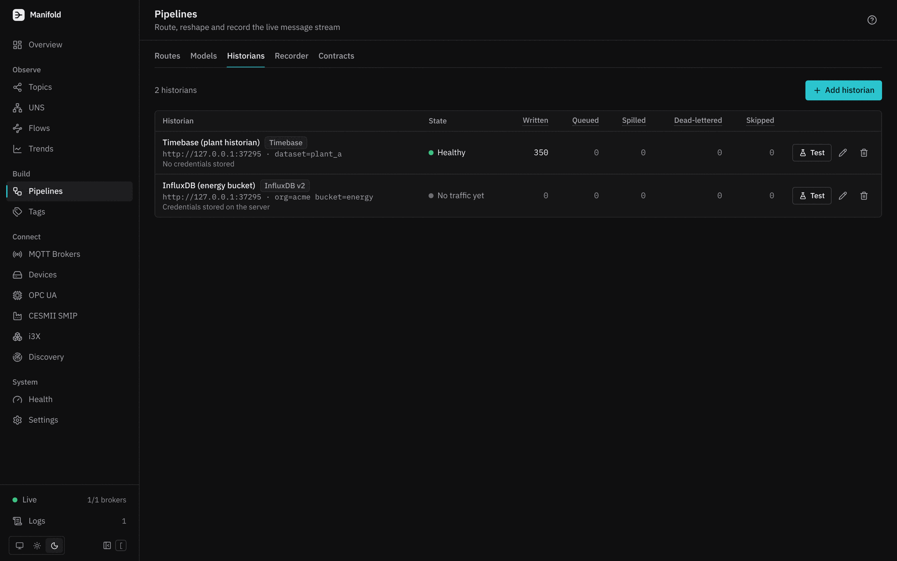
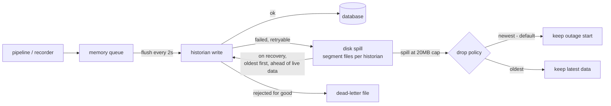
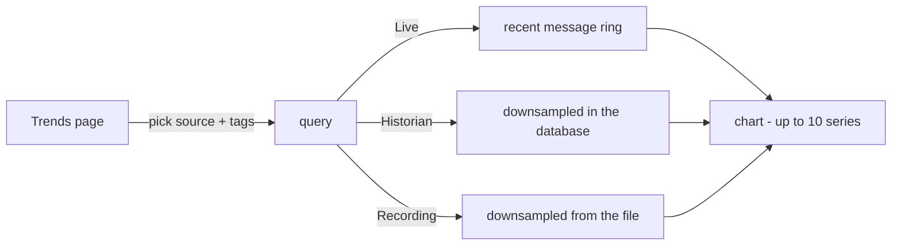
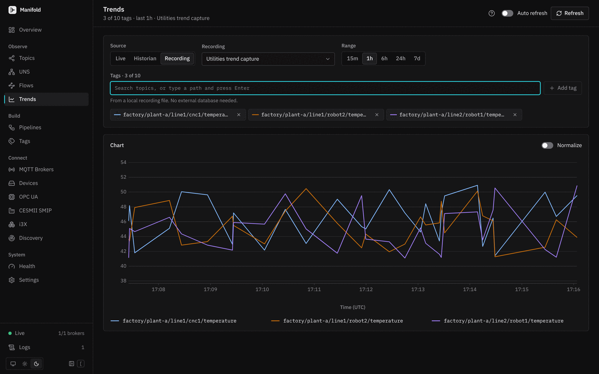

# 🗄️ Historians

> **Goal:** every sample that matters lands in a time-series database — and a
> historian outage delays data instead of deleting it.

Historians are configured under **Pipelines → Historians**. Pipelines and the
recorder never write to a database directly: everything passes through a
**store-and-forward outbox**.

> *Each historian row shows its live store-and-forward state in plain words, with the counters beside it.*

**The Historians tab.** One row per historian: the name and type, the endpoint (`url`, dataset, org and bucket, or
database), whether credentials are stored on the server (the secret itself is never shown again), a **State** and
the counters **Written** (accepted by the historian), **Queued** (waiting in memory), **Spilled** (held on disk
while the historian is unreachable), **Dead-lettered** (refused for good, kept in a dead-letter file) and **Skipped**
(had no usable value, so nothing was sent). The state reads *Healthy*, *No traffic yet*, *Buffering* (points are
waiting or on disk), *Retrying* (the last write failed; the error is shown), *Dropping points* (the offline buffer is full
and the drop policy is discarding) or *Rejecting points* (the historian refused some for good). **Test** writes one real
point (`manifold/connection-test`) and answers *Test write succeeded* or *Test write failed* with the reason; the
pencil edits (a stored secret is kept when you leave its field empty); **Add historian** opens the form (**Type**, **Name**,
the connection fields of that type, and **When the offline buffer is full**: *newest* or *oldest*).

**Deleting a historian that is in use is refused.** If a pipeline route, a recording or a mapping's direct historian
target still writes to it, deleting answers with a *"<name>" is still in use* dialog that names them (the API returns
409); remove or repoint them first.

## How store-and-forward protects your data

- The spill survives restarts and drains **strictly oldest-first**. While a
  backlog exists, live points are never sent ahead of it: if the backlog can't
  be drained they are appended **behind** it on disk. This matters for
  Timebase, which may ignore a point older than a tag's newest one.
- Every bound is explicit and visible — queue depth, spill bytes, and drop
  counts on the Historians tab and in `/metrics`. Nothing is dropped silently.
- A batch the historian **permanently rejects** (HTTP 4xx other than 408/429
  and the credential errors 401/403; Postgres data or integrity errors) does
  not block the queue. It is split (bounded extra requests) to isolate the bad
  points, which go to a **dead-letter file** (capped at 5 MiB, counted in the
  historian's stats as `deadLettered` and shown in the **Dead-lettered** column; it is not a Prometheus series); the rest is delivered. Credential errors (401/403) do the
  opposite: the backlog waits for you to fix the token, it is not discarded.
- The memory queue holds 5,000 points; beyond that the oldest queued points
  spill. Writes are asynchronous and serialized per historian.
- Use the **Test** button after configuring — it writes one real point
  and reports the outcome.

### Where the spill lives

Under `MANIFOLD_DATA_DIR/outbox/`, per historian:

| File | Purpose |
|---|---|
| `<id>.<seq>.seg` | append-only JSONL segments, one point per line, rotated at 4 MiB |
| `<id>.cursor` | how many bytes of the oldest segment are already delivered; written atomically (temp file, fsync, rename), so a crash re-sends at most a batch (**at-least-once**) and never loses or half-writes the spill |
| `<id>.deadletter.jsonl` | permanently rejected points (capped at 5 MiB) |
| `<id>.jsonl` | **legacy** single-file spill from older versions: read first, never appended to, so upgrading needs no conversion |

> 💡 **Choosing a drop policy:** *newest* (default) preserves the beginning of
> an outage — useful for post-mortems. *Oldest* keeps the freshest data —
> what most dashboards want. Set it per historian.

## Backend setup

### InfluxDB v2

| Field | Value |
|---|---|
| URL | `http://influx-host:8086` |
| Org / Bucket | as created in Influx |
| Token | a write-scoped API token |
| Measurement | optional, default `manifold` |

> 💡 Only a real finite number (or a string that is plainly a decimal number)
> writes the `value` field. Everything else, including `true`/`false`, writes
> a separate `raw` string field; `null` carries no information and is skipped
> (and counted). A topic that alternates types can never cause Influx's
> per-shard field-type conflict. Names containing control characters are
> rejected rather than written, so a topic can't inject extra lines.
>
> ⚠️ The InfluxDB writer stores **no quality**. By decision it is not offered
> for [device data](Mapping-to-the-UNS#historians-timebase-is-the-reference):
> a mapping's direct historian target refuses it at save time, and the editor
> lists it as unavailable. A pipeline can still write device topics to InfluxDB;
> you then lose quality.

### TimescaleDB / PostgreSQL

| Field | Value |
|---|---|
| Host / Port / Database / User / Password | Postgres connection |
| Table | optional, default `manifold_samples` |
| SSL | TLS toggle |

On first write, Manifold creates the table (`ts, topic, value, raw, quality`,
indexed; `value` holds only real numbers, `raw` the text of every non-null
value, and a Bad sample with no value is stored as NULL plus its quality) and promotes it to a **hypertable** when the TimescaleDB extension is
present — plain PostgreSQL works without promotion. Connections are pooled
with bounded timeouts: a database outage becomes a write error (which spills),
never a hung process.

### Timebase historian (Flow Software)

| Field | Value |
|---|---|
| URL | `http://historian-host:4511` |
| Dataset | target dataset (auto-created on first write) |
| API key | optional |
| Write path | optional override — confirm against `:4511/api/help` |

Writes are TVQ samples: value, ISO timestamp and the quality that travelled
with the data (Bad is preserved, not coerced). Each tag's samples are sent
oldest-first. Timebase also ingests MQTT/Sparkplug natively, so pointing its
own collector at the UNS is an equally valid integration, and **for device
data it is the path to try first**. See
[Mapping to the UNS](Mapping-to-the-UNS#historians-timebase-is-the-reference),
which also lists what about the Timebase API is still unverified (the shape of
a Bad sample with no value, ordering rules, resolution); the checks to run are
in [Verifying on real hardware](Verifying-on-Real-Hardware#timebase-direct-write).
A pipeline that writes an **envelope** topic stores the JSON wrapper as text
unless you add a `numeric` transform with `field: "v"`; the direct target of a
binding stores the number itself.

> ℹ️ Timebase has no tag-listing API, so the Trends tag *search* is off for
> it — type the exact tag path instead. Querying works for all three
> backends.

## Where the data comes from

- **Pipelines** with a historian target — see [Pipelines and Models](Pipelines-and-Models).
  A pipeline carries the source timestamp and quality of the message when the
  payload has them (TVQ envelope, Sparkplug), rather than stamping arrival time.
- **Device tags**: publish them to the UNS with a mapping
  ([Mapping to the UNS](Mapping-to-the-UNS)), then either let Timebase's own
  collector subscribe, route the topics through a pipeline, or give the mapping
  a **direct historian target** (Delivery section of the editor): every sample it publishes is also enqueued to
  the outbox here with its read timestamp, the value itself and its quality,
  under the resolved topic as the tag name. The target must be a **Timebase or
  TimescaleDB** historian; a mapping that names an InfluxDB historian is
  rejected at save time. See
  [Mapping to the UNS](Mapping-to-the-UNS#historians-timebase-is-the-reference)
  for what is stored, and the limits (use `envelope` or the object layout so
  quality changes reach history).
- The **Recorder** capturing a topic filter straight into a historian.

## Reading it back: the Trends page

**Trends** charts numeric series without leaving Manifold. Choose the **Source**:

| Source | Reads from | Needs |
|---|---|---|
| **Live** | the connected broker's recent message stream, held in memory | a connected broker; no storage |
| **Historian** | a configured InfluxDB or TimescaleDB historian (search its stored tags); a Timebase historian takes typed-in paths | a historian with data |
| **Recording** | a local file recording (Pipelines → Recorder) | a recording with data; no external database |

- Search topics in the box (or type a path and press `Enter`) and **Add tag**: up to **10 series** per chart. Pick the **Range**:
  **15m, 1h, 6h, 24h, 7d**. **Normalize** overlays series with different scales on 0 to 1.
- Historian and recording queries are downsampled **on the server**: at most 1000 points per series, so a week of 1 Hz data
  charts instantly. Gaps from real outages are drawn as gaps, not bridged by straight lines; Bad-quality samples are marked.
- **Auto refresh** (off by default) re-queries every 30 s while the tab is visible; **Refresh** does it now. The time axis
  names its time zone.

> 💡 Trends is also how you verify a pipeline to historian route end to end: if the tag appears in the tag search, it landed.
