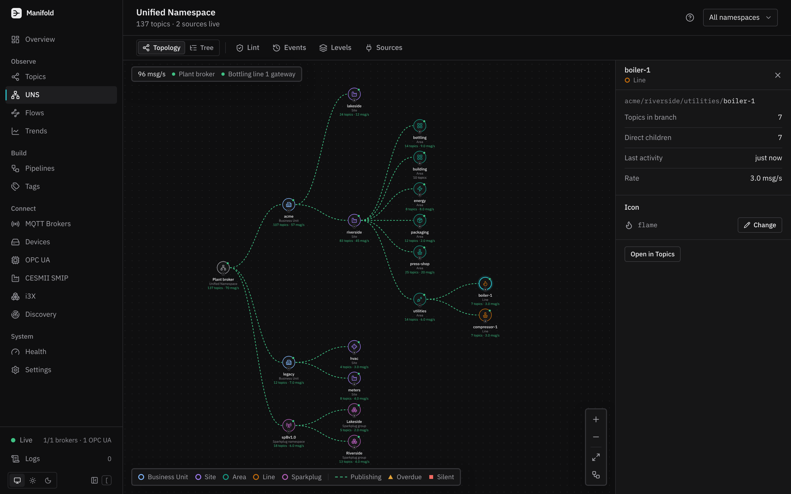
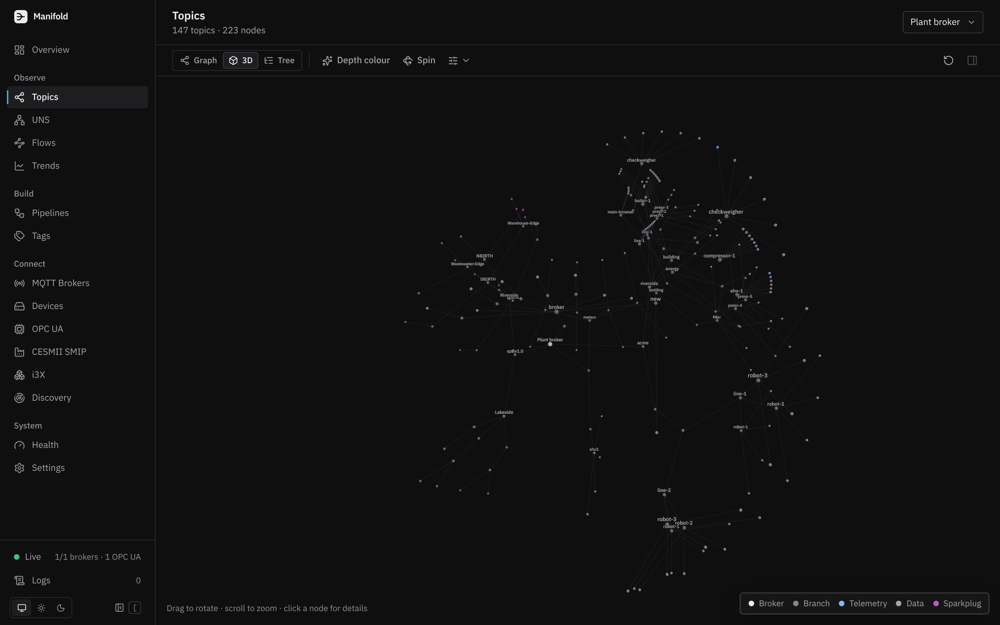
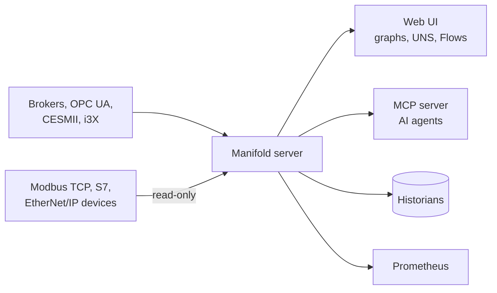

# 🏭 Manifold

**One live map of your industrial data** — MQTT · Sparkplug B · OPC UA · CESMII SMIP · i3X, plus read-only Modbus TCP · S7 · EtherNet/IP device drivers, explored, unified, and shaped into a Unified Namespace.

  

> *The live ISA-95 topology — built entirely from observed traffic: values on leaves, message rates on branches, publishing edges animated. Screenshots in this wiki come from the real app running against simulated devices and a simulated plant, captured by `npm run docs:shots` (see the README); the light theme has its own captures in [User interface](User-Interface).*

---

## 🚀 Start here

| | Guide | You will learn |
|---|---|---|
| 🏁 | **[Getting Started](Getting-Started)** | Install, run (source or Docker image), connect a broker, add a device, map its tags, and see them in the UNS |
| 🎨 | **[User interface](User-Interface)** | Layout, light and dark themes, keyboard shortcuts, what accessibility testing covers, deep links, phones |
| 🔌 | **[Broker Setup](Broker-Setup)** | Intake QoS, transports and MQTT 5, shared subscriptions, the EMQX ACL recipe, admin APIs for consumer lineage |
| 🗄️ | **[Historians](Historians)** | InfluxDB, TimescaleDB, Timebase — store-and-forward in, Trends charts back out |
| 🔀 | **[Pipelines and Models](Pipelines-and-Models)** | Route, reshape, and contextualize the live stream |
| 🔧 | **[Devices and Drivers](Devices-and-Drivers)** | Poll Modbus TCP, S7 and EtherNet/IP PLCs: addressing, byte order, PLC-side prerequisites, profiles and bulk creation, finding devices, polling health, the read-only guarantee |
| 🗺️ | **[Mapping to the UNS](Mapping-to-the-UNS)** | The mapping editor section by section, selecting tags by pick or by rule, per-tag settings, context, exact payloads from worked examples, quality, `_status` and `_meta`, deadband and heartbeat, profile mappings, preview, the direct historian target |
| ✅ | **[Verifying on real hardware](Verifying-on-Real-Hardware)** | The ordered checklist for an engineer with a real Modbus, S7 or EtherNet/IP device or a Timebase historian |
| 🏷️ | **[Tags and Sparkplug](Tags-and-Sparkplug)** | Browse tags, publish them into the UNS, run a Sparkplug primary host |
| 🛡️ | **[Operations](Operations)** | Fail-closed auth, roles and the viewer experience, session switching, the egress guard and its limits, audit, profile durability, the Health page and every metric, config as code, alerts, upgrade notes |
| 🩺 | **[Troubleshooting](Troubleshooting)** | Symptom → cause → fix, including devices, the mapping editor, canvases and themes |

## 📐 How it fits together

Deep design documentation lives in the repository:

- 📖 [README](https://github.com/zbest1000/manifold#readme) — overview and quick start
- 🏗️ [ARCHITECTURE.md](https://github.com/zbest1000/manifold/blob/main/ARCHITECTURE.md) — system design, hot path, API surface, testing
- 🐳 [DOCKER.md](https://github.com/zbest1000/manifold/blob/main/DOCKER.md) — one-command demo stack
- 📝 [CHANGELOG.md](https://github.com/zbest1000/manifold/blob/main/CHANGELOG.md) — release history

---

> ✏️ These pages are generated from [`docs/wiki/`](https://github.com/zbest1000/manifold/tree/main/docs/wiki) in the repository and published by CI. **Edit there, not here** — direct wiki edits are overwritten by the next sync.
