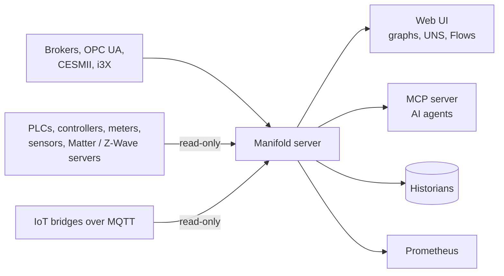

# 🏭 Manifold

Manifold is a self-hosted web application that reads live data from your plant's brokers, OPC UA servers and devices, shows it as one browsable namespace, and republishes it in a clean, consistent shape for other systems.

It reads MQTT (including Sparkplug B), OPC UA, CESMII SMIP and i3X; polls PLCs, meters and controllers through read-only drivers (Modbus TCP, Siemens S7, EtherNet/IP, BACnet/IP, SNMP, HTTP/JSON, MTConnect, CoAP, and Matter and Z-Wave through their bridge servers); and recognises IoT devices from the MQTT traffic of their bridges. Every driver except Modbus TCP, and every IoT convention, is **experimental: none has been run against real hardware yet**.

How the pieces fit is drawn in the [README](https://github.com/zbest1000/manifold#how-it-works) (one overview) and in [ARCHITECTURE.md](https://github.com/zbest1000/manifold/blob/main/ARCHITECTURE.md#diagrams) (processes, the path of one value, drivers, mappings, store-and-forward, security, alarms, deployment).

  

> *The live ISA-95 topology — built entirely from observed traffic: values on leaves, message rates on branches, publishing edges animated. Screenshots in this wiki come from the real app running against simulated devices and a simulated plant, captured by `npm run docs:shots` (see [How the screenshots are made](User-Interface#how-the-screenshots-are-made)); the light theme has its own captures in [User interface](User-Interface).*

---

## 🚀 Start here

| | Guide | You will learn |
|---|---|---|
| 🏁 | **[Getting Started](Getting-Started)** | Install, run (source or Docker image), connect a broker, add a device, map its tags, and see them in the UNS |
| 🎨 | **[User interface](User-Interface)** | Layout, light and dark themes, keyboard shortcuts, what accessibility testing covers, deep links, phones |
| 📶 | **[Broker Setup](Broker-Setup)** | Intake QoS, transports and MQTT 5, shared subscriptions, the EMQX ACL recipe, admin APIs for consumer lineage, the security posture, the opt-in canary, public test-broker presets |
| 🗄️ | **[Historians](Historians)** | InfluxDB, TimescaleDB, Timebase — store-and-forward in, Trends charts back out |
| 🔀 | **[Pipelines and Models](Pipelines-and-Models)** | Route, reshape, and contextualize the live stream; decode CBOR, MessagePack, SenML, Protobuf and Avro payloads (Codecs) |
| 🔧 | **[Devices and Drivers](Devices-and-Drivers)** | One table of every driver, what is common to all of them, then Modbus TCP, S7, EtherNet/IP, BACnet/IP, SNMP, HTTP/JSON, MTConnect and CoAP one by one; profiles and bulk creation, finding devices, polling health, the read-only guarantee |
| 🔌 | **[Matter and Z-Wave bridge servers](Bridge-Servers)** | Reading Matter and Z-Wave networks through the Matter Server and Z-Wave JS Server |
| 📡 | **[IoT devices over MQTT](IoT-Devices-over-MQTT)** | Zigbee2MQTT, Z-Wave JS UI, Home Assistant discovery, Tasmota, Shelly, ChirpStack and The Things Stack devices from their MQTT traffic |
| 🏭 | **[OPC UA](OPC-UA)** | Connecting, security and trust, browsing and monitoring |
| 🗺️ | **[Mapping to the UNS](Mapping-to-the-UNS)** | The mapping editor section by section, selecting tags by pick or by rule, per-tag settings, context, exact payloads from worked examples, quality, `_status` and `_meta`, deadband and heartbeat, profile mappings, preview, the direct historian target |
| ✅ | **[Verifying on real hardware](Verifying-on-Real-Hardware)** | One ordered checklist per driver, for the IoT conventions and for a Timebase historian |
| 🏷️ | **[Tags and Sparkplug](Tags-and-Sparkplug)** | Browse tags, publish them into the UNS, run a Sparkplug primary host |
| 🔔 | **[Alerts](Alerts)** | Alert rules and severities, active alarms and acknowledging them, the durable history and CSV export, what a restart does |
| 🛡️ | **[Operations](Operations)** | Fail-closed auth, roles and the viewer experience, session switching, the egress guard and its limits, audit, profile durability, the Health page and every metric, config as code, alerts, upgrade notes |
| 🩺 | **[Troubleshooting](Troubleshooting)** | Symptom → cause → fix, including devices, the mapping editor, canvases and themes |

## 📐 How it fits together

Deep design documentation lives in the repository:

- 📖 [README](https://github.com/zbest1000/manifold#readme) — overview and quick start
- 🏗️ [ARCHITECTURE.md](https://github.com/zbest1000/manifold/blob/main/ARCHITECTURE.md) — system design, hot path, API surface, testing
- 🐳 [DOCKER.md](https://github.com/zbest1000/manifold/blob/main/DOCKER.md) — one-command demo stack
- 📝 [CHANGELOG.md](https://github.com/zbest1000/manifold/blob/main/CHANGELOG.md) — release history

---

> ✏️ These pages are generated from [`docs/wiki/`](https://github.com/zbest1000/manifold/tree/main/docs/wiki) in the repository and published by CI. **Edit there, not here** — direct wiki edits are overwritten by the next sync.
