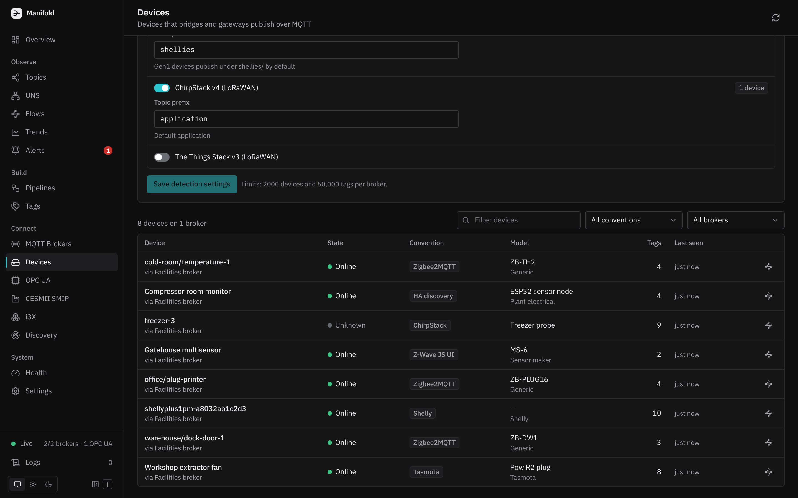

# 📡 IoT devices over MQTT

> **Goal:** see the Zigbee, Z-Wave, Wi-Fi and LoRaWAN devices that a bridge or gateway already
> publishes on your broker as **devices with named tags, units and types**, and map them into the
> UNS like any other device.

**Manifold reads from the bridge, it does not talk to the devices.** Zigbee2MQTT, Z-Wave JS UI,
Home Assistant, Tasmota, Shelly firmware and LoRaWAN network servers keep doing the pairing and
the radio work. Manifold only subscribes to what they publish. It does **not** pair, interview,
configure or control any device, and it never publishes to their command topics (`.../set`,
`cmnd/...`, `.../command`, `.../rpc`, Z-Wave `.../set`, LoRaWAN downlinks). There is no switch to
turn that on.

> **Experimental — not verified on real hardware.** This was built and tested against an in-process
> simulator that reproduces each project's documented MQTT messages
> (`server/test/support/iotMqttSimulator.js`), not against real bridges, gateways or devices.
> Expect differences in the field; the formats handled and the known gaps are listed in
> `server/services/iot/NOTES.md`.

## What is recognised

| Convention | Default topics | Device identity (survives renames) | Tags from |
|---|---|---|---|
| **Zigbee2MQTT** | `zigbee2mqtt/bridge/devices`, `zigbee2mqtt/<name>`, `.../availability` | IEEE address | the device definition's `exposes` (only properties Zigbee2MQTT publishes as state) |
| **Z-Wave JS UI** | `zwave/<node>/<cc>/<endpoint>/<property>`, named topics, `<node>/status` | node id | value topics; label, unit, range and states when the gateway sends the entire value object |
| **Home Assistant MQTT discovery** | `homeassistant/<component>/[<node>/]<object>/config`, device-based `homeassistant/device/<id>/config` | `device.identifiers` / `unique_id` | each entity's state topic and value template; `unit_of_measurement`, `device_class`, `state_class` |
| **Tasmota** | `tele/<topic>/SENSOR|STATE|LWT`, `stat/<topic>/POWER`, `tasmota/discovery/<MAC>/config` | MAC (from discovery) | the nested SENSOR/STATE JSON, units from `TempUnit` and field names |
| **Shelly** | Gen1 `shellies/<id>/...`; Gen2+ `<id>/status/<component>`, `<id>/events/rpc` | device id | scalar topics (Gen1), component JSON (Gen2+) |
| **ChirpStack v4** | `application/<app>/device/<devEUI>/event/up` | DevEUI | the decoded `object`; RSSI/SNR/frame counter/battery as diagnostics |
| **The Things Stack v3** | `v3/<app>@<tenant>/devices/<device>/up` | DevEUI | `uplink_message.decoded_payload`; RSSI/SNR/frame counter/battery as diagnostics |

Without a decoded LoRaWAN payload the raw application payload is shown as hex.

## Turning detection on

Detection is **off by default** and **per broker, per convention**.

1. Connect the broker the bridge publishes to (**Brokers**). Leave its intake filter at `#` so
   state topics anywhere on the broker are seen.
2. Open **Devices → IoT over MQTT**. Under **Detection**, pick the broker.
3. When Manifold has seen matching traffic (a Zigbee2MQTT device list, a Home Assistant discovery
   config, a Z-Wave JS UI gateway status, ...), it shows a suggestion such as *Zigbee2MQTT traffic
   seen* with **Turn on Zigbee2MQTT**, with the base topic it found. Or switch a convention on
   yourself, adjust its topic options (Zigbee2MQTT base topic, Z-Wave prefix, discovery prefix,
   Tasmota FullTopic, ...) and **Save detection settings**.

What the broker already holds (retained device lists and configs, last values) is read at once;
devices appear within a second or two.

## The device list and the device detail

Each device shows its name, **convention** and **via broker**, its state (*Online*, *Offline* or
*Unknown* when the convention reports no availability), model and manufacturer, tag count and
when it was last seen. Click a device to see what the convention says about it and every tag with
its **live value, unit, quality, type, range or allowed values and the topic and selector** it
comes from. Diagnostics (link quality, RSSI, battery) can be hidden.

Quality:

- **Good** - read from the latest message.
- **Uncertain** - the tag is known but the last message did not contain it (a missing attribute),
  or a Home Assistant template could not be evaluated by Manifold (*template not supported*; the
  raw payload is shown instead).
- **Bad** - the device is offline (availability topic, LWT, dead Z-Wave node, bridge or gateway
  offline) or the broker is disconnected.

Where the payload carries a time (Zigbee2MQTT `last_seen`, Z-Wave `lastUpdate`, ChirpStack
`time`, The Things Stack `received_at`, Shelly `ts`), it is the value's source time. Tasmota's
`Time` is local time without a zone and is not used.

## Mapping into the UNS

**Map to UNS** (in the list or the detail) opens **Tags** with the device as the source. Its tags
come with the name, unit, type, range and description the bridge described, so the mapping
editor is pre-filled; pick tags or **Map by rule** for every tag (new tags are picked up), set the
asset path and save. Everything in [Mapping to the UNS](Mapping-to-the-UNS) applies: envelope or
plain payloads, `_meta` and `_status`, Sparkplug targets, deadbands, history.

- An offline device publishes one Bad value per tag (envelope / object payloads) and
  `_status: { online: false }`.
- Renames in the bridge keep the mapping working where the convention gives a stable id (IEEE
  address, node id, DevEUI, `unique_id`, MAC).
- A mapping may not publish into topics detection reads on the same broker (for example under
  `zigbee2mqtt/`); the editor shows the server's refusal.

## Limits and safety

- At most 2000 devices and 50 000 tags per broker, 400 tags per device (`MANIFOLD_IOT_MAX_DEVICES`,
  `MANIFOLD_IOT_MAX_TAGS`). Payloads over 256 KB and JSON nested deeper than 24 levels are refused
  and counted; a payload a parser cannot read is counted per convention and shown as *unreadable*;
  ingest carries on.
- Home Assistant value templates are evaluated by a small built-in evaluator that supports
  `{{ value }}`, `{{ value_json.a.b }}`, `value_json['a']`, `| float`, `| int`, `| round(n)` and
  arithmetic. Nothing else is evaluated, and no template code is ever executed.

## API and MCP

- `GET /api/iot/conventions`, `GET /api/iot/brokers`, `GET|PUT /api/iot/brokers/:brokerId`
  (`{ conventions: { zigbee2mqtt: { enabled: true, baseTopic: "zigbee2mqtt" }, ... } }`),
  `GET /api/iot/devices?brokerId=&convention=&q=`, `GET /api/iot/devices/:brokerId/:deviceId`.
- Mapping source: `{ "type": "iot", "brokerId": "...", "deviceId": "z2m:0x00158d0001a2b3c4", "tags": ["temperature"] | "all" }`.
- MCP: `iot_devices` lists these devices; `tags_sources` includes them.

See also: [Devices and Drivers](Devices-and-Drivers) · [Broker Setup](Broker-Setup) · [Mapping to the UNS](Mapping-to-the-UNS)
