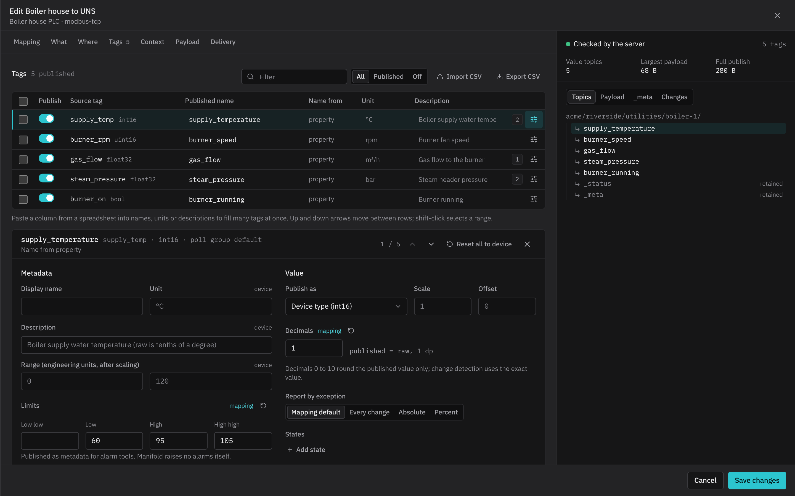
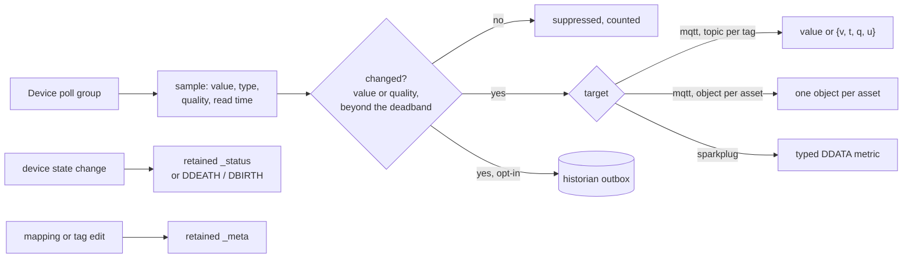
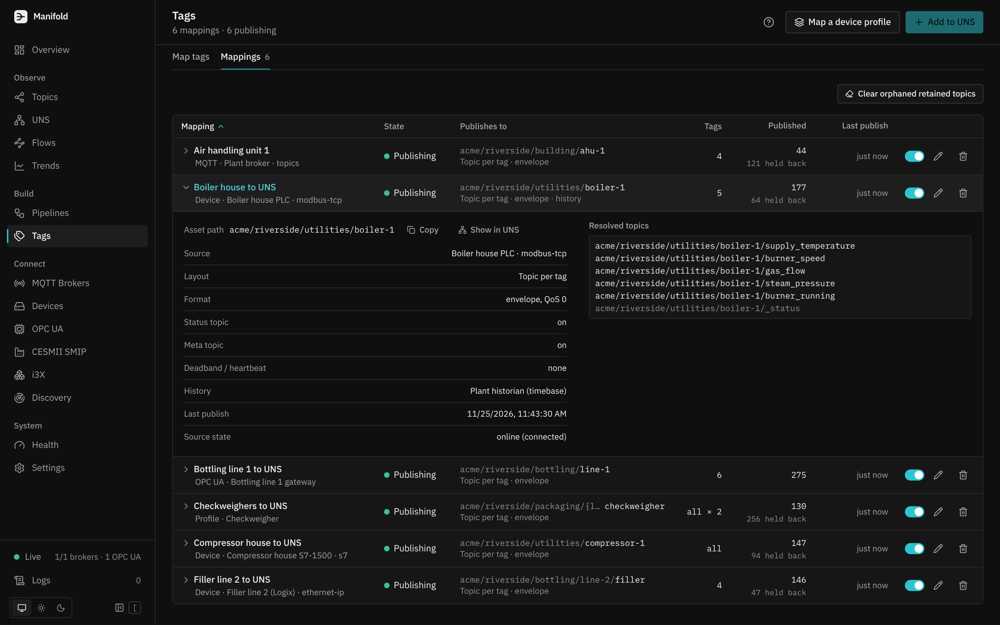
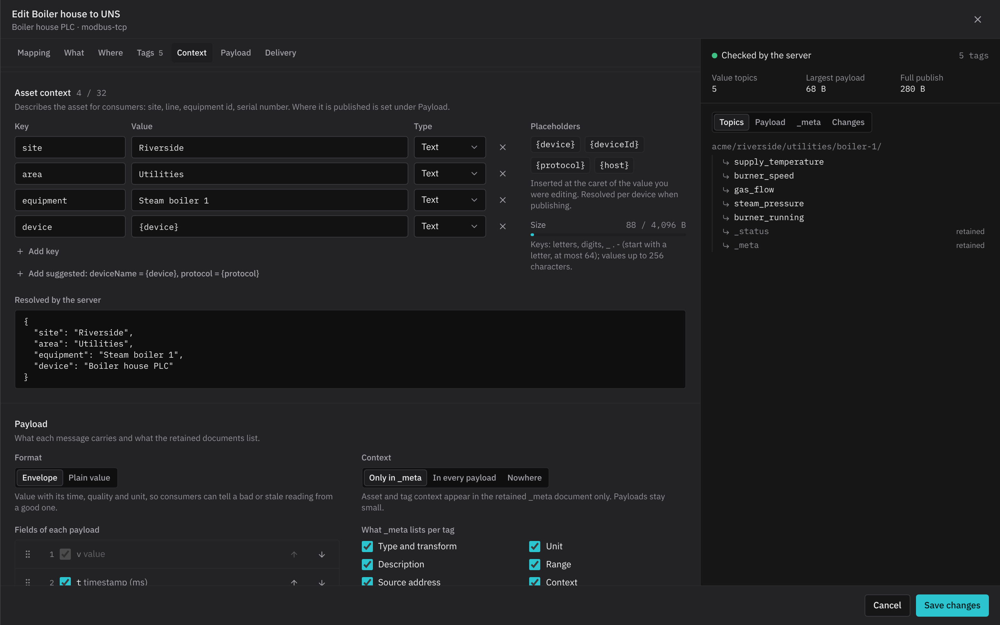
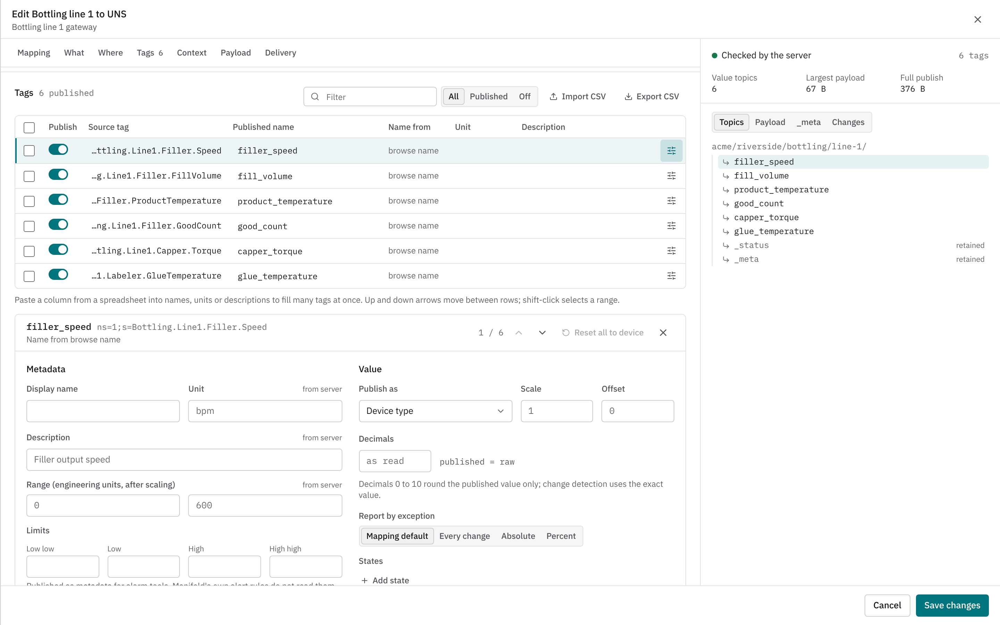

# 🗺️ Mapping to the UNS

> **Goal:** land device tags in the Unified Namespace as named, typed values
> that carry their quality and their units, so a consumer can tell "the value
> is 0" from "the device is gone".

A **mapping** takes tags from a source (a device, a device profile, an OPC UA
connection, a Sparkplug endpoint, MQTT topics or an IoT device that a bridge publishes over MQTT) and publishes them to the broker. **"Mapping" is
the word the interface uses; the REST API, the stored configuration and the
JSON on this page call the same object a *binding*** (`/api/tags/bindings`).
This guide says "mapping" for what you do in the UI and keeps `binding` where it
quotes the API.

This page is the reference for the mapping editor and for what a mapping publishes. New to it?
Read [The Tags page and the mapping editor](#the-tags-page-and-the-mapping-editor), then the
[worked examples](#worked-examples-the-exact-messages), which show the exact messages.

**Contents:** [The Tags page and the editor](#the-tags-page-and-the-mapping-editor) ·
[Path is not address](#path-is-not-address) · [Payload layouts](#plain-envelope-or-one-object-per-asset) ·
[Quality and `_status`](#quality-and-the-_status-topic) · [`_meta`](#metadata-units-and-the-_meta-document) ·
[Deadband and heartbeat](#report-by-exception-deadband-and-heartbeat) ·
[MQTT topics](#mqtt-topics-as-a-source) and [IoT devices](#iot-devices-as-a-source) as sources ·
[Retain and cleanup](#retain-and-what-is-cleaned-up) · [Choosing what to map](#choosing-what-to-map) ·
[Adding context](#adding-context) · [Preview and warnings](#preview-and-warnings) ·
[Sparkplug target](#sparkplug-as-the-target) · [Historians](#historians-timebase-is-the-reference) ·
[Worked examples](#worked-examples-the-exact-messages) · [Bindings as JSON](#quick-reference-bindings-as-json)

Device tags come from the [Devices page](Devices-and-Drivers). You create the
mapping on the **Tags** page: choose the source, tick tags (or choose a rule), and use
**Add to UNS**; the **mapping editor** opens as a single sheet and shows the topics
and payloads the server would publish before you save.





## The Tags page and the mapping editor

**Tags page** (`/tags`). Two tabs:

- **Map tags**: a **Source** selector (devices, device profiles, OPC UA connections,
  Sparkplug, and MQTT topic trees), a tag tree for it with a **Filter loaded tags** box,
  **Select shown (n)**, a refresh button, and a **mapped** marker on tags that already
  belong to a mapping. On the right: **Selected tags**, **Every tag of this device**
  (with **Map by rule**), **Mappings of this source** (each with its state and an edit
  pencil) and a collapsed **Sparkplug primary host** panel. In the header: **Map a device
  profile** and **Add to UNS**. MQTT topics become mappings like any other source (see
  [MQTT topics as a source](#mqtt-topics-as-a-source)); with an MQTT source the right column offers
  **Every topic under a filter** (**Map by filter**) instead of map by rule. The selected list
  shows each tag's name plus as many parent levels as it takes to tell same-named tags apart
  (`temp …/line1`, `temp …/line2`); the full address shows on hover and keyboard focus. A **CSV**
  button opens the editor straight into **Import mapping rows from CSV**.
- **Mappings**: every mapping in a sortable table (**State**, **Publishes to**, **Tags**,
  **Published**, **Last publish**), an enable switch, **Edit mapping** and **Delete mapping**
  per row, and an expandable row with the asset path (**Copy**, **Show in UNS**) and the
  resolved topics. A profile mapping shows `all x N` for its N instances. The **State** column
  answers "why is nothing publishing?" in plain language from the server's diagnosis
  (`health` in `GET /api/tags/bindings`): *Publishing*, *Waiting* (no first value yet),
  *Not publishing* with the reason (source offline, target broker not connected or removed,
  every tag switched off, 0 tags matched by the rules, no topic under the filter yet,
  deadband holding every value back, loop guard, stale topics, last error), *Disabled*, and
  **Source missing** when the device, profile, OPC UA connection or broker the mapping reads
  from was deleted, with how to fix it. A **Clear orphaned retained topics** button sits above
  the table (see [Retain, and what is cleaned up](#retain-and-what-is-cleaned-up)).
- Configuration from 1.0.0, where MQTT topic selections became pipeline routes, gets a banner
  that offers to **Review** those routes and turn each into a mapping (see
  [MQTT topics as a source](#mqtt-topics-as-a-source)).



**The editor.** One modal sheet with a tab strip that scrolls to each section (a red dot
marks a section with a problem): **Mapping, What, Where, Tags, Context, Payload,
Delivery**. A live **Preview** column is always on the right (from wide screens).
`Ctrl+S` saves (a save asked for while the server is still checking the latest change goes
ahead as soon as the check answers); `Esc` or **Cancel** asks before discarding what you
entered. A viewer session can open the editor read-only, with the reason on every disabled
control, and still use the preview, the suggestions and **Export CSV**. When the same mapping
is open in another tab of the browser, a banner says so.

**Concurrent edits.** The editor sends the mapping's `rev` back when the server provides one.
If someone saved the mapping after you opened it, the server answers `409 { code: 'stale',
current }` and the editor shows **This mapping was changed elsewhere**: what changed there and
what you changed (field by field, fields changed in both places marked), with **Keep mine
(overwrite)** (saves your version on top of their revision), **Take theirs** (reloads their
version) and **Cancel** (back to editing, nothing lost).

| Section | Controls | What it decides |
|---|---|---|
| **Mapping** | **Name**; **Target broker**; **Publish as**: *UNS topics* or *Sparkplug B device* | Where the output goes and in which form |
| **What** | **How tags are chosen**: *Pick tags* or *All tags by rule*. Rules: **Include (key or property)**, **Exclude**, poll-group and type checkboxes, **Property** (*Any tag*, *Only tags with a UNS name (property)*, *Only tags without a property*), with live match counts. For a profile mapping, the **Device profile** | Which tags are mapped. By rule, tags added to the device later are picked up when they match |
| **Where** | The **asset path**, with a picker that browses the branches already in the UNS or accepts a new path; for a profile an **Asset path template** with insertable `{device}`, `{deviceId}` and parameter chips and an own-path override per instance; for Sparkplug **Group**, **Edge node**, **Device**; **Layout**: *Topic per tag* or *Object per asset* | The topic of every tag |
| **Tags** | A table: **Publish** switch, **Source tag** (long paths are shortened from the start), **Published name**, **Name from**, **Unit**, **Description**, and a **Details of &lt;tag&gt;** button. A filter (*All*, *Published*, *Off*). **Import CSV** and **Export CSV** (see below). Paste a column from a spreadsheet into names, units or descriptions. Select rows (shift-click for a range) and use **More actions...**: set unit, set description, set deadband, set a context key, find and replace in names, names to camelCase or snake_case, strip a prefix, copy settings from a tag, reset to device values | What each tag is called and how it is described |
| **Context** | **Asset context**: key, value and type rows; **Placeholders** (`{device}`, `{deviceId}`, `{protocol}`, `{host}`, profile parameters); a size meter; **Add suggested**; **Resolved by the server** | Site, line, equipment id and the like, for consumers |
| **Payload** | **Format**: *Envelope* or *Plain value*; **Fields of each payload** (`v` value, `t` timestamp, `q` quality, `u` unit, `name`, `src`, `ctx`) as an ordered list: tick to publish, reorder with the arrow buttons, the arrow keys on a row's handle, or drag; the order is what is published; **Context**: *Only in _meta*, *In every payload*, *Nowhere*; **What _meta lists per tag**; switches for `_status` and `_meta` | What a message and the retained documents contain |
| **Delivery** | **QoS**; **Sampling interval (ms)** (OPC UA); for MQTT topics **Value field** and **Mark stale after (ms)**; **Retain values** (off by default); **Maximum object size (bytes)**; report by exception (**Deadband** *Absolute* or *Percent*, **Heartbeat (ms)**); **Also write every published sample to a historian** (Timebase or TimescaleDB only) | How often and how reliably |

**The per-tag details panel** opens from the sliders button on a row (**Details of
&lt;tag&gt;**). It has **Previous tag** and **Next tag**, **Reset all to device**, and these groups:

- *Metadata*: **Display name**, **Unit**, **Description**, **Range** (engineering units, after scaling).
- *Value*: **Publish as** (*Device type* or `number`, `integer`, `boolean`, `string`), **Scale**,
  **Offset**, **Decimals**, **Report by exception** (*Mapping default*, *Every change*,
  *Absolute*, *Percent*), **States** (raw value to label, with a choice of how states are
  published), **Limits** (low low, low, high, high high; published as metadata for alarm
  tools; Manifold's own [alert rules](Alerts) do not read them).
- *Tag context*: key/value pairs for this tag only.
- A line states the value pipeline for the tag, for example `published = raw x 0.1, 1 dp`.

Every field shows where its value comes from: **device** (the tag definition on the
Devices page), **from server** (an OPC UA node's EngineeringUnits, EURange, Description
or data type, read once per connect), **mapping** (your override) or nothing (the default), with a reset
arrow beside an override. A field you leave empty keeps following the device. The origins
are the server's answer for that one tag (the preview's `origins`, `metadata` and
`contextOrigins`); a value you just typed is marked *mapping* at once. For an MQTT topic the
panel also has **Value field** and **Mark stale after (ms)** for that topic.

**CSV, for every source.** **Import CSV** in the Tags section reads one line per tag, matched
by address: `address,name,enabled,unit,description,displayName,dataType,scale,offset,precision,deadband`
(plus `field,staleAfterMs` for MQTT topics; only `address,enabled` for Sparkplug metrics). A
header is optional (without one the columns are `address,name`, so a Kepware or Ignition
`nodeId,name` export works as is). Empty cells change nothing; `deadband` takes `0.5` or `2%`.
In a pick list, addresses not in the mapping are added when the source has them; by rule,
lines only update listed tags. Before anything applies, the dialog shows how many lines add
or update and every line it skips with the reason (`line 4: "nope" is not a tag of the
device`). **Download template** gives the columns for the source; **Export CSV** downloads the
table as it is.



The editor in the light theme:



**The preview** (right column) is the server's answer, not a guess: a status line
(**Checked by the server**), counts (**Value topics**, **Largest payload**, **Full
publish**), and four tabs: **Topics** (the topic tree, with `_status` and `_meta` marked
*retained*), **Payload** (the example payload of the focused tag, built from the latest
known value), **_meta** (the retained document that would be published) and **Changes**
(for an edit: what moves, with the old topic struck through). Warnings and collisions
appear as banners with **Go to tag**. The preview calls
`POST /api/tags/bindings/preview`; nothing is stored or published until you save, and a
viewer can use it.

## Path is not address

A tag has a device **address** (`DB10.DBD4`, `40012`,
`Program:Main.Filler.Speed`) and a UNS **name**. The topic is built from an
**asset path** and the name:

```text
<assetPath>/<name>      acme/dallas/packaging/line4/filler/speed
```

- **Asset path** (`target.assetPath`): the ISA-95 levels, written out in full,
  with no placeholders: `acme/dallas/packaging/line4/filler`. Segments are
  separated by `/`; none may be empty (no leading, trailing or doubled `/`),
  contain `+`, `#` or braces, or start with `$` (reserved for broker topics); at
  most 512 characters. The editor's **asset-path picker** (Where) browses the branches
  already in the UNS (lazily, one level per request) and also accepts a new
  path. A trailing `/` is dropped.
- **Name**: the published name of a tag is, in this order, the `name` on the
  binding entry, the tag's **property** (the "UNS name" field in the device tag
  table), or its key. Whitespace, `/`, `+` and `#` in a name become `_`. The
  editor never proposes a raw address as a name.
- **Path template** (`target.pathTemplate`, legacy): `acme/dallas/{name}`, where
  `{name}` is the tag name; a template without `{name}` gets `/<name>` appended.
  Stored bindings and the demo seed still use it and it keeps working; the
  editor writes `assetPath` for new mappings and keeps the form a binding was
  stored with when you edit it.

| Destination | Topic of tag `speed` |
|---|---|
| `assetPath: acme/dallas/line4/filler` | `acme/dallas/line4/filler/speed` |
| `pathTemplate: acme/dallas/line4/filler/{name}` | `acme/dallas/line4/filler/speed` |
| `pathTemplate: acme/dallas/line4/filler` (no `{name}`) | `acme/dallas/line4/filler/speed` |

The namespace lint flags a leaf that looks like a raw address (`DB10.DBD4`,
`40012`, `ns=2;s=...`, `Program:...`), and the editor and the API warn about
such names when you save (see [Preview and warnings](#preview-and-warnings)).

### One definition for many identical devices: profile bindings

A **device-profile binding** (`source.type: "device-profile"`) maps a
[device profile](Devices-and-Drivers#device-profiles-and-instances) once and
publishes **one asset per instance** (device) of that profile, including
instances added later. The destination is either:

- `target.assetPathTemplate`: for example `acme/{site}/{device}/pump`. Allowed
  placeholders are `{device}` (the device's name), `{deviceId}`, and any
  **parameter** the profile declares (`{site}`, `{db}` ...) with that instance's
  value. Each substituted value is cleaned like a name (whitespace, `/`, `+`,
  `#` become `_`), so a device called `Line 1 meter` gives `Line_1_meter`. An
  unknown placeholder is rejected at save time.
- or `target.assetPaths`: an explicit map `{ "<deviceId>": "acme/dallas/line4" }`.
  An entry here wins over the template for that device.

An instance whose path cannot be resolved (a missing parameter value, an
invalid path) is skipped and reported as a warning of type `asset-path`; the
other instances publish. For a Sparkplug target the device name defaults to
`{device}` and may use the same placeholders.

## Plain, envelope or one object per asset

Two **layouts** (`target.layout`):

### `topic-per-tag` (default)

One topic per tag, `<assetPath>/<name>`, in one of two **formats**:

| Format | Payload | Carries quality? |
|---|---|---|
| `plain` | the bare value: `23.1`, `true`, `"PUMP-1"` | **no** |
| `envelope` | `{"v": 23.1, "t": 1795503961422, "q": 192, "u": "degC"}` | yes |

`q` is **192 Good**, **64 Uncertain** or **0 Bad**. `t` is when Manifold read
the value, as epoch milliseconds (polled protocols have no device timestamp and
the envelope does not pretend otherwise; for OPC UA the source timestamp is used
when the server supplies one). `u` is the tag's engineering unit and is **left
out when the tag has none**.

**Use `envelope`** (the editor's default) for anything a consumer might act on.
With `plain` there is no way to say "bad": when a device drops out, the last
value stays on the topic and only `_status` changes.

### `object-per-asset`

One JSON object per asset, published **to the asset path itself**, instead of one
topic per tag. It always carries quality (the format choice does not apply):

```json
{
  "t": 1795503961422,
  "values": {
    "temperature": { "v": 21.5, "q": 192, "u": "degC" },
    "count":       { "v": 7,    "q": 192 }
  }
}
```

Topic: `acme/dallas/meter1`. `t` is the newest sample time in the object; each
member has `v`, `q` and, when the tag has a unit, `u`. Properties:

- Published at the end of a **poll cycle** (the device runtime signals the end
  of each batch) or 50 ms after the first change, whichever comes first, and only
  when some member's value or quality changed, plus the heartbeat. The whole object is sent every
  time, so a consumer always gets every member.
- A source going offline sets every member to `q: 0` and publishes the object at
  once.
- **Size-capped.** `target.maxObjectBytes` (default 65,536; 1,024 to 1,048,576).
  At save time the server estimates the worst case (number of tags times the
  largest plausible member for its type, plus the envelope) and **rejects** a
  binding that could exceed the cap, saying how many tags and bytes; split the
  binding, bind fewer tags or raise the cap. At run time an object that is over
  the cap is not published and the binding's error count and last error say so.
- QoS and retain apply to the object. `_status` and `_meta` are still published
  under it (`<asset>/_status`, `<asset>/_meta`), so the asset topic has a payload
  **and** children: the namespace lint reports this as `data-on-branch`. Turn the
  two documents off (the `_status` and `_meta` switches under Payload) if you want a clean
  object-only asset and accept the loss of the status document.
- Available for `mqtt` targets only, not Sparkplug.

Use one object per asset when consumers want a consistent snapshot of a machine
(a dashboard, an analytics model) and per-tag topics when they subscribe to
single values or use per-topic ACLs.

## Quality and the `_status` topic

What happens when the device goes away (connection lost, driver process down,
or a tag quarantined):

| Target | Tag topics | Device-level signal |
|---|---|---|
| `mqtt`, `envelope` | one publish per tag with `q: 0` and the last value | retained `_status` |
| `mqtt`, object per asset | one object publish with every member `q: 0` | retained `_status` |
| `mqtt`, `plain` | **nothing changes** | retained `_status` |
| `sparkplug` | nothing per tag | `DDEATH`; `DBIRTH` with last values on recovery |

While a device is offline, an envelope or object binding with a heartbeat keeps
republishing the last values with `q: 0`, so a consumer's "Bad" does not time out
into silence. A `plain` binding's heartbeat stops while the source is offline,
so stale values do not look live. Recovery republishes as Good.

The retained **`<assetPath>/_status`** document has exactly this shape:

```json
{ "online": true, "since": 1795503961422, "reason": null }
```

`since` is when the current state began (it does not move while the state is
unchanged); `reason` explains an offline state (`connecting`,
`connect ECONNREFUSED ...`, `driver host down`) and is `null` when online. It is
published at QoS 1, **retained**, whenever the source reports a state, and also
**as soon as a binding is created or edited while its source is already
online**, so the topic exists without waiting for the next transition. Turn it
off per binding with `statusTopic: false` (the `_status` switch under Payload). A
legacy-template binding publishes it at the template with `{name}` replaced by
`_status` (or `/_status` appended). Two things to know:

- Manifold sets **no last-will** for it. If Manifold itself stops, the retained
  `online: true` stays. A consumer that needs to notice a stopped Manifold should
  use a heartbeat on the values.
- A quality change that cannot be expressed in the target (Uncertain on a `plain`
  or Sparkplug target) is counted as suppressed; only the envelope format and the
  object layout publish quality-only changes.

## Metadata: units and the `_meta` document

Tags can carry a **type**, **unit**, **description** and **range** (min and max).
They travel three ways:

- **`u`** in every envelope and object member that has a unit.
- A retained **`<assetPath>/_meta`** document for plain-MQTT consumers, at QoS 1,
  published at start and whenever the binding or its tags' metadata change (not
  per value). `target.metaTopic: false` turns it off. Exact shape:

  ```json
  {
    "properties": {
      "temperature": {
        "type": "float32",
        "unit": "degC",
        "description": "Supply temp",
        "range": { "min": 0, "max": 200 },
        "source": { "deviceId": "7d1c...", "address": "temp" }
      },
      "count": { "type": "uint16", "source": { "deviceId": "7d1c...", "address": "count" } }
    },
    "updatedAt": 1795503961422
  }
  ```

  If the broker is not connected when the server starts, the first `_meta` or `_status`
  publish fails (the binding's last error says `Broker ... is not connected`); retained
  documents that could not be published are retried on a 15 s timer, so they appear once
  the broker is up without anyone saving the mapping again.

  Keys are the published names. `type`, `unit`, `description` and `range` appear
  only when set. `source` names the device (`deviceId`) or OPC UA connection
  (`connectionId`) and the tag's **address** (the device tag key, or the node id);
  a profile binding adds `profileId`. It is the one place the raw address is
  published, on purpose, for consumers that need to trace a value back.
- **Sparkplug targets** carry unit, description and range as metric properties
  in the BIRTH (`engUnit`, `description`, `engLow`, `engHigh`); there is no
  `_meta` topic.

## Report by exception, deadband and heartbeat

- A tag publishes only when its **value or quality** changes. Non-numbers publish
  on change; arrays and objects are compared structurally. Suppressed samples
  are counted on the binding.
- **Absolute deadband** (`rbe.deadband: { "type": "absolute", "value": 0.5 }`): a
  numeric change smaller than the value is suppressed. The legacy
  `target.deadband: 0.5` means the same.
- **Percent deadband** (`{ "type": "percent", "value": 1 }`, 0 to 100): the band
  is that percentage of the tag's **range** (`max - min`) when the tag defines a
  range, and otherwise that percentage of the **magnitude of the last published
  value**. Example: range 0 to 200 and 1 % is a band of 2, so after publishing
  100.0 the values 99.1 and 101.9 are suppressed and 102.0 is published (a change
  equal to the band publishes). Without a range, 10 % after publishing 50 is a
  band of 5; and because the band is relative to the last published value, from 0
  **any** change publishes. The comparison is always against the last
  **published** value, not the last sample, so slow drift eventually publishes.
  A band of 0 is off.
- **Heartbeat** (`rbe.heartbeatMs`, at least 1000, checked once a second)
  republishes every unchanged tag (or the whole object) at least that often with
  its current value and quality. The envelope's `t` stays the time of the **last
  change**, so a consumer sees both "alive now" (the message arrived) and "last
  changed then" (`t`). Without a heartbeat, an unchanged value and a dead device
  look the same on a `plain` topic. Use a few times your slowest acceptable
  stall. A heartbeat repeat is **not** sent to a direct historian target.

## MQTT topics as a source

Topics already on a broker map like device tags: each entry reads **one value from one
topic's payload** and gets every mapping feature (asset path, per-tag names and settings,
context, `_meta`, `_status`, quality, deadband, heartbeat, Sparkplug or historian output,
preview, selective mapping).

```json
{ "type": "mqtt", "brokerId": "plant-broker",
  "tags": [ { "address": "raw/plant1/line1/temp", "name": "line1/temp" },
            { "address": "raw/plant1/line2/flow", "name": "line2/flow", "field": "data.value", "staleAfterMs": 60000 } ],
  "field": null, "staleAfterMs": 30000 }
```

or every topic under a filter, picking up topics that appear later (at most 2000):

```json
{ "type": "mqtt", "brokerId": "plant-broker", "tags": "all", "filter": "raw/plant1/#",
  "select": { "include": ["*temp*"], "exclude": ["*spare*"] },
  "overrides": { "raw/plant1/line1/temp": { "name": "line1/temperature", "unit": "degC" } } }
```

- **Reading the value.** `field` is a dot path into a JSON payload (`data.value`,
  `readings.0.v`). Without one the payload itself is the value when it is a scalar. A
  value/time/quality envelope is recognised automatically, `{ v, t?, q?, u? }` or
  `{ value, timestamp?, quality?, unit? }` with nothing else in it: value, source time, quality
  (`192`/`64`/`0`, `"good"`/`"uncertain"`/`"bad"` or `true`/`false`) and unit (announced in
  `_meta`) come from it. A field that is missing publishes Bad with the reason; any other JSON
  object without a field is published as a structured value.
- **Names keep the topic levels.** Picked topics are named by the levels below their common
  prefix (`line1/temp`, `line2/temp`); by filter, by the levels below the filter's fixed part.
  A name may contain `/`; each level is cleaned like a name and the topic nests under the
  asset path (`acme/plant1/line1/temp`). Rules (`include`/`exclude` globs) test the topic and
  the published name.
- **Source state.** The broker connection is the source: when it drops, every tag publishes
  Bad once and `_status` goes offline, as for other sources. MQTT has no per-topic liveness,
  so `staleAfterMs` (source or per topic, 1000 to 86400000 ms) adds one: a topic silent for that
  long publishes Bad once with `reason: "stale"`; its next message is Good again.
- **A new mapping starts with what its topics already hold** (retained and slow topics publish
  at once instead of waiting for their next message).
- **Loop safety.** A mapping never consumes what it, or another mapping, publishes. Saving is
  refused when a target topic could match a source topic or filter on the same broker (the
  editor shows the server's refusal before you save: `loop: this mapping would read what it
  publishes ...`). At run time every publish made while handling an MQTT message is recorded
  with its hop depth and the mapping that made it (10 s, bounded) in the binding engine and in
  the pipeline engine's hop registry: a mapping ignores its own publications, and a message
  that went through 4 mapping or pipeline hops is not consumed (counted as `loopBlocked`, shown
  in the State column). A cross-mapping cycle is also warned about at save (`loop-risk`).
- **Hot path.** MQTT-source mappings ride the coalesced message tap: one map lookup per message
  on a broker some mapping reads, indexes compiled per configuration revision, a new topic
  tested once against the filters and then remembered (bounded).
- **Routes made by 1.0.0.** Topic selections used to compile to pipeline routes; those keep
  working. The Mappings tab's **Review** banner shows each route, the equivalent mapping and what
  changes; **Create mapping** asks for confirmation and then disables (default) or deletes the
  route. Only routes with exactly that shape are offered (`GET /api/tags/bindings/migrations`,
  `POST /api/tags/bindings/migrate { routeId, mapping, route: "disable" | "delete" }`).

## IoT devices as a source

Devices found by [IoT devices over MQTT](IoT-Devices-over-MQTT) (Zigbee2MQTT, Z-Wave JS UI, Home
Assistant discovery, Tasmota, Shelly, ChirpStack, The Things Stack; **experimental — not verified on
real hardware**) are a mapping source of their own, `source.type: "iot"`. **Map to UNS** on the IoT
over MQTT tab, or choosing the device as the Tags page's source, opens the editor with the tags the
bridge described: name, unit, type, range, allowed values and description are pre-filled.

```json
{ "type": "iot", "brokerId": "facility-broker", "deviceId": "z2m:0x00158d0004a1c201", "tags": "all" }
```

- `deviceId` is the convention's stable id (`z2m:<IEEE address>`, `zwave:<node>`, `ha:<device id>`,
  `tasmota:<MAC>`, `shelly:<device id>`, `chirpstack:` / `ttn:` and the DevEUI), so a rename in the
  bridge keeps the mapping working. `tags` is a list of tag keys or `"all"` (with `select` rules,
  as for devices).
- The device's availability is the source state: an offline device (availability topic, LWT, dead
  Z-Wave node, bridge offline) or a disconnected broker publishes one Bad value per tag and
  `_status: { online: false }`.
- **Loop safety.** A target on the same broker that overlaps the topics detection reads (for example
  under `zigbee2mqtt/`) is refused at save time, with the overlapping filters named.
- Detection must be on for the device's convention; until the device has been seen the mapping's
  health says so (*IoT device ... has not been seen on broker ... yet*).

## Retain, and what is cleaned up

The editor leaves **Retain values** off, on purpose: a retained value
outlives the device that produced it. Turn it on only for slow-changing values a
late subscriber needs immediately, and then use `envelope` (or the object
layout) plus a heartbeat so the value is never silently stale. `_status` and
`_meta` are retained by design.

Manifold clears what it published. The set of retained topics a binding owns
(`_status`, `_meta`, and the value or object topics when retain is on) is derived
from its configuration, and when a topic leaves that set Manifold publishes an
**empty retained message** to it (QoS 1): when you **delete** or **disable** a
binding, **rename** it (change the asset path, template or broker), switch
**retain off**, turn `_status` or `_meta` off, or remove a device from a profile
binding. The limits, so nothing surprises you:

- Every owned topic is also **recorded in a small state file** next to the
  configuration (`binding-retained.json` in the data directory, not in
  `profiles.json`, so a config export stays clean; written atomically; a corrupt
  file is moved aside and the record starts empty; at most 20000 topics per broker).
  At start, once each target broker is connected, Manifold clears every recorded
  topic no mapping owns any more, so **edits made while the server was down, a
  crash, or a clear aimed at a disconnected broker are cleaned up** when the broker
  is back (a topic leaves the record only after the broker acknowledged the clear).
- Topics named only at run time (a filter-mode MQTT source or a Sparkplug source
  with retain on) are recorded when they are published and cleared like the rest.
- **Clear orphaned retained topics** on the Mappings tab first shows what it
  would clear (a dry run: topic, broker, the mapping that published it and why it
  is orphaned, with topics on a disconnected broker marked *cleared later*), then
  clears on request. `GET /api/tags/bindings/cleanup-retained` is the dry run (a
  viewer may look); `POST` with `{ "dryRun": false }` (admin) clears.
- Only topics recorded as published by a mapping are cleaned; the broker's contents
  are never guessed from. Anything a pipeline or another client retained under the
  same path is not touched.

## Choosing what to map

Everything in this section is optional; a binding that uses none of it publishes the
defaults described above.

The examples below were produced by running the code against an S7 filler
(`deviceId: filler4`) with these tags: `DB10_speed` (property `speed`, `bpm`,
range 0..600), `DB10_temp` (`productTemp`, `degC`), `DB10_state` (`state`,
device-level states `0 Stopped / 1 Running / 2 Faulted`), `DB10_count`
(`goodCount`, poll group `slow`) and `DB10_spare` (no property). The asset path
is `acme/dallas/packaging/line4/filler`.

### Tick tags on and off

An entry of `source.tags` may be an object with `enabled`:

```json
"tags": [
  { "address": "DB10_speed" },
  { "address": "DB10_count", "name": "goodCount", "enabled": false }
]
```

A disabled entry stays in the stored binding (the editor shows it with its Publish switch off and
remembers its name and settings) but it is **not monitored, not published, not
counted, not listed in `_meta`, and not retained**. Turning a retained tag off
clears its retained topic, as a rename does. A disabled entry may even name a
tag the device no longer has (the save warns, `disabled-missing`); an enabled
one may not.

### Rules instead of a list

For `tags: "all"` on a device or a device profile, `source.select` picks tags
by rule, and tags added to the device later are picked up automatically when
they match:

```json
"source": {
  "type": "device", "deviceId": "filler4", "tags": "all",
  "select": { "include": ["*"], "exclude": ["*spare*"], "pollGroups": ["default"] },
  "overrides": { "DB10_temp": { "unit": "degF" } }
}
```

| Rule | Meaning |
|---|---|
| `include: [glob]` | keep tags whose key **or** property matches one pattern (omitted = all) |
| `pollGroups: [id]` | keep tags in these poll groups (a tag without one is in `default`) |
| `types: [type]` | keep tags of these device types (`float32`, `int16`, ...; case-insensitive) |
| `withProperty: true / false` | keep only tags with / without a property name |
| `exclude: [glob]` | drop tags whose key or property matches one pattern |

Globs use `*` (any run) and `?` (one character), case-insensitive. The order is
include, then the filters, then exclude. `source.overrides` gives rule-selected
tags per-tag settings (the keys of [Adding context](#adding-context)); an
override with `"enabled": false` deselects a tag the rules matched. An override
key that names no tag is kept and warns (`unknown-override`): it applies when
such a tag is added.

The preview reports the result for every candidate tag:

```json
"selection": {
  "matched": 3, "excluded": 2, "truncated": false,
  "rows": [
    { "unitId": "filler", "key": "DB10_speed", "property": "speed", "matched": true },
    { "unitId": "filler", "key": "DB10_temp", "property": "productTemp", "matched": true },
    { "unitId": "filler", "key": "DB10_state", "property": "state", "matched": true },
    { "unitId": "filler", "key": "DB10_count", "property": "goodCount", "matched": false, "rule": "pollGroups" },
    { "unitId": "filler", "key": "DB10_spare", "property": null, "matched": false, "rule": "exclude", "pattern": "*spare*" }
  ]
}
```

`rule` is `include`, `pollGroups`, `types`, `withProperty`, `exclude`,
`disabled` (an entry or override with `enabled: false`) or `missing`.

### Which fields a payload carries

`target.fields` chooses and orders the fields of an `envelope` payload and of
each `object-per-asset` member:

| Field | Value |
|---|---|
| `v` | the value (required) |
| `t` | timestamp, ms (source time when the driver has one, else read time) |
| `q` | quality: 192 good, 0 bad |
| `u` | engineering unit, when the tag has one |
| `name` | the published property name |
| `src` | the source address (the device tag key or the OPC UA node id) |
| `ctx` | the tag's merged context (see [Adding context](#adding-context)) |

Default: `v, t, q, u` for envelopes and `v, q, u` for object members. With `"fields": ["v", "t", "q", "u", "name", "src"]`:

```json
acme/dallas/packaging/line4/filler/speed
{"v":412.3456,"t":1729999999980,"q":192,"u":"bpm","name":"speed","src":"DB10_speed"}
```

Leaving out `q` is allowed but warns (`no-quality`): consumers cannot tell a
dead value from a live one. `fields` does not apply to `plain` topic-per-tag
payloads (the bare value); setting it there warns (`fields-ignored`).

### Which documents are published

`target.statusTopic: false` and `target.metaTopic: false` still switch the
retained `_status` and `_meta` documents off. `target.metaFields` chooses what
`_meta` lists per property: any of `type`, `unit`, `description`, `range`,
`source`, `context`, `displayName`, `limits`, `states` (default: all). Leave
out `source` to keep device addresses off the broker; with `"metaFields":
["type", "unit", "description", "displayName", "limits", "context"]` the
`_meta` of the context example below becomes:

```json
{
  "context": { "site": "dallas", "line": "line4", "equipmentClass": "Filler", "equipmentId": "filler4", "host": "10.20.4.11" },
  "properties": {
    "productTemp": {
      "type": "int16", "unit": "degC", "description": "Product temperature",
      "scale": 0.1, "offset": 0, "displayName": "Product temperature",
      "limits": { "lo": 4, "hi": 30, "hihi": 35 },
      "context": { "measurementType": "temperature", "pidTag": "TT-401" }
    },
    "state": { "type": "int16" }
  },
  "updatedAt": 1730000000000
}
```

`type` also governs the transform fields (`scale`, `offset`, `dataType`,
`precision`), `states` also governs `statesMode`, and `context` governs both the
asset and the tag context.

## Adding context

### Per-tag overrides

A tag entry, or `source.overrides[<tagKey>]`, may override how a tag is
published. Each key falls back to the device tag definition when absent; the
entry wins over `source.overrides`.

| Key | Type | Notes |
|---|---|---|
| `name` | string, at most 128 | published property name; default the tag's property, else its key |
| `displayName` | string, at most 128 | metadata only |
| `description`, `unit` | string, at most 512 | `unit` is `u` in payloads |
| `range` | `{ min, max }` | finite, `min < max`, in engineering units (after scale/offset); used by the percent deadband |
| `dataType` | `number`, `integer`, `boolean`, `string` | cast of the published value |
| `scale`, `offset` | finite number (scale non-zero) | `value * scale + offset` |
| `precision` | integer 0..10 | decimal places, publishing only |
| `states` | `{ "<raw>": "<label>" }`, at most 256 | enumeration labels |
| `statesMode` | `label-field` (default), `replace` | see below |
| `limits` | `{ lolo?, lo?, hi?, hihi? }` | ordered `lolo <= lo <= hi <= hihi`; **metadata only** |
| `deadband` | number (absolute) or `{ type, value }` | this tag's report-by-exception band; `0` turns the binding's band off for it |
| `context` | `{ key: string \| number \| boolean }` | merged over the device tag's context, mapping wins key by key |

**Limits are carried as context, not evaluated.** The mapping does not alarm, and
Manifold's [alert rules](Alerts) do not read limits (a rule has its own threshold):
a value beyond `hi` publishes like any other. Consumers that alarm read the
limits from `_meta` (or the Sparkplug BIRTH).

**Value pipeline.** read, device decode, mapping `scale`/`offset`, cast
(`dataType`), deadband / report by exception, then the published form
(`precision` rounding and `states`). Change detection uses the unrounded,
unlabelled value, so with a precision and no deadband two publishes can look
identical; give such a tag a deadband. A value that cannot be scaled or cast
publishes **Bad quality with a reason and value `null`, never a wrong value**:

```json
{"v":null,"t":1729999999980,"q":0,"reason":"cannot cast \"abc\" to integer"}
```

A `plain` payload cannot carry quality, so a failed cast is not published there
(the binding's `lastError` says why, and a direct historian target still records
the Bad sample). `integer` rounds to the nearest whole number, half away from
zero; `boolean` accepts booleans, numbers (0 is false) and the strings
`true/false/1/0/on/off/yes/no`; `string` turns structures into JSON.

With `{ "address": "DB10_speed", "precision": 1 }`,
`{ "address": "DB10_temp", "scale": 0.1, "dataType": "number", "precision": 1, "deadband": 0.2 }`
and the device-level states of `DB10_state` (raw values 412.3456, 2215 and 1):

```json
acme/dallas/packaging/line4/filler/speed        {"v":412.3,"t":1729999999980,"q":192,"u":"bpm"}
acme/dallas/packaging/line4/filler/productTemp  {"v":221.5,"t":1729999999980,"q":192,"u":"degC"}
acme/dallas/packaging/line4/filler/state        {"v":1,"label":"Running","t":1729999999980,"q":192}
```

**States.** In `label-field` mode the raw value is published and its label
follows `v` as `label` (envelope and object members; a raw value without a label
has no `label`). In `replace` mode the label **is** the value, which also works
in `plain` format (`acme/dallas/packaging/line4/filler/state` publishes
`"Running"`) and makes the Sparkplug metric a String. A raw value without a
label publishes unchanged.

Overrides on a profile binding are keyed by the **profile's** tag keys.

### Asset context

`target.context` describes the asset: site, area, line, equipment id, serial
number, equipment class, maintenance id, anything a consumer needs. String
values may use placeholders that resolve per unit:

| Placeholder | Value | Sources |
|---|---|---|
| `{device}` | device name | device, device-profile |
| `{deviceId}` | device id | device, device-profile |
| `{protocol}` | driver protocol | device, device-profile |
| `{host}` | device host | device, device-profile |
| `{param:<name>}` | the instance's profile parameter | device-profile |

An unknown placeholder is a validation error naming the key, e.g.
`target.context.tag uses unknown placeholder {param:nope} (allowed for a
device-profile source: {device}, {deviceId}, {protocol}, {host}, {param:line},
{param:serial})`. OPC UA and Sparkplug sources take no placeholders.

### Context on the device

A device tag (or a profile tag) may carry `context`, `displayName`, `states` and
`limits` next to `unit`, `description`, `property` and `range`; the device API
stores them as given and profile instances inherit them (they are not
parameter-substituted: use `{param:...}` in `target.context` for per-instance
values). Mapping-level values override device-level ones key by key. Invalid
device-level context keys are not published and the binding save warns
(`device-context`).

### Where context goes

`target.contextMode`:

- **`meta`** (default): asset context and per-tag context appear in the
  retained `_meta` document only.
- **`payload`**: additionally, the tag's merged context (asset, then device tag,
  then mapping) rides in every envelope and object member as `ctx`. Bounded: a
  tag whose `ctx` would exceed **1024 bytes** is rejected at save time with the
  number, and `ctx` counts toward `maxObjectBytes`.
- **`none`**: no context anywhere (and `"ctx"` in `fields` is a validation error).

With

```json
"tags": [
  { "address": "DB10_temp", "scale": 0.1, "displayName": "Product temperature",
    "limits": { "lo": 4, "hi": 30, "hihi": 35 },
    "context": { "measurementType": "temperature", "pidTag": "TT-401" } },
  { "address": "DB10_state" }
],
"context": { "site": "dallas", "line": "line4", "equipmentClass": "Filler", "equipmentId": "{deviceId}", "host": "{host}" }
```

the retained `acme/dallas/packaging/line4/filler/_meta` is:

```json
{
  "context": { "site": "dallas", "line": "line4", "equipmentClass": "Filler", "equipmentId": "filler4", "host": "10.20.4.11" },
  "properties": {
    "productTemp": {
      "type": "int16", "unit": "degC", "description": "Product temperature",
      "scale": 0.1, "offset": 0,
      "displayName": "Product temperature",
      "limits": { "lo": 4, "hi": 30, "hihi": 35 },
      "context": { "measurementType": "temperature", "pidTag": "TT-401" },
      "source": { "deviceId": "filler4", "address": "DB10_temp" }
    },
    "state": {
      "type": "int16",
      "states": { "0": "Stopped", "1": "Running", "2": "Faulted" },
      "statesMode": "label-field",
      "source": { "deviceId": "filler4", "address": "DB10_state" }
    }
  },
  "updatedAt": 1730000000000
}
```

`type` stays the device type; a mapping cast adds `dataType`. With
`"contextMode": "payload"` and `"context": { "site": "dallas", "equipmentId": "{deviceId}" }`
the value topics carry `ctx`:

```json
acme/dallas/packaging/line4/filler/productTemp
{"v":221.5,"t":1729999999980,"q":192,"u":"degC","ctx":{"site":"dallas","equipmentId":"filler4","measurementType":"temperature","pidTag":"TT-401"}}
acme/dallas/packaging/line4/filler/state
{"v":1,"label":"Running","t":1729999999980,"q":192,"ctx":{"site":"dallas","equipmentId":"filler4"}}
```

and an `object-per-asset` binding (`"fields": ["v", "q", "u"]`, context
`{ "site": "dallas" }`) publishes:

```json
{
  "t": 1729999999980,
  "values": {
    "productTemp": { "v": 221.5, "q": 192, "u": "degC", "ctx": { "site": "dallas", "measurementType": "temperature", "pidTag": "TT-401" } },
    "state": { "v": 1, "label": "Running", "q": 192, "ctx": { "site": "dallas" } }
  }
}
```

### Limits on context

| Limit | Value |
|---|---|
| key | 1-64 characters of `A-Z a-z 0-9 _ . -`, starting with a letter |
| keys per context object | 32 |
| string value | 256 characters (numbers must be finite; booleans allowed; no nesting) |
| one context object as JSON | 4096 bytes (also checked after placeholders resolve) |
| `ctx` in a payload | 1024 bytes per tag |

Nothing is redacted silently: a context key that looks like a credential
(`password`, `token`, `secret`, `key`, `apiToken`, ...; the audit-log heuristic)
is published as configured and the save warns (`credential-like-context`),
because context goes to the broker in clear text.

### Context on a Sparkplug target

Sparkplug metrics carry metadata in BIRTH only. Next to `engUnit`,
`description`, `engLow` and `engHigh` a binding sends `displayName` (String),
`limitLoLo`, `limitLo`, `limitHi`, `limitHiHi` (Double) and every key of the
tag's merged context as a **String** property (context keys are already
restricted to a safe charset; a key equal to one of the standard properties is
skipped and warns, `sparkplug-context-collision`). `contextMode: "none"` sends
no context. The DBIRTH metric for the example above:

```json
{"name":"productTemp","type":"float64","properties":{"engUnit":"degC","description":"Product temperature","displayName":"Product temperature","limitLo":4,"limitHi":30,"limitHiHi":35,"site":"dallas","measurementType":"temperature","pidTag":"TT-401"}}
```

A scaled tag is published as `float64` (a cast picks `float64`, `int64`, `bool`
or `string`). When a binding's or a device tag's metadata changes, the next
reconcile re-issues the DBIRTH with the last values and the new properties
(seq continues; only for a device that is born and online, otherwise the new
properties travel with the next BIRTH), so hosts see the change without
waiting for a value to move.

### Suggestions and the option schema

`POST /api/tags/bindings/suggest { "source": { "type": "device", "deviceId": "filler4" } }`
is read-only and returns per-tag name suggestions and an asset context
suggestion:

```json
{
  "sourceType": "device",
  "tags": [
    { "address": "DB10_speed", "property": "speed", "type": "float32", "unit": "bpm", "description": null,
      "suggestedName": "speed", "basis": "property", "rawAddress": false },
    { "address": "DB10_spare", "property": null, "type": "int16", "unit": null, "description": null,
      "suggestedName": "spare", "basis": "key", "rawAddress": false }
  ],
  "entries": [ { "address": "DB10_speed", "name": "speed" }, { "address": "DB10_spare", "name": "spare" } ],
  "context": { "suggested": { "deviceName": "{device}", "protocol": "{protocol}" }, "resolved": { "deviceName": "Filler 4", "protocol": "s7" } }
}
```

A name comes from the tag's `property`, else from a cleaned key (address-like
prefixes such as `DB10_` or `holding_` stripped, camelCase). A key that is a raw
address (`DB10.DBD4`, `40012`, `MW10`, `%IX0.1`, `Program:...`) gets
`suggestedName: null` with `reason: "raw-address"`: nothing is invented, and
units are never guessed. A suggestion that clashes with an earlier one carries
`duplicateOf`. Device, device-profile and OPC UA sources are supported.

`GET /api/tags/bindings/schema` returns the option catalogue the editor renders
from: field options and defaults, override keys with types and limits, select
rules, placeholders per source type, context limits, `statesMode` values and the
value pipeline.

## Preview and warnings

`POST /api/tags/bindings/preview` takes a binding draft (the same body as a save)
and changes nothing: no storing, no publishing. The editor calls it as you change the draft
and shows the result in the Preview column; viewers may call it. It returns, for up to 50 tags
(or the first 50 objects):

| Field | Meaning |
|---|---|
| `tags[]` | `name`, `address`, `topic`, `payload` (the latest known value; `v: null, q: 0` and `hasValue: false` when none yet), and `collisions` |
| `objects[]` | `topic`, `payload`, `bytes`, `worstCaseBytes`, `capBytes`, `collisions` |
| `meta[]`, `status[]` | the `_meta` documents (at most 10) and `_status` topics that would be published |
| `units`, `unitErrors[]`, `totalTags`, `truncated` | how many assets, which could not resolve a path, how many tags in all |
| `warnings[]` | the same non-blocking warnings a save returns |
| per tag (in `tags[]` and `members[]`) | `metadata` (effective name, type, unit, description, range, displayName, limits, states, transform, deadband, context), `origins` (`device`, `server` (OPC UA node metadata), `mapping` or `default` per field), `contextOrigins` (`asset`, `device` or `mapping` per context key), `warnings` (this tag's), `bytes` and `worstCaseBytes`; the example `payload` applies fields, transform, states and context to the latest raw value |
| `members[]` | object-per-asset only: one entry per member with `topic` (the object topic), `member` and the per-tag fields above |
| `selection` | `{ matched, excluded, truncated, rows: [{ unitId, key, property, matched, rule?, pattern?, missing? }] }`, at most 500 rows |
| `contexts[]`, `fields`, `contextMode` | the resolved asset context per unit, the field lists in use, the context mode |
| `sizes` | mqtt only: `exampleBytes` (the shown payloads), `worstCasePayloadBytes`, `worstCaseCycleBytes` (every payload of one full publish of all units) |

`previewTags` in the body raises the number of rows returned (up to 2,000).

An invalid draft returns `200` with `{ "valid": false, "error": "...", "details": ... }`
so the editor can show the reason inline. A save (`POST /api/tags/bindings`)
returns the stored binding plus `warnings`; a validation failure is a `400`.

Warnings (at most 50, **never blocking**):

| `type` | When |
|---|---|
| `raw-address` | a published name looks like a raw device address (`DB10.DBD4`, `40012`, `ns=2;s=...`, `Program:...`); give the tag a property name |
| `collision` | a topic is already published by another **enabled** binding on the same broker |
| `asset-path` | a profile instance's asset path (or context placeholder) could not be resolved |
| `no-quality` | `target.fields` leaves out `q` |
| `fields-ignored` | `target.fields` on a plain topic-per-tag binding |
| `credential-like-context` | a context key looks like a credential |
| `unknown-override`, `disabled-missing` | an override or a disabled entry names no tag |
| `device-context` | a device tag's context has invalid keys (not published) |
| `no-tags` | a unit publishes nothing (all entries disabled, or rules match nothing) |
| `duplicate-name` | two tags of one unit publish under the same name |
| `sparkplug-context-collision` | a context key equals a standard Sparkplug property |
| `option-ignored` | an option cannot take effect: context mode `payload` on a plain topic-per-tag payload, or `metaFields` on a Sparkplug target |

Collisions are checked against other bindings only. A pipeline, a client, or a
topic that merely exists in the namespace is not compared, and the preview does
not show a lint delta.

## Sparkplug as the target

`mode: sparkplug` publishes the device as a proper Sparkplug B device on an
edge node you name (group, edge node, device), with the full BIRTH / DATA /
DEATH lifecycle (see [Tags and Sparkplug](Tags-and-Sparkplug)).

- **Types survive.** Tag types map to Sparkplug datatypes (`int16` to Int16,
  `float32` to Float, `bool` to Boolean, `uint32` to UInt32 and so on) instead
  of everything becoming Double. The datatype is fixed the first time a metric
  is seen, so BIRTH and DATA agree. A value that cannot be represented as that
  type is sent as a null metric, never with a changed type. When a tag's type
  is unknown, the older behaviour (Int64 or Double by value) applies.
- **Metadata in the BIRTH:** `engUnit`, `description`, `engLow`, `engHigh`,
  plus `displayName`, limits and context (see
  [Context on a Sparkplug target](#context-on-a-sparkplug-target)).
- **No per-metric quality.** Metrics do not carry `q`. A device going offline
  is expressed by DDEATH. Use `envelope` if you need per-tag quality.
- **Never opens a session by itself.** DDEATH/DBIRTH only go out on a session
  the binding's data already opened.

## Historians: Timebase is the reference

A device sample is a value, a time and a quality, which is what Timebase
(Flow Software) stores natively, so a Good to Bad transition can survive all the
way into history.

There are **three delivery paths**:

1. **Through the broker (the default).** The binding publishes to the UNS
   (envelope or Sparkplug B) and **Timebase's own MQTT / Sparkplug collector**
   subscribes to it. Nothing to configure in Manifold's historian settings, and
   Timebase's collector brings its own store-and-forward. Use this first. With
   the Sparkplug target, Timebase sees typed metrics and DDEATH; with `plain`, it
   sees values only.
2. **Direct historian target on the binding.** In the editor's Delivery section (**Also write every published sample to a historian**, or
   `target.historian: { "historianId": "<id>" }`), every sample the binding
   publishes is also enqueued to the store-and-forward [outbox](Historians), so
   history survives a broker or historian outage. What is stored: the resolved
   **topic** as the tag name (for the object layout, the per-member topic
   `<assetPath>/<name>`; for a Sparkplug target, `group/edge/device/metric`), the
   **read timestamp**, the **value itself** (not the envelope) and the
   **quality**. It is applied after report-by-exception, so deadband applies to
   history too, and heartbeat repeats are not sent.
   - **Timebase and TimescaleDB only.** A binding that names an InfluxDB
     historian is **rejected at save time**: Manifold's InfluxDB writer stores no
     quality column, so a Bad sample would look like any other. That is a project
     decision, not a limitation of the code path; use Timebase or TimescaleDB, or
     record through a pipeline if you accept losing quality.
   - **Use `envelope` or the object layout with this target.** A quality change
     that the target cannot express (`plain`, Sparkplug) is suppressed before it
     reaches the historian. The Bad sample on source loss is recorded for
     envelope, object and `plain` bindings; a Sparkplug-target binding's history
     will not show the drop-out.
3. **A pipeline** whose source filter matches the binding's output topics and
   whose target is a historian. For an envelope topic add a `numeric` transform
   with `field: "v"` so the stored value is the number, not the JSON wrapper
   (the quality and timestamp are taken from the envelope either way).

> **Verify before relying on paths 2 and 3 with Timebase.** Manifold's CI exercises the write
> against `timebase/historian:1.3.4` (2.x is current), but the REST API reference could not be
> read: whether a sample older than a tag's newest point is ignored, the accepted shape of a Bad
> sample without a value (Manifold sends `v: null` with the quality), whether samples closer than
> the advertised 500 ms resolution are kept (avoid faster poll groups with a Timebase target),
> quality codes, batch limits and tokens are unconfirmed. The checks to run are in
> [Verifying on real hardware](Verifying-on-Real-Hardware#timebase-direct-write).

## Worked examples: the exact messages

Everything below was produced by running the code (November 2026): a Modbus simulator with one
device, **Example pump PLC**, a real Manifold backend and an in-process broker, six mappings
saved through the API, and a subscriber on `docs/#`. Timestamps are real epoch milliseconds from
that run; the device id is shortened to `...`. The device has these tags (key, address, type,
property, unit); the simulator holds raw values 215, 1450, a float 12.5 and a coil that is set:

| key | address | type | property | unit |
|---|---|---|---|---|
| `temp` | `holding:0` | `int16` | `water_temperature` | degC (tenths of a degree raw) |
| `rpm` | `holding:1` | `uint16` | `fan_speed` | rpm |
| `flow` | `holding:2` | `float32` | `flow` | L/min |
| `run` | `coil:0` | `bool` | `running` | |
| `spare_raw` | `holding:6` | `uint32` | (none) | |

### 1. Envelope per tag with scale, decimals, states, limits and context in `_meta`

In the editor: Payload, **Format** *Envelope*, **Context** *Only in _meta*; Tags, `temp` details: **Scale**
`0.1`, **Decimals** `1`, **Range** 0 to 100, **Limits** low `10` high `80`; `rpm`: **Publish as** *integer*; `run`:
**States** `true` = `Running`, `false` = `Stopped`; Context: `site` = `Hamburg`, `line` = `Line 2`,
`device` = `{device}`. As JSON:

```json
{ "name": "ex1",
  "source": { "type": "device", "deviceId": "...", "tags": [
    { "address": "temp", "name": "water_temperature", "scale": 0.1, "precision": 1,
      "limits": { "lo": 10, "hi": 80 }, "range": { "min": 0, "max": 100 } },
    { "address": "rpm", "name": "fan_speed", "dataType": "integer" },
    { "address": "run", "name": "running", "states": { "true": "Running", "false": "Stopped" } } ] },
  "target": { "mode": "mqtt", "brokerId": "b", "assetPath": "docs/ex1/pump-1",
    "format": "envelope", "layout": "topic-per-tag",
    "context": { "site": "Hamburg", "line": "Line 2", "device": "{device}" }, "contextMode": "meta" } }
```

Published (raw 215 became 21.5; the raw address never appears in a payload):

```text
docs/ex1/pump-1/water_temperature   {"v":21.5,"t":1795540707783,"q":192,"u":"°C"}
docs/ex1/pump-1/fan_speed           {"v":1450,"t":1795540707783,"q":192,"u":"rpm"}
docs/ex1/pump-1/running             {"v":true,"label":"Running","t":1795540707782,"q":192}
docs/ex1/pump-1/_status             {"online":true,"since":1795540705281,"reason":"connected"}
```

and the retained `docs/ex1/pump-1/_meta` (key order as published; `source` is the one place the
tag address appears):

```json
{"context":{"site":"Hamburg","line":"Line 2","device":"Example pump PLC"},
 "properties":{
  "water_temperature":{"type":"int16","unit":"°C","description":"Water temperature (raw tenths)",
    "range":{"min":0,"max":100},"scale":0.1,"offset":0,"precision":1,"limits":{"lo":10,"hi":80},
    "source":{"deviceId":"...","address":"temp"}},
  "fan_speed":{"type":"uint16","unit":"rpm","dataType":"integer","source":{"deviceId":"...","address":"rpm"}},
  "running":{"type":"bool","states":{"true":"Running","false":"Stopped"},"statesMode":"label-field",
    "source":{"deviceId":"...","address":"run"}}},
 "updatedAt":1795540707765}
```

### 2. Context in every payload, chosen fields, states that replace the value

**Payload** *Envelope*, **Context** *In every payload*, **Fields of each payload** `v`, `t`, `u`, `ctx` (no `q`);
`running` with **states** *replace*:

```text
docs/ex2/pump-1/water_temperature   {"v":21.5,"t":1795540707783,"u":"°C","ctx":{"site":"Hamburg"}}
docs/ex2/pump-1/running             {"v":"Running","t":1795540707782,"ctx":{"site":"Hamburg"}}
```

Dropping `q` is allowed but the server warns (`no-quality`): a consumer then cannot tell a dead value
from a live one. With the *replace* mode the label is the value (a String), so the `_meta` entry
says `"statesMode":"replace"`.

### 3. Plain value

**Format** *Plain value*: the topic carries the bare value, no unit, no quality.

```text
docs/ex3/pump-1/water_temperature   21.5
docs/ex3/pump-1/flow                12.5
```

The unit still travels in the retained `docs/ex3/pump-1/_meta`.

### 4. One object per asset

**Layout** *Object per asset* (envelope, always with quality), published to the asset path itself:

```text
docs/ex4/pump-1   {"t":1795540707783,"values":{"running":{"v":true,"q":192},"water_temperature":{"v":21.5,"q":192,"u":"°C"},"fan_speed":{"v":1450,"q":192,"u":"rpm"}}}
```

### 5. Mapping by rule

`tags: "all"` with **Include** `*temp*`, `fan*`, `flow` and **Exclude** `*raw*`, plain format, `_status` and `_meta`
off. The globs match the tag key **or** its property, case-insensitively. Nothing was renamed or scaled,
so the topics use the properties and the value is the raw 215:

```text
docs/ex5/pump-1/water_temperature   215
docs/ex5/pump-1/fan_speed           1450
docs/ex5/pump-1/flow                12.5
```

`running` and `spare_raw` matched no include pattern. If a tag called `temp_outlet` is added to the
device tomorrow, it matches `*temp*` and starts publishing on the next profile-store revision,
without anyone opening the mapping.

### 6. Rules plus a per-tag override

`tags: "all"`, **Property** *Only tags with a UNS name (property)* (this drops `spare_raw`), and in
the tag list `rpm` switched off and `temp` renamed `inlet_temperature` with scale `0.1` and unit `degC`:

```text
docs/ex6/pump-1/inlet_temperature   21.5
docs/ex6/pump-1/running             true
docs/ex6/pump-1/flow                12.5
```

`fan_speed` is absent because `rpm` was deselected (`enabled: false`).

### What the server refuses, warns about, or explains

- A **Scale** of `0` is refused: `tag "temp".scale must be a non-zero finite number`. In the editor this shows
  on the field; through the preview API it comes back as `{ "valid": false, "error": "..." }` with
  HTTP 200 so the editor can show it inline.
- Context on a plain payload cannot be carried. The preview and the save say so with an
  `option-ignored` warning: *context cannot ride a plain payload (it is a bare value); use the envelope
  format or the object layout, or keep context in _meta*.
- With **What _meta lists per tag** reduced to *Unit* only (`metaFields: ["unit"]`) and context *Nowhere*, the preview's
  `_meta` tab shows `{"properties":{"water_temperature":{"unit":"°C"}},"updatedAt":...}`.
### Editing, and what is cleaned up

Rename the asset path, switch a mapping off, delete it, or turn `_meta` off, and Manifold publishes an empty
retained message to each retained topic that left the set: `_status`, `_meta`, and value topics when **Retain
values** is on. A mapping that selects tags by rule publishes the retained topics of the tags it matches **now**;
when a rule stops matching a tag, that tag's retained topic is cleared the same way. Edits made while the server was
down, and clears aimed at a disconnected broker, are caught up from the recorded topics (see [Retain, and what is
cleaned up](#retain-and-what-is-cleaned-up)).

## Quick reference: bindings as JSON

An asset-path binding with units, a percent deadband and a heartbeat:

```json
{
  "name": "Meter 1 to UNS",
  "source": {
    "type": "device",
    "deviceId": "<device id>",
    "tags": [
      { "address": "temp", "name": "temperature" },
      { "address": "count" }
    ]
  },
  "target": {
    "mode": "mqtt",
    "brokerId": "<broker id>",
    "assetPath": "acme/dallas/packaging/line4/filler",
    "layout": "topic-per-tag",
    "format": "envelope",
    "qos": 0,
    "retain": false,
    "statusTopic": true,
    "metaTopic": true
  },
  "rbe": { "heartbeatMs": 10000, "deadband": { "type": "percent", "value": 1 } }
}
```

`source.tags[].address` is the device **tag key**; `name` is optional (the
property, then the key, is used). Add `"layout": "object-per-asset"` (and
optionally `"maxObjectBytes"`) for the object form, `"historian": {
"historianId": "<id>" }` for the direct target. A profile binding:

```json
{
  "name": "All meters to UNS",
  "source": { "type": "device-profile", "profileId": "<profile id>", "tags": "all" },
  "target": {
    "mode": "mqtt",
    "brokerId": "<broker id>",
    "assetPathTemplate": "acme/{site}/{device}",
    "layout": "object-per-asset",
    "format": "envelope"
  },
  "rbe": { "heartbeatMs": 10000 }
}
```

A binding that picks tags by rule and adds context is in [Rules instead of a list](#rules-instead-of-a-list)
and [Where context goes](#where-context-goes).

Post either to `POST /api/tags/bindings` (admin; the response carries
`warnings`), or to `POST /api/tags/bindings/preview` to see the result first. A
binding's profile tag entries use the **profile's** tag keys (before parameter
substitution), `tags: "all"` meaning every profile tag. See
[Devices and Drivers](Devices-and-Drivers) for how tags and quality are produced,
and [Troubleshooting](Troubleshooting#devices) when values look wrong.
