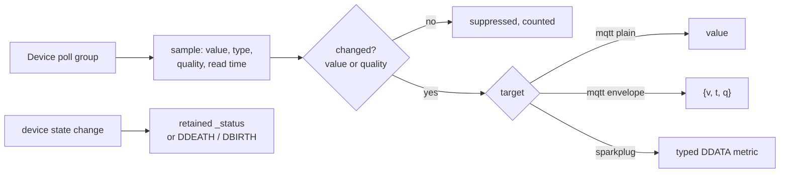

# 🗺️ Mapping to the UNS

> **Goal:** land device tags in the Unified Namespace as named, typed values
> that carry their quality, so a consumer can tell "the value is 0" from "the
> device is gone".

A **binding** takes tags from a source (a device, an OPC UA connection or a
Sparkplug endpoint) and publishes them to the broker. Device tags come from the
[Devices page](Devices-and-Drivers); you create the binding on the **Tags**
page: choose the device as the source, tick tags, and use **Add to UNS**. The
wizard shows the resolved topic for every tag before you save.



## Path is not address

A tag has a device **address** (`DB10.DBD4`, `40012`,
`Program:Main.Filler.Speed`) and a UNS **name**. The topic is built from a
**path template** and the name:

| Path template | Tag name | Topic |
|---|---|---|
| `acme/dallas/packaging/line4/filler/{name}` | `speed` | `acme/dallas/packaging/line4/filler/speed` |
| `acme/dallas/packaging/line4/filler` (no `{name}`) | `speed` | `acme/dallas/packaging/line4/filler/speed` |

The name defaults to the tag's **UNS name** field (`property` in the tag
table) and falls back to its key; you can rename each tag in the wizard.
Whitespace, `/`, `+` and `#` in a name become `_`. Do not publish raw PLC
addresses as topic names: the namespace becomes a tag dump nobody can read.
Choose the asset path (the ISA-95 levels) once per binding, and give every tag
a short property name (`speed`, `temperature`, `running`).

One binding takes one device's tags. Mapping fifty identical machines means
fifty bindings; profiles and per-instance paths are planned, not built (see
[the design document](https://github.com/zbest1000/manifold/blob/main/docs/design/southbound-drivers.md)).

## Plain or envelope

| Format | Payload | Carries quality? |
|---|---|---|
| `plain` | the bare value: `23.1`, `true`, `"PUMP-1"` | **no** |
| `envelope` | `{"v": 23.1, "t": 1795503961422, "q": 192}` | yes |

`q` is **192 Good**, **64 Uncertain** or **0 Bad**. `t` is when Manifold read
the value, as epoch milliseconds: polled protocols have no device timestamp,
and the envelope does not pretend otherwise. (For OPC UA the source timestamp
is used when the server supplies one.)

**Use `envelope`** (the wizard's default) for anything a consumer might act
on. With `plain` there is no way to say "bad": when a device drops out, the
last value stays on the topic and only the `_status` topic changes. If you
must use `plain` for a consumer that cannot parse JSON, make that consumer
watch `_status`.

## Quality and the `_status` topic

What happens when the device goes away (connection lost, driver process down,
or a tag quarantined):

| Target | Tag topics | Device-level signal |
|---|---|---|
| `mqtt`, `envelope` | one publish per tag with `q: 0` and the last value | retained `_status` |
| `mqtt`, `plain` | **nothing changes** | retained `_status` |
| `sparkplug` | nothing per tag | `DDEATH`; `DBIRTH` with last values on recovery |

While a device is offline, an envelope binding with a heartbeat keeps
republishing the last value with `q: 0`, so a consumer's "Bad" does not time
out into silence. Recovery republishes as Good.

The retained **`<path>/_status`** document (the template with `{name}`
replaced by `_status`, or `/_status` appended):

```json
{ "online": true, "since": 1795503961422, "reason": null }
```

`reason` explains an offline state (`connecting`, `connect ECONNREFUSED ...`,
`driver host down`). It is published at QoS 1, retained, once at start and on
every state change. Turn it off per binding with `statusTopic: false` (the
wizard has a checkbox). Two things to know:

- Manifold sets **no last-will** for it. If Manifold itself stops, the retained
  `online: true` stays. A consumer that needs to notice a stopped Manifold
  should use a heartbeat on the values.
- A binding quality change that cannot be expressed in the target (Uncertain
  on a `plain` or Sparkplug target) is counted as suppressed; only the
  envelope format publishes quality-only changes.

## Report by exception and heartbeat

- A tag publishes only when its **value or quality** changes. Numbers can have
  an **absolute deadband**: changes smaller than the band are suppressed
  (percent deadband is planned). Non-numbers publish on change; arrays and
  objects are compared structurally. Suppressed samples are counted on the
  binding.
- **Heartbeat** (`heartbeatMs`, at least 1000) republishes every unchanged tag
  at least that often with its current value and quality. The envelope's `t`
  stays the time of the **last change**, so a consumer can see both "alive
  now" (the message arrived) and "last changed then" (`t`). Without a
  heartbeat, an unchanged value and a dead device look the same on a `plain`
  topic. Use a heartbeat of a few times your slowest acceptable stall.

## Retain

The wizard leaves **retain off** for values, on purpose. A retained value
outlives the device that produced it: a new subscriber is handed "21.5" for a
sensor that died yesterday. Turn retain on only for slow-changing values that
a late subscriber needs immediately, and then use `envelope` plus a heartbeat
so the value is never silently stale. The `_status` document is retained by
design; that is what makes it useful.

## Sparkplug as the target

`mode: sparkplug` publishes the device as a proper Sparkplug B device on an
edge node you name (group, edge node, device), with the full BIRTH / DATA /
DEATH lifecycle (see [Tags and Sparkplug](Tags-and-Sparkplug)).

- **Types survive.** Tag types map to Sparkplug datatypes (`int16` to Int16,
  `float32` to Float, `bool` to Boolean, `uint32` to UInt32 and so on) instead
  of everything becoming Double. The datatype is fixed the first time a metric
  is seen, so BIRTH and DATA agree. A value that cannot be represented as that
  type is sent as a null metric, never with a changed type. When a tag's type
  is unknown, the older behaviour (Int64 or Double by value) applies.
- **No per-metric quality.** Metrics do not carry `q`. A device going offline
  is expressed by DDEATH. Use `envelope` if you need per-tag quality.
- **Never opens a session by itself.** DDEATH/DBIRTH only go out on a session
  the binding's data already opened.

## Historians: Timebase is the reference

A device sample is a value, a time and a quality, which is what Timebase
(Flow Software) stores natively, so a Good to Bad transition survives all the
way into history. Timebase also has no Modbus, S7 or EtherNet/IP collector
(per its product pages, read November 2026), so these drivers fill a gap.

There are **two delivery paths**:

1. **Through the broker (the default).** The binding publishes to the UNS
   (envelope or Sparkplug B) and **Timebase's own MQTT / Sparkplug collector**
   subscribes to it. Nothing to configure in Manifold's historian settings, and
   Timebase's collector brings its own store-and-forward. This is the path
   to use first. With the Sparkplug target, Timebase sees typed metrics and
   DDEATH; with `plain`, it sees values only.
2. **Direct REST write.** Add a **pipeline** whose source filter matches the
   binding's output topics and whose target is a Timebase historian. The
   points go through the store-and-forward [outbox](Historians), so history
   survives a broker or Timebase outage. For an envelope topic, add a
   `numeric` transform with `field: "v"` so the stored value is the number,
   not the JSON wrapper; the quality and the timestamp are taken from the
   envelope. (A built-in historian target on the binding itself is planned,
   not built.)

> **Verify before relying on path 2.** The Timebase REST API reference could
> not be read when this was written, so these are unconfirmed against the real
> product:
> - Whether the Historian really **ignores a TVQ older than a tag's newest
>   point** (a comment in the writer says so; the outbox is built to deliver
>   strictly oldest-first per historian either way).
> - The accepted shape for a Bad sample **without a value**: Manifold sends
>   `v: null` with the quality. A Bad publish from a binding normally keeps the
>   last value, so this arises for tags that read as unavailable (for example a
>   Modbus sentinel).
> - **Resolution:** Timebase advertises 500 ms storage resolution; whether
>   closer samples are kept is unconfirmed, so avoid poll groups faster than
>   500 ms with a Timebase target.
> - Quality-code semantics, batch limits, authentication (tokens) and the
>   tag/Field management endpoints.
>
> Manifold's CI exercises the write against `timebase/historian:1.3.4`; 2.x is
> current. Vendor pages also say Timebase is "first-in-wins" on a timestamp
> (an identical timestamp/value is discarded), which would make outbox retries
> safe to resend. That is also not tested here.

**InfluxDB is not offered for device data.** Its writer stores only the value
(no quality column), so a Bad sample would look like any other. This is a
decision, not a code block: nothing prevents a pipeline from writing device
topics into InfluxDB, but you will lose quality. Prefer Timebase or
TimescaleDB (which stores `quality`). InfluxDB remains fine for pipelines and
recordings that do not depend on quality.

## Quick reference: a binding as JSON

```json
{
  "name": "Pump 1 to UNS",
  "source": {
    "type": "device",
    "deviceId": "<device id>",
    "tags": [
      { "address": "temperature", "name": "temperature" },
      { "address": "running", "name": "running" }
    ]
  },
  "target": {
    "mode": "mqtt",
    "brokerId": "<broker id>",
    "pathTemplate": "acme/dallas/packaging/line4/filler/{name}",
    "format": "envelope",
    "qos": 0,
    "retain": false,
    "deadband": 0.1,
    "statusTopic": true
  },
  "rbe": { "heartbeatMs": 10000 }
}
```

`source.tags[].address` is the device **tag key**. Post it to
`POST /api/tags/bindings`. See [Devices and Drivers](Devices-and-Drivers) for
how tags and quality are produced, and
[Troubleshooting](Troubleshooting#devices) when values look wrong.
