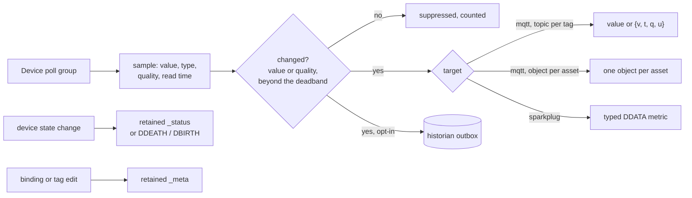

# 🗺️ Mapping to the UNS

> **Goal:** land device tags in the Unified Namespace as named, typed values
> that carry their quality and their units, so a consumer can tell "the value
> is 0" from "the device is gone".

A **binding** takes tags from a source (a device, a device profile, an OPC UA
connection or a Sparkplug endpoint) and publishes them to the broker. Device
tags come from the [Devices page](Devices-and-Drivers); you create the binding
on the **Tags** page: choose the source, tick tags, and use **Add to UNS**.
The wizard has three steps (**Target**, **Naming**, **Options**) and shows the
topics and payloads the server would publish before you save.



## Path is not address

A tag has a device **address** (`DB10.DBD4`, `40012`,
`Program:Main.Filler.Speed`) and a UNS **name**. The topic is built from an
**asset path** and the name:

```text
<assetPath>/<name>      acme/dallas/packaging/line4/filler/speed
```

- **Asset path** (`target.assetPath`): the ISA-95 levels, written out in full,
  with no placeholders: `acme/dallas/packaging/line4/filler`. Segments are
  separated by `/`; none may be empty (no leading, trailing or doubled `/`),
  contain `+`, `#` or braces, or start with `$` (reserved for broker topics); at
  most 512 characters. The wizard's **asset-path picker** browses the branches
  already in the UNS (lazily, one level per request) and also accepts a new
  path. A trailing `/` is dropped.
- **Name**: the published name of a tag is, in this order, the `name` on the
  binding entry, the tag's **property** (the "UNS name" field in the device tag
  table), or its key. Whitespace, `/`, `+` and `#` in a name become `_`. The
  wizard never proposes a raw address as a name.
- **Path template** (`target.pathTemplate`, legacy): `acme/dallas/{name}`, where
  `{name}` is the tag name; a template without `{name}` gets `/<name>` appended.
  Stored bindings and the demo seed still use it and it keeps working; the
  wizard writes `assetPath` for new bindings and keeps the form a binding was
  stored with when you edit it.

| Destination | Topic of tag `speed` |
|---|---|
| `assetPath: acme/dallas/line4/filler` | `acme/dallas/line4/filler/speed` |
| `pathTemplate: acme/dallas/line4/filler/{name}` | `acme/dallas/line4/filler/speed` |
| `pathTemplate: acme/dallas/line4/filler` (no `{name}`) | `acme/dallas/line4/filler/speed` |

The namespace lint flags a leaf that looks like a raw address (`DB10.DBD4`,
`40012`, `ns=2;s=...`, `Program:...`), and the wizard and the API warn about
such names when you save (see [Preview and warnings](#preview-and-warnings)).

### One definition for many identical devices: profile bindings

A **device-profile binding** (`source.type: "device-profile"`) maps a
[device profile](Devices-and-Drivers#device-profiles-and-instances) once and
publishes **one asset per instance** (device) of that profile, including
instances added later. The destination is either:

- `target.assetPathTemplate`: for example `acme/{site}/{device}/pump`. Allowed
  placeholders are `{device}` (the device's name), `{deviceId}`, and any
  **parameter** the profile declares (`{site}`, `{db}` ...) with that instance's
  value. Each substituted value is cleaned like a name (whitespace, `/`, `+`,
  `#` become `_`), so a device called `Line 1 meter` gives `Line_1_meter`. An
  unknown placeholder is rejected at save time.
- or `target.assetPaths`: an explicit map `{ "<deviceId>": "acme/dallas/line4" }`.
  An entry here wins over the template for that device.

An instance whose path cannot be resolved (a missing parameter value, an
invalid path) is skipped and reported as a warning of type `asset-path`; the
other instances publish. For a Sparkplug target the device name defaults to
`{device}` and may use the same placeholders.

## Plain, envelope or one object per asset

Two **layouts** (`target.layout`):

### `topic-per-tag` (default)

One topic per tag, `<assetPath>/<name>`, in one of two **formats**:

| Format | Payload | Carries quality? |
|---|---|---|
| `plain` | the bare value: `23.1`, `true`, `"PUMP-1"` | **no** |
| `envelope` | `{"v": 23.1, "t": 1795503961422, "q": 192, "u": "degC"}` | yes |

`q` is **192 Good**, **64 Uncertain** or **0 Bad**. `t` is when Manifold read
the value, as epoch milliseconds (polled protocols have no device timestamp and
the envelope does not pretend otherwise; for OPC UA the source timestamp is used
when the server supplies one). `u` is the tag's engineering unit and is **left
out when the tag has none**.

**Use `envelope`** (the wizard's default) for anything a consumer might act on.
With `plain` there is no way to say "bad": when a device drops out, the last
value stays on the topic and only `_status` changes.

### `object-per-asset`

One JSON object per asset, published **to the asset path itself**, instead of one
topic per tag. It always carries quality (the format choice does not apply):

```json
{
  "t": 1795503961422,
  "values": {
    "temperature": { "v": 21.5, "q": 192, "u": "degC" },
    "count":       { "v": 7,    "q": 192 }
  }
}
```

Topic: `acme/dallas/meter1`. `t` is the newest sample time in the object; each
member has `v`, `q` and, when the tag has a unit, `u`. Properties:

- Published at the end of a **poll cycle** (the device runtime signals the end
  of each batch) or 50 ms after the first change, whichever comes first, and only
  when some member's value or quality changed, plus the heartbeat. The whole object is sent every
  time, so a consumer always gets every member.
- A source going offline sets every member to `q: 0` and publishes the object at
  once.
- **Size-capped.** `target.maxObjectBytes` (default 65,536; 1,024 to 1,048,576).
  At save time the server estimates the worst case (number of tags times the
  largest plausible member for its type, plus the envelope) and **rejects** a
  binding that could exceed the cap, saying how many tags and bytes; split the
  binding, bind fewer tags or raise the cap. At run time an object that is over
  the cap is not published and the binding's error count and last error say so.
- QoS and retain apply to the object. `_status` and `_meta` are still published
  under it (`<asset>/_status`, `<asset>/_meta`), so the asset topic has a payload
  **and** children: the namespace lint reports this as `data-on-branch`. Turn the
  two documents off (the checkboxes under "also published") if you want a clean
  object-only asset and accept the loss of the status document.
- Available for `mqtt` targets only, not Sparkplug.

Use one object per asset when consumers want a consistent snapshot of a machine
(a dashboard, an analytics model) and per-tag topics when they subscribe to
single values or use per-topic ACLs.

## Quality and the `_status` topic

What happens when the device goes away (connection lost, driver process down,
or a tag quarantined):

| Target | Tag topics | Device-level signal |
|---|---|---|
| `mqtt`, `envelope` | one publish per tag with `q: 0` and the last value | retained `_status` |
| `mqtt`, object per asset | one object publish with every member `q: 0` | retained `_status` |
| `mqtt`, `plain` | **nothing changes** | retained `_status` |
| `sparkplug` | nothing per tag | `DDEATH`; `DBIRTH` with last values on recovery |

While a device is offline, an envelope or object binding with a heartbeat keeps
republishing the last values with `q: 0`, so a consumer's "Bad" does not time out
into silence. A `plain` binding's heartbeat stops while the source is offline,
so stale values do not look live. Recovery republishes as Good.

The retained **`<assetPath>/_status`** document has exactly this shape:

```json
{ "online": true, "since": 1795503961422, "reason": null }
```

`since` is when the current state began (it does not move while the state is
unchanged); `reason` explains an offline state (`connecting`,
`connect ECONNREFUSED ...`, `driver host down`) and is `null` when online. It is
published at QoS 1, **retained**, whenever the source reports a state, and also
**as soon as a binding is created or edited while its source is already
online**, so the topic exists without waiting for the next transition. Turn it
off per binding with `statusTopic: false` (a checkbox in the wizard). A
legacy-template binding publishes it at the template with `{name}` replaced by
`_status` (or `/_status` appended). Two things to know:

- Manifold sets **no last-will** for it. If Manifold itself stops, the retained
  `online: true` stays. A consumer that needs to notice a stopped Manifold should
  use a heartbeat on the values.
- A quality change that cannot be expressed in the target (Uncertain on a `plain`
  or Sparkplug target) is counted as suppressed; only the envelope format and the
  object layout publish quality-only changes.

## Metadata: units and the `_meta` document

Tags can carry a **type**, **unit**, **description** and **range** (min and max).
They travel three ways:

- **`u`** in every envelope and object member that has a unit.
- A retained **`<assetPath>/_meta`** document for plain-MQTT consumers, at QoS 1,
  published at start and whenever the binding or its tags' metadata change (not
  per value). `target.metaTopic: false` turns it off. Exact shape:

  ```json
  {
    "properties": {
      "temperature": {
        "type": "float32",
        "unit": "degC",
        "description": "Supply temp",
        "range": { "min": 0, "max": 200 },
        "source": { "deviceId": "7d1c...", "address": "temp" }
      },
      "count": { "type": "uint16", "source": { "deviceId": "7d1c...", "address": "count" } }
    },
    "updatedAt": 1795503961422
  }
  ```

  **Known issue:** if the broker is not yet connected when the server starts,
  the first `_meta` publish fails (the binding's last error says
  `_meta: Broker ... is not connected`) and is retried only at the next binding,
  device or profile save, so the document can be missing until then. Saving the
  binding again publishes it.

  Keys are the published names. `type`, `unit`, `description` and `range` appear
  only when set. `source` names the device (`deviceId`) or OPC UA connection
  (`connectionId`) and the tag's **address** (the device tag key, or the node id);
  a profile binding adds `profileId`. It is the one place the raw address is
  published, on purpose, for consumers that need to trace a value back.
- **Sparkplug targets** carry unit, description and range as metric properties
  in the BIRTH (`engUnit`, `description`, `engLow`, `engHigh`); there is no
  `_meta` topic.

## Report by exception, deadband and heartbeat

- A tag publishes only when its **value or quality** changes. Non-numbers publish
  on change; arrays and objects are compared structurally. Suppressed samples
  are counted on the binding.
- **Absolute deadband** (`rbe.deadband: { "type": "absolute", "value": 0.5 }`): a
  numeric change smaller than the value is suppressed. The legacy
  `target.deadband: 0.5` means the same.
- **Percent deadband** (`{ "type": "percent", "value": 1 }`, 0 to 100): the band
  is that percentage of the tag's **range** (`max - min`) when the tag defines a
  range, and otherwise that percentage of the **magnitude of the last published
  value**. Example: range 0 to 200 and 1 % is a band of 2, so after publishing
  100.0 the values 99.1 and 101.9 are suppressed and 102.0 is published (a change
  equal to the band publishes). Without a range, 10 % after publishing 50 is a
  band of 5; and because the band is relative to the last published value, from 0
  **any** change publishes. The comparison is always against the last
  **published** value, not the last sample, so slow drift eventually publishes.
  A band of 0 is off.
- **Heartbeat** (`rbe.heartbeatMs`, at least 1000, checked once a second)
  republishes every unchanged tag (or the whole object) at least that often with
  its current value and quality. The envelope's `t` stays the time of the **last
  change**, so a consumer sees both "alive now" (the message arrived) and "last
  changed then" (`t`). Without a heartbeat, an unchanged value and a dead device
  look the same on a `plain` topic. Use a few times your slowest acceptable
  stall. A heartbeat repeat is **not** sent to a direct historian target.

## Retain, and what is cleaned up

The wizard leaves **retain off** for values, on purpose: a retained value
outlives the device that produced it. Turn it on only for slow-changing values a
late subscriber needs immediately, and then use `envelope` (or the object
layout) plus a heartbeat so the value is never silently stale. `_status` and
`_meta` are retained by design.

Manifold clears what it published. The set of retained topics a binding owns
(`_status`, `_meta`, and the value or object topics when retain is on) is derived
from its configuration, and when a topic leaves that set Manifold publishes an
**empty retained message** to it (QoS 1): when you **delete** or **disable** a
binding, **rename** it (change the asset path, template or broker), switch
**retain off**, turn `_status` or `_meta` off, or remove a device from a profile
binding. The limits, so nothing surprises you:

- The owned set is held in memory and rebuilt at start. **An edit made while the
  server is down is not cleaned up**: the old retained topics stay on the broker
  until you remove them by hand (publish an empty retained message to each).
- A clear aimed at a broker that is disconnected at that moment is dropped, not
  retried.
- **Sparkplug-source bindings** with retain on publish topics named by metrics
  that are only known at run time; those are not cleaned.
- Only topics published by a binding are cleaned. Anything a pipeline or another
  client retained under the same path is not.

## Choosing what to map

Everything in this section is optional. A binding that uses none of it
publishes exactly what it published before (the test suite compares topics,
payloads and `_meta` byte for byte against fixtures captured from the earlier
code).

The examples below were produced by running the code against an S7 filler
(`deviceId: filler4`) with these tags: `DB10_speed` (property `speed`, `bpm`,
range 0..600), `DB10_temp` (`productTemp`, `degC`), `DB10_state` (`state`,
device-level states `0 Stopped / 1 Running / 2 Faulted`), `DB10_count`
(`goodCount`, poll group `slow`) and `DB10_spare` (no property). The asset path
is `acme/dallas/packaging/line4/filler`.

### Tick tags on and off

An entry of `source.tags` may be an object with `enabled`:

```json
"tags": [
  { "address": "DB10_speed" },
  { "address": "DB10_count", "name": "goodCount", "enabled": false }
]
```

A disabled entry stays in the stored binding (the wizard shows it unticked and
remembers its name and settings) but it is **not monitored, not published, not
counted, not listed in `_meta`, and not retained**. Turning a retained tag off
clears its retained topic, as a rename does. A disabled entry may even name a
tag the device no longer has (the save warns, `disabled-missing`); an enabled
one may not.

### Rules instead of a list

For `tags: "all"` on a device or a device profile, `source.select` picks tags
by rule, and tags added to the device later are picked up automatically when
they match:

```json
"source": {
  "type": "device", "deviceId": "filler4", "tags": "all",
  "select": { "include": ["*"], "exclude": ["*spare*"], "pollGroups": ["default"] },
  "overrides": { "DB10_temp": { "unit": "degF" } }
}
```

| Rule | Meaning |
|---|---|
| `include: [glob]` | keep tags whose key **or** property matches one pattern (omitted = all) |
| `pollGroups: [id]` | keep tags in these poll groups (a tag without one is in `default`) |
| `types: [type]` | keep tags of these device types (`float32`, `int16`, ...; case-insensitive) |
| `withProperty: true / false` | keep only tags with / without a property name |
| `exclude: [glob]` | drop tags whose key or property matches one pattern |

Globs use `*` (any run) and `?` (one character), case-insensitive. The order is
include, then the filters, then exclude. `source.overrides` gives rule-selected
tags per-tag settings (the keys of [Adding context](#adding-context)); an
override with `"enabled": false` deselects a tag the rules matched. An override
key that names no tag is kept and warns (`unknown-override`): it applies when
such a tag is added.

The preview reports the result for every candidate tag:

```json
"selection": {
  "matched": 3, "excluded": 2, "truncated": false,
  "rows": [
    { "unitId": "filler", "key": "DB10_speed", "property": "speed", "matched": true },
    { "unitId": "filler", "key": "DB10_temp", "property": "productTemp", "matched": true },
    { "unitId": "filler", "key": "DB10_state", "property": "state", "matched": true },
    { "unitId": "filler", "key": "DB10_count", "property": "goodCount", "matched": false, "rule": "pollGroups" },
    { "unitId": "filler", "key": "DB10_spare", "property": null, "matched": false, "rule": "exclude", "pattern": "*spare*" }
  ]
}
```

`rule` is `include`, `pollGroups`, `types`, `withProperty`, `exclude`,
`disabled` (an entry or override with `enabled: false`) or `missing`.

### Which fields a payload carries

`target.fields` chooses and orders the fields of an `envelope` payload and of
each `object-per-asset` member:

| Field | Value |
|---|---|
| `v` | the value (required) |
| `t` | timestamp, ms (source time when the driver has one, else read time) |
| `q` | quality: 192 good, 0 bad |
| `u` | engineering unit, when the tag has one |
| `name` | the published property name |
| `src` | the source address (the device tag key or the OPC UA node id) |
| `ctx` | the tag's merged context (see [Adding context](#adding-context)) |

Default: `v, t, q, u` for envelopes and `v, q, u` for object members, exactly
as before. With `"fields": ["v", "t", "q", "u", "name", "src"]`:

```json
acme/dallas/packaging/line4/filler/speed
{"v":412.3456,"t":1729999999980,"q":192,"u":"bpm","name":"speed","src":"DB10_speed"}
```

Leaving out `q` is allowed but warns (`no-quality`): consumers cannot tell a
dead value from a live one. `fields` does not apply to `plain` topic-per-tag
payloads (the bare value); setting it there warns (`fields-ignored`).

### Which documents are published

`target.statusTopic: false` and `target.metaTopic: false` still switch the
retained `_status` and `_meta` documents off. `target.metaFields` chooses what
`_meta` lists per property: any of `type`, `unit`, `description`, `range`,
`source`, `context`, `displayName`, `limits`, `states` (default: all). Leave
out `source` to keep device addresses off the broker; with `"metaFields":
["type", "unit", "description", "displayName", "limits", "context"]` the
`_meta` of the context example below becomes:

```json
{
  "context": { "site": "dallas", "line": "line4", "equipmentClass": "Filler", "equipmentId": "filler4", "host": "10.20.4.11" },
  "properties": {
    "productTemp": {
      "type": "int16", "unit": "degC", "description": "Product temperature",
      "scale": 0.1, "offset": 0, "displayName": "Product temperature",
      "limits": { "lo": 4, "hi": 30, "hihi": 35 },
      "context": { "measurementType": "temperature", "pidTag": "TT-401" }
    },
    "state": { "type": "int16" }
  },
  "updatedAt": 1730000000000
}
```

`type` also governs the transform fields (`scale`, `offset`, `dataType`,
`precision`), `states` also governs `statesMode`, and `context` governs both the
asset and the tag context.

## Adding context

### Per-tag overrides

A tag entry, or `source.overrides[<tagKey>]`, may override how a tag is
published. Each key falls back to the device tag definition when absent; the
entry wins over `source.overrides`.

| Key | Type | Notes |
|---|---|---|
| `name` | string, at most 128 | published property name; default the tag's property, else its key |
| `displayName` | string, at most 128 | metadata only |
| `description`, `unit` | string, at most 512 | `unit` is `u` in payloads |
| `range` | `{ min, max }` | finite, `min < max`, in engineering units (after scale/offset); used by the percent deadband |
| `dataType` | `number`, `integer`, `boolean`, `string` | cast of the published value |
| `scale`, `offset` | finite number (scale non-zero) | `value * scale + offset` |
| `precision` | integer 0..10 | decimal places, publishing only |
| `states` | `{ "<raw>": "<label>" }`, at most 256 | enumeration labels |
| `statesMode` | `label-field` (default), `replace` | see below |
| `limits` | `{ lolo?, lo?, hi?, hihi? }` | ordered `lolo <= lo <= hi <= hihi`; **metadata only** |
| `deadband` | number (absolute) or `{ type, value }` | this tag's report-by-exception band; `0` turns the binding's band off for it |
| `context` | `{ key: string \| number \| boolean }` | merged over the device tag's context, mapping wins key by key |

**Limits are carried as context, not evaluated.** Manifold has no alarm engine:
a value beyond `hi` publishes like any other. Consumers that alarm read the
limits from `_meta` (or the Sparkplug BIRTH).

**Value pipeline.** read, device decode, mapping `scale`/`offset`, cast
(`dataType`), deadband / report by exception, then the published form
(`precision` rounding and `states`). Change detection uses the unrounded,
unlabelled value, so with a precision and no deadband two publishes can look
identical; give such a tag a deadband. A value that cannot be scaled or cast
publishes **Bad quality with a reason and value `null`, never a wrong value**:

```json
{"v":null,"t":1729999999980,"q":0,"reason":"cannot cast \"abc\" to integer"}
```

A `plain` payload cannot carry quality, so a failed cast is not published there
(the binding's `lastError` says why, and a direct historian target still records
the Bad sample). `integer` rounds to the nearest whole number, half away from
zero; `boolean` accepts booleans, numbers (0 is false) and the strings
`true/false/1/0/on/off/yes/no`; `string` turns structures into JSON.

With `{ "address": "DB10_speed", "precision": 1 }`,
`{ "address": "DB10_temp", "scale": 0.1, "dataType": "number", "precision": 1, "deadband": 0.2 }`
and the device-level states of `DB10_state` (raw values 412.3456, 2215 and 1):

```json
acme/dallas/packaging/line4/filler/speed        {"v":412.3,"t":1729999999980,"q":192,"u":"bpm"}
acme/dallas/packaging/line4/filler/productTemp  {"v":221.5,"t":1729999999980,"q":192,"u":"degC"}
acme/dallas/packaging/line4/filler/state        {"v":1,"label":"Running","t":1729999999980,"q":192}
```

**States.** In `label-field` mode the raw value is published and its label
follows `v` as `label` (envelope and object members; a raw value without a label
has no `label`). In `replace` mode the label **is** the value, which also works
in `plain` format (`acme/dallas/packaging/line4/filler/state` publishes
`"Running"`) and makes the Sparkplug metric a String. A raw value without a
label publishes unchanged.

Overrides on a profile binding are keyed by the **profile's** tag keys.

### Asset context

`target.context` describes the asset: site, area, line, equipment id, serial
number, equipment class, maintenance id, anything a consumer needs. String
values may use placeholders that resolve per unit:

| Placeholder | Value | Sources |
|---|---|---|
| `{device}` | device name | device, device-profile |
| `{deviceId}` | device id | device, device-profile |
| `{protocol}` | driver protocol | device, device-profile |
| `{host}` | device host | device, device-profile |
| `{param:<name>}` | the instance's profile parameter | device-profile |

An unknown placeholder is a validation error naming the key, e.g.
`target.context.tag uses unknown placeholder {param:nope} (allowed for a
device-profile source: {device}, {deviceId}, {protocol}, {host}, {param:line},
{param:serial})`. OPC UA and Sparkplug sources take no placeholders.

### Context on the device

A device tag (or a profile tag) may carry `context`, `displayName`, `states` and
`limits` next to `unit`, `description`, `property` and `range`; the device API
stores them as given and profile instances inherit them (they are not
parameter-substituted: use `{param:...}` in `target.context` for per-instance
values). Mapping-level values override device-level ones key by key. Invalid
device-level context keys are not published and the binding save warns
(`device-context`).

### Where context goes

`target.contextMode`:

- **`meta`** (default): asset context and per-tag context appear in the
  retained `_meta` document only.
- **`payload`**: additionally, the tag's merged context (asset, then device tag,
  then mapping) rides in every envelope and object member as `ctx`. Bounded: a
  tag whose `ctx` would exceed **1024 bytes** is rejected at save time with the
  number, and `ctx` counts toward `maxObjectBytes`.
- **`none`**: no context anywhere (and `"ctx"` in `fields` is a validation error).

With

```json
"tags": [
  { "address": "DB10_temp", "scale": 0.1, "displayName": "Product temperature",
    "limits": { "lo": 4, "hi": 30, "hihi": 35 },
    "context": { "measurementType": "temperature", "pidTag": "TT-401" } },
  { "address": "DB10_state" }
],
"context": { "site": "dallas", "line": "line4", "equipmentClass": "Filler", "equipmentId": "{deviceId}", "host": "{host}" }
```

the retained `acme/dallas/packaging/line4/filler/_meta` is:

```json
{
  "context": { "site": "dallas", "line": "line4", "equipmentClass": "Filler", "equipmentId": "filler4", "host": "10.20.4.11" },
  "properties": {
    "productTemp": {
      "type": "int16", "unit": "degC", "description": "Product temperature",
      "scale": 0.1, "offset": 0,
      "displayName": "Product temperature",
      "limits": { "lo": 4, "hi": 30, "hihi": 35 },
      "context": { "measurementType": "temperature", "pidTag": "TT-401" },
      "source": { "deviceId": "filler4", "address": "DB10_temp" }
    },
    "state": {
      "type": "int16",
      "states": { "0": "Stopped", "1": "Running", "2": "Faulted" },
      "statesMode": "label-field",
      "source": { "deviceId": "filler4", "address": "DB10_state" }
    }
  },
  "updatedAt": 1730000000000
}
```

`type` stays the device type; a mapping cast adds `dataType`. With
`"contextMode": "payload"` and `"context": { "site": "dallas", "equipmentId": "{deviceId}" }`
the value topics carry `ctx`:

```json
acme/dallas/packaging/line4/filler/productTemp
{"v":221.5,"t":1729999999980,"q":192,"u":"degC","ctx":{"site":"dallas","equipmentId":"filler4","measurementType":"temperature","pidTag":"TT-401"}}
acme/dallas/packaging/line4/filler/state
{"v":1,"label":"Running","t":1729999999980,"q":192,"ctx":{"site":"dallas","equipmentId":"filler4"}}
```

and an `object-per-asset` binding (`"fields": ["v", "q", "u"]`, context
`{ "site": "dallas" }`) publishes:

```json
{
  "t": 1729999999980,
  "values": {
    "productTemp": { "v": 221.5, "q": 192, "u": "degC", "ctx": { "site": "dallas", "measurementType": "temperature", "pidTag": "TT-401" } },
    "state": { "v": 1, "label": "Running", "q": 192, "ctx": { "site": "dallas" } }
  }
}
```

### Limits on context

| Limit | Value |
|---|---|
| key | 1-64 characters of `A-Z a-z 0-9 _ . -`, starting with a letter |
| keys per context object | 32 |
| string value | 256 characters (numbers must be finite; booleans allowed; no nesting) |
| one context object as JSON | 4096 bytes (also checked after placeholders resolve) |
| `ctx` in a payload | 1024 bytes per tag |

Nothing is redacted silently: a context key that looks like a credential
(`password`, `token`, `secret`, `key`, `apiToken`, ...; the audit-log heuristic)
is published as configured and the save warns (`credential-like-context`),
because context goes to the broker in clear text.

### Context on a Sparkplug target

Sparkplug metrics carry metadata in BIRTH only. Next to `engUnit`,
`description`, `engLow` and `engHigh` a binding sends `displayName` (String),
`limitLoLo`, `limitLo`, `limitHi`, `limitHiHi` (Double) and every key of the
tag's merged context as a **String** property (context keys are already
restricted to a safe charset; a key equal to one of the standard properties is
skipped and warns, `sparkplug-context-collision`). `contextMode: "none"` sends
no context. The DBIRTH metric for the example above:

```json
{"name":"productTemp","type":"float64","properties":{"engUnit":"degC","description":"Product temperature","displayName":"Product temperature","limitLo":4,"limitHi":30,"limitHiHi":35,"site":"dallas","measurementType":"temperature","pidTag":"TT-401"}}
```

A scaled tag is published as `float64` (a cast picks `float64`, `int64`, `bool`
or `string`). When a binding's or a device tag's metadata changes, the next
reconcile re-issues the DBIRTH with the last values and the new properties
(seq continues; only for a device that is born and online, otherwise the new
properties travel with the next BIRTH), so hosts see the change without
waiting for a value to move.

### Suggestions and the option schema

`POST /api/tags/bindings/suggest { "source": { "type": "device", "deviceId": "filler4" } }`
is read-only and returns per-tag name suggestions and an asset context
suggestion:

```json
{
  "sourceType": "device",
  "tags": [
    { "address": "DB10_speed", "property": "speed", "type": "float32", "unit": "bpm", "description": null,
      "suggestedName": "speed", "basis": "property", "rawAddress": false },
    { "address": "DB10_spare", "property": null, "type": "int16", "unit": null, "description": null,
      "suggestedName": "spare", "basis": "key", "rawAddress": false }
  ],
  "entries": [ { "address": "DB10_speed", "name": "speed" }, { "address": "DB10_spare", "name": "spare" } ],
  "context": { "suggested": { "deviceName": "{device}", "protocol": "{protocol}" }, "resolved": { "deviceName": "Filler 4", "protocol": "s7" } }
}
```

A name comes from the tag's `property`, else from a cleaned key (address-like
prefixes such as `DB10_` or `holding_` stripped, camelCase). A key that is a raw
address (`DB10.DBD4`, `40012`, `MW10`, `%IX0.1`, `Program:...`) gets
`suggestedName: null` with `reason: "raw-address"`: nothing is invented, and
units are never guessed. A suggestion that clashes with an earlier one carries
`duplicateOf`. Device, device-profile and OPC UA sources are supported.

`GET /api/tags/bindings/schema` returns the option catalogue the wizard renders
from: field options and defaults, override keys with types and limits, select
rules, placeholders per source type, context limits, `statesMode` values and the
value pipeline.

## Preview and warnings

`POST /api/tags/bindings/preview` takes a binding draft (the same body as a save)
and changes nothing: no storing, no publishing. The wizard calls it on the Naming
step and shows the result; viewers may call it. It returns, for up to 50 tags
(or the first 50 objects):

| Field | Meaning |
|---|---|
| `tags[]` | `name`, `address`, `topic`, `payload` (the latest known value; `v: null, q: 0` and `hasValue: false` when none yet), and `collisions` |
| `objects[]` | `topic`, `payload`, `bytes`, `worstCaseBytes`, `capBytes`, `collisions` |
| `meta[]`, `status[]` | the `_meta` documents (at most 10) and `_status` topics that would be published |
| `units`, `unitErrors[]`, `totalTags`, `truncated` | how many assets, which could not resolve a path, how many tags in all |
| `warnings[]` | the same non-blocking warnings a save returns |
| per tag (in `tags[]` and `members[]`) | `metadata` (effective name, type, unit, description, range, displayName, limits, states, transform, deadband, context), `origins` (`device`, `mapping` or `default` per field), `contextOrigins` (`asset`, `device` or `mapping` per context key), `warnings` (this tag's), `bytes` and `worstCaseBytes`; the example `payload` applies fields, transform, states and context to the latest raw value |
| `members[]` | object-per-asset only: one entry per member with `topic` (the object topic), `member` and the per-tag fields above |
| `selection` | `{ matched, excluded, truncated, rows: [{ unitId, key, property, matched, rule?, pattern?, missing? }] }`, at most 500 rows |
| `contexts[]`, `fields`, `contextMode` | the resolved asset context per unit, the field lists in use, the context mode |
| `sizes` | mqtt only: `exampleBytes` (the shown payloads), `worstCasePayloadBytes`, `worstCaseCycleBytes` (every payload of one full publish of all units) |

An invalid draft returns `200` with `{ "valid": false, "error": "...", "details": ... }`
so the wizard can show the reason inline. A save (`POST /api/tags/bindings`)
returns the stored binding plus `warnings`; a validation failure is a `400`.

Warnings (at most 50, **never blocking**):

| `type` | When |
|---|---|
| `raw-address` | a published name looks like a raw device address (`DB10.DBD4`, `40012`, `ns=2;s=...`, `Program:...`); give the tag a property name |
| `collision` | a topic is already published by another **enabled** binding on the same broker |
| `asset-path` | a profile instance's asset path (or context placeholder) could not be resolved |
| `no-quality` | `target.fields` leaves out `q` |
| `fields-ignored` | `target.fields` on a plain topic-per-tag binding |
| `credential-like-context` | a context key looks like a credential |
| `unknown-override`, `disabled-missing` | an override or a disabled entry names no tag |
| `device-context` | a device tag's context has invalid keys (not published) |
| `no-tags` | a unit publishes nothing (all entries disabled, or rules match nothing) |
| `duplicate-name` | two tags of one unit publish under the same name |
| `sparkplug-context-collision` | a context key equals a standard Sparkplug property |

Collisions are checked against other bindings only. A pipeline, a client, or a
topic that merely exists in the namespace is not compared, and the preview does
not show a lint delta.

## Sparkplug as the target

`mode: sparkplug` publishes the device as a proper Sparkplug B device on an
edge node you name (group, edge node, device), with the full BIRTH / DATA /
DEATH lifecycle (see [Tags and Sparkplug](Tags-and-Sparkplug)).

- **Types survive.** Tag types map to Sparkplug datatypes (`int16` to Int16,
  `float32` to Float, `bool` to Boolean, `uint32` to UInt32 and so on) instead
  of everything becoming Double. The datatype is fixed the first time a metric
  is seen, so BIRTH and DATA agree. A value that cannot be represented as that
  type is sent as a null metric, never with a changed type. When a tag's type
  is unknown, the older behaviour (Int64 or Double by value) applies.
- **Metadata in the BIRTH:** `engUnit`, `description`, `engLow`, `engHigh`,
  plus `displayName`, limits and context (see
  [Context on a Sparkplug target](#context-on-a-sparkplug-target)).
- **No per-metric quality.** Metrics do not carry `q`. A device going offline
  is expressed by DDEATH. Use `envelope` if you need per-tag quality.
- **Never opens a session by itself.** DDEATH/DBIRTH only go out on a session
  the binding's data already opened.

## Historians: Timebase is the reference

A device sample is a value, a time and a quality, which is what Timebase
(Flow Software) stores natively, so a Good to Bad transition can survive all the
way into history. Timebase also has no Modbus, S7 or EtherNet/IP collector (per
its product pages, read November 2026), so these drivers fill a gap.

There are **three delivery paths**:

1. **Through the broker (the default).** The binding publishes to the UNS
   (envelope or Sparkplug B) and **Timebase's own MQTT / Sparkplug collector**
   subscribes to it. Nothing to configure in Manifold's historian settings, and
   Timebase's collector brings its own store-and-forward. Use this first. With
   the Sparkplug target, Timebase sees typed metrics and DDEATH; with `plain`, it
   sees values only.
2. **Direct historian target on the binding.** In the wizard's Options step (or
   `target.historian: { "historianId": "<id>" }`), every sample the binding
   publishes is also enqueued to the store-and-forward [outbox](Historians), so
   history survives a broker or historian outage. What is stored: the resolved
   **topic** as the tag name (for the object layout, the per-member topic
   `<assetPath>/<name>`; for a Sparkplug target, `group/edge/device/metric`), the
   **read timestamp**, the **value itself** (not the envelope) and the
   **quality**. It is applied after report-by-exception, so deadband applies to
   history too, and heartbeat repeats are not sent.
   - **Timebase and TimescaleDB only.** A binding that names an InfluxDB
     historian is **rejected at save time**: Manifold's InfluxDB writer stores no
     quality column, so a Bad sample would look like any other. That is a project
     decision, not a limitation of the code path; use Timebase or TimescaleDB, or
     record through a pipeline if you accept losing quality.
   - **Use `envelope` or the object layout with this target.** A quality change
     that the target cannot express (`plain`, Sparkplug) is suppressed before it
     reaches the historian. The Bad sample on source loss is recorded for
     envelope, object and `plain` bindings; a Sparkplug-target binding's history
     will not show the drop-out.
3. **A pipeline** whose source filter matches the binding's output topics and
   whose target is a historian. For an envelope topic add a `numeric` transform
   with `field: "v"` so the stored value is the number, not the JSON wrapper
   (the quality and timestamp are taken from the envelope either way).

> **Verify before relying on paths 2 and 3 with Timebase.** The Timebase REST API
> reference could not be read when this was written, and nothing has been
> checked against the real product:
> - Whether the Historian really **ignores a TVQ older than a tag's newest
>   point** (a comment in the writer says so; the outbox delivers strictly
>   oldest-first per historian either way).
> - The accepted shape for a Bad sample **without a value**: Manifold sends
>   `v: null` with the quality.
> - **Resolution:** Timebase advertises 500 ms storage resolution; whether closer
>   samples are kept is unconfirmed, so avoid poll groups faster than 500 ms with
>   a Timebase target.
> - Quality-code semantics, batch limits, authentication (tokens) and the
>   tag/Field management endpoints.
>
> Manifold's CI exercises the write against `timebase/historian:1.3.4`; 2.x is
> current. Vendor pages also say Timebase is "first-in-wins" on a timestamp (an
> identical timestamp/value is discarded), which would make outbox retries safe
> to resend. That is also untested here. The checks to run are in
> [Verifying on real hardware](Verifying-on-Real-Hardware#timebase-direct-write).

## Quick reference: bindings as JSON

An asset-path binding with units, a percent deadband and a heartbeat:

```json
{
  "name": "Meter 1 to UNS",
  "source": {
    "type": "device",
    "deviceId": "<device id>",
    "tags": [
      { "address": "temp", "name": "temperature" },
      { "address": "count" }
    ]
  },
  "target": {
    "mode": "mqtt",
    "brokerId": "<broker id>",
    "assetPath": "acme/dallas/packaging/line4/filler",
    "layout": "topic-per-tag",
    "format": "envelope",
    "qos": 0,
    "retain": false,
    "statusTopic": true,
    "metaTopic": true
  },
  "rbe": { "heartbeatMs": 10000, "deadband": { "type": "percent", "value": 1 } }
}
```

`source.tags[].address` is the device **tag key**; `name` is optional (the
property, then the key, is used). Add `"layout": "object-per-asset"` (and
optionally `"maxObjectBytes"`) for the object form, `"historian": {
"historianId": "<id>" }` for the direct target. A profile binding:

```json
{
  "name": "All meters to UNS",
  "source": { "type": "device-profile", "profileId": "<profile id>", "tags": "all" },
  "target": {
    "mode": "mqtt",
    "brokerId": "<broker id>",
    "assetPathTemplate": "acme/{site}/{device}",
    "layout": "object-per-asset",
    "format": "envelope"
  },
  "rbe": { "heartbeatMs": 10000 }
}
```

A binding that picks tags by rule and adds context:

```json
{
  "name": "Filler 4 to UNS",
  "source": {
    "type": "device",
    "deviceId": "filler4",
    "tags": "all",
    "select": { "exclude": ["*spare*"], "withProperty": true },
    "overrides": {
      "DB10_temp": { "scale": 0.1, "precision": 1, "limits": { "hi": 30 }, "context": { "pidTag": "TT-401" } },
      "DB10_state": { "states": { "0": "Stopped", "1": "Running" } }
    }
  },
  "target": {
    "mode": "mqtt",
    "brokerId": "<broker id>",
    "assetPath": "acme/dallas/packaging/line4/filler",
    "format": "envelope",
    "fields": ["v", "t", "q", "u"],
    "metaFields": ["type", "unit", "description", "range", "displayName", "limits", "states", "context"],
    "context": { "site": "dallas", "equipmentId": "{deviceId}" },
    "contextMode": "meta"
  }
}
```

Post either to `POST /api/tags/bindings` (admin; the response carries
`warnings`), or to `POST /api/tags/bindings/preview` to see the result first. A
binding's profile tag entries use the **profile's** tag keys (before parameter
substitution), `tags: "all"` meaning every profile tag. See
[Devices and Drivers](Devices-and-Drivers) for how tags and quality are produced,
and [Troubleshooting](Troubleshooting#devices) when values look wrong.
