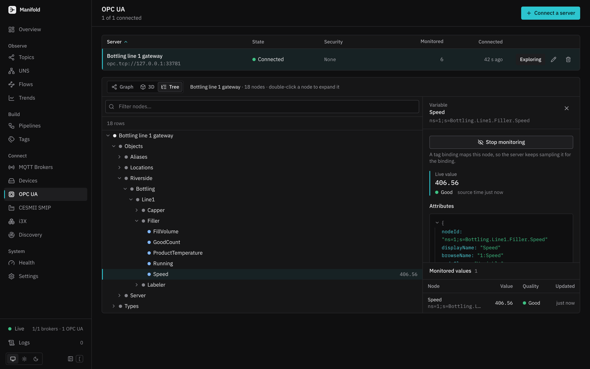

# OPC UA

Manifold is an OPC UA **client**: it connects to servers, browses their address space, monitors values
live and maps nodes into the Unified Namespace. It never writes to a server.

## Connect a server

1. **OPC UA → Connect a server.** Enter a name and the endpoint URL (`opc.tcp://host:4840`).
2. **Discover** lists every endpoint the server offers (security mode, policy, level, server
   certificate). Pick one to fill in the security settings.
3. Optionally set a user name and password; leave them empty for anonymous access.
4. **Connect.** The connection is saved and restored when Manifold restarts.

An exact duplicate of an existing connection (the same endpoint URL, written any way: case, `localhost`,
the default port 4840 and a trailing slash do not matter; the same security mode and policy; the same user)
is refused inline, naming the existing connection, with a button to edit it instead (`409 { code: "duplicate",
existing }`). A refused connect is reported once, in the form. **Edit** reconnects with the new settings; if
someone else saved the connection since you opened it, the save is refused (`409 stale`) and the conflict
dialog offers Keep mine, Take theirs or Cancel.

Mode **None** sends everything in clear text: use it on a trusted plant network only.

### Secure connections (Sign, SignAndEncrypt)

Trust is explicit in both directions; open **Certificates and trust** in the form:

1. **Give the server Manifold's certificate.** Its subject and SHA-1 thumbprint are shown; the PEM is
   `GET /api/opcua/certificate`. The server's administrator trusts it there.
2. **Connect once.** The first secure connect fails with *the server's certificate is not trusted by
   Manifold*: its certificate is now waiting in step 3.
3. **Trust it, then connect again.** Or tick *Trust server certificate on first connect* to trust exactly
   the certificate the server presents.

If the error says *the server closed the connection while the secure channel was being opened*, the
server does not trust Manifold's certificate yet (step 1). Certificates live in
`<data dir>/pki` (`trusted/certs`, `rejected/`, `own/`); the private key is owner-only.

## Browse and monitor

The list shows each connection with its **State**, **Security**, how many nodes are **Monitored** and when it
connected; **Exploring** marks the one the explorer below shows. The explorer shows the address space as a graph, in 3D or as a tree. In the tree, arrow keys move and
expand (→ expands, ← collapses), Enter selects. Select a variable to see its attributes (with
engineering units and range when the server publishes them) and choose **Monitor value**. Monitored
values stay monitored when you select other nodes; **Stop monitoring** ends them. A node a tag binding
maps stays sampled for the binding.

Quality is shown as Good, Uncertain or Bad, with the status code (for example `BadSensorFailure`), on the
panel, in **Monitored values** and on the tree node. Timestamps are the server's **source** timestamps.

## When the server goes away

The connection shows **Reconnecting** and retries forever with growing, jittered delays (1 s up to 60 s);
monitored values are marked as the last ones received. When the server is back the session, the
subscription and every monitored item are rebuilt once and values resume. A session the server closes
(timeout) or a subscription it deletes is detected within a few seconds even when TCP stays up.

Errors name what to do: wrong user name or password, anonymous access refused, the server's session limit
(`BadTooManySessions`), no endpoint with the chosen security, connection refused, host not found, timeouts.

## Into the UNS

- **Tags page:** choose the OPC UA connection as the source, select variables (keyboard or click) and
  **Add to UNS**. Published names come from the browse names. Values carry quality and the source time;
  a status change publishes Bad with the last value, a lost connection publishes Bad once and sets
  `_status` offline, recovery republishes Good. See [Mapping to the UNS](Mapping-to-the-UNS).
  The browse shows each variable's type and unit; once the connection is online the mapping reads the
  server's **EngineeringUnits**, **EURange**, **Description** and data type (once per connect, never per
  value) and uses them wherever the mapping sets none (the editor marks them *from server*); `_meta` and the
  Sparkplug BIRTH are republished when they change.
- **Sparkplug targets:** OPC UA built-in types become typed metrics (Int64/UInt64 exact); arrays and
  structures travel untyped.
- **UNS mounts:** UNS → Sources → *Mounted sources* grafts a server's address space (structure only) into
  the namespace tree. The server walks it (`GET /api/uns/mounts/:id/tree`): two levels below the start node,
  one batched browse request per level, at most 50 children per node, 400 nodes and 8 s.

## What is verified

Everything above is tested against a real OPC UA server (node-opcua) in the server tests and the UI
end-to-end suite. **Not verified:** Kepware, Siemens S7-1500, Ignition, Prosys and other servers, their
security policies and quirks, and tens of thousands of monitored items. Network discovery verifies an OPC UA
server with a real GetEndpoints (security None, no session) and shows its application name and the security it
offers; a listener that does not answer the UA-TCP Hello is not reported.
