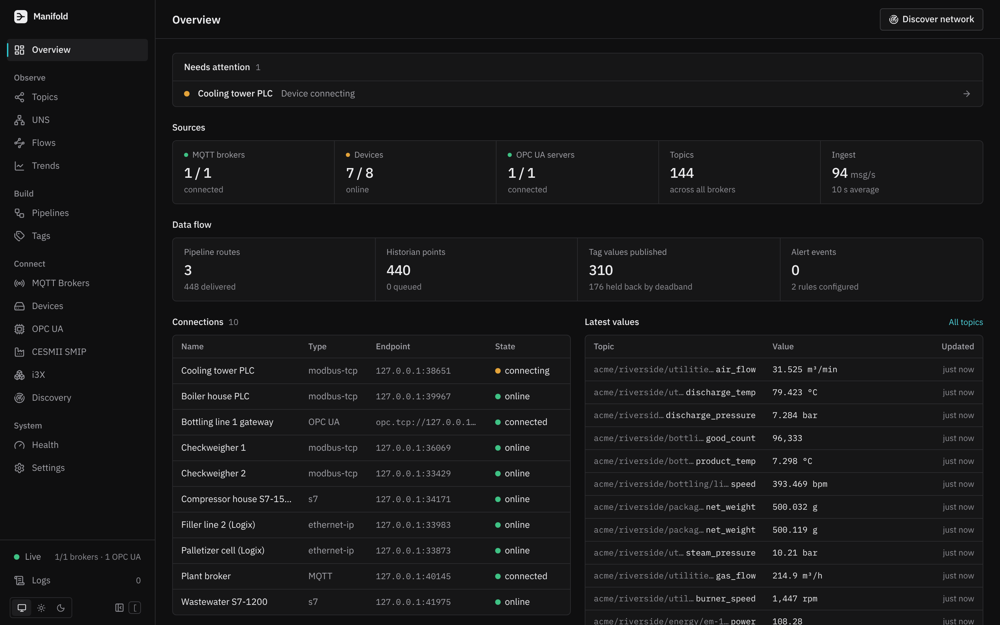
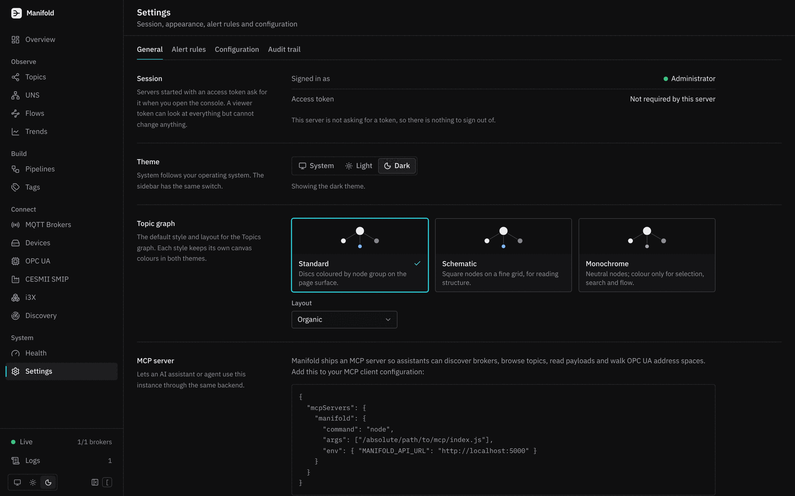
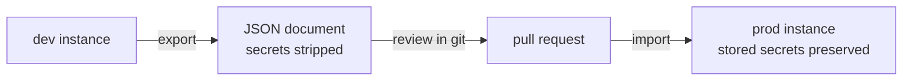

# 🛡️ Operations

> **Goal:** run Manifold like the control plane it is — authenticated,
> audited, monitored, and with its configuration in git.

## At a glance

The **Overview** page surfaces platform health live. Top to bottom: **Needs
attention** (what is wrong, worst first, each row linking to where it is fixed; a
single quiet line when nothing is: connections that are down, routes and historians
with rejected points or a pending backlog that keeps growing, alert rules firing or
breached, enabled mappings that are not publishing with the first reason, and stored
objects with a broken reference, from `GET /api/system/broken-references`), **Sources** (MQTT brokers, Devices, OPC UA servers,
Topics, Ingest rate), **Data flow** (pipeline routes and what they delivered, historian
points and what is queued, tag values published and how many the deadband held back,
alert events and rules configured), **Connections** (every broker, device and OPC UA
connection with its state, problems first) and **Latest values**:




For deeper self-observability, **Health** renders Manifold's own
Prometheus `/metrics` in the browser: process uptime, memory, and event-loop
delay; per-broker message rate and topic counts; and every engine counter
(pipelines, outbox, contracts, alerts, bindings, recorder) — each with a rolling
sparkline, and thresholds (event-loop delay, dropped/spilled points, errors)
flagged amber.

## Authentication and roles

Manifold can publish to brokers, actuate equipment through Sparkplug
commands, and scan networks. Run it authenticated anywhere beyond localhost:

```bash
MANIFOLD_AUTH_TOKEN=$(openssl rand -hex 24) \
MANIFOLD_VIEWER_TOKEN=$(openssl rand -hex 24) \
npm start
```

| Role | Token | Can |
|---|---|---|
| 🔑 Admin | `MANIFOLD_AUTH_TOKEN` | everything — API, socket, mutations |
| 👁️ Viewer | `MANIFOLD_VIEWER_TOKEN` | read everything; mutations refused with 403, **except** a short allowlist of read-only POSTs (below) |

**Behaviour to be aware of:**

- A viewer token **by itself turns authentication on**, exactly like an admin
  token. If you set only `MANIFOLD_VIEWER_TOKEN` there is no admin: set
  `MANIFOLD_AUTH_TOKEN` (or an admin entry in `MANIFOLD_TOKENS`) too.
- Roles fail closed. In `MANIFOLD_TOKENS` an **unknown role is rejected** with
  a startup error (it used to be treated as admin) and that entry is ignored.
  If tokens are configured but every entry is rejected, auth **stays on** and
  everything answers 401, never an open server. A token that itself contains
  `:` needs an explicit role as the last segment (`bot:ab:cd:viewer`).
- Viewers may call these POSTs because they cannot change anything: historian
  trend queries, pipeline dry-runs, subscription resolve, schema inference,
  device tag validation, mapping previews and name suggestions, i3X reads and
  CESMII history. The exact list is `VIEWER_READ_ONLY_POSTS` in
  `server/services/authConfig.js` (also quoted in
  [ARCHITECTURE.md](https://github.com/zbest1000/manifold/blob/main/ARCHITECTURE.md#security-model)).
  Everything else non-GET is refused, over HTTP and over the socket.
- Nobody sees alert **webhook URLs** back (Slack/Teams URLs are credentials): every role
  sees only that one is set and the service it calls (its origin). Saving a rule without
  `webhookUrl` keeps the stored one; the editor offers **Replace** and **Remove**.

Auth is enforced identically on the REST API **and** the Socket.IO handshake —
the socket can publish and actuate, so it is gated the same way. See
[the viewer experience](#the-viewer-experience-and-switching-sessions) below. `/health` stays open for
probes. `/metrics` requires a bearer token (any role) whenever a token is
configured; set `MANIFOLD_METRICS_PUBLIC=1` to leave it open for an
unauthenticated scraper. Failed logins, viewer 403s and throttled requests are
audited (never with the token), and `audit.jsonl` rotates by size
(`MANIFOLD_AUDIT_MAX_BYTES`, default 10 MiB; `MANIFOLD_AUDIT_KEEP`, default 5).

### The viewer experience and switching sessions



A browser with a viewer token sees the whole console, but every control that would change
something is **disabled and says why** ("Read-only session: changes are rejected" in a
tooltip or beside the control), pages that own mutations show a short read-only note, and
the sidebar shows a read-only marker. Editors still open (the mapping editor, device
form) so a viewer can look at configuration, with saving disabled. Webhook URLs and the
audit trail are hidden.

**Settings → General → Session** shows who this browser is signed in as (*Administrator*,
*Viewer (read-only)*, or *Open access (no token required)*) and whether a token is stored
in this browser. **Sign out / use a different token** clears the stored token and reloads, which
brings back the **Manifold is locked** screen where the next token is entered. That is how a
viewer switches to an admin token, and how a rotated token is replaced. A `401` while a token is
stored also returns to the unlock screen. If the server asks for no token the card says there is
nothing to sign out of.

### Fail closed by default

With **no token set**, the server binds `127.0.0.1` only and warns at startup —
an accidentally-unauthenticated instance is reachable from its own host, never
the network. Exposing an open instance off-host is a deliberate act:

```bash
MANIFOLD_HOST=0.0.0.0 npm start   # UNAUTHENTICATED and on the network — you were warned
```

The Docker demo already does this safely: it binds `0.0.0.0` inside the
container but maps only to host loopback (`127.0.0.1:5000:5000`), so `docker
compose up` is reachable at `localhost` and nowhere else until you set a token.

An open instance on loopback also checks the `Host` header: it answers only to
`localhost`, `127.x` and `::1`, and refuses any other name with 421. A web page on
another site whose name was re-pointed at `127.0.0.1` (DNS rebinding) therefore cannot
drive it, and the Socket.IO connection refuses foreign `Origin`s. If you reach a
token-less local instance by another name (an `/etc/hosts` alias), list it in
`MANIFOLD_ALLOWED_HOSTS` (comma-separated). With a token, or a non-loopback bind,
the token is the protection and any `Host` is accepted.

The published image has no token and no `MANIFOLD_HOST` set, so inside the container
it binds `127.0.0.1` and a published port reaches nothing. Pass
`-e MANIFOLD_AUTH_TOKEN=...` (see [Docker image](#docker-image)).

### Named tokens

For teams, `MANIFOLD_TOKENS` issues **individually revocable** tokens with a
name and a role — the name is what shows up in the audit trail:

```bash
MANIFOLD_TOKENS="alice:$(openssl rand -hex 24):admin,dashboard:$(openssl rand -hex 24):viewer" npm start
```

Format: `name:token:role,...` with role `admin` or `viewer`. Revoking one
person's access means removing one entry — no shared-secret rotation.

### Brute-force protection and rate limiting

Failed authentication is rate-limited per IP — on **both** the REST API and the
socket handshake — after **20 failures in a minute**, further attempts get `429`
until the window passes. Successful requests are unaffected. A separate general
limiter caps overall `/api` traffic (default 600 requests/minute per IP;
`MANIFOLD_RATE_MAX` / `MANIFOLD_RATE_WINDOW_MS`), and `helmet` sets standard
security headers on every response.

**Behind a reverse proxy** every request arrives from the proxy's address, so without
more configuration all users share one rate-limit bucket and one auth-failure counter,
and the audit log records the proxy. Set `MANIFOLD_TRUST_PROXY` to the number of proxy
hops in front of Manifold (`1` for one nginx/Traefik/IIS) or to the proxy addresses or
subnets (`10.0.0.5,10.0.1.0/24`, `loopback`); the client address is then taken from
`X-Forwarded-For`. It is off by default. `true` is refused with a startup warning: it
would trust any `X-Forwarded-For`, so every client could choose its own address and step
around the limits. Do not set it when Manifold is reached directly.

### Network safety (egress guard)

Features that reach out to other machines pass their targets through one egress
guard. Loopback, link-local (including the cloud-metadata address
`169.254.169.254`), multicast, and reserved ranges are **always** blocked, so
Manifold can't be turned into an SSRF pivot or an internal port scanner. IPv6
forms that embed an IPv4 address (mapped, NAT64, 6to4) are judged by the
embedded address. RFC1918 / LAN targets — the normal case on a plant network,
and what Discovery is *for* — are **fail-closed by default**; set
`MANIFOLD_ALLOW_PRIVATE_TARGETS=1` on a trusted on-prem network to allow them
(the server warns at startup when it's on). The Docker demo sets it, since it is
a local-only demo.

What the guard covers, and how strongly:

| Path | Enforcement |
|---|---|
| Network scanner (Discovery) | each candidate address is checked |
| i3X, CESMII, broker admin API, **alert webhooks** | full: checked before the request, the connect-time address is pinned (closes DNS rebinding), redirects are followed manually (at most 5) and every hop is re-checked, and credentials are dropped on a cross-origin redirect. A webhook to `localhost` or a private address is **refused** (private ones work with `MANIFOLD_ALLOW_PRIVATE_TARGETS=1`) |
| **Device drivers** (every protocol, TCP, UDP, HTTP and WebSocket) | checked when a device is saved, tested or started. A hostname is resolved and validated in the server process; the validated address is passed to the driver host, which connects to **that address** (the hostname stays for display), so there is no re-resolution window. The name is re-resolved whenever a driver host restarts and every 30 s for running devices; if it now resolves to a blocked address the device goes offline with that reason instead of connecting. **Loopback is allowed only with `MANIFOLD_ALLOW_LOOPBACK_DEVICES=1`** (for simulators; the server warns at startup when set). Metadata ranges stay blocked either way. A refused device shows as Stopped with the reason |

**Not covered:** MQTT broker hosts, OPC UA endpoints, and historian / database
URLs are **not** checked against private or loopback ranges: a broker or historian on
`localhost` or the LAN is the normal setup. (The public test-broker presets in the connect form only fill the
form: they are public host names, so they would pass the guard, and a preset added twice is refused by
the usual duplicate-broker rule.) They **do** refuse **link-local and cloud-metadata**
targets: 169.254.0.0/16 (including `169.254.169.254`), fe80::/10, the metadata helper
addresses of Azure, Alibaba, Oracle and AWS (IPv6), and metadata host names such as
`metadata.google.internal`. A save is answered 403; a connection whose name later resolves
to such an address fails to connect with *link-local or cloud-metadata address* as its
last error (MQTT on every reconnect, OPC UA before every session, historians before every
request). Otherwise they are connections an admin configures by hand, and
an admin can point them anywhere else the server can reach. Treat admin tokens
accordingly, and use network policy for these.

### Stored secrets and address changes

Passwords, tokens and community strings are never sent back to the browser, so an editor
keeps the stored one when its field is left blank. That only holds while the address stays
the same: when the scheme, host or port changes (for a URL, its origin) and the secret is
left blank, the save is refused with 400 `{ code: "secret-required", field }` and the form
shows *The address changed, so the password must be entered again* next to the field.
Otherwise anyone with an admin token could move a connection to a server of their own and
receive the stored password. It applies to brokers, the broker admin API URL, historians,
OPC UA connections, devices (and the device connection test), and to config import: an
imported historian or device whose endpoint differs from the stored one is imported without
the stored secret. Renaming, or changing only a path, keeps the secret.

### CORS

The API only accepts browser requests from `CLIENT_URL` (default
`http://localhost:3000`). Set it to the origin your users actually load the
UI from when the client is served separately.

## Audit log

Every mutating API call and socket command is recorded — role, IP, route,
outcome — with secrets redacted. **Rejected requests are recorded too**: failed
authentication (401), viewer-forbidden (403) and throttled (429) requests are
audited even when they are GETs, because they are what an investigator looks
for. Bearer tokens are never written (only the matched token's *name*), and
query strings are dropped from the logged path. View under **Settings → Audit trail**
(admin only), or read the append-only JSONL in `MANIFOLD_DATA_DIR`.

`audit.jsonl` rotates by size: at `MANIFOLD_AUDIT_MAX_BYTES` (default 10 MiB)
it becomes `audit.jsonl.1`, then `.2` and so on up to `MANIFOLD_AUDIT_KEEP`
(default 5) files; the oldest is dropped.

## Prometheus

`GET /metrics` exposes event-loop delay percentiles, per-broker ingest,
per-route pipeline counters, outbox depth/spill/drops, contract violations,
binding counters and device and driver-host health:

```yaml
scrape_configs:
  - job_name: manifold
    authorization:            # needed when MANIFOLD_AUTH_TOKEN / MANIFOLD_TOKENS is set
      credentials: <viewer-token>   # a viewer-role token is enough
    static_configs:
      - targets: ['manifold-host:5000']
```

With auth enabled `/metrics` returns 401 without a token; set
`MANIFOLD_METRICS_PUBLIC=1` to scrape anonymously.

**Every series `/metrics` exposes** (from `server/services/metricsExporter.js`):

| Metric | Meaning |
|---|---|
| `manifold_process_uptime_seconds`, `manifold_process_memory_bytes`, `manifold_event_loop_delay_ms` | process health (event-loop delay as percentiles) |
| `manifold_process_cpu_seconds_total` (`mode` user/system) | process CPU time; `rate()` gives utilisation, 1.0 = one core |
| `manifold_host_load_average` (`period` 1m/5m/15m), `manifold_host_cpus`, `manifold_host_memory_bytes` (`kind` total/free) | the host or container the server runs on |
| `manifold_broker_messages_received_total`, `manifold_broker_topics` | per-broker ingest |
| `manifold_broker_canary_state` (`state` ok/slow/failing/not-permitted/pending/unknown, 1 for the current one), `manifold_broker_canary_success_ratio`, `manifold_broker_canary_latency_ms` (`quantile` 0.5/0.95), `manifold_broker_canary_last_success_age_seconds`, `manifold_broker_canary_probes_total` | the opt-in [broker canary](Broker-Setup#broker-canary-opt-in-round-trip-probe); only brokers that turned it on appear |
| `manifold_broker_posture_findings` (`severity` high/medium/low/info) | security findings per broker, see [Security posture](Broker-Setup#security-posture) |
| `manifold_pipeline_messages_total` | per-route pipeline counters, `result` = `matched`, `delivered`, `error`, `loop_blocked` |
| `manifold_pipeline_pending_points` (`route`) | points a route handed to a historian target that are still waiting (queued or spilled) |
| `manifold_outbox_points_total`, `manifold_outbox_queued_points`, `manifold_outbox_pending_points`, `manifold_outbox_spill_bytes` | historian store-and-forward: `result` = `written`, `spilled`, `dropped`; queue depth; points waiting in memory and on disk; spill size |
| `manifold_recorder_points_total` | points per recording |
| `manifold_contract_checks_total`, `manifold_contract_violations_total` | schema contracts |
| `manifold_alert_events` | events in the in-memory alert ring |
| `manifold_alerts_active` (`state`, `severity`), `manifold_alerts_unacknowledged` (`severity`) | active alarms; firing alarms nobody has acknowledged (see [Alerts](Alerts#metrics)) |
| `manifold_alert_transitions_total` (`state`, `severity`), `manifold_alert_history_bytes`, `manifold_alert_history_write_errors_total` | alert events since start; the alarm history on disk |
| `manifold_binding_published_total`, `manifold_binding_suppressed_total`, `manifold_binding_errors_total` | per mapping (labelled by the first 8 characters of its binding id): publishes, samples suppressed by report-by-exception, publish errors |
| `manifold_device_up`, `manifold_device_connects_total`, `manifold_device_requests_total`, `manifold_device_timeouts_total` | per device |
| `manifold_device_exceptions_total` | protocol exceptions, by `code` |
| `manifold_device_cycle_ms`, `manifold_device_overruns_total` | per poll `group` |
| `manifold_device_quarantined_tags` | tags currently quarantined |
| `manifold_driver_host_up`, `manifold_driver_host_restarts_total` | per driver host (`host`, `protocol`) |

Device labels: `device` is the device name, `device_id` its first 8 characters, `protocol`.
Series are capped (500 devices, 500 mappings, 500 hosts, 16 poll groups and 16 exception codes
per device) so a misbehaving device cannot explode cardinality. A parked driver shows as
`manifold_driver_host_up 0` with a climbing restart counter; a stalled device as
`manifold_device_up 0` or a growing `manifold_device_overruns_total`. The historian's
dead-letter count is **not** a Prometheus series (it is on the Historians tab).

> 💡 The Overview figures never poll — engine numbers are pushed over the existing
> socket every 2 s, only while a client is connected. The **Health**
> page reads the same `/metrics` endpoint directly for the full set (process and
> per-broker readings the socket stream doesn't carry).

## Configuration as code



**Settings → Configuration** (**Export config**; and **Import config** under *Danger zone*) exports the entire DataOps setup — pipelines, models,
historians, recordings, contracts, bindings, **devices and device profiles**,
mounts, alert rules — as one JSON document with secrets stripped. Import merges
by id and keeps stored secrets when the incoming document carries a null.

Secrets are stripped by field **name**, one shared rule for export and audit
(anything matching `pass`, `token`, `secret`, `key`, `credential`, `cert`,
`authorization`, `webhook`, plus `ca` and `pfx`), at any depth, and passwords in
URLs. Import is validated whole before anything is applied (ids, sizes, depth,
prototype-polluting keys); one bad item rejects the document with a 400.

Device and profile **tag keys** (`tags` and `ownTags` lists) are identifiers,
not secrets, and are kept in an export; a secret nested inside a tag, or a
`key` anywhere else (a TLS private key in a broker profile), is still stripped.
Imported configuration **applies immediately**: mappings are reconciled and
devices re-applied without a restart. The import asks to confirm (*Import and overwrite*)
because anything with a matching id is overwritten.

## Alerts

Alert rules, active alarms (with acknowledgement) and the durable alarm history are on the
**Alerts** page; the full reference is **[Alerts](Alerts)**. In short: rules have a severity
(info, warning, critical); value rules have a sustain time and a clear value against flapping; firing
alarms can be acknowledged with a note (who and when are recorded; an acknowledgement never silences
an alarm and ends when it clears); every event is kept in `alerts.jsonl` in the data directory (two
size-capped segments, `MANIFOLD_ALERT_HISTORY_MAX_BYTES`, default 8 MiB), and alarms that were active
when the server stopped are closed as *Ended by restart* and re-fire from live data if the condition
still holds.

## Broker health in operation

Two optional read-outs per MQTT broker, both described in [Broker setup](Broker-Setup):

- **Canary.** Alert on `manifold_broker_canary_state{state="failing"} == 1` (probes are not coming back
  although the session is connected) and watch `manifold_broker_canary_latency_ms{quantile="0.95"}`.
  `not-permitted` means an ACL refusal, not an outage. The canary **publishes** to the broker, so it is
  off until someone turns it on per broker. Its traffic is kept out of the topic tree, the UNS,
  recordings, pipelines, mappings and the broker message counters.
- **Security posture.** `manifold_broker_posture_findings{severity="high"} > 0` is worth a ticket. The
  assessment reads settings and the live session only; it adds no traffic.

## Concurrent edits, duplicates and references

- **Two people editing the same item.** Every stored object (brokers, OPC UA endpoints, devices, device profiles, mappings, routes, models, historians, recordings, contracts, alert rules) carries an integer `rev` that the store raises on each write, and `updatedAt`. Send the `rev` you loaded in the body of a `PUT` / `POST` with an id (or as `If-Match`); if the stored `rev` differs the answer is `409 { error, code: "stale", current }`, where `current` is the stored object exactly as the matching `GET` shows it (secrets redacted). The UI then shows what changed elsewhere and offers **Keep mine (overwrite)**, **Take theirs** or **Cancel**. A request **without** `rev` keeps last-write-wins, so existing scripts work. Config import bypasses the check but bumps revisions. Older stored data counts as `rev` 0.
- **Duplicate broker connections.** `POST /api/mqtt/brokers` (and `PUT` that would make one) is refused with `409 { code: "duplicate", existing }` when another connection has the same protocol, host, port, WebSocket path, username and subscribe filter. Two connections to one broker with different filters or users are allowed.
- **Dangling references.** Saving a route, model, recording, contract or alert rule that names a broker or historian that does not exist is a `400` naming it. Deleting a broker that is still used is a `409` naming the users (routes, mappings, recordings, alert rules, models, contracts, Sparkplug host sessions). Objects whose reference was lost (after an import or a manual edit of the data directory) are marked **Broken reference** with the missing id; the server logs them at startup.

## Device drivers in operation

- Each protocol's driver runs in its **own child process** supervised by the
  server; see [Devices and Drivers](Devices-and-Drivers). A crashing driver
  restarts with a growing delay and is **parked** after more than five crashes
  in a minute (the Devices page says so; saving the device set again retries).
  A hung driver is killed after missing heartbeats.
- A device can run in its own process (useful for a flaky gateway): tick **Run
  this device in its own driver process** under **Advanced** in the device form
  (stored as `"isolate": true`). Modbus **Unmapped register ranges** are in the same section.
- **Saving a device validates it against its driver** (options, limits, S7 rack and slot), names must be unique, and
  `POST /api/devices/bulk` (the profile table and Discovery's **Add all**) is all-or-nothing, at most 200 rows.
- **Profiles** are admin-only to create, edit and delete. Editing a profile
  re-applies it to every instance atomically and is refused if any instance
  would break; deleting one is refused while a device or a mapping uses it.
- **Discovery of devices** is opt-in and sends one read-only identification
  request per ticked protocol per address (see
  [Devices and Drivers](Devices-and-Drivers#finding-devices-on-the-network-discovery)).
  It is intrusive on an OT network: scan small ranges in a window. It follows
  the egress guard (private ranges need `MANIFOLD_ALLOW_PRIVATE_TARGETS=1`;
  loopback needs `MANIFOLD_ALLOW_LOOPBACK_DEVICES=1`). The UDP kinds (BACnet/IP, CoAP,
  SNMP) are each opt-in on their own; the SNMP probe sends the community `public`.
- **Device secrets** (HTTP passwords and tokens, SNMP communities and v3 passwords, the
  bridge servers' bearer token) are stored in `profiles.json` and answered as `null` by
  every API call; leave the field blank on edit to keep the stored value.
- **Experimental drivers.** Every driver except Modbus TCP is experimental — not verified on
  real hardware; run it against a real device with the checklist in
  [Verifying on real hardware](Verifying-on-Real-Hardware) before relying on it.
- Device setup is admin-only and audited like any other change. A viewer can
  read devices and live values; `POST /api/devices/validate-tags` is the only
  device POST a viewer may call.
- Saved OPC UA connections are **supervised**: after a restart, or a lost
  session, Manifold keeps retrying (1 s growing to 60 s, jittered) until you
  delete the connection, and re-creates its monitored items. A first connect you
  start from the UI that fails is reported and not kept.
- Device health is on `/metrics` (see [Prometheus](#prometheus)) and on the
  Devices page and `GET /api/devices` (state, cycle times, overruns, quarantined
  tags with their reasons, last error and its time).
- **Retained topics**: a mapping clears what it published when it is deleted,
  disabled or renamed; the owned topics are recorded in `binding-retained.json`, so an edit
  made while Manifold was down is cleaned up once the broker is connected (at most 20,000
  recorded topics per broker; [details](Mapping-to-the-UNS#retain-and-what-is-cleaned-up)).

## Upgrade notes: behaviour changes an operator must know

Collected from the changelog; each is verified against the code.

- **The UI was redesigned.** Every page was rebuilt; routes and URLs are unchanged. The Tags
  wizard is now the mapping editor, Devices is a table with a drawer and a full-page form,
  and the graph styles are Standard, Schematic and Monochrome (old stored ids map to the nearest).
  Light, dark and system themes are new (the preference is `tc.theme` in the browser).
- **`device-values` is one Socket.IO event per 250 ms flush** carrying every touched device
  (`{ batch: [{ deviceId, values }] }`), reliable when it carries a quality change. Anything
  that listened to per-device events must read the batch. The contract is in
  [ARCHITECTURE.md](https://github.com/zbest1000/manifold/blob/main/ARCHITECTURE.md#socketio-events).
- **Devices are validated at save**: unique names, driver options, S7 rack and slot. A device that
  used to save and then sit offline is now refused with the driver's message.
- **A historian that something still uses cannot be deleted** (409 naming the pipeline routes,
  recordings and mappings). Pipeline source filters, `repath` targets, model targets and recorder
  filters are validated as MQTT topics; an invalid one that used to save is refused.
- **Bulk device creation is all-or-nothing**, one request, at most 200 rows.
- **Viewer allowlist** gained mapping preview and name suggestions and CESMII history.
- **A mapping's Retain values is off by default**; a Bad sample is recorded in history when a source
  goes offline, for plain mappings too; `_meta` and `_status` that fail to publish (broker not yet
  connected) are retried on a 15 s timer.
- **Mapping options**: with none of the new options (selection rules, overrides, fields, context)
  a mapping publishes byte for byte what it did before; this is asserted against a captured fixture.
- **Sparkplug host STATE sessions** reconnect with the new settings when started again after a
  broker edit; they do not notice an edit by themselves.
- **Recordings** can be paused and resumed (the pause/resume control on the Recorder tab).
- **Secrets and address changes**: changing a connection's host, port or scheme with its
  password left blank is refused (400 `secret-required`); type the password again. Scripts
  that PUT a broker, OPC UA connection or device with a new host and no password must now
  send the password.
- **Alert webhook URLs** are no longer returned to admins either (`hasWebhook`,
  `webhookOrigin`); a rule saved without `webhookUrl` keeps it, `""` removes it. Scripts
  that cleared a webhook by omitting the field must send `""`.
- **Brokers, OPC UA endpoints and historians** on a link-local or cloud-metadata address are
  refused (403 at save, an error at connect).
- **Canary topics** must start with `manifold/canary/` and contain no command level.
- **`GET /api/recorder/:id/series` needs `tags`** (1-10); a series stops after 1,000,000
  samples (`meta.truncated`), and a recording's `maxBytes` is at most 4 GiB.
- **`MANIFOLD_TRUST_PROXY`** is new; set it behind a reverse proxy (see
  [rate limiting](#brute-force-protection-and-rate-limiting)).
- **A token-less instance bound to loopback refuses foreign host names** (421) and the
  Socket.IO connection refuses foreign `Origin`s. Reaching it as `localhost`, `127.x` or `::1`
  works as before; add any other name to `MANIFOLD_ALLOWED_HOSTS`.
- **Alert rules moved from Settings to the Alerts page** (Settings links to them;
  `/settings?tab=alerts` redirects).
- **Stored device secrets are answered as `null`** (the HTTP drivers used to answer
  `********`); a save that leaves a secret out, blank or `null` keeps it.
- **A viewer token alone enables auth**, and then nobody is admin: also set
  `MANIFOLD_AUTH_TOKEN` or an admin entry in `MANIFOLD_TOKENS`.
- **Unknown roles in `MANIFOLD_TOKENS` are rejected** (an entry such as
  `bob:secret:readonly` used to become an admin token). Rejected entries are logged at
  startup; if tokens were configured but all were rejected, auth stays on and every request is 401.
- **`/metrics` needs a bearer token** (any role) when auth is on. Give Prometheus a viewer
  token, or set `MANIFOLD_METRICS_PUBLIC=1`. `/health` stays open.
- **Fail closed by default**: with no token the server binds `127.0.0.1` only.
- **Alert webhooks pass the egress guard**: a webhook to `localhost`, a link-local address or
  (without `MANIFOLD_ALLOW_PRIVATE_TARGETS=1`) a private address is refused; redirects are
  re-checked on every hop.
- **Device targets are guarded**: loopback hosts need `MANIFOLD_ALLOW_LOOPBACK_DEVICES=1` and
  private ranges need `MANIFOLD_ALLOW_PRIVATE_TARGETS=1`.
- **Sparkplug messages are delivered in order and un-coalesced** (a bounded queue; overflow
  is counted), so they reach consumers at flush cadence, up to 100 ms later. Mappings publish a
  Bad-quality value when a source goes offline and a retained `_status` topic.
- **The historian spill is segment files plus a cursor** under `outbox/` (a legacy
  `<id>.jsonl` is still read first and drained, no conversion needed); permanently rejected
  points go to a dead-letter file.
- **InfluxDB typing is stricter**: only real numbers write `value`; booleans and everything
  else write `raw` as text (booleans were `1`/`0`).
- **`audit.jsonl` rotates by size** and records rejected requests (401/403/429).
- **Config export keeps device tag `key` fields** (an earlier build blanked them) and an
  import applies immediately.

## Limits that protect the server

| Limit | Default | Setting | When it is reached |
|---|---|---|---|
| Topics per broker | 2,000,000 | (fixed) | New topics are dropped and counted, a `topic-cap-reached` event is raised and the server logs a warning |
| Idle-topic eviction | off | `MANIFOLD_TOPIC_IDLE_TTL_MS` (milliseconds) | When set, topics silent for longer than this are forgotten by a background sweep, freeing their slots (so a namespace with churning topics does not slowly fill the cap) |
| Retained payload per topic | 256 KB | `MANIFOLD_MAX_PAYLOAD_BYTES` | Larger payloads are truncated for storage and preview |
| MQTT 5 property entries | 200,000 | `MANIFOLD_MAX_MSG_PROPS` | New topics' properties are refused and counted (`droppedProps`) |
| Sparkplug un-coalesced queue | 5,000 messages / 8 MiB per 100 ms flush | `MANIFOLD_SPARKPLUG_QUEUE_MAX`, `MANIFOLD_SPARKPLUG_QUEUE_BYTES` | A topic falls back to latest-wins for that window; `sparkplugCoalesced` counts the affected messages |
| Historian HTTP calls | 15 s | `MANIFOLD_HISTORIAN_TIMEOUT_MS` | The write fails and spills |
| Codec payload size | 256 KiB | `MANIFOLD_CODEC_MAX_BYTES` | The payload is not decoded and stays as it arrived (counted as failed); decoding is also bounded to 32 levels and 100,000 items |
| Codec auto-detection | on | `MANIFOLD_CODEC_AUTODETECT=0` turns it off | CBOR and MessagePack without a binding are then left as they arrived |
| IoT devices / tags per broker | 2,000 / 50,000 | `MANIFOLD_IOT_MAX_DEVICES`, `MANIFOLD_IOT_MAX_TAGS` | New devices or tags are not added and the drop is counted |
| Alert history on disk | 8 MiB (two segments) | `MANIFOLD_ALERT_HISTORY_MAX_BYTES` | The oldest events are dropped |
| Trends CSV export | 1,000,000 rows | `MANIFOLD_EXPORT_MAX_ROWS` | The file stops with a `# Truncated` line |

See the full list of settings in the
[README](https://github.com/zbest1000/manifold#configuration).

## Data directory

`MANIFOLD_DATA_DIR` (default `server/data/`) holds profiles, history
snapshots, outbox spill, recordings, the audit log, and the OPC UA PKI
(`pki/` — Manifold's application certificate and the trusted/rejected server
certificate stores) — written 0600/0700.

> ⚠️ The profiles file contains connection credentials, and `pki/own/private`
> holds the OPC UA private key. Protect the host, and back the directory up
> if your DataOps config matters.

**How `profiles.json` is protected.** Changes are coalesced (all edits in one
tick make one write) and written as temp file, `fsync`, rename, then a
directory `fsync`, so a crash leaves the old or the new complete file, never an
empty one. Rotating backups `profiles.json.bak.1` … `.5` (newest first) are cut
from the previous good file, at most one per minute so a burst of edits cannot
push every good copy out. On startup, a corrupt or missing file is **recovered
from the newest valid backup** (loudly, in the log: changes since that backup
are lost), after the bad file is kept as `profiles.json.bak`. Pending writes
are flushed on shutdown and on exit; a hard kill (SIGKILL, power loss) can lose
only the edits of the current instant.

**When the data directory cannot be written** (disk full, permissions, a read-only mount),
saves still answer OK but only change the running server. `GET /api/system/status` then
answers `"status": "degraded"` with `storage.profiles` (configuration) and
`storage.alertJournal` (alert history) saying which store failed and why; Overview lists
each under **Needs attention** and the Health page shows a banner *Storage degraded:
changes are not being saved*. Free space or fix the permissions: the next save writes
everything again. Until then, changes are lost on restart.

## Docker image

Every `v*` tag publishes `ghcr.io/zbest1000/manifold` — server plus built UI
in one container:

```bash
docker run -p 5000:5000 \
  -v manifold-data:/data \
  -e MANIFOLD_AUTH_TOKEN=$(openssl rand -hex 24) \
  ghcr.io/zbest1000/manifold:1.1.0
```

The image sets `MANIFOLD_DATA_DIR=/data` — mount a volume there or your
profiles, history, spill files, and PKI vanish with the container. `/health`
answers without a token, so it works as a liveness probe even when auth is
on.
