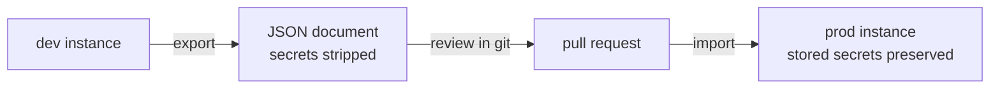

# 🛡️ Operations

> **Goal:** run Manifold like the control plane it is — authenticated,
> audited, monitored, and with its configuration in git.

## At a glance

The Overview page surfaces platform health live — pipelines, historians
(store-and-forward state), tag bindings, and alerts, each card linking to its
module:


> *Pipelines, historians, tag bindings, and alerts — live, each card linking to its module.*

For deeper self-observability, **System → Health** renders Manifold's own
Prometheus `/metrics` in the browser: process uptime, memory, and event-loop
delay; per-broker message rate and topic counts; and every engine counter
(pipelines, outbox, contracts, alerts, bindings, recorder) — each with a rolling
sparkline, and thresholds (event-loop delay, dropped/spilled points, errors)
flagged amber.

## Authentication and roles

Manifold can publish to brokers, actuate equipment through Sparkplug
commands, and scan networks. Run it authenticated anywhere beyond localhost:

```bash
MANIFOLD_AUTH_TOKEN=$(openssl rand -hex 24) \
MANIFOLD_VIEWER_TOKEN=$(openssl rand -hex 24) \
npm start
```

| Role | Token | Can |
|---|---|---|
| 🔑 Admin | `MANIFOLD_AUTH_TOKEN` | everything — API, socket, mutations |
| 👁️ Viewer | `MANIFOLD_VIEWER_TOKEN` | read everything; mutations refused with 403, **except** a short allowlist of read-only POSTs (below) |

**Behaviour to be aware of:**

- A viewer token **by itself turns authentication on**, exactly like an admin
  token. If you set only `MANIFOLD_VIEWER_TOKEN` there is no admin: set
  `MANIFOLD_AUTH_TOKEN` (or an admin entry in `MANIFOLD_TOKENS`) too.
- Roles fail closed. In `MANIFOLD_TOKENS` an **unknown role is rejected** with
  a startup error (it used to be treated as admin) and that entry is ignored.
  If tokens are configured but every entry is rejected, auth **stays on** and
  everything answers 401, never an open server. A token that itself contains
  `:` needs an explicit role as the last segment (`bot:ab:cd:viewer`).
- Viewers may call these POSTs because they cannot change anything: historian
  trend queries, pipeline dry-runs, subscription resolve, schema inference,
  device tag validation, and i3X reads. Everything else non-GET is refused.
- Viewers do not see alert **webhook URLs** (Slack/Teams URLs are credentials);
  they see only that one is set.

Auth is enforced identically on the REST API **and** the Socket.IO handshake —
the socket can publish and actuate, so it is gated the same way. Viewers see a
persistent *read-only* badge in the UI and mutation controls are disabled, so a
read-only session is never a wall of silent 403s. `/health` stays open for
probes. `/metrics` requires a bearer token (any role) whenever a token is
configured; set `MANIFOLD_METRICS_PUBLIC=1` to leave it open for an
unauthenticated scraper. Failed logins, viewer 403s and throttled requests are
audited (never with the token), and `audit.jsonl` rotates by size
(`MANIFOLD_AUDIT_MAX_BYTES`, default 10 MiB; `MANIFOLD_AUDIT_KEEP`, default 5).

### Fail closed by default

With **no token set**, the server binds `127.0.0.1` only and warns at startup —
an accidentally-unauthenticated instance is reachable from its own host, never
the network. Exposing an open instance off-host is a deliberate act:

```bash
MANIFOLD_HOST=0.0.0.0 npm start   # UNAUTHENTICATED and on the network — you were warned
```

The Docker demo already does this safely: it binds `0.0.0.0` inside the
container but maps only to host loopback (`127.0.0.1:5000:5000`), so `docker
compose up` is reachable at `localhost` and nowhere else until you set a token.

### Named tokens

For teams, `MANIFOLD_TOKENS` issues **individually revocable** tokens with a
name and a role — the name is what shows up in the audit trail:

```bash
MANIFOLD_TOKENS="alice:$(openssl rand -hex 24):admin,dashboard:$(openssl rand -hex 24):viewer" npm start
```

Format: `name:token:role,...` with role `admin` or `viewer`. Revoking one
person's access means removing one entry — no shared-secret rotation.

### Brute-force protection and rate limiting

Failed authentication is rate-limited per IP — on **both** the REST API and the
socket handshake — after **20 failures in a minute**, further attempts get `429`
until the window passes. Successful requests are unaffected. A separate general
limiter caps overall `/api` traffic (default 600 requests/minute per IP;
`MANIFOLD_RATE_MAX` / `MANIFOLD_RATE_WINDOW_MS`), and `helmet` sets standard
security headers on every response.

### Network safety (egress guard)

Features that reach out to other machines pass their targets through one egress
guard. Loopback, link-local (including the cloud-metadata address
`169.254.169.254`), multicast, and reserved ranges are **always** blocked, so
Manifold can't be turned into an SSRF pivot or an internal port scanner. IPv6
forms that embed an IPv4 address (mapped, NAT64, 6to4) are judged by the
embedded address. RFC1918 / LAN targets — the normal case on a plant network,
and what Discovery is *for* — are **fail-closed by default**; set
`MANIFOLD_ALLOW_PRIVATE_TARGETS=1` on a trusted on-prem network to allow them
(the server warns at startup when it's on). The Docker demo sets it, since it is
a local-only demo.

What the guard covers, and how strongly:

| Path | Enforcement |
|---|---|
| Network scanner (Discovery) | each candidate address is checked |
| i3X, CESMII, broker admin API, **alert webhooks** | full: checked before the request, the connect-time address is pinned (closes DNS rebinding), redirects are followed manually (at most 5) and every hop is re-checked, and credentials are dropped on a cross-origin redirect. A webhook to `localhost` or a private address is **refused** (private ones work with `MANIFOLD_ALLOW_PRIVATE_TARGETS=1`) |
| **Device drivers** (Modbus, S7, EtherNet/IP) | checked when a device is saved, tested or started. The drivers open their own sockets, so the hostname is resolved again at connect time: a small DNS-rebinding window remains for hostnames (literal IPs have none). **Loopback is allowed only with `MANIFOLD_ALLOW_LOOPBACK_DEVICES=1`** (for simulators; the server warns at startup when set). Metadata ranges stay blocked either way. A refused device shows as Stopped with the reason |

**Not covered:** MQTT broker hosts, OPC UA endpoints, and historian / database
URLs are **not** checked. They are connections an admin configures by hand, and
an admin can point them anywhere the server can reach. Treat admin tokens
accordingly, and use network policy for these.

### CORS

The API only accepts browser requests from `CLIENT_URL` (default
`http://localhost:3000`). Set it to the origin your users actually load the
UI from when the client is served separately.

## Audit log

Every mutating API call and socket command is recorded — role, IP, route,
outcome — with secrets redacted. **Rejected requests are recorded too**: failed
authentication (401), viewer-forbidden (403) and throttled (429) requests are
audited even when they are GETs, because they are what an investigator looks
for. Bearer tokens are never written (only the matched token's *name*), and
query strings are dropped from the logged path. View under **Settings → Audit**
(admin only), or read the append-only JSONL in `MANIFOLD_DATA_DIR`.

`audit.jsonl` rotates by size: at `MANIFOLD_AUDIT_MAX_BYTES` (default 10 MiB)
it becomes `audit.jsonl.1`, then `.2` and so on up to `MANIFOLD_AUDIT_KEEP`
(default 5) files; the oldest is dropped.

## Prometheus

`GET /metrics` exposes event-loop delay percentiles, per-broker ingest,
per-route pipeline counters, outbox depth/spill/drops, contract violations,
binding counters and device and driver-host health:

```yaml
scrape_configs:
  - job_name: manifold
    authorization:            # needed when MANIFOLD_AUTH_TOKEN / MANIFOLD_TOKENS is set
      credentials: <viewer-token>   # a viewer-role token is enough
    static_configs:
      - targets: ['manifold-host:5000']
```

With auth enabled `/metrics` returns 401 without a token; set
`MANIFOLD_METRICS_PUBLIC=1` to scrape anonymously.

**Device and binding metrics** (labels: `device` is the device name, `device_id`
its first 8 characters, `protocol`; bindings are the first 8 characters of the
binding id; `group` is a poll group id; `host` a driver host id). Series are
capped (500 devices, 500 bindings, 500 hosts, 16 poll groups and 16 exception
codes per device) so a misbehaving device cannot explode cardinality.

| Metric | Type | Meaning |
|---|---|---|
| `manifold_device_up` | gauge | 1 when the device is Online |
| `manifold_device_connects_total` | counter | connections that succeeded |
| `manifold_device_requests_total` | counter | read requests sent |
| `manifold_device_timeouts_total` | counter | requests that hit their deadline |
| `manifold_device_exceptions_total` | counter | protocol exceptions, by `code` |
| `manifold_device_cycle_ms` | gauge | average poll cycle time, per `group` |
| `manifold_device_overruns_total` | counter | cycles skipped because the previous one overran, per `group` |
| `manifold_device_quarantined_tags` | gauge | tags currently quarantined |
| `manifold_driver_host_up` | gauge | 1 while a driver host process runs (`host`, `protocol`) |
| `manifold_driver_host_restarts_total` | counter | driver host restarts |
| `manifold_binding_published_total` | counter | publishes, per `binding` |
| `manifold_binding_suppressed_total` | counter | samples suppressed by report-by-exception |
| `manifold_binding_errors_total` | counter | publish errors |

A parked driver shows as `manifold_driver_host_up 0` with a climbing restart
counter; a stalled device as `manifold_device_up 0` or a growing
`manifold_device_overruns_total`. The historian's dead-letter count is **not** a
Prometheus series yet.

> 💡 The Overview cards never poll — engine numbers are pushed over the existing
> socket every 2 s, only while a client is connected. The **System → Health**
> page reads the same `/metrics` endpoint directly for the full set (process and
> per-broker readings the socket stream doesn't carry).

## Configuration as code



**Settings → Config** exports the entire DataOps setup — pipelines, models,
historians, recordings, contracts, bindings, **devices and device profiles**,
mounts, alert rules — as one JSON document with secrets stripped. Import merges
by id and keeps stored secrets when the incoming document carries a null.

Secrets are stripped by field **name**, one shared rule for export and audit
(anything matching `pass`, `token`, `secret`, `key`, `credential`, `cert`,
`authorization`, `webhook`, plus `ca` and `pfx`), at any depth, and passwords in
URLs. Import is validated whole before anything is applied (ids, sizes, depth,
prototype-polluting keys); one bad item rejects the document with a 400.

Device and profile **tag keys** (`tags` and `ownTags` lists) are identifiers,
not secrets, and are kept in an export; a secret nested inside a tag, or a
`key` anywhere else (a TLS private key in a broker profile), is still stripped.
Imported configuration **applies immediately**: bindings are reconciled and
devices re-applied without a restart.

## Alerts

Four rule types, evaluated server-side:

| Rule | Fires when | Evaluated |
|---|---|---|
| 📉 Branch silent | nothing under a path for N seconds | every 15 s |
| 🔇 Topic silent | a specific topic stops | every 15 s |
| 🆕 New topic | a topic appears (optionally under a prefix) | every 15 s |
| 📈 Value threshold | a numeric value crosses a limit | **per message**, as it arrives |

Value-threshold rules watch a topic's payload — or a dot-path `field` inside
a JSON payload (`motor.temp`) — against `>`, `>=`, `<`, `<=`, `==`, `!=`,
with two anti-flap controls:

- **Sustain** — the condition must hold continuously for `sustainMs` before
  the rule fires (one spiky sample is not an incident).
- **Clear value** — hysteresis: a `> 90` rule with clear value `85` fires at
  90 but only resolves back below 85, so a signal hovering at the threshold
  cannot flap.

Rules fire on transitions (firing → resolved) and can POST each event to a
webhook (5 s timeout). Webhook delivery failures are counted and the last
error is shown with the rules — a dead webhook is visible, not silent. Recent
events show in **Settings → Alerts** and stream over the socket.

## Device drivers in operation

- Each protocol's driver runs in its **own child process** supervised by the
  server; see [Devices and Drivers](Devices-and-Drivers). A crashing driver
  restarts with a growing delay and is **parked** after more than five crashes
  in a minute (the Devices page says so; saving the device set again retries).
  A hung driver is killed after missing heartbeats.
- A device config can set `"isolate": true` to get its own process (useful for
  a flaky gateway). This is honoured by the supervisor but not exposed in the
  UI (REST only).
- **Profiles** are admin-only to create, edit and delete. Editing a profile
  re-applies it to every instance atomically and is refused if any instance
  would break; deleting one is refused while a device or a binding uses it.
- **Discovery of devices** is opt-in and sends one read-only identification
  request per ticked protocol per address (see
  [Devices and Drivers](Devices-and-Drivers#finding-devices-on-the-network-discovery)).
  It is intrusive on an OT network: scan small ranges in a window. It follows
  the egress guard (private ranges need `MANIFOLD_ALLOW_PRIVATE_TARGETS=1`;
  loopback is always refused).
- Device setup is admin-only and audited like any other change. A viewer can
  read devices and live values; `POST /api/devices/validate-tags` is the only
  device POST a viewer may call.
- Saved OPC UA connections are **supervised**: after a restart, or a lost
  session, Manifold keeps retrying (1 s growing to 60 s, jittered) until you
  delete the connection, and re-creates its monitored items. A first connect you
  start from the UI that fails is reported and not kept.
- Device health is on `/metrics` (see [Prometheus](#prometheus)) and on the
  Devices page and `GET /api/devices` (state, cycle times, overruns, quarantined
  tags with their reasons, last error and its time).
- **Retained topics**: a binding clears what it published when it is deleted,
  disabled or renamed, but not for edits made while Manifold was down
  ([details](Mapping-to-the-UNS#retain-and-what-is-cleaned-up)).

## Limits that protect the server

| Limit | Default | Setting | When it is reached |
|---|---|---|---|
| Topics per broker | 2,000,000 | (fixed) | New topics are dropped and counted, a `topic-cap-reached` event is raised and the server logs a warning |
| Idle-topic eviction | off | `MANIFOLD_TOPIC_IDLE_TTL_MS` (milliseconds) | When set, topics silent for longer than this are forgotten by a background sweep, freeing their slots (so a namespace with churning topics does not slowly fill the cap) |
| Retained payload per topic | 256 KB | `MANIFOLD_MAX_PAYLOAD_BYTES` | Larger payloads are truncated for storage and preview |
| MQTT 5 property entries | 200,000 | `MANIFOLD_MAX_MSG_PROPS` | New topics' properties are refused and counted (`droppedProps`) |
| Sparkplug un-coalesced queue | 5,000 messages / 8 MiB per 100 ms flush | `MANIFOLD_SPARKPLUG_QUEUE_MAX`, `MANIFOLD_SPARKPLUG_QUEUE_BYTES` | A topic falls back to latest-wins for that window; `sparkplugCoalesced` counts the affected messages |
| Historian HTTP calls | 15 s | `MANIFOLD_HISTORIAN_TIMEOUT_MS` | The write fails and spills |

See the full list of settings in the
[README](https://github.com/zbest1000/manifold#environment-variables).

## Data directory

`MANIFOLD_DATA_DIR` (default `server/data/`) holds profiles, history
snapshots, outbox spill, recordings, the audit log, and the OPC UA PKI
(`pki/` — Manifold's application certificate and the trusted/rejected server
certificate stores) — written 0600/0700.

> ⚠️ The profiles file contains connection credentials, and `pki/own/private`
> holds the OPC UA private key. Protect the host, and back the directory up
> if your DataOps config matters.

**How `profiles.json` is protected.** Changes are coalesced (all edits in one
tick make one write) and written as temp file, `fsync`, rename, then a
directory `fsync`, so a crash leaves the old or the new complete file, never an
empty one. Rotating backups `profiles.json.bak.1` … `.5` (newest first) are cut
from the previous good file, at most one per minute so a burst of edits cannot
push every good copy out. On startup, a corrupt or missing file is **recovered
from the newest valid backup** (loudly, in the log: changes since that backup
are lost), after the bad file is kept as `profiles.json.bak`. Pending writes
are flushed on shutdown and on exit; a hard kill (SIGKILL, power loss) can lose
only the edits of the current instant.

## Docker image

Every `v*` tag publishes `ghcr.io/zbest1000/manifold` — server plus built UI
in one container:

```bash
docker run -p 5000:5000 \
  -v manifold-data:/data \
  -e MANIFOLD_AUTH_TOKEN=... \
  ghcr.io/zbest1000/manifold:latest
```

The image sets `MANIFOLD_DATA_DIR=/data` — mount a volume there or your
profiles, history, spill files, and PKI vanish with the container. `/health`
answers without a token, so it works as a liveness probe even when auth is
on.
