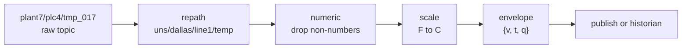
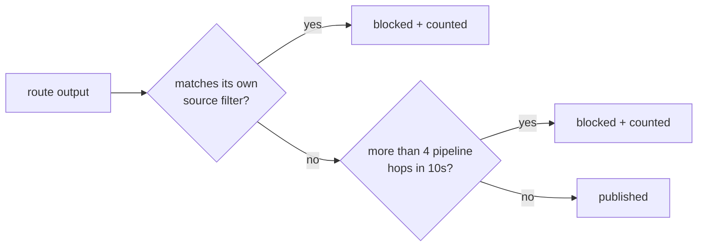
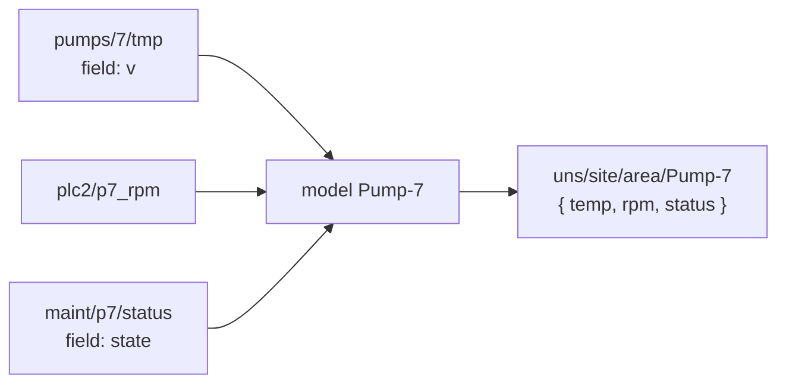

# 🔀 Pipelines and models

> **Goal:** turn a messy raw namespace into a clean, contextualized UNS —
> without guessing what a route will do before you switch it on.

## Anatomy of a route

A route consumes a topic filter on one broker, runs an ordered transform
chain, and delivers to a broker or a historian:

> 💡 **Always preview first.** Every route has a dry-run: Manifold resolves
> the filter against the topics actually observed on the broker and shows the
> exact in→out topic and payload mapping — nothing is published.

## The Pipelines page

**Pipelines** (`/pipelines`) has five tabs, kept in the URL (`?tab=`): **Routes**, **Models**,
**Historians**, **Recorder** and **Contracts**. Each is a dense table with one primary action
(**New route**, **New model**, **Add historian**, ...), a dialog for the form, and the same
read-only behaviour for viewer sessions.

**Routes.** One row per route: its name, `source filter -> N transforms -> target`, **State**
(*Running*, *Paused*, *Failing* when it has errors, *Loop blocked* when a loop guard fired),
and the counters **In**, **Out**, **Blocked** and **Errors**. Per row: a **Pause route** /
**Resume route** button, **Edit route** and **Delete route**. Pausing keeps the route and stops it.

**The route editor** (a dialog; **New route** or **Edit route**) reads top to bottom as the
route does:

- **Source**: **Name**, **Source broker** and **Source filter** (MQTT wildcards, `+` for one level and
  `#` for the rest; an invalid filter is refused).
- **Transforms**: an ordered list, applied top to bottom, with move up, move down and delete
  on each, and **Add a transform...** at the end. With none, the message is forwarded unchanged. The
  kinds are **Re-path**, **Pick fields**, **Rename fields**, **Set values**, **Scale**, **To number**,
  **Flatten Sparkplug** and **Wrap as TVQ** (the table below).
- **Target**: **Type** (*Publish to a broker* with **Broker** and **Publish as retained messages**, or a
  **Historian**).
- **Dry run**: **Run dry run** applies the current, unsaved settings to recent messages and shows
  each input topic and payload beside what would come out. Nothing is published.

> **The TVQ hint.** When the source topic carries a `{ v, t, q }` envelope (a mapping's output, for
> example) and the target is a historian, the editor shows **This topic carries a value/time/quality
> envelope** with a one-click **Add numeric transform on v**. Without it a historian stores the whole
> JSON object as text and the history cannot be trended. A mapping's *direct historian target* does
> not have this problem.

## Transform reference

| Transform | Effect | Example |
|---|---|---|
| `repath` | Rewrite the topic with segment templates | `uns/{2}/{4-}` — `{n}` = source segment n, `{n-}` = n..end, `{topic}` = whole topic |
| `pick` | Keep only listed payload fields | `["temp","rpm"]` |
| `rename` | Rename payload fields | `{"tmp":"temperature"}` |
| `set` | Merge fixed values into the payload | `{"site":"dallas"}` |
| `scale` | `value * mul + add` on the payload or one field | °F → °C: `mul 0.5556, add -17.78` |
| `numeric` | Coerce to number; **drops** non-numeric messages | filter semantics |
| `sparkplugFlatten` | Decoded Sparkplug metrics → `{ name: value }`; `is_null` metrics become explicit `null` | |
| `envelope` | Wrap as TVQ `{ v, t, q }` — value, source timestamp, quality | consumers can tell "zero" from "dead" |

## Loop protection — why you can't blow up your broker

Re-pathing makes accidental feedback loops easy (route output matching
another route's input, possibly across brokers). Manifold blocks them twice:

The hop counter catches indirect A→B→A cycles that no static check can see
through templates. Blocked counts appear in the route's **Blocked** column (and the state turns to *Loop blocked*).

## Models — many topics, one object

A model merges attributes plucked from many raw topics (even across brokers)
into **one object at a clean UNS path**:

Models have their own tab (**New model**: **Name**, **Target broker**, the source topics and fields, and when to publish). Publish on change (debounced) or on an interval. In envelope mode each
attribute carries `{v, t, q}` with staleness-derived quality — good 192,
uncertain 64, bad 0 — so a stale sensor is visible in the data itself.

## Delivering to a historian

Pick a configured historian as the route target; delivery rides the
store-and-forward outbox described in [Historians](Historians). A historian that a route (or a
recording, or a mapping) still writes to cannot be deleted: the **Historians** tab answers with a
*still in use* dialog that names them.

## Recorder and contracts

- **Recorder tab.** **New recording**: **Name**, **Broker**, **Filter**, **Record to** (a local file, or a historian).
  Each row shows the captured points and the last error. **Pause recording** keeps everything captured so far and
  stops appending; **Resume recording** continues in the same recording (the API is `enabled: false` and `true` on
  `POST /api/recorder`). A recording can be **peeked** (the first points, in a drawer) and **replayed**
  (**Start replay** with **Speed**, **Topic prefix** and **Loop until stopped**); only one replay runs at a time, and
  a banner with **Stop** shows it. A recording to a file is also a **Trends** source with no external database.
- **Contracts tab.** **New contract** locks the payload shape inferred from an observed topic (**Name**, **Broker**,
  **Topic**, then infer and lock); **Recent violations** lists drift. A contract's topic is tied to its inferred schema:
  changing the topic discards the inference, so a stale schema can never be locked under another topic.
