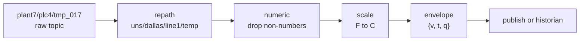
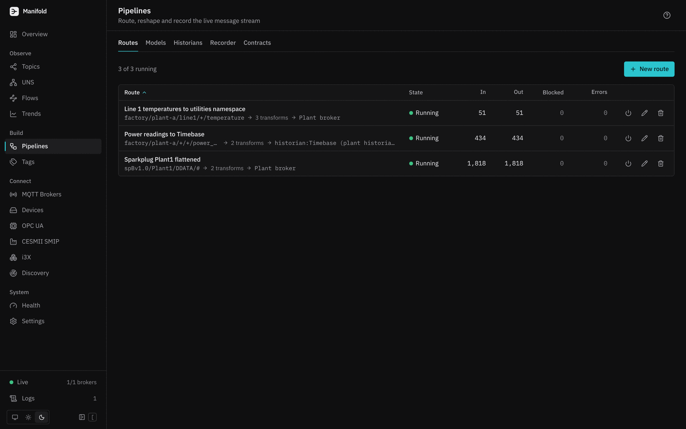
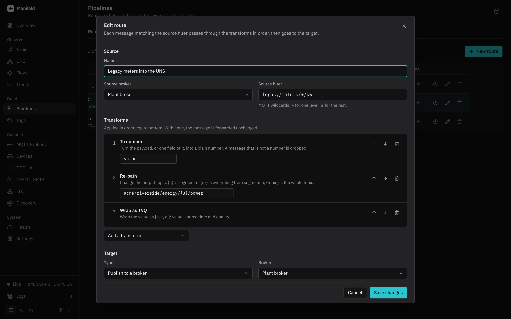
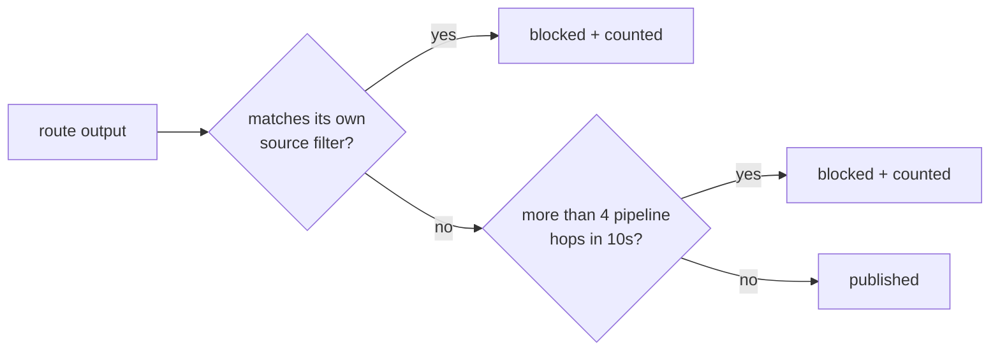
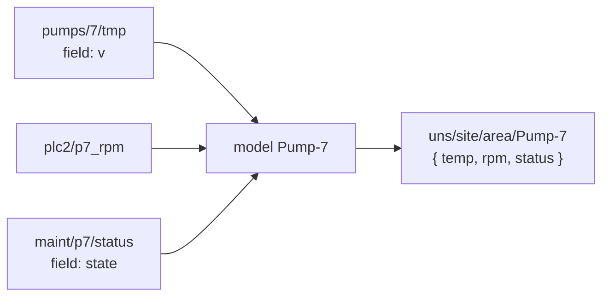
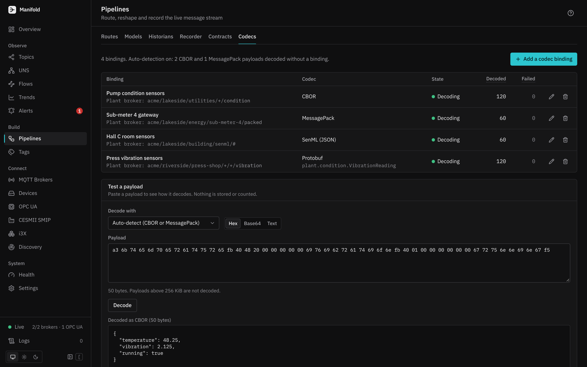

# 🔀 Pipelines and models

> **Goal:** turn a messy raw namespace into a clean, contextualized UNS —
> without guessing what a route will do before you switch it on.

## Anatomy of a route

A route consumes a topic filter on one broker, runs an ordered transform
chain, and delivers to a broker or a historian:

> 💡 **Always preview first.** Every route has a dry-run: Manifold resolves
> the filter against the topics actually observed on the broker and shows the
> exact in→out topic and payload mapping — nothing is published.

## The Pipelines page

**Pipelines** (`/pipelines`) has six tabs, kept in the URL (`?tab=`): **Routes**, **Models**,
**Historians**, **Recorder**, **Contracts** and **Codecs**. Each is a dense table with one primary action
(**New route**, **New model**, **Add historian**, ...), a dialog for the form, and the same
read-only behaviour for viewer sessions.

**Routes.** One row per route: its name, `source filter -> N transforms -> target`, **State**
(*Running*, *Paused*, *Failing* when it has errors, *Loop blocked* when a loop guard fired, *Historian
rejecting* when its historian refuses everything, *Broken reference*),
and the counters **In** (matched the source filter), **Routed** (handed on), **Delivered** (accepted by the target: the publish succeeded, or the historian stored it), **Pending** (queued or spilled to disk), **Rejected** (dead-lettered or unrepresentable), **Blocked** (stopped by the loop guard) and **Errors**; each column header explains itself on hover. For a route into a historian, **Routed** means *admitted to the outbox*, which is not the same as stored, so a historian that refuses everything is visible as Rejected (and in **Needs attention** on the Overview). The same numbers are on `/metrics` (`manifold_pipeline_messages_total{result=routed|delivered|rejected}`, `manifold_pipeline_pending_points`, `manifold_outbox_pending_points`) and per historian on the Historians tab. Per row: a **Pause route** /
**Resume route** button, **Edit route** and **Delete route**. Pausing keeps the route and stops it.

**The route editor** (a dialog; **New route** or **Edit route**) reads top to bottom as the
route does:

- **Source**: **Name**, **Source broker** and **Source filter** (MQTT wildcards, `+` for one level and
  `#` for the rest; an invalid filter is refused).
- **Transforms**: an ordered list, applied top to bottom, with move up, move down and delete
  on each, and **Add a transform...** at the end. With none, the message is forwarded unchanged. The
  kinds are **Re-path**, **Pick fields**, **Rename fields**, **Set values**, **Scale**, **To number**,
  **Flatten Sparkplug** and **Wrap as TVQ** (the table below).
- **Target**: **Type** (*Publish to a broker* with **Broker** and **Publish as retained messages**, or a
  **Historian**).
- **Dry run**: **Run dry run** applies the current, unsaved settings to recent messages and shows
  each input topic and payload beside what would come out. Nothing is published.

> **The TVQ hint.** When the source topic carries a `{ v, t, q }` envelope (a mapping's output, for
> example) and the target is a historian, the editor shows **This topic carries a value/time/quality
> envelope** with a one-click **Add numeric transform on v**. Without it a historian stores the whole
> JSON object as text and the history cannot be trended. A mapping's *direct historian target* does
> not have this problem.

## Transform reference

| Transform | Effect | Example |
|---|---|---|
| `repath` | Rewrite the topic with segment templates | `uns/{2}/{4-}` — `{n}` = source segment n, `{n-}` = n..end, `{topic}` = whole topic |
| `pick` | Keep only listed payload fields | `["temp","rpm"]` |
| `rename` | Rename payload fields | `{"tmp":"temperature"}` |
| `set` | Merge fixed values into the payload | `{"site":"dallas"}` |
| `scale` | `value * mul + add` on the payload or one field | °F → °C: `mul 0.5556, add -17.78` |
| `numeric` | Coerce to number; **drops** non-numeric messages | filter semantics |
| `sparkplugFlatten` | Decoded Sparkplug metrics → `{ name: value }`; `is_null` metrics become explicit `null` | |
| `envelope` | Wrap as TVQ `{ v, t, q }` — value, source timestamp, quality | consumers can tell "zero" from "dead" |

## Loop protection — why you can't blow up your broker

Re-pathing makes accidental feedback loops easy (route output matching
another route's input, possibly across brokers). Manifold blocks them twice:

The hop counter catches indirect A→B→A cycles that no static check can see
through templates. Blocked counts appear in the route's **Blocked** column (and the state turns to *Loop blocked*).

## Models — many topics, one object

A model merges attributes plucked from many raw topics (even across brokers)
into **one object at a clean UNS path**:

Models have their own tab (**New model**: **Name**, **Target broker**, the source topics and fields, and when to publish). Publish on change (debounced) or on an interval. In envelope mode each
attribute carries `{v, t, q}` with staleness-derived quality — good 192,
uncertain 64, bad 0 — so a stale sensor is visible in the data itself.

## Delivering to a historian

Pick a configured historian as the route target; delivery rides the
store-and-forward outbox described in [Historians](Historians). A historian that a route (or a
recording, or a mapping) still writes to cannot be deleted: the **Historians** tab answers with a
*still in use* dialog that names them.

## Recorder and contracts

- **Recorder tab.** **New recording**: **Name**, **Broker**, **Filter**, **Record to** (a local file, or a historian).
  Each row shows the captured points and the last error. **Pause** keeps everything captured so far and
  stops appending; **Resume** continues in the same recording (the API is `enabled: false` and `true` on
  `POST /api/recorder`). A recording can be **peeked** (the first points, in a drawer) and **replayed**
  (**Start replay** with **Speed**, **Topic prefix** and **Loop until stopped**); only one replay runs at a time, and
  a banner with **Stop** shows it. A recording to a file is also a **Trends** source with no external database.
- **Contracts tab.** **Lock a payload contract** locks the payload shape inferred from an observed topic (**Name**, **Broker**,
  **Topic**, then infer and lock); **Recent violations** lists drift. A contract's topic is tied to its inferred schema:
  changing the topic discards the inference, so a stale schema can never be locked under another topic.

## Codecs — payloads that are not JSON

Devices often publish CBOR, MessagePack, SenML or Protobuf instead of JSON. Without help those show as an unreadable
base64 blob and nothing downstream can use them. A **codec** decodes the payload when it arrives, before anything else
sees it, so topics, the UNS, Trends, mappings, routes, recordings and alerts all get the values.

**Codec bindings** (Pipelines → **Codecs** → **Add a codec binding**) map a **Topic filter**, on one **Broker** or any, to a
**Codec**:

| Codec | What it decodes | Notes |
|---|---|---|
| **CBOR** | RFC 8949: every major type, half/single/double floats, indefinite lengths, tags | dates (tags 0 and 1) become ISO strings, bignums (tags 2 and 3) and decimal fractions (tag 4) decimal strings, UUIDs (tag 37) UUID strings; other tags `{ tag, value }` |
| **MessagePack** | every format family | the timestamp extension (-1) becomes an ISO string with up to nanoseconds; other extensions `{ ext, hex }` |
| **SenML (JSON)** / **SenML (CBOR)** | RFC 8428 packs | base name, time, unit, value and sum are resolved into records `{ n, u, v / vs / vb / vd, s, t, ut }` with absolute times in seconds; a pack whose records share one time sets the message's source time |
| **Protobuf** | your `.proto` schema and **Message type** (optional when the schema has one message) | decoded through the schema's reflection, never generated code; the google/protobuf well-known types can be imported (Timestamp becomes ISO, wrappers their value, Struct plain JSON) |
| **Avro** | your Avro JSON schema | primitives, records, enums, arrays, maps, unions, fixed; logical types decimal, uuid, date, time, timestamp and local-timestamp (millis, micros, nanos) and duration; a single-object header (`C3 01` + the schema's fingerprint) is optional |
| **Raw** | nothing | keeps matching payloads as they arrive and turns auto-detection off for them |

Schemas are pasted or uploaded (**Upload schema file**, up to 128 KiB) and compiled when you save: a schema that does
not compile is refused with the parser's message (for Protobuf it names the line). **Try this codec** in the dialog
decodes a pasted payload with the unsaved settings. When several filters match a topic, the most specific wins (an exact
topic before `+`, `+` before `#`, then the longer filter). Bindings are stored like other configuration (with a revision
for conflict checks), travel in the config export and can be edited by admins only.

**Auto-detection.** A payload without a binding that is not valid UTF-8 (what used to show as binary) is tried as CBOR
and as MessagePack. It is kept only when the bytes decode completely, as one map or array, under exactly one of the two
formats; text, JSON and anything ambiguous are left exactly as before. Protobuf and Avro are never guessed: they need a
schema. Set `MANIFOLD_CODEC_AUTODETECT=0` to turn auto-detection off everywhere, or bind a filter to **Raw**. Sparkplug
topics keep their own decoder and never use codecs.

**What you see.** The table shows each binding's **State** (*Decoding*, *Waiting for data*, *Failing* with the last error,
*Schema error*, *Disabled*), and how many payloads it **Decoded** and **Failed**. Topics are coalesced per 100 ms, so a topic
that publishes faster counts its latest payload per flush. The topic details on **Topics** say *Decoded by Protobuf (binding
Pumps)* or *Auto-detected CBOR*; when a bound codec fails, the payload is shown as it arrived with the reason. **Test a
payload** decodes a pasted payload (hex, base64 or text) with auto-detection, a saved binding or a built-in codec; nothing is
stored or counted.

**Values.** Byte strings become lowercase hex; NaN and infinities the strings `"NaN"`, `"Infinity"`, `"-Infinity"`. 64-bit
integers follow the rule used everywhere in Manifold: they are never rounded. CBOR and MessagePack integers beyond
±2^53 become decimal strings; Protobuf's 64-bit types and Avro `long` are always decimal strings, so a field's type does
not change with its value (a **To number** transform turns them into numbers when a route needs one).

**Limits.** A payload larger than 256 KiB (`MANIFOLD_CODEC_MAX_BYTES`) is not decoded; nesting is capped at 32 levels and
a payload at 100,000 items, so a hostile or corrupt payload costs at most a linear pass over its bytes and fails with a
counted error. A failed decode never blocks ingest. Not supported: Avro object container files and schema evolution,
Protobuf groups, extensions and imports other than the well-known types, the SenML XML and EXI forms.

API: `GET /api/codecs` (bindings, counters, auto-detection, limits), `POST /api/codecs`, `DELETE /api/codecs/:id`,
`POST /api/codecs/test` (`{ codec | bindingId, schemaText?, messageType?, payload, encoding }`, read-only, allowed for
viewer tokens).
