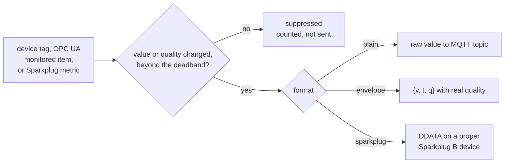
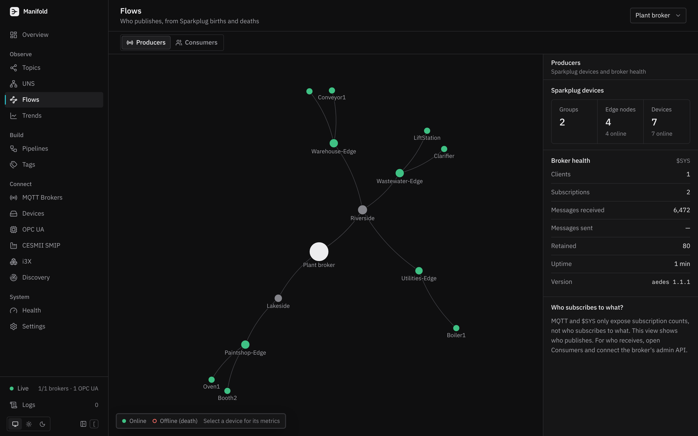
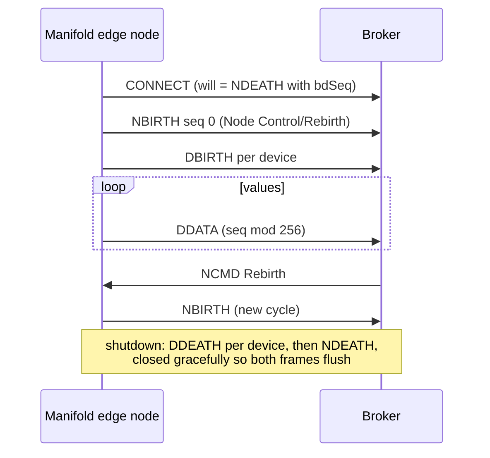

# 🏷️ Tags and Sparkplug

> **Goal:** know what the Tags page can map, how Sparkplug B traffic is read in order, and how
> Manifold publishes as a Sparkplug edge node or host. The mapping editor itself is described in
> [Mapping to the UNS](Mapping-to-the-UNS).

## The tag browser

**Tags** unifies every source Manifold already speaks:

| Source | What you browse |
|---|---|
| 🔧 Devices | the tags you defined on the [Devices page](Devices-and-Drivers) (every driver), grouped by poll group; device profiles as a whole |
| 🖧 OPC UA | the address space of any connected server, loaded lazily |
| ⚡ Sparkplug | the device registry (Group → Edge → Device → metrics) rebuilt from BIRTH certificates |
| 📡 MQTT | the observed topic trie |
| 💡 IoT devices | devices a bridge publishes over MQTT ([IoT devices over MQTT](IoT-Devices-over-MQTT)) |


Pick a **Source**, tick tags in the tree (or press **Map by rule** to take every tag matching include
and exclude patterns, or **Map by filter** for every MQTT topic under a wildcard filter), and press **Add to
UNS**. Every source becomes a **mapping** (stored as a *binding*), edited in the single-sheet **mapping
editor** with a live preview of what the server would publish; **Retain values** is off by default. The tree
is keyboard accessible and has a **Filter loaded tags** box, **Select shown (n)** (up to 500 tags) and a marker
on tags that are already mapped; **Map a device profile** maps every instance of a profile at once. The editor,
the Mappings tab, MQTT topics as a source and every option are described in
[Mapping to the UNS](Mapping-to-the-UNS#the-tags-page-and-the-mapping-editor).

**A Sparkplug source** maps the metrics of an edge node or device (`{ type: "sparkplug", brokerId, group,
edge, device?, metrics? }`). Each metric keeps its own timestamp and its declared quality (the `Quality`
property most edge stacks send, OPC-style 0 to 255). BIRTH and DEATH are the source state: DDEATH of the
device (or NDEATH of the edge node) publishes every tag Bad once and `_status` offline with the reason
(`DDEATH from Edge1/Pump1`); the next DBIRTH (NBIRTH for edge-node metrics), or the first data, brings it back
online.

## How a mapping flows



- **Report by exception** — an absolute or **percent** deadband suppresses
  numeric noise (percent is of the tag's range, or of the last published value
  when it has none); non-numeric values publish on change only. Change detection keys on
  **(value, quality)**, so Good to Bad with an unchanged value is still
  published (in the envelope format). An optional **heartbeat** republishes
  unchanged tags so "unchanged" can be told from "dead".
- **Quality is honest** — OPC UA status codes map to Good 192 / Uncertain 64 /
  Bad 0 and travel inside the envelope. When a source goes offline (a device
  loses its connection, an OPC UA session drops) every known tag of its
  mappings gets one Bad publish, and a retained `_status` document says why.
  Sparkplug targets get DDEATH instead.
- **Types survive** — Sparkplug targets use the tag's real type (Int16, Float,
  Boolean, ...) rather than sending everything as Double, and carry the unit,
  description and range as metric properties in the BIRTH.
- **Metadata travels** — envelopes carry the unit (`u`), and a retained
  `_meta` document lists each property's type, unit, description, range and
  source.
- **Read-only by design** — mappings never write toward a device. There is no
  write path in the engine, and the device drivers' frame encoders refuse
  every write service (see [Devices and Drivers](Devices-and-Drivers#the-read-only-guarantee-and-its-limits)).

## Sparkplug messages are delivered in order, none dropped



NDATA and DDATA carry only the metrics that **changed**, so keeping just the
latest message per topic would lose data. Sparkplug topics are therefore
handled differently from ordinary MQTT topics at intake: **every message is
delivered, in arrival order**, to the registry, mappings, pipelines and
historian targets (the UI still shows the latest per topic). The queue that
makes this possible is bounded per 100 ms flush (5,000 messages or 8 MiB by
default; `MANIFOLD_SPARKPLUG_QUEUE_MAX` and `MANIFOLD_SPARKPLUG_QUEUE_BYTES`).
Past the bound a topic falls back to latest-wins for the rest of that window
and the broker's `sparkplugCoalesced` counter increments, so loss is never
silent. The defaults admit on the order of 50,000 Sparkplug messages per
second per broker.

## CSV import

Every source can import and export mapping rows as CSV: **Import CSV** / **Export CSV** in the editor's Tags
section, or **CSV** beside **Selected tags** to open the editor straight into the import. Columns are
`address,name,enabled,unit,description,displayName,dataType,scale,offset,precision,deadband` (plus
`field,staleAfterMs` for MQTT topics), with a downloadable template and an error per line that cannot apply
(see [Mapping to the UNS](Mapping-to-the-UNS#the-tags-page-and-the-mapping-editor)). Without a header the columns
are `address,name`, so tag exports from Kepware/Ignition-style tools work as they are:

```csv
nodeId,name
ns=2;s=Channel1.Device1.Temperature,Temperature
ns=2;s=Channel1.Device1.Pressure,Pressure
```

> The tags themselves (`key,address,type,pollGroup,scale,...`) are imported on the Devices page; see
> [Devices and Drivers](Devices-and-Drivers). This CSV only maps tags that exist.

## The Sparkplug B publisher

Mappings that target Sparkplug get a dedicated session per (broker, group,
edge node) implementing the specification's full lifecycle — consumers with
Sparkplug state management (Ignition, HiveMQ extensions, Timebase collectors)
see Manifold as a first-class edge node:



A device whose source goes offline gets a **DDEATH** (sequence-numbered), and a
**DBIRTH** with the last known values when it recovers, before any further
DDATA.

> ✅ This lifecycle is exercised frame-by-frame against a real broker in CI —
> BIRTH ordering, sequence numbering, and death certificates included.

## Host application STATE

Sparkplug host applications announce themselves on retained
`spBv1.0/STATE/{host_id}` topics. Manifold works with STATE in both
directions:

- **Tracking** — every STATE message folds into the registry: host
  online/offline status appears in the Tags page and in the UNS event feed
  (`host-online` / `host-offline`). Because STATE is retained, status is
  correct immediately after connecting.
- **Publishing** — the collapsed **Sparkplug primary host** panel on the Tags page (a **Broker**, a **Host ID**, start and stop) starts a
  dedicated session that publishes retained `{ "online": true, ... }` for a
  host ID of your choice, with a matching last-will. Edge nodes configured to
  wait for a primary host (a common Ignition/edge gateway setting) then see
  one and start publishing.

> A running host session follows edits and removals of its broker profile on its own: it publishes a clean
> offline STATE on the old connection and reconnects with the new settings.

> 💡 Only run one primary host per host ID on a broker — that is the
> specification's whole point. Manifold refuses nothing here; the convention
> is yours to keep.
