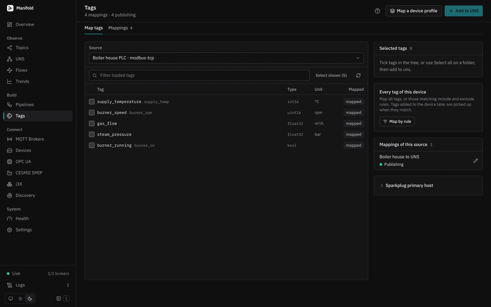
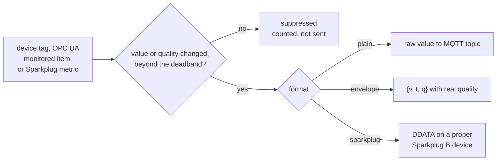
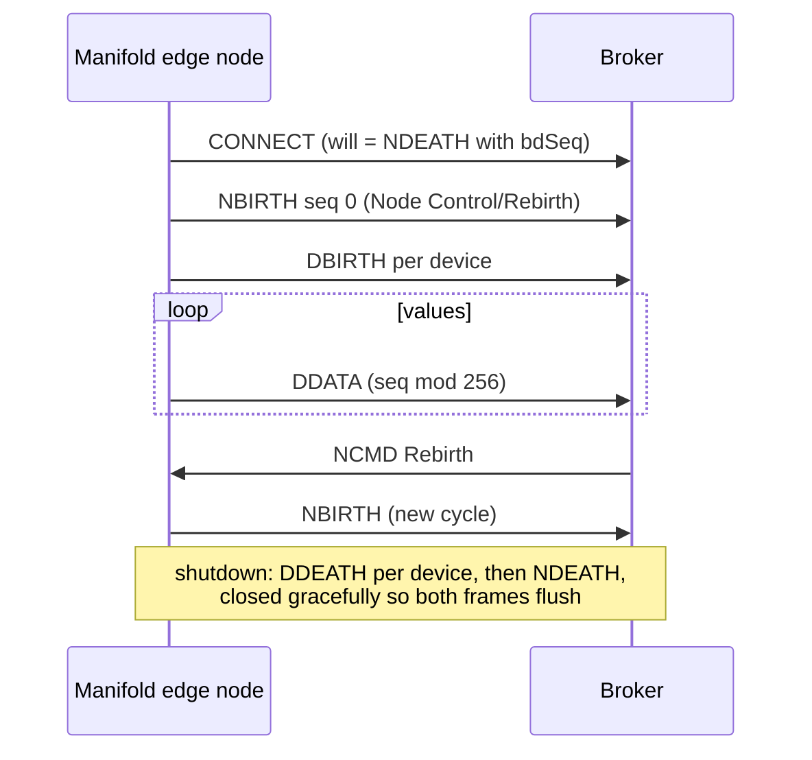

# 🏷️ Tags and Sparkplug

> **Goal:** from "browse a device's tags" to "they live in the UNS" in one
> editor — with report-by-exception and real quality codes on the way.

## The tag browser

**Tags** unifies every source Manifold already speaks:

| Source | What you browse |
|---|---|
| 🔧 Devices | the tags you defined on the [Devices page](Devices-and-Drivers) (Modbus TCP, S7, EtherNet/IP), grouped by poll group |
| 🖧 OPC UA | the address space of any connected server, loaded lazily |
| ⚡ Sparkplug | the device registry (Group → Edge → Device → metrics) rebuilt from BIRTH certificates |
| 📡 MQTT | the observed topic trie |



Pick a **Source**, tick tags in the tree (or press **Map by rule** to take every tag matching include
and exclude patterns), and press **Add to UNS**. The page does the right thing per source: MQTT
selections compile into a **pipeline route** (the button then reads **Create pipeline route**); device,
OPC UA and Sparkplug selections become **mappings** (stored as *bindings*; the interface says mapping). The
**mapping editor** is one sheet, not a wizard: **Mapping** (name, broker, UNS topics or Sparkplug B device),
**What** (pick tags or choose by rule), **Where** (the asset path, chosen in a picker over the live UNS tree, and
the layout), **Tags** (the published name, unit and description of each tag, and a details panel per tag),
**Context**, **Payload** (format, fields, `_status` and `_meta`) and **Delivery** (QoS, deadband, heartbeat, retain,
the direct historian target, the object size cap), with the topics and payloads the **server** would publish
(collisions and raw-address warnings included) in a preview column. Every section is described in
[Mapping to the UNS](Mapping-to-the-UNS#the-tags-page-and-the-mapping-editor). **Retain values is off by default**
(a retained value outlives a dead device).

The tree is keyboard accessible (arrow keys to move, Space to select, Enter to open) and has a **Filter loaded
tags** box, **Select shown (n)** (up to 500 tags) and a marker on tags that are already mapped. The **Mappings** tab
lists every mapping with its state, and warnings from the last save appear in a banner above the table. A device
profile can be mapped as a whole with **Map a device profile** (every instance gets its own asset); see
[Mapping to the UNS](Mapping-to-the-UNS#one-definition-for-many-identical-devices-profile-bindings).

For the full story on device tags (asset paths versus templates, the two
layouts, quality, the `_status` and `_meta` documents, deadband, heartbeat,
retained cleanup, historians) see [Mapping to the UNS](Mapping-to-the-UNS).
The MQTT-source path is the exception: it compiles to a pipeline route and does
not get `_status`, `_meta`, object payloads or a historian target.

## How a mapping flows



- **Report by exception** — an absolute or **percent** deadband suppresses
  numeric noise (percent is of the tag's range, or of the last published value
  when it has none); non-numeric values publish on change only. Change detection keys on
  **(value, quality)**, so Good to Bad with an unchanged value is still
  published (in the envelope format). An optional **heartbeat** republishes
  unchanged tags so "unchanged" can be told from "dead".
- **Quality is honest** — OPC UA status codes map to Good 192 / Uncertain 64 /
  Bad 0 and travel inside the envelope. When a source goes offline (a device
  loses its connection, an OPC UA session drops) every known tag of its
  mappings gets one Bad publish, and a retained `_status` document says why.
  Sparkplug targets get DDEATH instead.
- **Types survive** — Sparkplug targets use the tag's real type (Int16, Float,
  Boolean, ...) rather than sending everything as Double, and carry the unit,
  description and range as metric properties in the BIRTH.
- **Metadata travels** — envelopes carry the unit (`u`), and a retained
  `_meta` document lists each property's type, unit, description, range and
  source.
- **Read-only by design** — mappings never write toward a device. There is no
  write path in the engine, and the device drivers' frame encoders refuse
  every write service (see [Devices and Drivers](Devices-and-Drivers#the-read-only-guarantee-and-its-limits)).

## Sparkplug messages are delivered in order, none dropped


NDATA and DDATA carry only the metrics that **changed**, so keeping just the
latest message per topic would lose data. Sparkplug topics are therefore
handled differently from ordinary MQTT topics at intake: **every message is
delivered, in arrival order**, to the registry, mappings, pipelines and
historian targets (the UI still shows the latest per topic). The queue that
makes this possible is bounded per 100 ms flush (5,000 messages or 8 MiB by
default; `MANIFOLD_SPARKPLUG_QUEUE_MAX` and `MANIFOLD_SPARKPLUG_QUEUE_BYTES`).
Past the bound a topic falls back to latest-wins for the rest of that window
and the broker's `sparkplugCoalesced` counter increments, so loss is never
silent. The defaults admit on the order of 50,000 Sparkplug messages per
second per broker.

## CSV import

For an **OPC UA** source the tag list has an **Import CSV** button: tag exports from Kepware/Ignition-style tools drop
straight into the selection:

```csv
nodeId,name
ns=2;s=Channel1.Device1.Temperature,Temperature
ns=2;s=Channel1.Device1.Pressure,Pressure
```

> For **device tags**, import and edit tags on the Devices page instead
> (`key,address,type,pollGroup,scale,...`); see
> [Devices and Drivers](Devices-and-Drivers).

## The Sparkplug B publisher

Mappings that target Sparkplug get a dedicated session per (broker, group,
edge node) implementing the specification's full lifecycle — consumers with
Sparkplug state management (Ignition, HiveMQ extensions, Timebase collectors)
see Manifold as a first-class edge node:



A device whose source goes offline gets a **DDEATH** (sequence-numbered), and a
**DBIRTH** with the last known values when it recovers, before any further
DDATA.

> ✅ This lifecycle is exercised frame-by-frame against a real broker in CI —
> BIRTH ordering, sequence numbering, and death certificates included.

## Host application STATE

Sparkplug host applications announce themselves on retained
`spBv1.0/STATE/{host_id}` topics. Manifold works with STATE in both
directions:

- **Tracking** — every STATE message folds into the registry: host
  online/offline status appears in the Tags page and in the UNS event feed
  (`host-online` / `host-offline`). Because STATE is retained, status is
  correct immediately after connecting.
- **Publishing** — the collapsed **Sparkplug primary host** panel on the Tags page (a **Broker**, a **Host ID**, start and stop) starts a
  dedicated session that publishes retained `{ "online": true, ... }` for a
  host ID of your choice, with a matching last-will. Edge nodes configured to
  wait for a primary host (a common Ignition/edge gateway setting) then see
  one and start publishing.

> A host session records its broker's connection settings when it starts. If you edit the broker
> profile afterwards, start the host again to reconnect with the new settings; the session does not notice the
> edit by itself.

> 💡 Only run one primary host per host ID on a broker — that is the
> specification's whole point. Manifold refuses nothing here; the convention
> is yours to keep.
