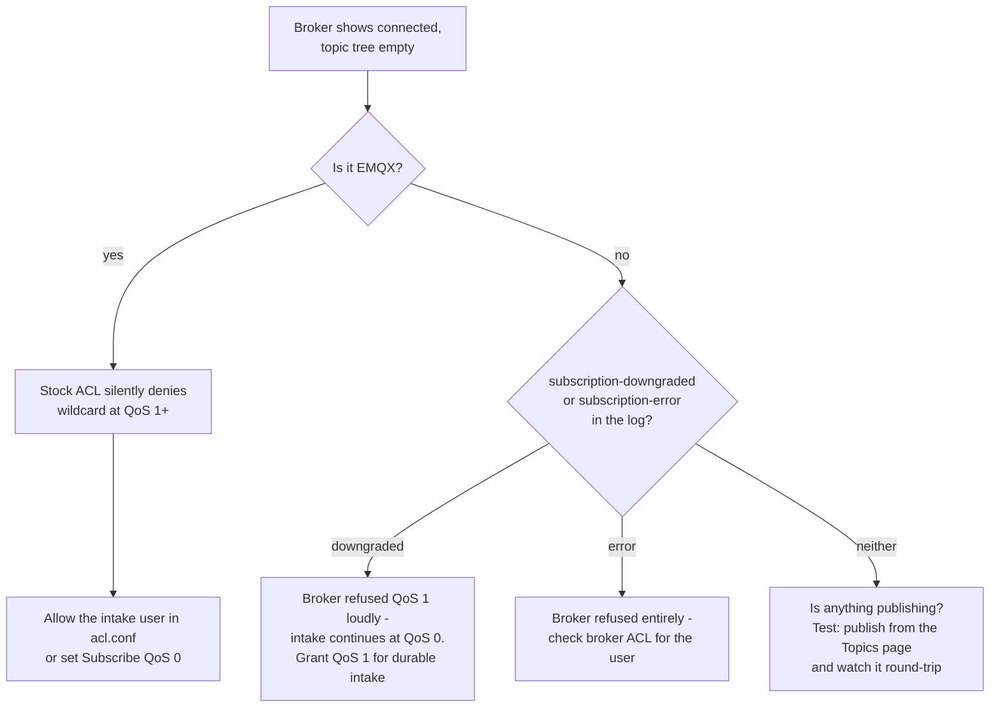

# 🩺 Troubleshooting

> Start with the decision tree for the most common case — "I connected but
> see nothing" — then use the symptom table.

## No data appearing?

## Symptom table

| Symptom | Likely cause | Fix |
|---|---|---|
| 🔌 Broker *connected* but no topics (EMQX) | Stock EMQX silently denies `#` at QoS 1+ (`deny_action=ignore`) | Broker ACL allow rule, or *Subscribe QoS* 0 — see [Broker Setup](Broker-Setup) |
| 🔉 `subscription-downgraded` events | Broker refused the wildcard grant loudly (SUBACK 0x80); Manifold fell back to QoS 0 | Expected. Grant QoS 1 in the broker ACL for durable intake |
| 💾 Historian spill bytes growing | Historian unreachable or rejecting writes; points spilling to disk | Check `lastError` on the card, fix connectivity/auth — spill drains oldest-first automatically |
| ⏱️ TimescaleDB write errors with a timeout | Database unreachable — connections have bounded timeouts by design | Fix connectivity; queued points spill and recover |
| 👥 Flows → Consumers empty | No broker admin API configured, or broker is Mosquitto (no per-client subscription API) | Configure EMQX/HiveMQ admin credentials; for Mosquitto this data does not exist |
| 🔢 Influx rejects writes: field type conflict | Another writer created the field with a different type in the current shard | Manifold's `value=`/`raw=` split can't cause this — check other writers, or use a fresh bucket |
| 🕰️ UNS marks a slow topic *dead* | The topic hasn't established its publish cadence yet | Staleness is per-topic (inter-arrival EMA); thresholds adapt after a few publishes |
| ⚡ Sparkplug devices offline after a broker restart | Edge nodes haven't re-birthed | State comes from BIRTH certificates (per spec); send an NCMD rebirth or wait for reconnect BIRTH |
| 🧪 Tests fail: "Unable to deserialize cloned data" | `node --test` child-process IPC corruption | Use `npm test` (serial in-process runner). Harness-only issue, never the server |
| 🔒 Unlock screen appears unexpectedly | A token is set on the server (`MANIFOLD_AUTH_TOKEN`, `MANIFOLD_VIEWER_TOKEN` or `MANIFOLD_TOKENS`: any of them turns auth on) | Enter the token (remembered locally). Viewer tokens get read-only access |
| 🔑 Everything answers 401 after setting `MANIFOLD_TOKENS` | Every entry was rejected at startup (typo in the role, or a token containing `:` without an explicit role); auth stays on rather than opening up | Read the `[auth]` lines in the server log. Roles are `admin` or `viewer`; write `name:ab:cd:viewer` for a token containing `:` |
| 📈 Prometheus gets 401 from `/metrics` | `/metrics` needs a bearer token (any role) when auth is on | Give the scraper a viewer token, or set `MANIFOLD_METRICS_PUBLIC=1` |
| 🔔 Alert webhook never arrives, "Egress ... blocked" | Webhooks pass the egress guard: `localhost`, link-local and (by default) private addresses are refused | Use a reachable address, or set `MANIFOLD_ALLOW_PRIVATE_TARGETS=1` for an on-prem receiver. Loopback is never allowed for webhooks |
| 🗑️ Historian `deadLettered` count rising | The historian permanently rejected some points (a 4xx, or a Postgres data error); they were moved to `<id>.deadletter.jsonl` so the rest could flow | Inspect the file under `outbox/` in the data directory; fix the data or the target schema |
| 📉 `sparkplugCoalesced` rising on a broker | A Sparkplug burst exceeded the per-flush queue bound, and affected topics fell back to latest-wins for that window | Raise `MANIFOLD_SPARKPLUG_QUEUE_MAX` / `MANIFOLD_SPARKPLUG_QUEUE_BYTES`, or split intake across instances |
| 🚫 API answers `429` | Auth-failure rate limit — 20 bad tokens per minute from one IP | Fix the token; the window clears after a minute |
| 🔐 OPC UA secure connect fails: certificate not trusted | The server's certificate is unknown (it lands in `rejected/`) — or the server rejected *Manifold's* certificate | Trust the server certificate (trust panel / `POST /api/opcua/trust`, or reconnect with trust-on-first-connect); for the reverse case, install Manifold's certificate (`GET /api/opcua/certificate`) on the server |
| 📡 "Disconnected" banner across the top of the UI | The socket to the backend dropped — panels would otherwise show stale data silently | Check that the server is up and reachable; the banner clears on reconnect |

## Devices

Start on the **Devices** page. The card's badge and the last error usually
name the problem. The table below is organised by what you see.

| What you see | Likely cause | Fix |
|---|---|---|
| **Backoff: connect ECONNREFUSED host:port** | Nothing is listening on that port, or a firewall rejects it; the PLC is powered off or in a download | Check host and port (Modbus 502, S7 102, EtherNet/IP 44818), reach it from the Manifold host with `nc -vz host port`. Manifold keeps retrying (1 s growing to 60 s), so it recovers on its own once the device is back |
| **Backoff: ... timed out** (`connect to host:port timed out`, `no response within 2000 ms`) | Packets are dropped (wrong IP, firewall, the device is on another VLAN), or the device has used up its allowed connections | Check routing; look at the device's connection diagnostics. Manifold holds exactly one connection per device; other tools (an HMI, another Manifold, a Modbus master) may be using the slots. Raise `limits.connectTimeoutMs` / `requestDeadlineMs` only for genuinely slow links |
| Device is **Stopped** with `Egress (device) to ... blocked` (or a 403 when saving) | The egress guard refused the target. RFC1918 addresses need `MANIFOLD_ALLOW_PRIVATE_TARGETS=1`; loopback needs `MANIFOLD_ALLOW_LOOPBACK_DEVICES=1` (simulators on the same host); cloud-metadata ranges are never allowed. A hostname that does not resolve is refused the same way | Set the right variable on the server and restart, or use a different address. See [Operations](Operations#network-safety-egress-guard) |
| **S7**: device is Online but every tag is Bad, reason `quarantined` | The CPU is refusing the reads: PUT/GET is not permitted, the DB uses **optimized block access**, the protection level is too high, or the DB is shorter than the address. The device status shows the refusal only as a counter (code `33028`, which is 0x8104, for a whole-request refusal) | Run **Probe** on one tag, for example `DB1.DBW0`: its error text names the cause ("PUT/GET not permitted, optimized block access enabled, or protection level too high", "DB does not exist", "DB shorter than the requested range"). Then follow the S7 checklist in [Devices and Drivers](Devices-and-Drivers#siemens-s7) |
| **Modbus exception 02** (illegal data address): a few tags Bad, reason `quarantined`; the device's exception counter shows `2` | A tag points at a register the device does not have, or every address is off by one (**Address base**), or a block read spans an unmapped gap | Probe the exact address: the error reads `probe failed: exception (illegal data address)`. Try Address base 1, or the other Modicon form (5 versus 6 digits). Keep **Max gap** at 0 unless the device tolerates gaps. Healthy tags keep polling; quarantined ones are retried every minute |
| **Modbus exception 04, 05, 06** | Device failure, acknowledge, or busy | Treated as retryable: tags are Bad (`device-exception`) for that cycle and read again on the next. If it persists, slow the poll group down |
| Tags Bad, reason `unit-down` | A gateway reports "target device failed to respond" (exception 0B/0A) for that unit ID three times; the rest of the unit IDs behind it are unaffected | Check that slave's wiring, address and baud rate at the gateway. It is probed every 30 s and recovers by itself |
| **Values are wrong but not Bad**: huge numbers, `-2.9e-31`, tiny floats, bytes swapped | Wrong **byte order or word order** (or the wrong type: int32 read as two int16) | Open **Probe**, read the registers, and pick the row of the four decodings (ABCD, CDAB, BADC, DCBA) that shows the number you can see on the device. Set that byte and word order on the tag (or the device default). Float32 values that are plausible in CDAB are the classic word-swapped case |
| Values are off by one register | Address base | Switch Address base 0/1, or use Modicon addresses (always 1-based) |
| A temperature reads 10 times too big | Device stores x10 integers | Set `scale` 0.1 on a Modbus tag. S7 and EtherNet/IP tags have no scale: do it downstream |
| Value is Bad, reason `unavailable` | The raw value matched a tag **sentinel** (for example `-32768` for "sensor fault") | Expected. Remove the sentinel if the number is real |
| Value is Bad, reason `decode` | The bytes cannot be decoded as the declared type (S7 STRING header, DATE out of range, EtherNet/IP declared type differs from the controller's) | Fix the type, or check the string `length` |
| **EtherNet/IP**: tag not found or Bad right after a controller download | The controller's tag table changed under the cached symbol list | Caches are rebuilt automatically after the error; if a tag stays Bad, check its name and that **External Access** is not None |
| Badge says **Overrunning** or **slowed** | Cycles take longer than the interval, so Manifold skipped cycles and, after five in a row, stretched the interval (up to 8x) | Move slow-changing tags to a slower poll group, reduce tags per group, raise `interRequestDelayMs` only if the device needs breathing room, or accept the longer interval. It speeds back up by itself |
| Banner **Driver host ... is parked** | The driver process crashed more than five times in a minute | Look at the server log for the crash (`[driver-host ...]` lines). Saving a device (or restarting the server) tries again. Please report a reproducible crash |
| Device Online, tags Good, nothing in the UNS | No binding, the binding is disabled, or the broker it targets is not connected | Check **Tags → Bindings** (published / suppressed / errors per binding). A deadband larger than the signal's noise suppresses everything |
| Topic keeps showing the last value after the device died | `plain` format cannot carry quality; or retain is on | Use `envelope`, watch `<path>/_status`, add a heartbeat. See [Mapping to the UNS](Mapping-to-the-UNS#quality-and-the-_status-topic) |

> 💡 You can reproduce most of these without hardware with the Docker demo's
> simulators; see
> [DOCKER.md](https://github.com/zbest1000/manifold/blob/main/DOCKER.md#simulated-devices).
> The simulators can also be started on their own and told to misbehave in
> tests; they are test doubles, not real devices.

## Still stuck?

- The audit log (**Settings → Audit**) shows every mutation and its outcome.
- `/metrics` exposes counters for most engines — a zero where you expect
  traffic points at the failing stage.
- [Open an issue](https://github.com/zbest1000/manifold/issues) with the
  symptom, broker type, and any `subscription-*` events from the log.
