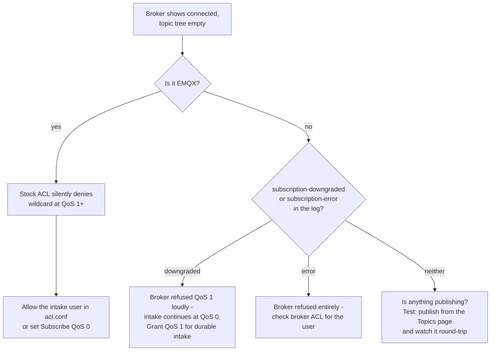

# 🩺 Troubleshooting

> Start with the decision tree for the most common case — "I connected but
> see nothing" — then use the symptom table.

## No data appearing?

## Symptom table

| Symptom | Likely cause | Fix |
|---|---|---|
| 🔌 Broker *connected* but no topics (EMQX) | Stock EMQX silently denies `#` at QoS 1+ (`deny_action=ignore`) | Broker ACL allow rule, or *Subscribe QoS* 0 — see [Broker Setup](Broker-Setup) |
| 🔉 `subscription-downgraded` events | Broker refused the wildcard grant loudly (SUBACK 0x80); Manifold fell back to QoS 0 | Expected. Grant QoS 1 in the broker ACL for durable intake |
| 💾 Historian spill bytes growing | Historian unreachable or rejecting writes; points spilling to disk | Check the last error on the historian's row (Pipelines → Historians), fix connectivity/auth — spill drains oldest-first automatically |
| ⏱️ TimescaleDB write errors with a timeout | Database unreachable — connections have bounded timeouts by design | Fix connectivity; queued points spill and recover |
| 👥 Flows → Consumers empty | No broker admin API configured, or broker is Mosquitto (no per-client subscription API) | Configure EMQX/HiveMQ admin credentials; for Mosquitto this data does not exist |
| 🔢 Influx rejects writes: field type conflict | Another writer created the field with a different type in the current shard | Manifold's `value=`/`raw=` split can't cause this — check other writers, or use a fresh bucket |
| 🕰️ UNS marks a slow topic *dead* | The topic hasn't established its publish cadence yet | Staleness is per-topic (inter-arrival EMA); thresholds adapt after a few publishes |
| ⚡ Sparkplug devices offline after a broker restart | Edge nodes haven't re-birthed | State comes from BIRTH certificates (per spec); send an NCMD rebirth or wait for reconnect BIRTH |
| 🧪 Tests fail: "Unable to deserialize cloned data" | `node --test` child-process IPC corruption | Use `npm test` (serial in-process runner). Harness-only issue, never the server |
| 🔒 Unlock screen appears unexpectedly | A token is set on the server (`MANIFOLD_AUTH_TOKEN`, `MANIFOLD_VIEWER_TOKEN` or `MANIFOLD_TOKENS`: any of them turns auth on) | Enter the token (remembered locally). Viewer tokens get read-only access |
| 🔑 Everything answers 401 after setting `MANIFOLD_TOKENS` | Every entry was rejected at startup (typo in the role, or a token containing `:` without an explicit role); auth stays on rather than opening up | Read the `[auth]` lines in the server log. Roles are `admin` or `viewer`; write `name:ab:cd:viewer` for a token containing `:` |
| 📈 Prometheus gets 401 from `/metrics` | `/metrics` needs a bearer token (any role) when auth is on | Give the scraper a viewer token, or set `MANIFOLD_METRICS_PUBLIC=1` |
| 🔔 Alert webhook never arrives, "Egress ... blocked" | Webhooks pass the egress guard: `localhost`, link-local and (by default) private addresses are refused | Use a reachable address, or set `MANIFOLD_ALLOW_PRIVATE_TARGETS=1` for an on-prem receiver. Loopback is never allowed for webhooks |
| 🗑️ Historian `deadLettered` count rising | The historian permanently rejected some points (a 4xx, or a Postgres data error); they were moved to `<id>.deadletter.jsonl` so the rest could flow | Inspect the file under `outbox/` in the data directory; fix the data or the target schema |
| 📉 `sparkplugCoalesced` rising on a broker | A Sparkplug burst exceeded the per-flush queue bound, and affected topics fell back to latest-wins for that window | Raise `MANIFOLD_SPARKPLUG_QUEUE_MAX` / `MANIFOLD_SPARKPLUG_QUEUE_BYTES`, or split intake across instances |
| 🚫 API answers `429` | Auth-failure rate limit — 20 bad tokens per minute from one IP, or the general limit (600 requests a minute) | Fix the token; the window clears after a minute. Behind a reverse proxy, see `MANIFOLD_TRUST_PROXY` below |
| 🔐 OPC UA secure connect fails: certificate not trusted | The server's certificate is unknown (it lands in `rejected/`) — or the server rejected *Manifold's* certificate | Trust the server certificate (trust panel / `POST /api/opcua/trust`, or reconnect with trust-on-first-connect); for the reverse case, install Manifold's certificate (`GET /api/opcua/certificate`) on the server |
| 📡 "Disconnected" banner across the top of the UI | The socket to the backend dropped — panels would otherwise show stale data silently | Check that the server is up and reachable; the banner clears on reconnect |

## Devices

Start on the **Devices** page. The **State** column and **Last error** usually
name the problem; click the device for the drawer. The table below is organised by what you see.

| What you see | Likely cause | Fix |
|---|---|---|
| **Backoff: connect ECONNREFUSED host:port** | Nothing is listening on that port, or a firewall rejects it; the PLC is powered off or in a download | Check host and port (Modbus 502, S7 102, EtherNet/IP 44818), reach it from the Manifold host with `nc -vz host port`. Manifold keeps retrying (1 s growing to 60 s), so it recovers on its own once the device is back |
| **Backoff: ... timed out** (`connect to host:port timed out`, `no response within 2000 ms`) | Packets are dropped (wrong IP, firewall, the device is on another VLAN), or the device has used up its allowed connections | Check routing; look at the device's connection diagnostics. Manifold holds exactly one connection per device; other tools (an HMI, another Manifold, a Modbus master) may be using the slots. Raise `limits.connectTimeoutMs` / `requestDeadlineMs` only for genuinely slow links |
| Device is **Stopped** with `Egress (device) to ... blocked` (or a 403 when saving) | The egress guard refused the target. RFC1918 addresses need `MANIFOLD_ALLOW_PRIVATE_TARGETS=1`; loopback needs `MANIFOLD_ALLOW_LOOPBACK_DEVICES=1` (simulators on the same host); cloud-metadata ranges are never allowed. A hostname that does not resolve is refused the same way | Set the right variable on the server and restart, or use a different address. See [Operations](Operations#network-safety-egress-guard) |
| **S7**: device is Online but every tag is Bad, reason `quarantined` | The CPU is refusing the reads: PUT/GET is not permitted, the DB uses **optimized block access**, the protection level is too high, or the DB is shorter than the address | Read the **last error** on the device (`tag <key>: ...`, in the table and the drawer's Overview) and the reason next to each quarantined tag: it names the cause ("PUT/GET not permitted, optimized block access enabled, or protection level too high", "DB does not exist", "DB shorter than the requested range"). The exception counter also shows `33028` (0x8104) for a whole-request refusal. **Probe** one tag, for example `DB1.DBW0`, to see the same text. Then follow the S7 checklist in [Devices and Drivers](Devices-and-Drivers#siemens-s7) |
| **Modbus exception 02** (illegal data address): a few tags Bad, reason `quarantined`; the device's exception counter shows `2` | A tag points at a register the device does not have, or every address is off by one (**Address base**), or a block read spans an unmapped gap | Probe the exact address: the error reads `probe failed: exception (illegal data address)`. Try Address base 1, or the other Modicon form (5 versus 6 digits). Keep **Max gap** at 0 unless the device tolerates gaps. Healthy tags keep polling; quarantined ones are retried every minute |
| **Modbus exception 04, 05, 06** | Device failure, acknowledge, or busy | Treated as retryable: tags are Bad (`device-exception`) for that cycle and read again on the next. If it persists, slow the poll group down |
| Tags Bad, reason `unit-down` | A gateway reports "target device failed to respond" (exception 0B/0A) for that unit ID three times; the rest of the unit IDs behind it are unaffected | Check that slave's wiring, address and baud rate at the gateway. It is probed every 30 s and recovers by itself |
| **Values are wrong but not Bad**: huge numbers, `-2.9e-31`, tiny floats, bytes swapped | Wrong **byte order or word order** (or the wrong type: int32 read as two int16) | Open **Probe**, read the registers, and pick the row of the four decodings (ABCD, CDAB, BADC, DCBA) that shows the number you can see on the device. Set that byte and word order on the tag (or the device default). Float32 values that are plausible in CDAB are the classic word-swapped case |
| Values are off by one register | Address base | Switch Address base 0/1, or use Modicon addresses (always 1-based) |
| A temperature reads 10 times too big | Device stores x10 integers | Set `scale` 0.1 on a Modbus tag. S7 and EtherNet/IP tags have no scale: do it downstream |
| Value is Bad, reason `unavailable` | The raw value matched a tag **sentinel** (for example `-32768` for "sensor fault") | Expected. Remove the sentinel if the number is real |
| Value is Bad, reason `decode` | The bytes cannot be decoded as the declared type (S7 STRING header, DATE out of range, EtherNet/IP declared type differs from the controller's) | Fix the type, or check the string `length` |
| **EtherNet/IP**: tag not found or Bad right after a controller download | The controller's tag table changed under the cached symbol list | Caches are rebuilt automatically after the error; if a tag stays Bad, check its name and that **External Access** is not None |
| The poll-cycle meter is amber or the group says **Overrunning** or **Slowed to ...** | Cycles take longer than the interval, so Manifold skipped cycles and, after five in a row, stretched the interval (up to 8x) | Move slow-changing tags to a slower poll group, reduce tags per group, raise `interRequestDelayMs` only if the device needs breathing room, or accept the longer interval. It speeds back up by itself |
| Banner **Driver host ... is parked** | The driver process crashed more than five times in a minute | Look at the server log for the crash (`[driver-host ...]` lines). Saving a device (or restarting the server) tries again. Please report a reproducible crash |
| Device Online, tags Good, nothing in the UNS | No mapping, the mapping is disabled, or the broker it targets is not connected | Check **Tags → Mappings** (state, published and last publish per mapping; the expanded row shows the source state). A deadband larger than the signal's noise suppresses everything |
| Topic keeps showing the last value after the device died | `plain` format cannot carry quality; or retain is on | Use `envelope` (or the object layout), watch `<path>/_status`, add a heartbeat. See [Mapping to the UNS](Mapping-to-the-UNS#quality-and-the-_status-topic) |
| An old retained topic (`_status`, `_meta` or a value) is still on the broker after I renamed, disabled or deleted a mapping | Manifold records the retained topics each mapping owns and clears orphans once the target broker is connected (also after a restart or an edit made while the server was down). Topics past the record's limit (20,000 per broker), or published before the record existed, are not known to it | Open **Clear orphaned retained topics** on the Mappings tab to see what Manifold would clear; for anything it does not know, publish an empty retained message to the old topic (for example `mosquitto_pub -r -n -t <topic>`). See [Mapping to the UNS](Mapping-to-the-UNS#retain-and-what-is-cleaned-up) |
| Saving a mapping says **"object-per-asset payload ... exceeds the cap"** | The worst case (tags times the largest plausible member, plus the envelope) is over `maxObjectBytes` (default 64 KB) | Map fewer tags per asset, split the mapping, or raise the cap (at most 1,048,576) |
| Saving a mapping says **"InfluxDB cannot be a direct historian target"** | By decision, InfluxDB's writer stores no quality | Pick a Timebase or TimescaleDB historian, or record through a pipeline and accept losing quality |
| A mapping saved with a **warning** (`raw-address` or `collision`) | A published name looks like a PLC address, or another enabled binding on the same broker already publishes the topic | Give the tag a property name; change the asset path or the name. Warnings never block a save |
| A profile mapping publishes fewer assets than there are devices, with an `asset-path` warning | An instance's asset path could not be resolved: a placeholder has no value for it or the path is invalid | Fill the parameter on that instance, or give it an entry in `assetPaths` |
| **BACnet/IP**: Backoff with `no answer` | UDP 47808 is filtered, the address is a BACnet router that cannot reach the device's network, or the device answers only from port 47808 / only by broadcast | Check the port with the device's own tool from the Manifold host. For a device behind a router set **Network number** and **MAC address**; set **Device instance** when several devices share one IP. A slow MS/TP link needs **APDU timeout** 3000 ms or more |
| **BACnet/IP**: one tag Bad, reason `quarantined` (`unknown-object`) | The object does not exist on this device (wrong type or instance) | Use **Import from device** to pick objects from the device's own object list |
| **BACnet/IP**: tag Bad with `fault` or Uncertain with `out-of-service` | The device itself reports the point faulty (status-flags, reliability) or out of service | Expected: the quality comes from the device. Turn **Read status with values** off only if you want present-value alone |
| **SNMP**: Backoff with no answer at all | A wrong v1/v2c **community** gets no reply from a real agent (not an error); also a filtered UDP 161, an agent ACL that does not list Manifold's address, or an agent that answers from another interface | Check the community and the agent's access list; **Test connection** lists what to check. For a multi-homed agent turn on **Accept answers from another address** |
| **SNMP v3**: *unknown user*, *wrong digest*, *decryption error* | User name, authentication password or protocol, or privacy password or protocol differ from the agent's | Fix the setting the message names; passwords are at least 8 characters |
| **SNMP**: tag Bad with `rate-warmup`, `counter-reset` or a `noSuch...` reason | The first sample of a **Rate /s** tag; the agent restarted (`sysUpTime` went backwards); the OID does not exist on this agent | The first two clear on the next poll. For the third, browse with **Import from agent** |
| **HTTP/JSON**: tag Bad with `http-401` / `http-404`, `not-json`, `too-large` or *no match* | Credentials missing or wrong; the path is wrong; the device answered HTML or text; the response exceeds **Max response size**; the selector matches nothing | Open the URL in a browser from the Manifold host; use **Import from device** to get working selectors. The device stays Online for these |
| **HTTP/JSON / MTConnect / bridges**: TLS error, or a redirect refused | A private CA or self-signed certificate; a redirect to another host, port or scheme (refused by design) | Paste the CA certificate or pin the SHA-256 fingerprint; point the device at the final URL |
| **MTConnect**: value Bad, reason `unavailable` | The agent reports the data item `UNAVAILABLE` (machine off, adapter disconnected) | Expected; check the agent's adapter. After an agent restart Manifold takes a fresh `/current` by itself |
| **CoAP**: the host or port is refused with a DTLS message | `coaps://` or port 5684: CoAP over DTLS is not supported | Use the device's plain CoAP endpoint on a trusted segment, or a gateway |
| **CoAP**: Offline although the device answers GETs | The device ignores the CoAP **ping** used as the connect check | Set **Check on connect** to `none` |
| **CoAP**: tag Bad with a code such as *4.04 Not Found* | The resource path is wrong | **Import from device** lists the paths in `/.well-known/core`. For lossy low-power links raise **Request deadline** to 10 s or more |
| **Matter / Z-Wave**: cannot connect to the server in Home Assistant | The add-on's WebSocket port (5580 for Matter Server, 3000 for Z-Wave JS) is not published on the host | Give the port a host port in the add-on's network settings and use that port. With Z-Wave JS UI enable its WS server |
| **Matter**: tag Bad, `node unavailable`; **Z-Wave**: `node dead`, or Good with reason `sleeping` | The node is offline in the server; a battery device is asleep (its last value is kept) | Expected; Manifold never wakes or pings devices. Check the node in the server's own UI |
| **IoT over MQTT**: no devices appear | Detection is off for that broker and convention, the broker's intake filter does not cover the bridge's topics, or the base topic / prefix differs from the default | Devices → IoT over MQTT → Detection: pick the broker, switch the convention on (or use the suggestion), check its topic options, leave the intake filter at `#` |
| **IoT over MQTT**: tags Uncertain with *template not supported* | A Home Assistant value template uses something the built-in evaluator does not support | The raw payload is shown instead; map the raw value and convert it in a pipeline |
| A topic's value shows as a base64 blob | A binary payload with no codec binding (and not CBOR or MessagePack beyond doubt) | Add a codec binding under Pipelines → **Codecs**; for Protobuf and Avro attach the schema. The test box shows how a pasted payload decodes |
| Saving a codec binding fails with *schema error* | The Protobuf or Avro schema does not compile (the parser's message is shown) | Fix the schema; it is compiled before anything is stored. Schemas are limited to 128 KiB |
| Broker **Canary: Not permitted** | The broker's ACL refuses the canary subscribe or publish (the details say which) | Allow the canary topic (default `manifold/canary/<id>`) for Manifold's user, or give the canary a topic it may use, or turn the canary off |
| A public test-broker preset does not connect | The preset's host names and ports were written from memory and may be out of date, or the network blocks outbound MQTT | Check the operator's page and connect with the normal form |
| **Find devices** in Discovery finds nothing, or says every host is blocked | Device ports are scanned only when ticked; the scan refuses private ranges without `MANIFOLD_ALLOW_PRIVATE_TARGETS=1`, loopback without `MANIFOLD_ALLOW_LOOPBACK_DEVICES=1`, and **always** refuses link-local and metadata ranges; a port that does not answer the protocol is not reported (an OPC UA server must answer GetEndpoints to show as *Verified*) | Tick the protocols, set the variable for a plant network (or loopback for local simulators), scan the real subnet |

> 💡 You can reproduce most of these without hardware with the Docker demo's
> simulators; see
> [DOCKER.md](https://github.com/zbest1000/manifold/blob/main/DOCKER.md#simulated-devices).
> The simulators can also be started on their own and told to misbehave in
> tests; they are test doubles, not real devices.

## Saving, duplicates and references

| What you see | Cause | Fix |
|---|---|---|
| A dialog *was changed elsewhere* on save | Another tab, user or agent saved the item after you opened it | Read the differing fields; **Keep mine (overwrite)**, **Take theirs**, or **Cancel** to keep editing |
| *This broker is already connected as ...* | Same protocol, host, port, user and subscribe filter as an existing connection | Edit that connection, or use a different subscribe filter or user |
| *Cannot remove: still used by ...* | Routes, mappings, recordings, alert rules, models, contracts or Sparkplug sessions use it | Remove or repoint the named users first |
| A row marked **Broken reference** | It names a broker or historian that is gone | Use **Fix** to pick an existing one, or recreate the missing item |
| A route into a historian shows Out rising but Delivered at 0 | The historian rejects or dead-letters the points | See the Historians tab for the last error; Rejected counts what was refused |
| A device is offline with *resolves to a blocked address* | Its hostname now resolves to a loopback, link-local or metadata address (or a private one without `MANIFOLD_ALLOW_PRIVATE_TARGETS`) | Fix DNS, or use the literal IP |
| *The address changed, so the password must be entered again* (400 `secret-required`) | You changed the host, port or scheme of a broker, historian, OPC UA connection or device and left the stored password, token or community blank. A stored secret is never carried to a new address | Type the secret again, or change the address back. A name or path change keeps it |
| A broker, OPC UA server or historian is refused with *link-local or cloud-metadata address* (403, or the connection's last error) | Its host is 169.254.x.x, fe80::, a metadata name such as `metadata.google.internal`, or a name that resolves to one. These are never a broker, server or historian | Use the server's real LAN or loopback address; fix DNS if the name resolves to a link-local address |
| An alert rule's webhook URL is not shown when you edit it | Webhook URLs are credentials: no role gets them back, the editor shows only the service it calls | Leave it to keep it, or use **Replace** or **Remove** |
| Overview says **Configuration storage**: *Changes are not being saved*, or the Health page shows *Storage degraded* | The data directory cannot be written (disk full, permissions, read-only mount); the configuration or the alert history exists only in memory | Free disk space or fix the directory's permissions (`MANIFOLD_DATA_DIR`); the next save writes it again. A restart before that loses the changes |
| Everyone gets `429` at once behind a reverse proxy | Without `MANIFOLD_TRUST_PROXY` every request comes from the proxy's address, so all users share one rate-limit bucket | Set `MANIFOLD_TRUST_PROXY=1` (one proxy hop) or the proxy's address, and restart |

## Mappings and the editor

| What you see | Likely cause | Fix |
|---|---|---|
| A banner **The server would refuse this mapping** in the Preview, with **Go to tag** | Validation on the server (a scale of 0, an unknown placeholder, an object that could exceed its size cap, a bad asset path) | Read the message; **Go to tag** jumps to the row. Saving a draft the server refuses fails with the same message ("Could not save the mapping") |
| **N topics are already published by another mapping** | Another enabled mapping on the same broker publishes the same topic | Change the asset path or a published name; only warnings, saving is allowed but two writers will fight |
| The Preview says **The preview failed** | The preview request itself failed (server down, session expired) | **Retry**; check the connection indicator at the bottom of the sidebar |
| A banner **Earlier versions mapped MQTT topics with a pipeline route** on the Mappings tab | The configuration still holds routes the old Tags page created for MQTT topic selections (MQTT topics now create mappings, like every other source) | **Review** opens the migration: each old route is shown with the mapping that would replace it; nothing changes until you confirm each one ([Mapping to the UNS](Mapping-to-the-UNS)) |
| A warning that an option **cannot take effect** (`option-ignored`) | Context in every payload on a plain-value mapping, or `metaFields` on a Sparkplug target | Choose the Envelope format or the object layout, or keep context in `_meta` |
| A tag is in the mapping but nothing is published for it | Its **Publish** switch is off, a rule excludes it (the row shows the rule), or its source has no value yet (the Preview says no value) | Switch it on or change the rule; wait for the first sample |
| The save button is disabled with a tooltip | A read-only session | Sign out and use the admin token (**Settings → General → Session**). A red dot on a section tab marks a problem to fix; the editor reports it when you save |
| **Esc** asks "discard" | You have unsaved changes | By design |
| A retained `_meta` is missing after a start | The broker was not connected yet | It is retried on a 15 s timer; save the mapping to force it |

## Devices page and bulk creation

| What you see | Likely cause | Fix |
|---|---|---|
| **Nothing was created** after **Create N devices** | At least one row was rejected by the server (a name another device uses, a driver rule); bulk creation is all-or-nothing | Read each row's message, fix, and run it again |
| **Create N devices** is disabled | A row is marked *Problem* in the table, or everything was already created | Fix the rows, or close the dialog |
| **Live values unavailable** (a banner in the form or the drawer) | The values request failed; the table falls back to what the socket delivers | **Retry**; check the connection indicator |
| **Address validation unavailable** | The `validate-tags` request failed | **Retry**; the server still validates on save |
| A device row stays **Connecting** and **Last error** says `connect failed: connect ECONNREFUSED ...` | Nothing listens at that `host:port` (in a demo, a device that is not running) | See the Devices table above; the device keeps retrying by itself |
| Delete says a mapping still uses the device | A mapping reads from it | Delete or edit the mapping first (the dialog names it) |
| A historian cannot be deleted (409, a *still in use* dialog) | A pipeline route, a recording or a mapping writes to it | The dialog names them; remove or repoint them first |
| A long value overflows its cell in the device drawer's Tags tab | A very large float (a wrong word order often produces one) | Fix the decoding in **Probe**; the raw value is the symptom |

## Canvases, themes and the interface

| What you see | Likely cause | Fix |
|---|---|---|
| **Topics** opens as a **Tree**, with a note "Showing the tree because this broker has N topics (more than 200)" | Large namespaces default to the tree; the graph would be unreadable | Pick **Graph** (the choice is remembered) |
| A canvas is blank, or the 3D view is empty | WebGL is unavailable or the GPU context was lost; the app recovers from a lost context by itself. On a software renderer (a VM, a remote desktop) 3D is slow | Reload; enable hardware acceleration in the browser. The **Tree** view shows the same data |
| The UNS shows an inline note that a path is missing after you followed a link | The path is not in the namespace (renamed, deleted, or another broker) | Check the `broker` and `path` in the URL; open **UNS** and browse |
| The UNS or the Topics graph seems frozen | With no traffic and no interaction the UNS map repaints about once a second; hidden tabs and off-screen canvases do not paint at all | Interact with it, or check that data is flowing (**Overview → Ingest**) |
| The wrong theme at first load, or the theme does not follow my OS | The preference is stored in this browser (`tc.theme`): **Light** and **Dark** ignore the OS; only **System** follows it | **Settings → General → Theme**, or the sidebar switch; clear site data to reset |
| **Trends** says **Add a tag to start** | A chart needs at least one tag | Search topics in the box (or type a path and press `Enter`); up to ten tags per chart. The **Recording** source needs a recording, the **Historian** source a historian with data |
| **Logs** shows a count but no errors | The count includes verbose entries | Turn the **Verbose** filter on |
| The Overview's **Latest values** shows a Sparkplug topic as unreadable text | Sparkplug payloads are protobuf; this list shows the raw payload | Open the topic on the **Topics** page, where it is decoded |
| A control is disabled with a tooltip about a read-only session | You are signed in with a viewer token | **Settings → General → Session → Sign out / use a different token** |

## Still stuck?

- The audit trail (**Settings → Audit trail**) shows every mutation and its outcome.
- `/metrics` exposes counters for most engines — a zero where you expect
  traffic points at the failing stage.
- [Open an issue](https://github.com/zbest1000/manifold/issues) with the
  symptom, broker type, and any `subscription-*` events from the log.
