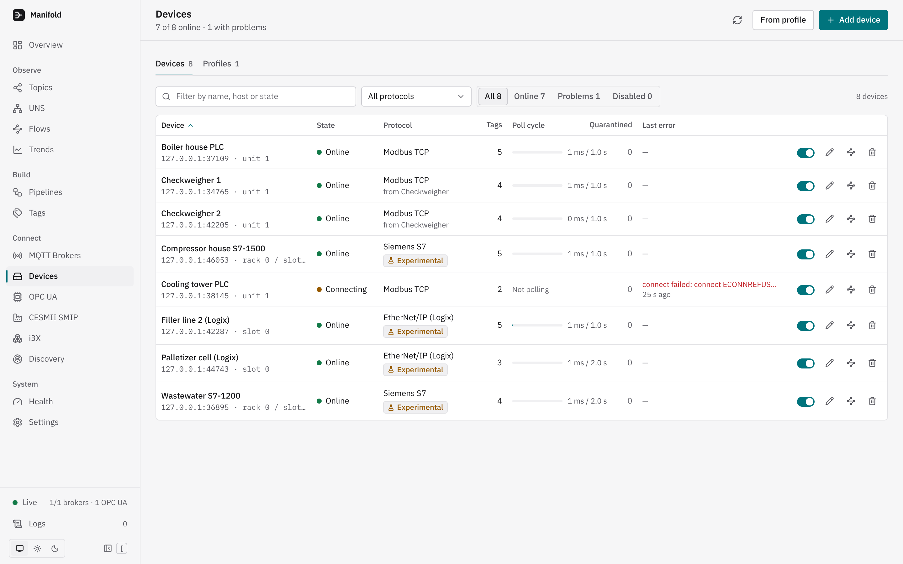
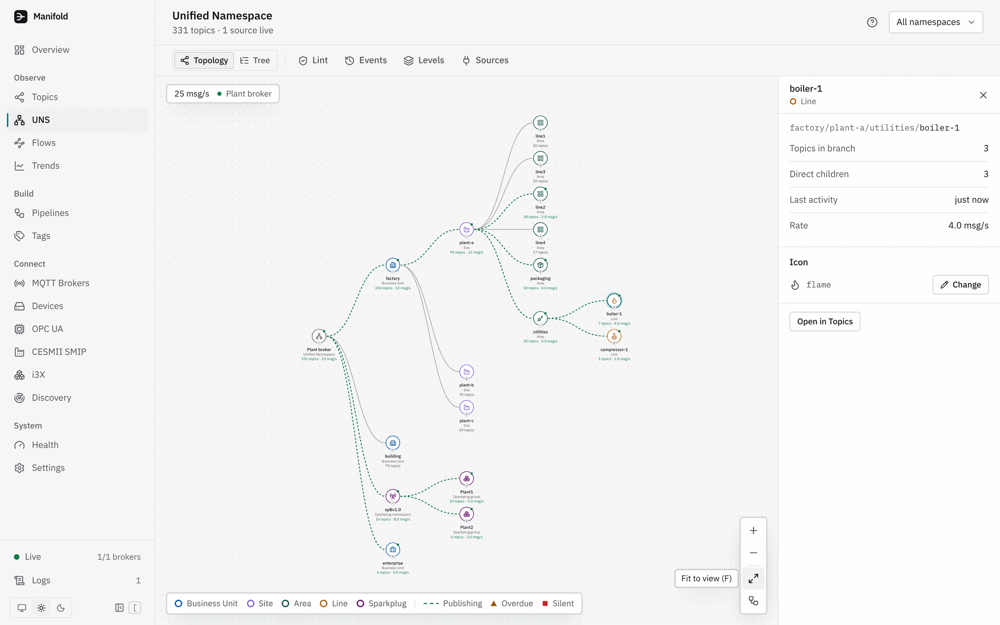
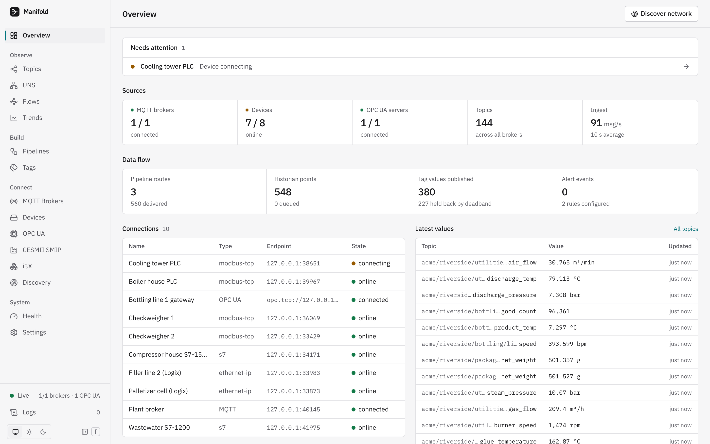
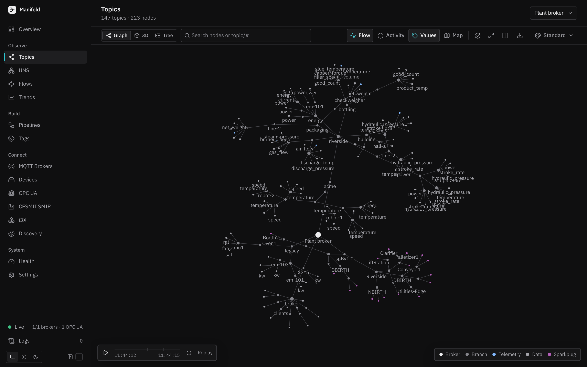
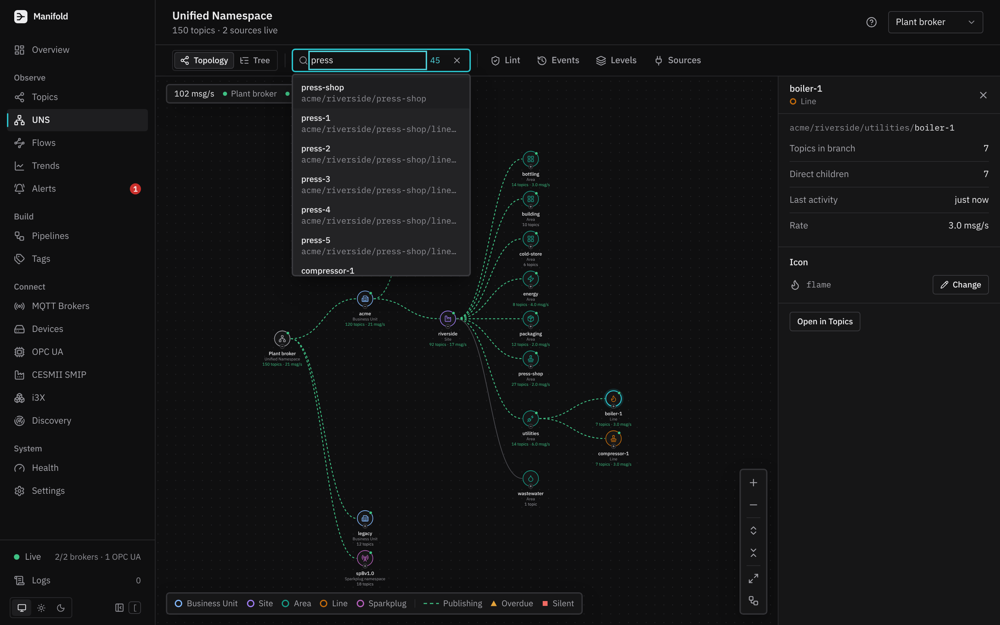
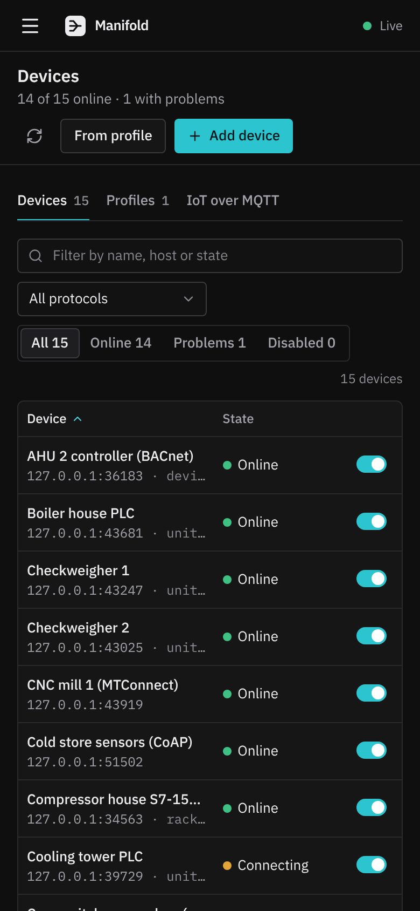
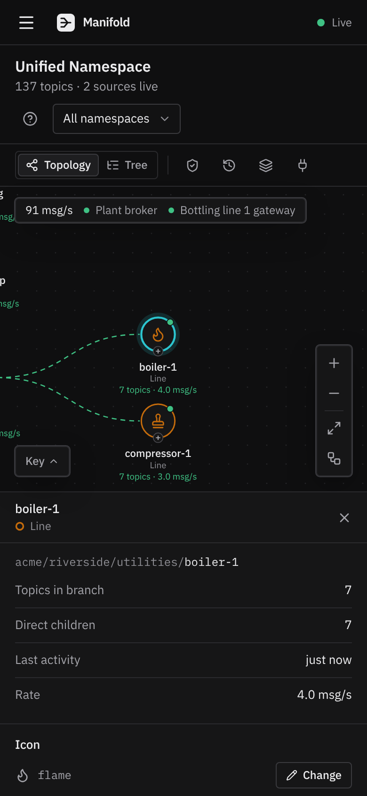

# 🎨 User interface

> **Goal:** know how the console is laid out, how to switch themes, what the keyboard can
> do, what accessibility is actually checked, and which links you can bookmark or share.

## Layout

The sidebar groups every page. **Overview** is on its own; then **Observe** (Topics, UNS, Flows, Trends, Alerts),
**Build** (Pipelines, Tags), **Connect** (MQTT Brokers, Devices, OPC UA, CESMII SMIP, i3X, Discovery) and
**System** (Health, Settings). At the bottom:

- a **Live** / **Offline** indicator (the Socket.IO connection) with the number of connected brokers;
- **Logs** with a count: a drawer of recent events (errors, warnings, info and verbose) from the live
  connection, with level filters and **Clear**. The count is what the level chips count (verbose lines excluded);
- the **Alerts** item carries a red count while a critical alarm is firing unacknowledged;
- the **theme switch**;
- the collapse button (`[`).

Every page has a header with the page title, a one-line subtitle that states the current state
("14 of 15 online · 1 with problems"), and its actions, the primary one last. Most pages with
configuration are either a **table** (Brokers, Devices, Pipelines tabs, Mappings), a **drawer** for
looking at a row without leaving the list, a **dialog** for short forms, or a **full-page form** for long
ones (add or edit a device). The canvas pages (Topics, UNS, Flows) put one toolbar row under the header
and a docked side panel for details.



## Themes

Three choices: **System** (follow the operating system), **Light** and **Dark**. Dark is the look of
most screenshots in this wiki; light is a full theme, not an inverted one, with its own contrast values.

- The switch is the three-button group at the bottom of the sidebar (**System theme**, **Light theme**,
  **Dark theme**); with the sidebar collapsed it is one button that cycles. The same choice is under
  **Settings → General → Theme**.
- The choice is stored **in your browser** (`localStorage`, key `tc.theme`) and applied before the first
  paint, so there is no flash of the wrong theme. Another tab follows the change. On **System**, the page
  follows the OS when the OS switches.
- **Canvases follow the theme.** The UNS map, the Topics graph (2D, WebGL and 3D) and the charts recolour in
  place when you switch; the camera and your selection stay where they are. A canvas background is the page
  surface in both themes. Under **Settings → General → Topic graph** you choose the graph **style**
  (*Standard*: discs coloured by node group; *Schematic*: square nodes on a fine grid; *Monochrome*: neutral
  nodes with colour only for selection, search and flow) and the **Layout** (Organic, Spacious, Tight, Radial,
  Tree, Cluster). Styles and layouts apply to the Topics graph; the UNS map is a fixed tidy tree.
- Colour is never the only carrier of meaning: status dots always come with a word.







## Keyboard

| Where | Keys |
|---|---|
| Anywhere (outside a text field) | `[` collapses or expands the sidebar |
| Dialogs, drawers, menus | `Esc` closes; `Tab` stays inside the dialog and focus returns to the control that opened it |
| Mobile navigation | **Open navigation menu** opens a drawer whose first focus is **Close navigation menu** |
| Mapping editor | `Ctrl+S` (or `Cmd+S`) saves; `Esc` asks before discarding changes; in the tag table, the up and down arrows move between rows and shift-click selects a range |
| UNS map (focus the canvas) | arrow keys pan; `+` and `-` zoom; `F` fits everything (also the **Fit to view (F)** button); `Esc` clears a multi-selection; `Ctrl`/`Cmd`-click toggles a node in the selection; `Shift`-drag on empty canvas draws a selection box |
| Trees (Topics tree, UNS tree, tag trees, controller import) | up and down arrows move; `Right` expands (or enters), `Left` collapses; `Home` and `End` jump; `Enter` or `Space` selects. Rows are virtualised but stay reachable by keyboard |
| Search boxes on the UNS map and the Topics, OPC UA and i3X graphs | type to list matches (ranked by name, then path; `+` and `#` work as MQTT filters); `Down` and `Up` move through the list, `Enter` picks the highlighted match (the first when none is) and selects and reveals it; `Esc` closes the list, a second `Esc` clears the box. The match count and the pick are announced. On the graphs, **Zoom to matches** frames every match |
| UNS map controls | **Expand all** opens every branch of the broker namespaces, breadth first, one page per long branch, and stops at 2,500 nodes on the map (it says how far it got); **Collapse all** leaves each namespace open one level |
| Replay scrubber | `Left` and `Right` seek 5 percent, `Home` and `End`, `Space` or `Enter` play and pause |
| Icon picker | arrow keys move across the grid, `Home` and `End` |
| Tabs and segmented controls | arrow keys move, `Home` and `End` jump |

There are no other global shortcuts; the list above was collected from the code.

## Accessibility: what is tested, and what is not

**Tested automatically, on every CI run.** The Playwright suite loads **every route** (`/`, `/topics`, `/uns`,
`/flows`, `/trends`, `/alerts`, `/pipelines`, `/tags`, `/brokers`, `/devices`, `/opcua`, `/cesmii`, `/i3x`, `/discovery`,
`/system`, `/settings`, plus Flows' consumers view and the Alerts page's History and Rules tabs and its Active tab with a firing alarm) in the **dark and the light theme**, at **1440 px** and at
**390 px (touch)**, and fails on:

- any axe-core violation of impact **serious or critical** (WCAG 2.0 and 2.1 A and AA rules and axe best
  practices); the per-route allowlist is empty;
- any horizontal overflow of the page or of content outside a scroller;
- any console error or uncaught exception.

Other specs check roles and names the way a screen reader would find them (buttons by name, dialogs by title, regions,
trees), keyboard paths (the mobile nav drawer by keyboard, the controller-import tree with arrow keys), that the canvases
are crisp and respond to clicks at device pixel ratio 1 and 2, and that nothing keeps painting when idle.

**Designed in, and unit-tested:** body text meets WCAG AA contrast in both themes (the computed table is in the
[design system](https://github.com/zbest1000/manifold/blob/main/docs/design/ui-design-system.md)); the chart and graph colour
palette keeps 3:1 against the canvas and stays distinguishable under simulated colour-vision deficiencies, with dashes for
the later series; visible `:focus-visible` outlines everywhere; every icon-only control has a label; tables that scroll are
focusable and named; `prefers-reduced-motion` and `prefers-contrast: more` are honoured.

**Not claimed.** This is automated checking plus design rules. It is not a certified WCAG audit, nobody has recorded sessions
with a screen reader as part of the test suite, and axe cannot judge everything (reading order, meaningful names, canvas
content). The canvases themselves (topology, graphs) are visual: they have a text summary and the same data is available in
the Tree views and tables, but drawing a graph is not accessible in the way a table is. Report gaps as issues.

## Pages and tabs

| Route | Page | Tabs or views |
|---|---|---|
| `/` | Overview | Needs attention, Sources, Data flow, Connections, Latest values |
| `/topics` | Topics | Graph, 3D, Tree |
| `/uns` | Unified Namespace | Topology, Tree; side panels Lint, Events, Levels, Sources |
| `/flows` | Flows | Producers, Consumers |
| `/trends` | Trends | sources Live, Historian, Recording; Export CSV |
| `/alerts` | Alerts | Active, History, Rules |
| `/pipelines` | Pipelines | Routes, Models, Historians, Recorder, Contracts, Codecs |
| `/tags` | Tags | Map tags, Mappings |
| `/brokers` | MQTT Brokers | the broker table and a details drawer (subscription, canary, security) |
| `/devices` | Devices | Devices, Profiles, IoT over MQTT |
| `/opcua`, `/cesmii`, `/i3x` | OPC UA, CESMII SMIP, i3X | |
| `/discovery` | Discovery | scan form and results |
| `/system` | Health | |
| `/settings` | Settings | General, Configuration, Audit trail |



## Deep links

| Link | Opens |
|---|---|
| `/uns?broker=<id>&path=<asset path>` | the UNS map with that node selected, expanded and centred, with its panel open; an inline note says so if the path is not in the namespace; the URL follows your selection |
| `/topics?broker=<id>&topic=<topic>` | the Topics view framed on that topic once the layout has settled |
| `/tags?source=device:<deviceId>` | the Tags workspace on that device |
| `/tags?view=mappings` | the Mappings tab |
| `/devices?tab=<profiles\|iot>` | the Profiles or the IoT over MQTT tab (`&iot=<sourceId>` opens an IoT device) |
| `/devices?device=<id>` | the Devices tab with that device's drawer open |
| `/pipelines?tab=<routes\|models\|historians\|recorder\|contracts\|codecs>` | a Pipelines tab |
| `/alerts?tab=<active\|history\|rules>` | an Alerts tab |
| `/alerts?alarm=<ruleId>\|<topic>` | the Active tab with that alarm highlighted (the Overview's Needs attention links use it) |
| `/settings?tab=<general\|configuration\|audit>` | a Settings tab (`?tab=alerts`, the old place of the alert rules, opens `/alerts?tab=rules`) |

**Show in UNS** on a mapping row and **Open in Topics** in the UNS panel use these links.

## Phones and narrow windows

Below the large breakpoint the sidebar becomes a drawer behind **Open navigation menu**; tables keep their key columns and scroll
horizontally inside their own region; detail panels dock to the bottom of canvas pages; dialogs fit the screen. In the mapping editor, below the wide breakpoint, an **Edit** / **Preview** switch
replaces the side-by-side preview. The phone layouts are checked at 390 x 844 by the same route spec. Dense work (the mapping editor, the tag
tables) is easier on a larger screen.

 

## Read-only sessions

With a viewer token every control that would change something is disabled and says why, and a short note explains it. See
[Operations](Operations#the-viewer-experience-and-switching-sessions).

## How the screenshots are made

The images in `docs/wiki/images/` (and the copies in `site/assets/`) are generated, not hand-made:

```bash
cd client && npm run build && npm run docs:shots                # all of them
npm run docs:shots -- --only overview,trends                    # some of them
npm run docs:shots -- --out /tmp/shots                          # somewhere else
npm run docs:shots -- --serve    # seed the demo plant and keep it running; then, in another shell:
npm run docs:shots -- --attach --only opcua                     # capture against it
```

`client/scripts/capture-docs.js` starts a demo plant on 127.0.0.1 from the test simulators (a plant MQTT broker with an
ISA-95 namespace, Sparkplug B edge nodes and some CBOR, MessagePack, SenML and Protobuf payloads; a facilities broker
with Zigbee2MQTT, Home Assistant, Tasmota, Shelly, Z-Wave JS UI and ChirpStack traffic; Modbus TCP, S7, EtherNet/IP,
BACnet/IP, SNMP, HTTP/JSON, MTConnect and CoAP simulators, Matter Server and Z-Wave JS Server stand-ins, a small OPC UA
server and two historian stand-ins), the real backend on a throwaway data directory, seeds it through the REST API
(devices, a profile, an OPC UA connection, IoT detection, codecs, mappings, routes, historians, alert rules with
firing, acknowledged and cleared alarms, a recording) and drives Chromium: 1440 x 900 at device scale 2, phone images
390 x 844, dark unless the name ends in `-light`. Nothing leaves the machine. Set `PW_CHROMIUM_PATH` to use a browser
other than Playwright's own. When a page changes, update its step in the script's `shots()` list, re-run, and look at
every image before committing.
